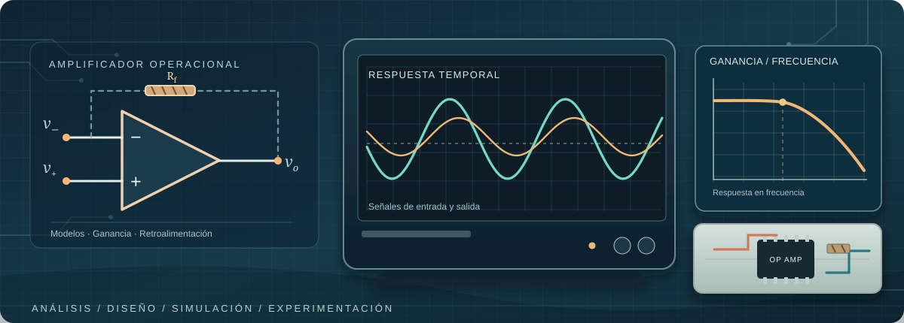

<section class="course-home-intro" aria-labelledby="course-home-title">

Curso universitario · IEC2704-96 · Ingeniería Eléctrica

<h1 id="course-home-title">Electrónica II</h1>

Circuitos electrónicos analógicos con amplificadores operacionales

<strong>Ernesto Sifuentes de la Hoya</strong> · Universidad Autónoma de Ciudad Juárez

Este curso reúne fundamentos teóricos, modelos matemáticos, ejemplos resueltos, ejercicios, simulaciones y prácticas de laboratorio para estudiar y aplicar los circuitos electrónicos analógicos. A lo largo de <strong>16 semanas</strong>, el estudiante avanza de la comprensión de los principios del amplificador operacional al análisis, diseño y comprobación experimental de sus aplicaciones.

<a class="course-button course-button-primary" href="semanas/01/semana-01.html">Comenzar la Semana 1</a><a class="course-button" href="lecciones.html">Explorar las lecciones</a><a class="course-button" href="calendario.html">Consultar el calendario</a>

</section>
<figure class="course-home-image"><figcaption>De los modelos de circuito a la simulación y a la comprobación en el laboratorio.</figcaption></figure>
<section class="course-home-section" aria-labelledby="course-home-metodo"><h2 id="course-home-metodo">Aprender mediante el análisis y la experimentación</h2>

El material se ha organizado para relacionar los conceptos con resultados observables: primero se estudia el circuito y se formulan sus ecuaciones; después se predice su comportamiento, se simula y se contrasta con mediciones o actividades prácticas.

<h3>Fundamentos y modelos</h3>
Explicaciones, esquemas y ecuaciones que permiten interpretar el comportamiento de los circuitos.

<h3>Ejemplos y ejercicios</h3>
Problemas desarrollados y actividades para practicar el análisis y el diseño.

<h3>Simulación y laboratorio</h3>
Guías, circuitos y recursos para comparar los resultados teóricos con los experimentales.

<h3>Estudio asistido</h3>
Videos, materiales complementarios y consignas del Tutor IA para reforzar el razonamiento.

</section>
<section class="course-home-section" aria-labelledby="course-home-unidades"><h2 id="course-home-unidades">Organización del curso</h2>
El recorrido académico comprende tres unidades y se distribuye a lo largo de 16 semanas.

<table class="course-home-units"><thead><tr><th scope="col">Unidad</th><th scope="col">Campo de estudio</th></tr></thead><tbody><tr><td>I</td><td>Fundamentos del amplificador operacional</td></tr><tr><td>II</td><td>Circuitos con amplificadores operacionales, parte I</td></tr><tr><td>III</td><td>Circuitos con amplificadores operacionales, parte II</td></tr></tbody></table></section>
<section class="course-home-section" aria-labelledby="course-home-semanas"><h2 id="course-home-semanas">Acceso por semanas</h2>
Seleccione la semana correspondiente para consultar las lecciones, actividades, entregas y recursos de apoyo.
<nav class="course-home-weeks" aria-label="Acceso directo a las 16 semanas"><a href="semanas/01/semana-01.html">Semana<strong>01</strong></a><a href="semanas/02/semana-02.html">Semana<strong>02</strong></a><a href="semanas/03/semana-03.html">Semana<strong>03</strong></a><a href="semanas/04/semana-04.html">Semana<strong>04</strong></a><a href="semanas/05/semana-05.html">Semana<strong>05</strong></a><a href="semanas/06/semana-06.html">Semana<strong>06</strong></a><a href="semanas/07/semana-07.html">Semana<strong>07</strong></a><a href="semanas/08/semana-08.html">Semana<strong>08</strong></a><a href="semanas/09/semana-09.html">Semana<strong>09</strong></a><a href="semanas/10/semana-10.html">Semana<strong>10</strong></a><a href="semanas/11/semana-11.html">Semana<strong>11</strong></a><a href="semanas/12/semana-12.html">Semana<strong>12</strong></a><a href="semanas/13/semana-13.html">Semana<strong>13</strong></a><a href="semanas/14/semana-14.html">Semana<strong>14</strong></a><a href="semanas/15/semana-15.html">Semana<strong>15</strong></a><a href="semanas/16/semana-16.html">Semana<strong>16</strong></a></nav></section>
<section class="course-home-section course-home-last" aria-labelledby="course-home-tutor"><h2 id="course-home-tutor">Tutor IA y orientación de estudio</h2>
El <a href="tutor-ia.html">Tutor IA</a> ofrece consignas que pueden copiarse en ChatGPT para explorar conceptos, revisar procedimientos y comprobar la comprensión. Es un apoyo al estudio, no un sustituto de los cálculos, las simulaciones ni las mediciones del estudiante.

Se recomienda seguir la secuencia semanal; para consultas específicas, puede acceder directamente al <a href="lecciones.html">índice de lecciones</a>.
</section>

