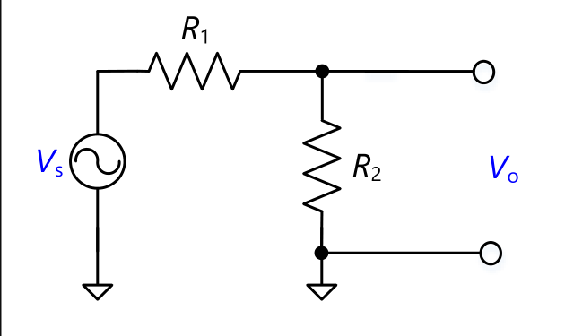

# Inicio {.unnumbered .unlisted .inicio-etiqueta}

::: {.course-intro}
**Universidad Autónoma de Ciudad Juárez** · Ingeniería Eléctrica · IEC2704-96

Apuntes para analizar, diseñar y experimentar con circuitos analógicos. El curso se organiza en 16 semanas. Cada semana reúne su agenda y las lecciones, ejercicios y prácticas correspondientes.

::: {.course-actions}
[Empezar la Semana 1](semanas/01/semana-01.qmd){.course-button .course-button-primary}
[Ir a la Semana 2](semanas/02/semana-02.qmd){.course-button}
[Ir a la Semana 3](semanas/03/semana-03.qmd){.course-button}
[Ir a la Semana 4](semanas/04/semana-04.qmd){.course-button}
[Ir a la Semana 5](semanas/05/semana-05.qmd){.course-button}
[Ir a la Semana 6](semanas/06/semana-06.qmd){.course-button}
[Ir a la Semana 7](semanas/07/semana-07.qmd){.course-button}
[Ir a la Semana 8](semanas/08/semana-08.qmd){.course-button}
[Ir a la Semana 9](semanas/09/semana-09.qmd){.course-button}
[Ir a la Semana 10](semanas/10/semana-10.qmd){.course-button}
[Ir a la Semana 11](semanas/11/semana-11.qmd){.course-button}
[Ir a la Semana 12](semanas/12/semana-12.qmd){.course-button}
[Ir a la Semana 13](semanas/13/semana-13.qmd){.course-button}
[Ir a la Semana 14](semanas/14/semana-14.qmd){.course-button}
[Ir a la Semana 15](semanas/15/semana-15.qmd){.course-button}
[Ir a la Semana 16](semanas/16/semana-16.qmd){.course-button}
[Ver el calendario](calendario.qmd){.course-button}
[Abrir Tutor IA](tutor-ia.qmd){.course-button}
:::
:::

## Primera semana

::: {.featured-lesson}
::: {.featured-lesson-copy}
### [Lección inicial · Divisor de voltaje](semanas/01/divisor-de-voltaje.qmd)

Calcule el voltaje de salida, simule el circuito en Multisim y compare los resultados con las mediciones en NI myDAQ. Use el efecto de carga para explicar por qué cambia el voltaje al conectar otro circuito.

[Ir a los ejercicios](semanas/01/divisor-de-voltaje.qmd#ejercicios-propuestos) · [Abrir el Tutor IA](tutor-ia.qmd)
:::

{fig-alt="Divisor de voltaje con R1 entre la fuente y el nodo de salida y R2 entre la salida y tierra."}
:::

## Contenido del curso

| Unidad | Temas |
|:--|:--|
| I | Fundamentos del amplificador operacional |
| II | Circuitos con op-amp, parte I |
| III | Circuitos con op-amp, parte II |

[Consultar el encuadre y los criterios de evaluación](semanas/01/encuadre.qmd)
