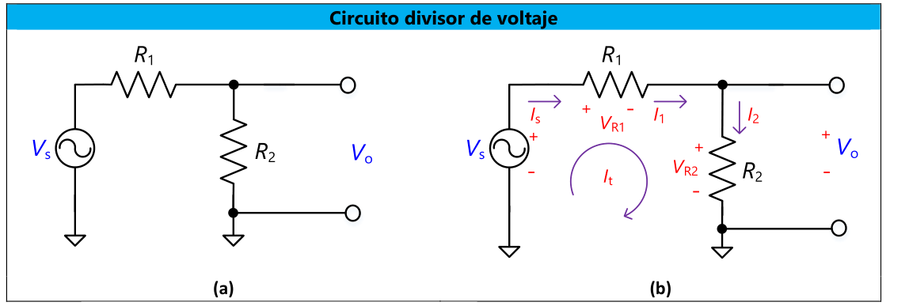
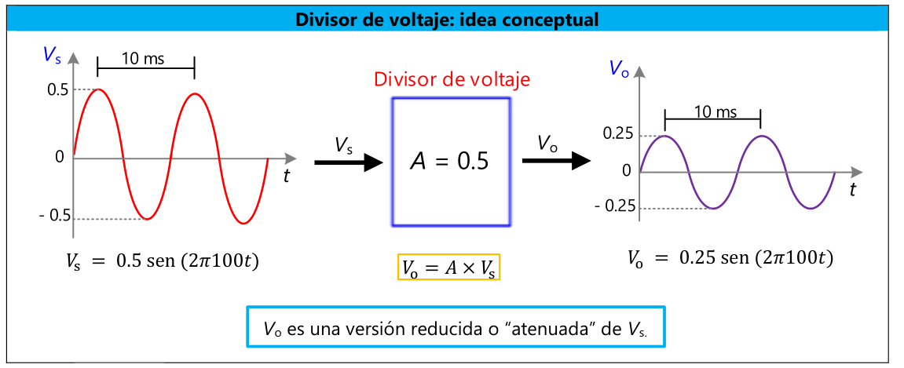
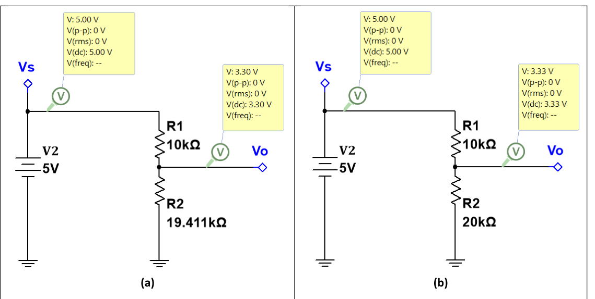
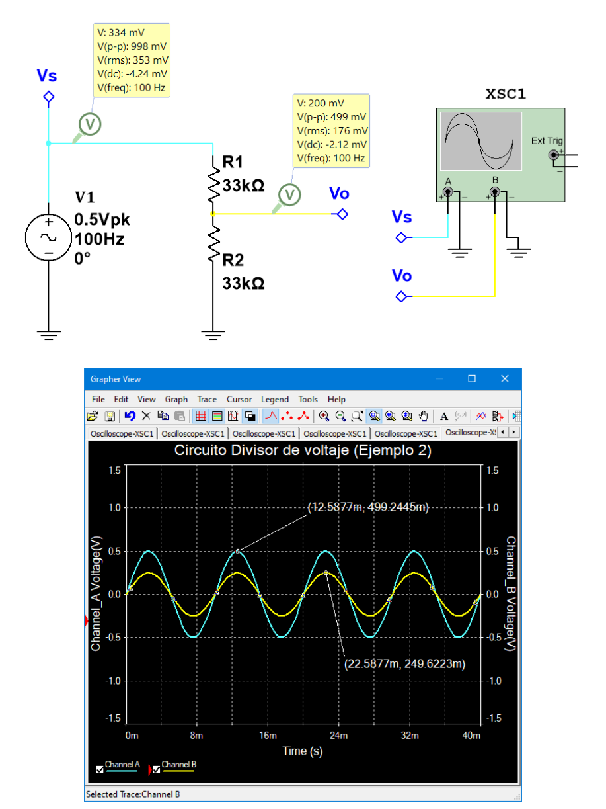
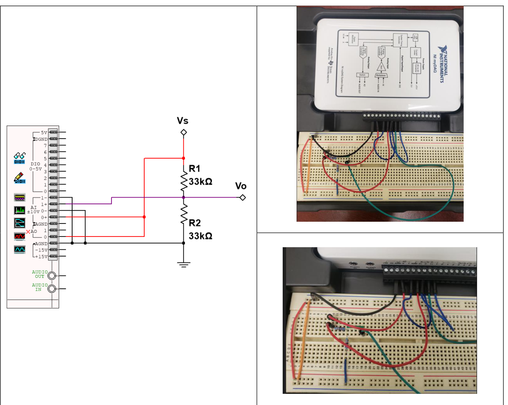
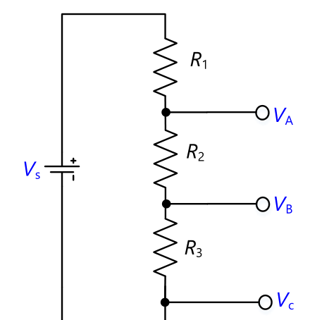

# Lección inicial · Divisor de voltaje {.unnumbered}

Un divisor resistivo entrega una fracción del voltaje de entrada. En esta lección se analiza el circuito, se eligen valores de resistencia y se comparan los resultados obtenidos por cálculo, simulación en Multisim y medición con NI myDAQ.

::: {.course-actions}
[Descargar el apunte original](../../recursos/semana-01/apunte-divisor-de-voltaje.pdf){.course-button}
[Ir a las simulaciones](#simulaciones){.course-button}
:::

## Circuito y modelo sin carga {#circuito-y-modelo}

En el divisor de la figura, $R_1$ conecta la fuente $V_s$ con el nodo de salida y $R_2$ conecta ese nodo con tierra. Se mide $V_o$ entre el nodo y tierra. Con la salida abierta, por ambas resistencias circula la misma corriente $I$.

{fig-alt="Dos esquemas del divisor. R1 va de la fuente a la salida y R2 de la salida a tierra. En el segundo se identifican la corriente de malla y las caídas de voltaje."}

Aplicando la ley de voltajes de Kirchhoff y la ley de Ohm se obtiene

$$
V_s-I R_1-I R_2=0,
\qquad I=\frac{V_s}{R_1+R_2}.
$$

Como la salida se toma sobre $R_2$, el factor de atenuación $A$ y el voltaje de salida son

$$
A=\frac{R_2}{R_1+R_2},
\qquad V_o=A V_s.
$$

Para resistencias iguales, $A=0.5$. En el modelo resistivo ideal, una señal senoidal de 100 Hz y 0.5 V pico produce una salida de 100 Hz y 0.25 V pico. La razón de amplitudes es la misma si ambas se expresan en voltios pico a pico.

{fig-alt="La entrada y la salida tienen un periodo de 10 ms. La amplitud baja de 0.5 V pico a 0.25 V pico."}

## Diseño y ejemplos resueltos {#diseno-y-ejemplos}

Para una atenuación objetivo $0<A<1$, elija un valor comercial para $R_1$ y calcule $R_2$ mediante

$$
R_2=\frac{A}{1-A}R_1.
$$

Después de elegir el valor comercial de $R_2$, vuelva a calcular la salida y compruebe el efecto de la impedancia de la etapa que recibirá la señal.

### Ejemplo 1. Atenuación de 5 V a 3.3 V

Para $V_s=5\,\mathrm{V}$ y $V_o=3.3\,\mathrm{V}$, se requiere $A=0.66$. Con $R_1=10\,\mathrm{k\Omega}$, resulta $R_2\approx19.41\,\mathrm{k\Omega}$. Si se usa $R_2=20\,\mathrm{k\Omega}$, la salida calculada en vacío es 3.33 V. Este montaje ilustra la adaptación de una señal o referencia a una entrada de alta impedancia.

{fig-alt="En ambos circuitos Vs es 5 V y R1 es 10 kiloohmios. A la izquierda R2 vale 19.411 kiloohmios y a la derecha 20 kiloohmios."}

### Ejemplo 2. Atenuación de una señal senoidal

Con $R_1=R_2=33\,\mathrm{k\Omega}$ y $v_s(t)=0.5\sin(2\pi\cdot100t)\,\mathrm{V}$, el modelo ideal predice

$$
v_o(t)=0.25\sin(2\pi\cdot100t)\,\mathrm{V}.
$$

| Magnitud | Entrada | Salida calculada |
|:--|--:|--:|
| Frecuencia | 100 Hz | 100 Hz |
| Amplitud pico | 0.50 V | 0.25 V |
| Amplitud pico a pico | 1.00 V | 0.50 V |

## Efecto de carga {#efecto-de-carga}

Al conectar una resistencia $R_L$ a la salida, queda en paralelo con $R_2$. La resistencia de la rama inferior se convierte en $R_2\parallel R_L$, por lo que disminuye el voltaje de salida respecto al circuito en vacío.

$$
\begin{gathered}
R_2\parallel R_L=\frac{R_2R_L}{R_2+R_L},\\[0.25em]
V_o=V_s\frac{R_2\parallel R_L}{R_1+(R_2\parallel R_L)}.
\end{gathered}
$$

Visto desde la carga, el equivalente de Thévenin consta de un voltaje $V_{\mathrm{Th}}$ y una resistencia en serie $R_{\mathrm{Th}}$. Para hallar esta última, se sustituye la fuente ideal de voltaje por un cortocircuito.

$$
\begin{gathered}
V_{\mathrm{Th}}=V_s\frac{R_2}{R_1+R_2},
\qquad R_{\mathrm{Th}}=R_1\parallel R_2,\\[0.25em]
V_o=V_{\mathrm{Th}}\frac{R_L}{R_{\mathrm{Th}}+R_L}.
\end{gathered}
$$

Por ejemplo, en el divisor de 5 V con $R_1=10\,\mathrm{k\Omega}$ y $R_2=20\,\mathrm{k\Omega}$, la salida pasa de 3.33 V en vacío a 2.00 V al conectar $R_L=10\,\mathrm{k\Omega}$. Una entrada de alta impedancia aproxima el caso en vacío. Cuando una carga exige un voltaje de alimentación estable y su consumo varía, se requiere una fuente adecuada a ese consumo.

### Tutor IA · Revise el efecto de carga {#tutor-efecto-de-carga}

::: {.tutor-box}
::: {.tutor-texto}
Actúe como tutor de Electrónica II y tráteme de usted. Estoy analizando un divisor de voltaje. Pídame mi esquema, los valores de la fuente y de las resistencias, la referencia de tierra y mi primera predicción de la salida. Guíeme con una pregunta a la vez para identificar qué cambia al conectar la carga y para obtener el equivalente de Thévenin visto desde la salida. Espere mi respuesta antes de dar la siguiente pista.

Cuando justifique mi resultado, pídame que lo contraste con la simulación o con una medición y que explique en qué condiciones la aproximación sin carga es razonable. Use únicamente los datos que yo le entregue y reserve el resultado final hasta que yo haya planteado el procedimiento.
:::

::: {.tutor-acciones}
[Abrir ChatGPT](https://chatgpt.com/){.course-button target="_blank" rel="noopener"}
:::
:::

## Simulaciones en Multisim {#simulaciones}

1. Abra el circuito correspondiente en NI Multisim. Identifique $V_s$, $V_o$ y la referencia común.
2. En el ejemplo 1, compare el resultado con el valor calculado de $R_2$ y con el valor comercial.
3. En el ejemplo 2, observe ambas señales en el osciloscopio. Registre las amplitudes en la misma unidad y calcule $A=V_{o,\mathrm{pp}}/V_{s,\mathrm{pp}}$.
4. Para observar el efecto de carga, añada $R_L$ en paralelo con $R_2$ y repita la comparación.

| Recurso | Archivo |
|:--|:--|
| Circuito del ejemplo 1 | [Ejemplo 1 · Circuito (.ms14)](../../recursos/semana-01/simulaciones/ejemplo-1-circuito.ms14){download="ejemplo-1-circuito.ms14"} |
| Variante del ejemplo 1 | [Ejemplo 1 · Divisor (.ms14)](../../recursos/semana-01/simulaciones/ejemplo-1-divisor.ms14){download="ejemplo-1-divisor.ms14"} |
| Variante con NI myDAQ | [Ejemplo 1 · Divisor y NI myDAQ (.ms14)](../../recursos/semana-01/simulaciones/ejemplo-1-mydaq.ms14){download="ejemplo-1-mydaq.ms14"} |
| Circuito senoidal | [Ejemplo 2 · Circuito (.ms14)](../../recursos/semana-01/simulaciones/ejemplo-2-circuito.ms14){download="ejemplo-2-circuito.ms14"} |
| Medición de voltaje | [Medir voltaje en el divisor (.ms14)](../../recursos/semana-01/simulaciones/medir-voltaje-divisor.ms14){download="medir-voltaje-divisor.ms14"} |

{fig-alt="Divisor de 33 kiloohmios y señales senoidales de entrada y salida en Multisim." width="78%"}

## Verificación experimental con NI myDAQ {#verificacion-experimental}

1. Mida los resistores con el circuito desenergizado. Monte el divisor en protoboard según el esquema del ejemplo. Use la misma referencia de tierra para la fuente y los canales de medición.
2. Para el ejemplo de continua, mida la entrada y la salida con el osciloscopio o multímetro. Mida también las caídas sobre $R_1$ y $R_2$ y compruebe su suma respecto a $V_s$.
3. Para el ejemplo senoidal, use el generador de NI ELVISmx con 100 Hz y una entrada de 0.5 V pico. Ajuste el osciloscopio para ver cinco periodos (50 ms) y registre entrada y salida en voltios pico a pico.
4. Registre los valores nominales y los medidos. Al estimar la salida a partir de los datos del montaje, use el voltaje de entrada medido y declare qué valores de resistencia empleó.

{fig-alt="Figura 7 del apunte original, con la conexión de la NI myDAQ al divisor de 33 kiloohmios y dos fotografías del protoboard."}

Consulte también el [montaje del ejemplo 1](../../recursos/semana-01/figuras/montaje-mydaq-ejemplo-1.png) y la [captura experimental del ejemplo 2](../../recursos/semana-01/figuras/medicion-mydaq-ejemplo-2.png).

### Compare los resultados {#comparar-resultados}

Indique la referencia que usará para calcular el error. Si toma como referencia el voltaje teórico $V_{o,\mathrm{teo}}$, el error absoluto y el relativo porcentual son

$$
\begin{gathered}
e_{\mathrm{abs}}=\left|V_{o,\mathrm{med}}-V_{o,\mathrm{teo}}\right|,\\[0.25em]
e_{\%}=100\frac{e_{\mathrm{abs}}}{\left|V_{o,\mathrm{teo}}\right|}.
\end{gathered}
$$

El error relativo se usa cuando el valor de referencia es distinto de cero. Para la señal senoidal, compare magnitudes expresadas de la misma manera. La tabla de la p. 14 del apunte indica **1 kHz** para el barrido de amplitud. Para su primera fila reporta 1.002 Vpp de entrada, 0.500 Vpp de salida teórica nominal y 0.504 Vpp de salida experimental. Con esa referencia, el error absoluto es 0.004 V y el relativo es 0.8 %. Registre la frecuencia de cada ensayo para que la comparación quede asociada a sus condiciones de medición.

### Tutor IA · Interprete sus mediciones {#tutor-mediciones}

::: {.tutor-box}
::: {.tutor-texto}
Actúe como tutor de Electrónica II y tráteme de usted. Pídame mi tabla con el voltaje de entrada, los voltajes de salida calculado, simulado y medido, las unidades, los valores de resistencias y la frecuencia si usé una señal senoidal. Pídame que indique si las amplitudes son pico o pico a pico y que elija una referencia para calcular el error.

Guíeme con una pista a la vez para verificar mis operaciones. Si hay diferencias, pídame que formule una hipótesis que pueda comprobar, por ejemplo, una tolerancia de resistencia o el efecto de carga del instrumento. Use mis mediciones y ayúdeme a identificar qué dato adicional permitiría comprobar mi hipótesis.
:::

::: {.tutor-acciones}
[Abrir ChatGPT](https://chatgpt.com/){.course-button target="_blank" rel="noopener"}
:::
:::

## Ejercicios propuestos {#ejercicios-propuestos}

[Descargar los enunciados originales (PDF)](../../recursos/semana-01/ejercicios-leccion-inicial.pdf){.course-button}

1. Para el divisor de tres resistencias del enunciado, deduzca $V_A$, $V_B$ y $V_C$ respecto a tierra. Evalúe con $V_s=5\,\mathrm{V}$ y $R_1=R_2=R_3=33\,\mathrm{k\Omega}$. Compare su cálculo con la simulación y las mediciones. Explique la posición de $V_C$ en el esquema.
2. Analice cómo obtener alrededor de 4.5 V de una batería de 9 V cuando la carga demanda cerca de 4 mA. Use el modelo de Thévenin para justificar el diseño y contrástelo mediante simulación y experimentación. La solución parcial usa $R_L=1\,\mathrm{k\Omega}$ como carga de prueba. Declare la carga utilizada y compare el voltaje y la corriente obtenidos con los valores solicitados.

{fig-alt="R1, R2 y R3 en serie. VA se ubica entre R1 y R2, VB entre R2 y R3, y VC en el nodo inferior conectado a tierra." width="48%"}

En el informe incluya cálculos, resultados teóricos, simulados y experimentales, su interpretación y una conclusión por ejercicio. Si usó el tutor, indique qué revisó y cómo verificó la corrección con sus propios resultados. La entrega corresponde a la [tercera clase de la Semana 2](../02/semana-02.qmd).
