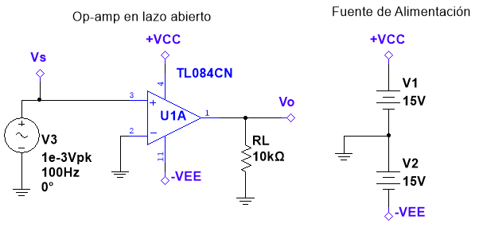
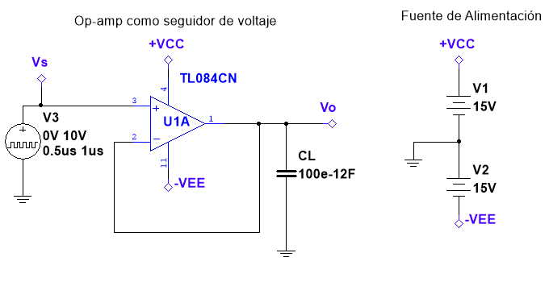

# Actividad L1 · Caracterización del TL084 {.unnumbered}

En esta actividad simulará un TL084 en Multisim. Medirá la ganancia en lazo abierto y su respuesta en frecuencia con un barrido AC. Después, usará un seguidor de voltaje para estimar la velocidad máxima de cambio de la salida ante un escalón.

::: {.course-actions}
[Descargar la actividad editable (Word)](../../recursos/semana-02/actividad-l1-caracterizacion-tl084.docx){.course-button .course-button-primary download="actividad-l1-caracterizacion-tl084.docx"}
[Consultar la hoja de datos del TL084](https://www.ti.com/lit/ds/symlink/tl084.pdf){.course-button target="_blank" rel="noopener"}
:::

## Experimento 1. Ganancia en lazo abierto y Bode {#experimento-bode}

1. Seleccione el TL084 y use un canal. Alimente el dispositivo con $\pm15\,\mathrm V$. Conecte la entrada inversora a tierra y la no inversora a una fuente con componente DC de 0 V y amplitud de análisis AC de 1 mV. Si añade la carga resistiva de 10 kΩ indicada en la guía, anótela junto con el resultado.
2. Revise el punto de operación de continua antes del barrido. Si la salida está saturada, ajuste el nivel de continua de entrada para centrarla antes de interpretar la curva. El análisis AC de Multisim linealiza el circuito alrededor de ese punto de operación.
3. En **Simulate → Analyses → AC Analysis**, configure un barrido por décadas de 1 Hz a 10 MHz, con 100 puntos por década. Grafique $V_o/V_s$ en magnitud y fase. Si registra ambas señales por separado, use su cociente para obtener la ganancia.
4. Localice la meseta de baja frecuencia. Lea $A_0$ en dB y conviértala a V/V. Determine $f_p$ en el punto que esté 3 dB por debajo de la meseta. Registre el cruce de 0 dB y la fase en ese punto. Compare la frecuencia de cruce con $A_0 f_p$ y describa el intervalo donde observa una pendiente próxima a −20 dB/década.

{fig-alt="Un canal del TL084 con fuente en la entrada no inversora, entrada inversora a tierra, alimentación dual de 15 V y una carga de 10 kiloohmios."}

El modelo de pequeña señal con un polo dominante usa la ganancia de baja frecuencia $A_0$ y la frecuencia del polo $f_p$.

$$
A(j2\pi f)\approx\frac{A_0}{1+j f/f_p}.
$$

$$
G_{\mathrm{dB}}=20\log_{10}\left|\frac{V_o}{V_s}\right|,
\qquad A_0=10^{G_{0,\mathrm{dB}}/20}.
$$

La fase del modelo de un polo es aproximadamente −45° en $f_p$ y se acerca a −90° para frecuencias mucho mayores que $f_p$. Use la curva de fase para contrastar la aproximación e identificar el efecto de polos adicionales si la simulación los muestra.

| Registro | Unidad |
|:--|:--|
| Ganancia de la meseta de baja frecuencia, $A_0$ | dB y V/V |
| Frecuencia del polo dominante, $f_p$ | Hz |
| Producto $A_0 f_p$ y frecuencia de cruce de 0 dB | Hz |
| Fase en el cruce de 0 dB | grados |

### Tutor IA · Revise su Bode {#tutor-bode}

::: {.tutor-box}
::: {.tutor-texto}
Actúe como tutor de Electrónica II y tráteme de usted. Estoy analizando un barrido AC del TL084. Pídame la magnitud y la fase, el voltaje de salida de continua, la carga y la expresión que graficó Multisim. Guíeme con una pregunta a la vez para localizar la meseta de baja frecuencia, la caída de 3 dB y el cruce de 0 dB. Espere mi respuesta antes de dar la siguiente pista.

Pídame que convierta la ganancia de dB a V/V y que compare el producto de esa ganancia por la frecuencia del polo con la frecuencia del cruce. Use los datos que yo le proporcione y ayúdeme a decidir qué parte de la curva describe el modelo de un polo.
:::

::: {.tutor-acciones}
[Abrir ChatGPT](https://chatgpt.com/){.course-button target="_blank" rel="noopener"}
:::
:::

## Experimento 2. Slew rate en seguidor {#experimento-slew-rate}

1. Conecte la salida del TL084 a la entrada inversora y aplique la señal a la entrada no inversora. Mantenga la alimentación dual de 15 V. Configure una onda cuadrada de 0 a 10 V a 1 kHz, con flancos de entrada rápidos.
2. En **Transient Analysis**, use una duración de 2 a 5 ms y un paso máximo de 100 ns. Grafique la entrada y la salida. Amplíe la vista en cada flanco y reduzca el paso máximo si hacen falta más puntos para identificar la rampa.
3. Coloque los cursores en dos puntos del tramo de pendiente aproximadamente constante. Repita la medición en subida y bajada. Reporte las magnitudes en V/µs y anote los valores usados de $\Delta V_o$ y $\Delta t$.
4. Repita con 0 pF, 100 pF y 200 pF de carga capacitiva. Registre los cambios que observe en los flancos y explique cómo eligió los puntos de medición.

{fig-alt="Un canal del TL084 con realimentación directa de salida a entrada inversora, una fuente pulsada en la otra entrada y una carga capacitiva en la salida."}

$$
\mathrm{SR}=\left|\frac{\Delta V_o}{\Delta t}\right|.
$$

Una salida con limitación por *slew rate* muestra un tramo en rampa durante el flanco. Para identificar saturación de amplitud, revise si la salida se mantiene en un nivel límite y compare ese nivel con el punto de operación y la carga.

### Tutor IA · Compruebe la pendiente {#tutor-slew-rate}

::: {.tutor-box}
::: {.tutor-texto}
Actúe como tutor de Electrónica II y tráteme de usted. Estoy midiendo el slew rate del TL084 como seguidor. Pídame mi gráfica de entrada y salida, la carga capacitiva, el paso máximo de simulación y los tiempos y voltajes que leí con los cursores. Revise conmigo un flanco a la vez. Ayúdeme a elegir dos puntos de la rampa y a expresar la magnitud de la pendiente en V/µs.

Pídame que compare subida y bajada para las cargas que simulé y que explique qué parte de la gráfica distingue una limitación de pendiente de una saturación de salida. Si faltan datos, solicítemelos antes de evaluar mi conclusión.
:::

::: {.tutor-acciones}
[Abrir ChatGPT](https://chatgpt.com/){.course-button target="_blank" rel="noopener"}
:::
:::

## Ensayo opcional en lazo abierto {#ensayo-opcional}

Para observar una respuesta temporal en la región lineal, estime el máximo voltaje diferencial con la excursión de salida del modelo y la ganancia de baja frecuencia. Ajuste el punto de operación cerca de 0 V. La guía propone un escalón de 20 a 30 µV como punto de partida. Verifique en su simulación que la salida permanezca dentro de su excursión lineal.

## Informe y entrega {#informe}

Entregue el informe en la [tercera sesión de la Semana 3](../03/semana-03.qmd#entregas). Incluya la identificación del equipo, el modelo del op-amp, las condiciones de prueba, las tablas del Word y las capturas anotadas de Bode y del análisis transitorio. Muestre cómo obtuvo cada parámetro. Use el cuestionario de retroalimentación de la actividad para discutir la región de validez del modelo, el efecto de la carga y las diferencias con la hoja de datos. Cierre con tres a cinco conclusiones sustentadas en sus resultados.

Si utilizó el Tutor IA, indique qué punto del análisis revisó y cómo lo comprobó con sus datos.

[Manual de NI sobre el análisis AC de Multisim](https://www.ni.com/docs/en-US/bundle/multisim/page/topics/fundamental-analysis-ac-analysis.html){target="_blank" rel="noopener"}.
