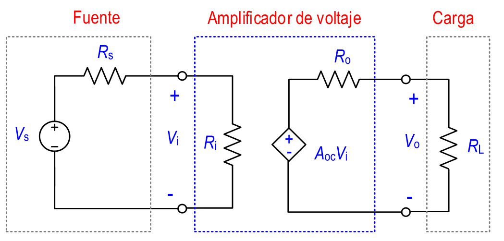
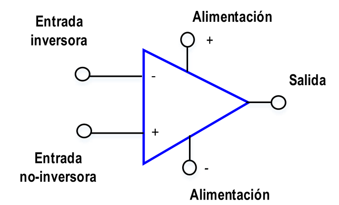
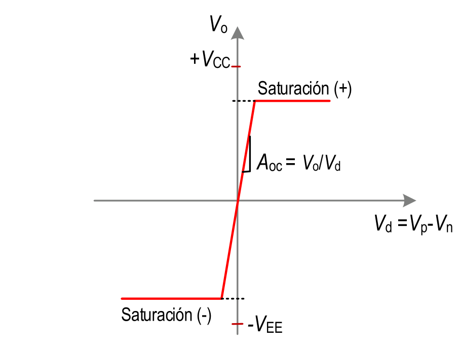
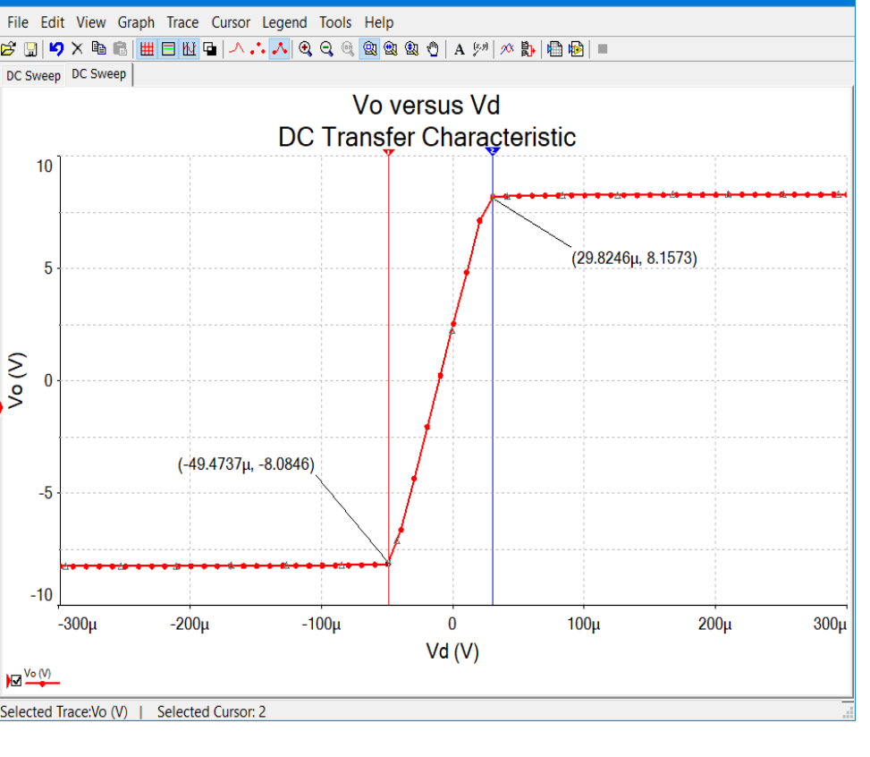

# Lección 1 · Introducción al op-amp {.unnumbered}

Al conectar un amplificador entre una fuente y una carga, ¿por qué la ganancia medida puede ser menor que la esperada? El divisor de voltaje de la lección inicial permite explicar dos causas. En esta lección también se analiza cómo un amplificador operacional convierte una diferencia de voltaje muy pequeña en una salida que puede alcanzar la saturación.

::: {#video-l1 .course-actions}
[Ver video de la Lección 1](https://www.youtube.com/watch?v=u1MEtijf-PM){.course-button .course-button-primary target="_blank" rel="noopener"}
[Consultar la presentación (PDF)](../../recursos/semana-02/presentacion-introduccion-opamp.pdf){.course-button}
:::

**Actividad de video — Lección 1.** Vea la presentación en video y elabore **a mano un resumen** que sintetice los conceptos principales, con extensión proporcional al contenido. **Entrega: clase 4 (primera sesión de la semana 2).** Consulte las [entregas de la Semana 2](semana-02.qmd#entregas-de-la-leccion-inicial).

## El amplificador de voltaje y el efecto de carga {#amplificador-y-carga}

El modelo de dos puertos representa la fuente con su resistencia interna $R_s$, el amplificador con una resistencia de entrada $R_i$, una fuente controlada $A_{oc}V_i$ y una resistencia de salida $R_o$. La carga $R_L$ se conecta a la salida. En este modelo, $A_{oc}$ es la ganancia interna con la salida en circuito abierto.

{fig-alt="A la entrada, Rs y Ri forman un divisor entre Vs y Vi. A la salida, Ro y RL forman un divisor entre la fuente controlada Aoc por Vi y Vo."}

En la entrada, $R_s$ y $R_i$ determinan el voltaje que recibe el amplificador. En la salida, $R_o$ y $R_L$ determinan el voltaje que recibe la carga. Al aplicar el [modelo del divisor de voltaje](../01/divisor-de-voltaje.qmd#circuito-y-modelo) en ambos puertos se obtiene

$$
V_i=V_s\frac{R_i}{R_s+R_i},
\qquad V_o=A_{oc}V_i\frac{R_L}{R_o+R_L}.
$$

Por tanto, la ganancia entre la fuente y la carga es

$$
\frac{V_o}{V_s}=\frac{R_i}{R_s+R_i}\,A_{oc}\,\frac{R_L}{R_o+R_L}.
$$

Cuando $R_i\gg R_s$ y $R_L\gg R_o$, ambos factores de carga se aproximan a uno. En esas condiciones, $V_o/V_s\approx A_{oc}$. El modelo supone operación lineal. Compruebe por separado el efecto de cada puerto en los [ejercicios demostrativos](ejercicios-demostrativos-l1.qmd).

## Terminales y modelo diferencial {#modelo-diferencial}

El amplificador operacional tiene una entrada no inversora $V_p$ marcada con $+$, una entrada inversora $V_n$ marcada con $-$, una salida $V_o$ y dos terminales de alimentación. En una alimentación dual, los rieles son positivo y negativo respecto a la referencia. En una alimentación simple, el riel inferior puede conectarse a tierra si el circuito opera dentro del rango permitido por el dispositivo.

{fig-alt="Símbolo triangular con entradas inversora y no inversora a la izquierda, salida a la derecha y terminales de alimentación arriba y abajo." width="62%"}

En la región lineal del modelo simplificado y despreciando el offset, la salida cumple

$$
V_d=V_p-V_n,
\qquad V_o=A_{oc}V_d.
$$

Para el op-amp, $A_{oc}$ designa la ganancia diferencial en lazo abierto. El modelo ideal supone ganancia diferencial e impedancia de entrada infinitas, impedancia de salida nula y rechazo perfecto al modo común. En un circuito con realimentación negativa que opera en la región lineal, la ganancia elevada permite aproximar $V_p\approx V_n$. Si una de esas entradas está a tierra, la otra queda aproximadamente al mismo potencial y se habla de tierra virtual. En lazo abierto, una diferencia pequeña puede llevar la salida a saturación.

## Curva de transferencia en lazo abierto {#curva-de-transferencia}

El tramo central de la curva $V_o$ contra $V_d$ es lineal y su pendiente estima $A_{oc}$. En los extremos, la salida se aproxima a sus niveles de saturación. El voltaje de salida disponible depende de la alimentación, la carga y el dispositivo. Para estimar el intervalo lineal, use los límites de salida observados o especificados para las condiciones de trabajo.

{fig-alt="Curva con pendiente positiva en el centro y niveles planos de saturación a ambos lados, dentro de los rieles de alimentación." width="65%"}

### Ejemplo de estimación de la ganancia {#estimar-ganancia}

Con $A_{oc}=200\,\mathrm{V/mV}=2\times10^{5}\,\mathrm{V/V}$, una salida de $8\,\mathrm V$ en la región lineal requiere $V_d=40\,\mu\mathrm V$ en el modelo sin offset. Este cálculo supone que $8\,\mathrm V$ está dentro de la excursión de salida para la carga y la alimentación utilizadas.

En un barrido DC, estime la pendiente a partir de dos puntos interiores del tramo lineal. Así la diferencia entre los puntos elimina un desplazamiento constante de la curva.

$$
A_{oc}\approx\frac{V_{o,2}-V_{o,1}}{V_{d,2}-V_{d,1}}.
$$

{fig-alt="Curva simulada de Vo frente a Vd, con saturación cerca de 8 V en ambos sentidos y una transición pronunciada cerca de cero." width="72%"}

### Tutor IA · Elija el tramo lineal {#tutor-curva-transferencia}

::: {.tutor-box}
::: {.tutor-texto}
Actúe como tutor de Electrónica II y tráteme de usted. Estoy revisando la curva de transferencia de un op-amp en lazo abierto. Pídame mi gráfica de voltaje de salida contra voltaje diferencial, el modelo del componente, la alimentación, la carga y los dos puntos que elegí para calcular la pendiente. Hágame una pregunta a la vez para comprobar si ambos puntos están en el tramo lineal y si mis unidades de voltaje son coherentes.

Después de que calcule la pendiente, pídame que la exprese en V/V y en V/mV, y que explique por qué la salida se limita en los extremos. Si hace falta un dato para comprobar mi cálculo, solicítemelo y espere mi respuesta.
:::

::: {.tutor-acciones}
[Abrir ChatGPT](https://chatgpt.com/){.course-button target="_blank" rel="noopener"}
:::
:::

## Parámetros del op-amp real {#parametros-del-opamp}

| Parámetro | Qué describe |
|:--|:--|
| $R_i$ y $R_o$ | La impedancia que presenta la entrada y la impedancia vista desde la salida. La hoja de datos puede distinguir impedancia de entrada diferencial y de modo común. |
| $V_{OS}$ | El voltaje diferencial de continua necesario para ajustar la salida a la referencia bajo las condiciones de prueba. |
| $I_B$ e $I_{OS}$ | La corriente de polarización de entrada y la diferencia entre las corrientes de ambas entradas, según la convención de la hoja de datos. |
| CMRR | El rechazo de una señal que aparece en ambas entradas. Un valor mayor indica menor sensibilidad al modo común. |
| GBW y SR | El producto ganancia–ancho de banda caracteriza la respuesta de pequeña señal. El *slew rate* limita la pendiente de salida ante señales de gran amplitud. |

Para separar modo diferencial y modo común, defina el voltaje de modo común como $V_{\mathrm{CM}}=(V_p+V_n)/2$. En un modelo lineal que incluye ambos efectos, $V_o=A_d V_d + A_{\mathrm{CM}} V_{\mathrm{CM}}$. El rechazo en decibelios es

$$
\mathrm{CMRR}_{\mathrm{dB}}=20\log_{10}\left|\frac{A_d}{A_{\mathrm{CM}}}\right|.
$$

En la [hoja de datos del TL084](https://www.ti.com/lit/ds/symlink/tl084.pdf){target="_blank" rel="noopener"}, identifique el sufijo, la alimentación, la carga y la temperatura asociados a cada valor. Use esas condiciones para comparar el dato del fabricante con el modelo de Multisim.

## Respuesta en frecuencia y velocidad de respuesta {#respuesta-en-frecuencia}

En el modelo de pequeña señal con un polo dominante, $f_p$ es la frecuencia a la que la magnitud cae unos 3 dB respecto de la ganancia de baja frecuencia. Por encima del polo, la pendiente se aproxima a $-20\,\mathrm{dB}$ por década en el tramo dominado por ese polo. La frecuencia de ganancia unitaria se aproxima a $A_0 f_p$ si el modelo de un polo representa ese tramo, con $A_0$ expresada en V/V.

El *slew rate* se estima en la zona de pendiente máxima de la respuesta temporal a un escalón. La [actividad del TL084 en Multisim](caracterizacion-tl084.qmd) separa ambas mediciones mediante un barrido AC en lazo abierto y un análisis transitorio en seguidor de voltaje.

## Ejercicios y cuestionario {#ejercicios-y-cuestionario}

- [Ejercicios demostrativos L1](ejercicios-demostrativos-l1.qmd). Compare el análisis de los dos puertos con los resultados en Multisim.
- [Ejercicios propuestos L1](../03/ejercicios-propuestos-l1.qmd). Resuelva los dos casos de carga y caracterice el TL084CN.
- [Caracterización del TL084 en Multisim](caracterizacion-tl084.qmd). Registre la ganancia, la frecuencia del polo y las pendientes de subida y bajada.
- [Práctica 1. Primer contacto con un op-amp](../03/practica-01-primer-contacto-opamp.qmd). Compare las simulaciones con sus mediciones en el protoboard.
- [Cuestionario L1 (PDF)](../../recursos/semana-02/cuestionario-l1.pdf). Discuta las preguntas en equipo, justifique los cálculos y registre las condiciones de prueba de la hoja de datos. Para el ejercicio 20, declare si usa los rieles como límite ideal o la excursión de salida del modelo para estimar el rango lineal. La entrega es en la [tercera sesión de la Semana 3](../03/semana-03.qmd#entregas).
