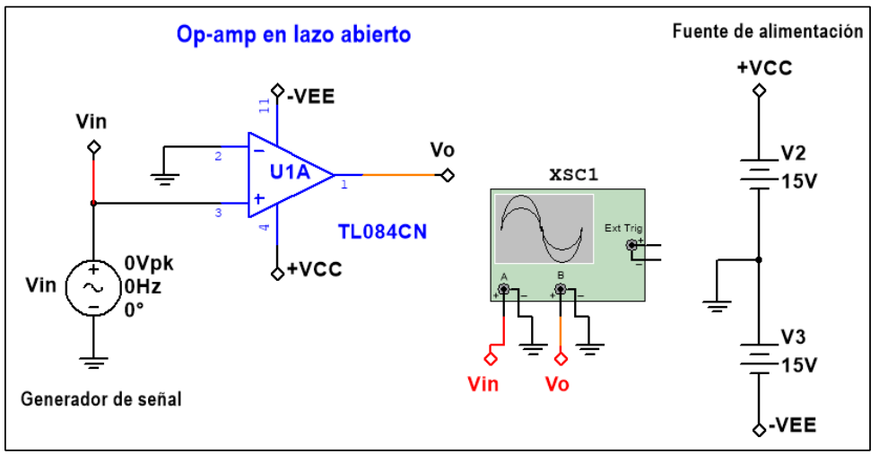
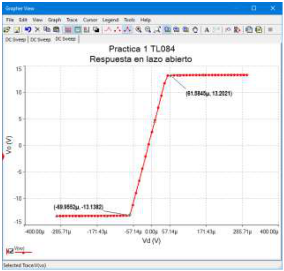
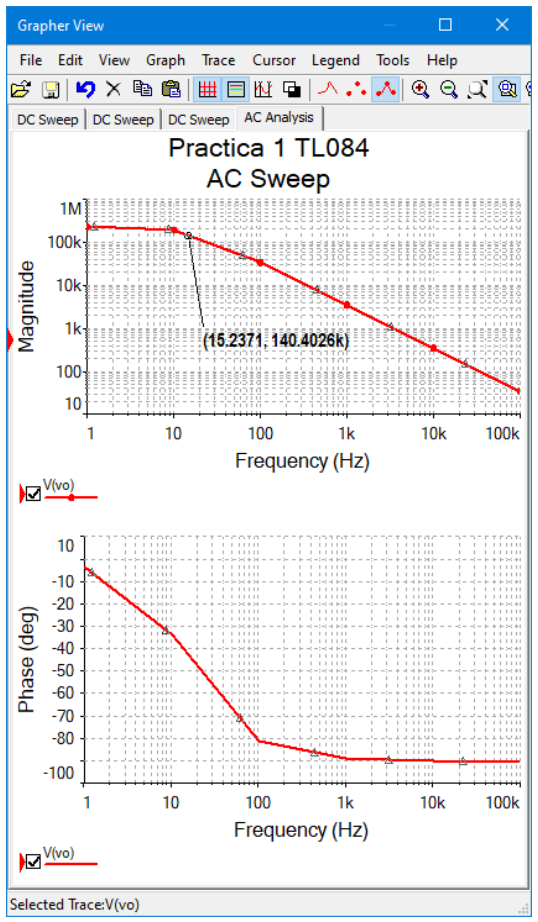
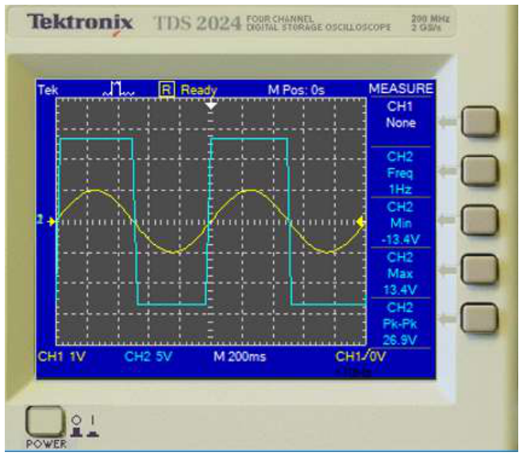

# Práctica 1 · Primer contacto con un op-amp {.unnumbered}

En las clases 8 y 9 observará cómo responde un TL084 en lazo abierto. Medirá la pendiente de su curva de transferencia en Multisim, estudiará cómo cambia la ganancia con la frecuencia y comparará la simulación con las señales de un montaje en protoboard.

::: {.course-actions}
[Consultar la guía de la Práctica 1 (PDF)](../../recursos/semana-03/practica-01-primer-contacto-opamp.pdf){.course-button .course-button-primary}
[Descargar el circuito TL084 (.ms14)](../../recursos/semana-03/simulaciones/practica-01-tl084.ms14){.course-button download="practica-01-tl084.ms14"}
:::

## Preparación {#preparacion}

Antes de la [clase 8](semana-03.qmd#entregas), transcriba en su libreta la teoría básica de las páginas 1 a 3 de la guía. Repase en la [Lección 1](../02/introduccion-opamp.qmd#modelo-diferencial) qué representan $V_p$, $V_n$, $V_d=V_p-V_n$ y la ganancia $A_{oc}$. Complete las tablas de terminales y parámetros de la página 4 con el número de parte y las condiciones de prueba de la hoja de datos. Si una especificación solo se da como valor típico, consígnelo con su unidad y condición de prueba.

Reúna una computadora con NI Multisim, el TL084 o el componente indicado por el profesor, protoboard, cables, una fuente dual, un generador de funciones, un osciloscopio y un multímetro.

[Hoja de datos del TL084 de Texas Instruments](https://www.ti.com/lit/ds/symlink/tl084.pdf){target="_blank" rel="noopener"}

## Simulación en Multisim {#simulacion}

Abra el circuito TL084 y confirme que la entrada inversora se conecta al común y la no inversora a la fuente de señal. En este circuito $V_d=V_{in}$. Use el canal y los rieles de alimentación indicados en el esquema.

{fig-alt="La entrada no inversora recibe Vin, la inversora se conecta a tierra y los rieles de alimentación son +15 V y −15 V. El osciloscopio observa Vin y Vo."}

### Barrido DC y ganancia en lazo abierto {#barrido-dc}

1. En **DC Sweep**, seleccione la fuente de entrada. Barra de −300 µV a +300 µV en pasos de 10 µV y grafique $V_o$ contra $V_d$.
2. Identifique el tramo central de la curva y los niveles donde la salida se aplana. Seleccione dos puntos interiores del tramo lineal. Si hay pocos puntos disponibles, reduzca el paso del barrido en torno a esa región.
3. Calcule la pendiente con las dos diferencias de voltaje. Exprese el resultado en V/V y en V/mV. Compare con la especificación de ganancia en lazo abierto y registre el modelo, la alimentación y la carga.

$$
A_{oc}\approx\frac{V_{o,2}-V_{o,1}}{V_{d,2}-V_{d,1}}.
$$

{fig-alt="La salida se aplana en ambos extremos y cambia de forma casi lineal en una región estrecha del voltaje diferencial." width="66%"}

[Revisar con el Tutor IA si los dos puntos están en el tramo lineal](../02/introduccion-opamp.qmd#tutor-curva-transferencia).

### Barrido AC de pequeña señal {#barrido-ac}

1. Compruebe que la salida de continua quede en la región lineal. Si el offset del modelo la lleva a saturación, ajuste el punto de operación antes de interpretar la gráfica.
2. Configure **AC Sweep** de 1 Hz a 100 kHz. Grafique la magnitud y la fase de $V_o/V_{in}$. Localice la meseta de baja frecuencia y el punto en que la magnitud cae a aproximadamente el 70.7 % de esa meseta, equivalente a una caída de 3 dB.
3. Compare la frecuencia del polo dominante con la obtenida en la [Actividad L1](../02/caracterizacion-tl084.qmd#experimento-bode). Si el cruce de 0 dB queda fuera del barrido de la práctica, registre la frecuencia del polo y consulte el barrido más amplio de la Actividad L1 para el cruce.

{fig-alt="La magnitud parte de una meseta y decae con la frecuencia. La fase se acerca a menos 90 grados en el rango mostrado." width="57%"}

[Manual de NI sobre el análisis AC de Multisim](https://www.ni.com/docs/en-US/bundle/multisim/page/topics/fundamental-analysis-ac-analysis.html){target="_blank" rel="noopener"}

### Respuesta temporal en lazo abierto {#simulacion-temporal}

Aplique una senoidal de 50 mV pico a 100 Hz y luego a 1 kHz. Capture $V_{in}$ y $V_o$ en cada caso. Observe los niveles de saturación, la forma de las transiciones y su posición respecto a los cruces por cero de la entrada. Indique si cambian al subir la frecuencia.

| Frecuencia de entrada | Captura de referencia en la guía |
|:--|:--|
| 100 Hz | [Señales simuladas de entrada y salida, figura 6](../../recursos/semana-03/figuras/transitorio-100-hz.png) |
| 1 kHz | [Señales simuladas de entrada y salida, figura 7](../../recursos/semana-03/figuras/transitorio-1-khz.png) |

### Archivos adicionales de Multisim {#archivos-multisim}

Los archivos `.ms13` permiten consultar las variantes de la práctica. Verifique el componente y las conexiones antes de comparar resultados entre circuitos.

| Componente | Archivo |
|:--|:--|
| TL084 | [Práctica 1 TL084 (.ms13)](../../recursos/semana-03/simulaciones/practica-01-tl084.ms13){download="practica-01-tl084.ms13"} |
| TL084 | [Práctica 1 TL084 c (.ms13)](../../recursos/semana-03/simulaciones/practica-01-tl084-c.ms13){download="practica-01-tl084-c.ms13"} |
| LM358 | [Práctica 1 LM358 (.ms13)](../../recursos/semana-03/simulaciones/practica-01-lm358.ms13){download="practica-01-lm358.ms13"} |
| LM358 | [Práctica 1a LM358 (.ms13)](../../recursos/semana-03/simulaciones/practica-01a-lm358.ms13){download="practica-01a-lm358.ms13"} |
| LM358 | [Práctica 1b LM358 (.ms13)](../../recursos/semana-03/simulaciones/practica-01b-lm358.ms13){download="practica-01b-lm358.ms13"} |

## Montaje y medición {#montaje-y-medicion}

1. Configure la fuente dual en modo **TRACK**, si está disponible en el equipo, y verifique con el multímetro los rieles de +15 V y −15 V respecto al común. Desactive la salida de la fuente antes de conectar el TL084 y coteje los pines con la hoja de datos del encapsulado.
2. Conecte la entrada inversora y los retornos del generador y de las sondas convencionales al común del circuito. Mida la entrada no inversora con el canal 1 y la salida con el canal 2. Revise las conexiones antes de habilitar la fuente y el generador.
3. Comience con una senoidal de 1 V pico (2 V pico a pico), 1 Hz y componente de continua de 0 V. Confirme la amplitud en el canal 1 y ajuste la base de tiempo y el disparo para observar ambas señales.
4. Repita el ensayo para las frecuencias de la tabla. Registre los niveles máximo y mínimo de $V_o$, su amplitud pico a pico y una captura de ambos canales en cada frecuencia. Anote cualquier cambio de forma que dificulte identificar una transición.

| Frecuencia (Hz) | $V_{o,\max}$ (V) | $V_{o,\min}$ (V) | $V_{o,\mathrm{pp}}$ (V) |
|--:|--:|--:|--:|
| 1 | — | — | — |
| 10 | — | — | — |
| 100 | — | — | — |
| 1 000 | — | — | — |
| 10 000 | — | — | — |
| 100 000 | — | — | — |
| 1 000 000 | — | — | — |

{fig-alt="La pantalla del osciloscopio muestra una entrada senoidal y una salida que alterna entre dos niveles de saturación." width="66%"}

Para estimar desde qué frecuencia se aprecia un retardo, use los dos canales en la misma captura. Mida $\Delta t$ entre el cruce ascendente de la entrada por cero y el paso de la salida por el punto medio de la transición correspondiente. Registre también el periodo $T$. Si puede identificar la misma transición en ciclos consecutivos, puede expresar el retardo como $360^\circ\,\Delta t/T$. Indique la primera frecuencia ensayada en la que pudo distinguir ese retardo con la resolución del osciloscopio. Esta medición describe el desplazamiento de la transición con la salida en saturación. Para la fase de pequeña señal, use el barrido AC.

[Referencia de Tektronix sobre sondas referidas a tierra](https://www.tek.com/en/support/faqs/what-maximum-floating-voltage-single-ended-probe){target="_blank" rel="noopener"}

### Tutor IA · Revise sus capturas de laboratorio {#tutor-capturas-laboratorio}

::: {.tutor-box}
::: {.tutor-texto}
Actúe como tutor de Electrónica II y tráteme de usted. Estoy comparando la entrada y la salida del TL084 en lazo abierto. Pídame una captura con ambos canales, el modelo exacto, la alimentación, la amplitud y frecuencia de entrada y la escala de tiempo. Hágame una pregunta a la vez para localizar los niveles de saturación y elegir un cruce de entrada y su transición de salida correspondiente.

Pídame que mida el retardo con mis cursores y que justifique si el osciloscopio permite distinguirlo. Luego ayúdeme a explicar por qué el barrido AC y la prueba con una entrada que satura la salida describen condiciones distintas. Use solo los datos que yo le proporcione y espere mi respuesta antes de pasar al siguiente punto.
:::

::: {.tutor-acciones}
[Abrir ChatGPT](https://chatgpt.com/){.course-button target="_blank" rel="noopener"}
:::
:::

## Evidencias del informe {#informe}

El PDF abre con la rúbrica de evaluación. Consulte el ejemplo para organizar el informe, describir el procedimiento, rotular las capturas y redactar conclusiones. Use la guía vigente y los datos de su equipo para presentar el montaje y los resultados.

[Ver el ejemplo de redacción del reporte (PDF)](../../recursos/semana-03/ejemplo-reporte-practica-01.pdf){.course-button .course-button-primary}

Incluya el modelo y las conexiones, el cálculo de $A_{oc}$ con los puntos seleccionados, el barrido AC, las capturas de 100 Hz y 1 kHz, la tabla de laboratorio y su comparación. Justifique la frecuencia a partir de la cual pudo distinguir el retardo y responda las preguntas de retroalimentación de la página 10 de la guía. Cierre con conclusiones que se puedan rastrear a los datos y a las gráficas que obtuvo.
