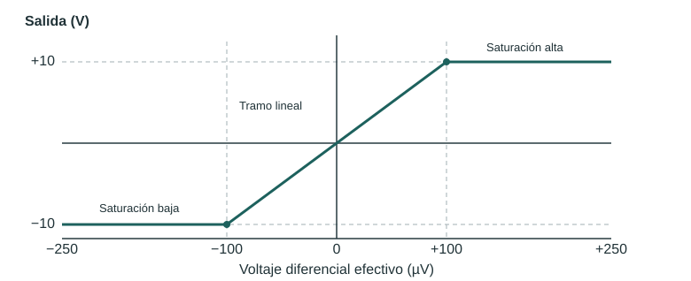
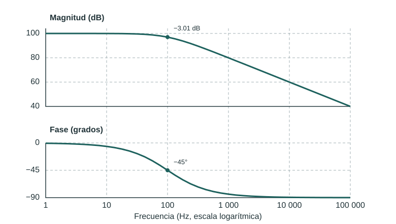
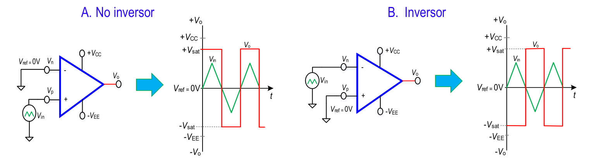
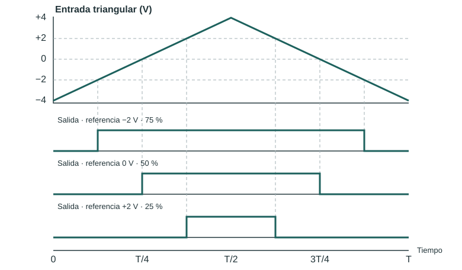

# Lección 2 · Comparar voltajes {.unnumbered}

¿Cómo puede un op-amp indicar que una señal cruzó un voltaje de referencia? A partir de la curva de transferencia de la Lección 1, en esta lección estudiará seis configuraciones del comparador en lazo abierto.

::: {#video-l2 .course-actions}
[Ver video de la Lección 2 (desde 2:09)](https://www.youtube.com/watch?v=2ypst8wHYQw&t=129s){.course-button .course-button-primary target="_blank" rel="noopener"}
[Consultar la presentación (PDF)](../../recursos/semana-04/presentacion-comparar-voltajes.pdf){.course-button}
:::

**Actividad de video — Lección 2.** Vea la presentación en video y elabore **a mano un resumen** que sintetice los conceptos principales, con extensión proporcional al contenido. **Entrega: clase 11 (segunda sesión de la semana 4).** Consulte las [entregas de la Semana 4](semana-04.qmd#entregas-de-la-semana-3).

## Modelo de continua y saturación {#transferencia-comparador-l2}

Los voltajes $V_p$ y $V_n$ corresponden a las entradas no inversora e inversora. Su diferencia es $V_d=V_p-V_n$. La ganancia en lazo abierto de baja frecuencia, $A_0$, se expresa en V/V. Si se adopta la convención $V_{d,\mathrm{ef}}=V_d+V_{OS}$ para incluir el offset de entrada, el modelo con límites de salida es

$$
V_o=
\begin{cases}
V_L, & A_0 V_{d,\mathrm{ef}}\le V_L,\\
A_0 V_{d,\mathrm{ef}}, & V_L<A_0 V_{d,\mathrm{ef}}<V_H,\\
V_H, & A_0 V_{d,\mathrm{ef}}\ge V_H.
\end{cases}
$$

$V_L$ y $V_H$ son los niveles bajo y alto con la alimentación y la carga del circuito. Para calcular los extremos del tramo lineal divida esos voltajes entre $A_0$. Con $A_0=100\,\mathrm{V/mV}=100\,000\,\mathrm{V/V}$ y niveles ilustrativos de $\pm10$ V, el intervalo lineal abarca de $-100$ a $+100\,\mu\mathrm V$. La pendiente elevada permite que una pequeña diferencia entre las entradas lleve la salida a uno de sus límites.

{#fig-transferencia-comparador-l2 fig-alt="Curva con saturación a más y menos diez voltios y un tramo lineal entre menos cien y más cien microvoltios."}

Con salida asimétrica, puede definir el instante de transición cuando la salida atraviesa $V_M=(V_H+V_L)/2$. En el modelo, en ese instante se cumple $V_d=V_M/A_0-V_{OS}$. En el TL084 consulte el intervalo de modo común de entrada y la excursión de salida para la alimentación y la carga utilizadas. [Hoja de datos del TL084](https://www.ti.com/lit/ds/symlink/tl084.pdf).

## Respuesta en frecuencia en lazo abierto {#respuesta-en-frecuencia}

En el [modelo de polo dominante](../02/introduccion-opamp.qmd#respuesta-en-frecuencia), la magnitud de la ganancia y el ángulo de fase en lazo abierto se aproximan por

$$
|A_{oc}(f)|=\frac{A_0}{\sqrt{1+(f/f_c)^2}},
\qquad \varphi(f)=-\arctan(f/f_c).
$$

La frecuencia $f_c$ marca la caída de 3 dB respecto de la ganancia de baja frecuencia $A_0$. Por encima de $f_c$, en el tramo dominado por un solo polo, la magnitud disminuye aproximadamente 20 dB por década. Este modelo describe la respuesta de pequeña señal alrededor de un punto de operación lineal.

### Ejemplos 1 y 2. Ganancia y frecuencia de corte

En el ejemplo 1, $A_0=100\,\mathrm{V/mV}=100\,000\,\mathrm{V/V}$ y $f_c=100\,\mathrm{Hz}$. A 100 Hz el cociente $f/f_c$ vale 1. La magnitud es $100\,000/\sqrt{2}\approx70\,711\,\mathrm{V/V}$ y la fase es $-45^\circ$. Puede usar las mismas expresiones en los otros tres puntos de la diapositiva.

El ejemplo 2 muestra un corte cercano a 15 Hz para el TL084 en Multisim. Compruebe la lectura con el [barrido AC de la Práctica 1](../03/practica-01-primer-contacto-opamp.qmd#barrido-ac) y la meseta de baja frecuencia de su propio modelo.

### Magnitud y fase del ejemplo 1

Para $A_0=100\,000$ V/V y $f_c=100$ Hz, la magnitud en decibelios del modelo de un polo es

$$
A_{\mathrm{dB}}(f)
=20\log_{10}(A_0)-10\log_{10}\left[1+(f/f_c)^2\right].
$$

| $f$ (Hz) | $\lvert A_{oc}\rvert$ (V/V) | Magnitud (dB) | Fase |
|--:|--:|--:|--:|
| 0 | 100 000 | 100.00 | $0^\circ$ |
| 10 | 99 503.72 | 99.96 | $-5.71^\circ$ |
| 100 | 70 710.68 | 96.99 | $-45^\circ$ |
| 1 000 | 9 950.37 | 79.96 | $-84.29^\circ$ |

{#fig-bode-lazo-abierto-l2 fig-alt="Respuesta en frecuencia con una caída de 3.01 decibelios y un desfase de menos 45 grados a 100 hercios."}

Al imponer $\lvert A_{oc}(f_u)\rvert=1$ se obtiene $f_u=f_c\sqrt{A_0^2-1}\approx A_0 f_c$. Para el ejemplo resulta aproximadamente 10 MHz. En el barrido del TL084, el corte cercano a 15 Hz se lee 3.01 dB por debajo de la meseta de ese modelo. Repita la lectura con el [barrido AC de la Práctica 1](../03/practica-01-primer-contacto-opamp.qmd#barrido-ac), después de comprobar el punto de operación DC.

## El op-amp como detector de nivel {#comparador}

El modelo de la [Lección 1](../02/introduccion-opamp.qmd#modelo-diferencial) relaciona en el tramo lineal la salida con $V_d=V_p-V_n$ mediante $V_o=A_{oc}V_d$. Fuera de ese tramo, la salida se aproxima a uno de sus niveles de saturación. El signo del voltaje diferencial indica qué nivel esperar en el modelo ideal.

| Variante | $V_p$ | $V_n$ | $V_o$ si $V_{in}>V_{ref}$ | $V_o$ si $V_{in}<V_{ref}$ |
|:--|:--:|:--:|:--:|:--:|
| No inversora | $V_{in}$ | $V_{ref}$ | Alto | Bajo |
| Inversora | $V_{ref}$ | $V_{in}$ | Bajo | Alto |

Al intercambiar las entradas cambia el sentido de la transición. Al modificar $V_{ref}$ cambia el umbral. Para que una señal periódica produzca dos transiciones en cada ciclo, debe cruzar la referencia en ambos sentidos. Si la referencia está fuera del intervalo de la señal, la salida permanece en un solo nivel. Si la señal apenas toca el umbral, el offset y el ruido pueden afectar lo que se observe.

{fig-alt="Dos circuitos con referencia a tierra. Cuando la entrada triangular cruza cero en sentido ascendente, la salida sube en el no inversor y baja en el inversor."}

En los detectores de las [diapositivas 8 y 9](../../recursos/semana-04/presentacion-comparar-voltajes.pdf#page=8), la referencia se desplaza por encima o por debajo de cero. Cambia la porción de cada periodo durante la que la señal está por encima del umbral. Esta propiedad permite, por ejemplo, obtener pulsos de distinto ancho con una señal triangular.

### Los seis detectores de las diapositivas 7 a 9

Sea $V_R>0$ la magnitud de una referencia distinta de cero. En el detector no inversor, $V_d=V_{in}-V_{ref}$. En el inversor, $V_d=V_{ref}-V_{in}$. En el modelo ideal, el signo de $V_d$ determina la salida.

| Detector | $V_p$ | $V_n$ | Si $V_{in}<V_{ref}$ | Si $V_{in}>V_{ref}$ | Cruce ascendente |
|:--|:--|:--|:--:|:--:|:--|
| Cruce por cero no inversor | $V_{in}$ | 0 | $V_L$ | $V_H$ | $V_L\to V_H$ |
| Cruce por cero inversor | 0 | $V_{in}$ | $V_H$ | $V_L$ | $V_H\to V_L$ |
| Nivel positivo no inversor | $V_{in}$ | $+V_R$ | $V_L$ | $V_H$ | $V_L\to V_H$ |
| Nivel positivo inversor | $+V_R$ | $V_{in}$ | $V_H$ | $V_L$ | $V_H\to V_L$ |
| Nivel negativo no inversor | $V_{in}$ | $-V_R$ | $V_L$ | $V_H$ | $V_L\to V_H$ |
| Nivel negativo inversor | $-V_R$ | $V_{in}$ | $V_H$ | $V_L$ | $V_H\to V_L$ |

En un cruce descendente, el sentido de transición es el opuesto al indicado en la última columna. Si cada semiperiodo es monótono, hay dos cruces por ciclo cuando el umbral queda estrictamente entre el mínimo y el máximo de la entrada. Una referencia fuera de ese intervalo produce un estado permanente.

### Cruces y ciclo de trabajo con entrada triangular

Para una triangular centrada en $V_C$, de amplitud pico $A$ y periodo $T$, defina $k=(V_{ref}-V_C)/A$. Si la señal empieza en su mínimo y $-1<k<1$, las pendientes son $\pm4A/T$. Al igualar la triangular con $V_{ref}$ en ambos semiperiodos se obtiene

$$
\frac{t_\uparrow}{T}=\frac{1+k}{4},\qquad
\frac{t_\downarrow}{T}=\frac{3-k}{4},\qquad
D_{\mathrm{NI}}=\frac{t_\downarrow-t_\uparrow}{T}
=\frac{1-k}{2},\qquad
D_{\mathrm I}=1-D_{\mathrm{NI}}.
$$

$D$ es la fracción del periodo que la salida permanece alta. Para una triangular de 4 V pico centrada en cero y referencias de $-2$, 0 y $+2$ V, los ciclos de trabajo no inversores son 75 %, 50 % y 25 %. En la configuración inversora se obtienen 25 %, 50 % y 75 %. Para una senoidal centrada en $V_C$ resulta $D_{\mathrm{NI}}=\tfrac12-\arcsin(k)/\pi$, dentro del mismo intervalo de $k$.

{#fig-cruces-referencias-l2 fig-alt="La referencia de menos dos voltios da el pulso más largo y la referencia de más dos voltios da el más corto en el no inversor."}

En la [Práctica 2](practica-02-comparador-voltaje.qmd), ajuste la referencia del detector inversor de nivel positivo y compare los ciclos de trabajo. Cuando el umbral coincide con el pico, la triangular ideal lo toca en un instante. Cerca de ese punto, el offset y el ruido influyen en la transición observada. La selección de un umbral mediante un divisor o un sensor también aparece en las aplicaciones del voltímetro luminoso, la alarma por sonido y el detector de humo de las diapositivas 10 y 11.

### Ejemplo 3. Comparación de tres nodos {#ejemplo-tres-nodos}

El siguiente circuito conecta tres resistencias iguales entre 15 V y tierra. Con el modelo de impedancia de entrada alta, determine $V_A$, $V_B$ y $V_C$ mediante el divisor. Como ejemplo, al aplicar $V_A$ a $V_p$ y $V_B$ a $V_n$ se obtiene $V_p>V_n$ y la salida tiende al nivel alto. Invierta las conexiones y compruebe la polaridad. Cuando ambas entradas reciben el mismo potencial nominal, registre lo que indica el modelo en Multisim y considere el voltaje de offset al interpretar ese caso.

Los tres resistores de $10\,\mathrm{k\Omega}$ del ejemplo 3 conducen $I=15\,\mathrm V/(30\,\mathrm{k\Omega})=0.5$ mA. Cada resistor tiene una caída de 5 V. Así resultan $V_A=10$ V, $V_B=5$ V y $V_C=0$ V.

| $V_p$ | $V_n=V_A$ | $V_n=V_B$ | $V_n=V_C$ |
|:--|:--|:--|:--|
| $V_A$ | 0 V · umbral | $+5$ V · alto | $+10$ V · alto |
| $V_B$ | $-5$ V · bajo | 0 V · umbral | $+5$ V · alto |
| $V_C$ | $-10$ V · bajo | $-5$ V · bajo | 0 V · umbral |

Cada celda indica $V_p-V_n$ y la predicción de salida. En la diagonal, registre el estado obtenido en Multisim y considere el voltaje de offset del modelo. Para el montaje verifique los límites de modo común y el diferencial admisible.

### Cómo leer las capturas de la Práctica 2

Registre la amplitud de entrada, la referencia medida y los dos niveles de salida. Coloque un cursor en el instante en que $V_{in}$ cruza $V_{ref}$ y otro en el instante en que la salida cruza $V_M=(V_H+V_L)/2$. La diferencia es $\Delta t=t_{o,M}-t_{in,\mathrm{ref}}$. Mida por separado el tiempo de 10 a 90 % de la transición y calcule $V_{o,\mathrm{pp}}=V_H-V_L$.

Compare los flancos al variar la frecuencia. La respuesta de conmutación depende de la excursión, la velocidad de salida y la recuperación después de saturar. El barrido AC caracteriza una perturbación pequeña alrededor de un punto de operación lineal. [Texas Instruments, Application Design Guidelines for LM324 and LM358 Devices, sección 6](https://www.ti.com/lit/an/sloa277b/sloa277b.pdf).

### Tutor IA · Prediga la transición de salida {#tutor-transicion-comparador}

::: {.tutor-box}
::: {.tutor-texto}
Actúe como tutor de Electrónica II y tráteme de usted. Estoy analizando un detector de nivel con un op-amp en lazo abierto. Pídame el esquema o las conexiones a las dos entradas y el valor de la referencia con su signo. Hágame una pregunta a la vez para que yo determine el signo de Vp − Vn antes y después de un cruce ascendente. Espere mi respuesta después de cada pregunta.

Cuando justifique mi predicción, pídame una captura de Vin y Vo, con la referencia y las escalas. Ayúdeme a comprobar el sentido de la transición y a explicar qué sucede si la señal deja de cruzar la referencia. Use los datos que yo le proporcione.
:::

::: {.tutor-acciones}
[Abrir ChatGPT](https://chatgpt.com/){.course-button target="_blank" rel="noopener"}
:::
:::

## Simulaciones en Multisim {#simulaciones}

| Umbral | No inversor | Inversor |
|:--|:--|:--|
| Cruce por cero | [Cruce por cero no inversor (.ms14)](../../recursos/semana-04/simulaciones/cruce-por-cero-no-inversor.ms14){download="cruce-por-cero-no-inversor.ms14"} | [Cruce por cero inversor (.ms14)](../../recursos/semana-04/simulaciones/cruce-por-cero-inversor.ms14){download="cruce-por-cero-inversor.ms14"} |
| Nivel positivo | [Nivel positivo no inversor (.ms14)](../../recursos/semana-04/simulaciones/nivel-positivo-no-inversor.ms14){download="nivel-positivo-no-inversor.ms14"} | [Nivel positivo inversor (.ms14)](../../recursos/semana-04/simulaciones/nivel-positivo-inversor.ms14){download="nivel-positivo-inversor.ms14"} |
| Nivel negativo | [Nivel negativo no inversor (.ms14)](../../recursos/semana-04/simulaciones/nivel-negativo-no-inversor.ms14){download="nivel-negativo-no-inversor.ms14"} | [Nivel negativo inversor (.ms14)](../../recursos/semana-04/simulaciones/nivel-negativo-inversor.ms14){download="nivel-negativo-inversor.ms14"} |

En cada circuito localice las entradas y la referencia. Prediga la transición de $V_o$ para un cruce ascendente de $V_{in}$ y compruébela con la captura de ambos canales.

## Práctica y preguntas de retroalimentación {#practica-y-preguntas}

En la [Práctica 2 · Comparador de voltaje](practica-02-comparador-voltaje.qmd) comparará las simulaciones con las mediciones en protoboard. Las preguntas de retroalimentación están en la página 12 de la [guía de la práctica (PDF)](../../recursos/semana-04/practica-02-comparador-de-voltaje.pdf#page=12).
