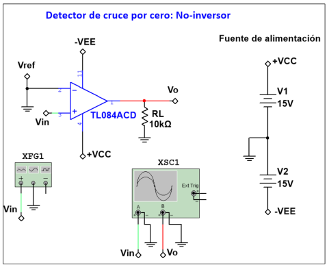

# Práctica 2 · Comparador de voltaje {.unnumbered}

En la clase 12 comprobará por simulación y en protoboard el funcionamiento del op-amp como detector de cruce por cero y como detector de nivel positivo. Compare el umbral, el sentido de la transición y los niveles de salida en las dos formas de trabajo.

::: {.course-actions}
[Abrir la guía de la Práctica 2 (PDF)](../../recursos/semana-04/practica-02-comparador-de-voltaje.pdf){.course-button .course-button-primary}
[Repasar la Lección 2](comparador-de-voltaje.qmd){.course-button}
:::

## Preparación {#preparacion}

Lea las páginas 7 a 12 de la guía. Prepare Multisim, protoboard, cables, un TL084 o el componente indicado por el profesor, resistencias de 10 kΩ, un potenciómetro de 10 kΩ, una fuente dual, un generador de funciones, un multímetro y un osciloscopio.

Antes de energizar, verifique el pinout del encapsulado y los rieles respecto al nodo común. Con el osciloscopio de banco, conecte los retornos de las sondas convencionales al común del circuito. En las mediciones, use el rango del instrumento adecuado para los niveles de salida del montaje.

| Referencia | Consulta |
|:--|:--|
| TL084 | [Hoja de datos de Texas Instruments](https://www.ti.com/lit/ds/symlink/tl084.pdf){target="_blank" rel="noopener"} |
| Sondas de osciloscopio | [Referencia a tierra de las sondas convencionales, Tektronix](https://www.tek.com/en/support/faqs/what-maximum-floating-voltage-single-ended-probe){target="_blank" rel="noopener"} |
| NI myDAQ | [Manual de usuario (PDF)](../../recursos/semana-04/ni-mydaq-user-guide.pdf). Si usa las entradas analógicas de la tarjeta, respete su rango de medición de ±10 V. Si la salida puede excederlo, consulte con el profesor cómo escalarla o cómo medirla con el osciloscopio de banco. |

## Simulación en Multisim {#simulacion}

En los apartados 1 y 2, compare el cruce por cero en ambas configuraciones. Use la entrada triangular de 2 V pico a 100 Hz indicada en las figuras 5 a 8 de la guía. Ubique un cruce ascendente en las dos capturas y compruebe qué transición ocurre en cada circuito.

{fig-alt="Montaje en Multisim del TL084 con la entrada triangular en la terminal no inversora, tierra en la entrada inversora y osciloscopio conectado a la entrada y salida." width="65%"}

### Archivos de Multisim {#archivos-multisim}

| Circuito | Archivo |
|:--|:--|
| TL084 · Cruce por cero no inversor | [Descargar (.ms14)](../../recursos/semana-04/simulaciones/practica-02-tl084-cruce-por-cero-no-inversor.ms14){download="practica-02-tl084-cruce-por-cero-no-inversor.ms14"} |
| TL084 · Cruce por cero inversor | [Descargar (.ms14)](../../recursos/semana-04/simulaciones/practica-02-tl084-cruce-por-cero-inversor.ms14){download="practica-02-tl084-cruce-por-cero-inversor.ms14"} |
| TL084 · Nivel positivo no inversor | [Descargar (.ms14)](../../recursos/semana-04/simulaciones/practica-02-tl084-nivel-positivo-no-inversor.ms14){download="practica-02-tl084-nivel-positivo-no-inversor.ms14"} |
| TL082 · Comparador | [Descargar (.ms14)](../../recursos/semana-04/simulaciones/practica-02-tl082-comparador.ms14){download="practica-02-tl082-comparador.ms14"} |

Para el montaje inversor de nivel positivo del apartado 5, use el esquema de la página 11 o adapte el [circuito inversor de la Lección 2](../../recursos/semana-04/simulaciones/nivel-positivo-inversor.ms14){download="nivel-positivo-inversor.ms14"} con los valores de la guía. Verifique qué terminal recibe la referencia.

## Montaje y medición {#montaje-y-medicion}

| Etapa | Condiciones iniciales | Qué observar |
|:--|:--|:--|
| Cruce por cero no inversor, apartado 3 | Monte el TL084 con la carga de 10 kΩ y alimentación de ±15 V. Comience con la triangular de 2 V pico a 100 Hz. | Para el barrido de frecuencias use los 3 V pico de la tabla de la página 9. Mida máximo, mínimo y pico a pico de $V_o$. |
| Cruce por cero inversor, apartado 4 | Use la carga de 10 kΩ y alimentación de ±15 V. Comience con la triangular de 4 V pico a 1 kHz. | Repita las mediciones con las frecuencias de la página 10 a 4 V pico. Mida el tiempo entre el cruce y la transición correspondiente. |
| Detector inversor de nivel positivo, apartado 5 | Use la carga de 10 kΩ, alimentación de ±10 V y triangular de 4 V pico a 1 kHz. | Mida $V_{ref}$ en continua. Compare qué fracción del periodo permanece alta la salida al aumentar la referencia. Cuando el umbral esté cerca del pico de entrada, anote si aún observa dos cruces. |

Los voltajes anteriores suponen un offset de entrada de 0 V. Confirme la amplitud en el osciloscopio. Una triangular centrada de 4 V pico tiene 8 V pico a pico. Los niveles alto y bajo de salida dependen del dispositivo, la carga y la alimentación. Registre sus valores y compárelos con los rieles medidos.

### Tutor IA · Revise el umbral a partir de sus capturas {#tutor-umbral-practica-02}

::: {.tutor-box}
::: {.tutor-texto}
Actúe como tutor de Electrónica II y tráteme de usted. Estoy comparando los resultados de la Práctica 2. Pídame una captura de entrada y salida, la configuración del detector, la referencia medida, el voltaje pico de entrada, los rieles y la carga. Hágame una pregunta a la vez y espere mi respuesta.

Guíeme para encontrar el cruce de la entrada con la referencia, comprobar el sentido de la transición y calcular el voltaje pico a pico de salida a partir del máximo y el mínimo. Si no distingo un cruce, pídame los extremos medidos de la entrada y ayúdeme a compararlos con la referencia. Al final pídame que justifique una diferencia entre simulación y montaje con mis datos.
:::

::: {.tutor-acciones}
[Abrir ChatGPT](https://chatgpt.com/){.course-button target="_blank" rel="noopener"}
:::
:::

## Evidencias del informe {#informe}

Incluya los esquemas con los valores utilizados, las capturas de $V_{in}$ y $V_o$, las tablas de los apartados 3 a 5, las respuestas a las preguntas de retroalimentación y conclusiones que comparen el cálculo, la simulación y la medición. En cada captura identifique los canales, la unidad de amplitud, la frecuencia y la referencia.

El informe se entrega en la [clase 17 de la Semana 6](../06/semana-06.qmd#entregas). El [ejemplo de la Práctica 1](../03/practica-01-primer-contacto-opamp.qmd#informe) muestra cómo ordenar los resultados y redactar conclusiones con evidencias propias.
