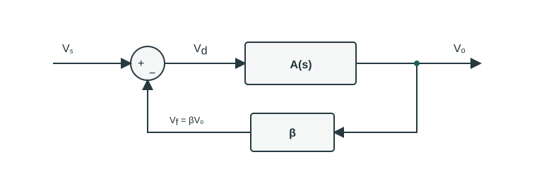
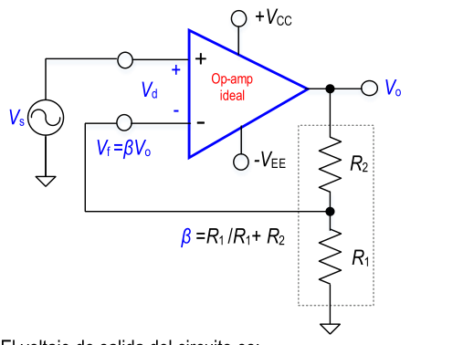
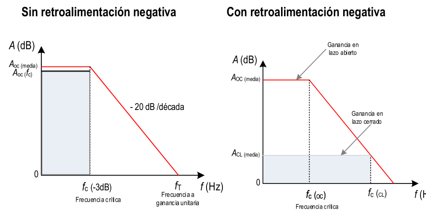
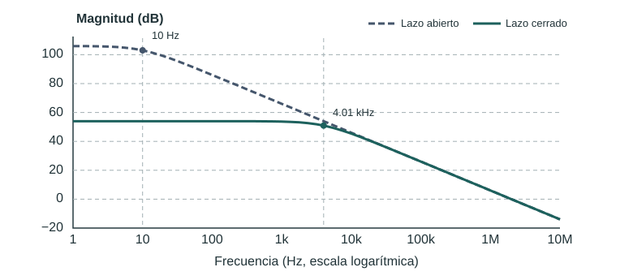
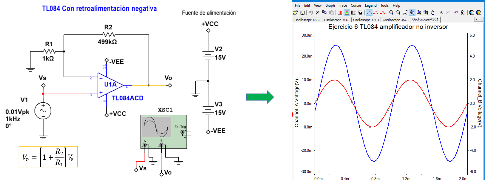
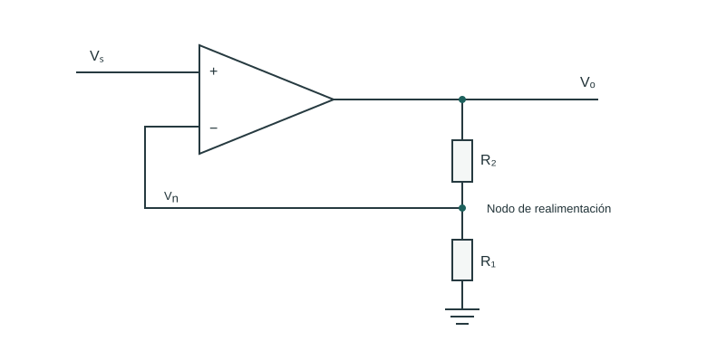

# Lección 3 · Retroalimentación negativa {.unnumbered}

¿Cómo puede el mismo op-amp que satura como comparador producir una salida proporcional a la entrada? En esta lección estudiará cómo la retroalimentación negativa determina la ganancia en lazo cerrado, modifica el ancho de banda y permite aproximar la igualdad de voltaje entre las entradas.

::: {#video-l3 .course-actions}
[Ver video de la Lección 3](https://www.youtube.com/watch?v=OCgXwEnq_1Y){.course-button .course-button-primary target="_blank" rel="noopener"}
[Consultar la presentación (PDF)](../../recursos/semana-05/presentacion-retroalimentacion-negativa.pdf){.course-button}
:::

**Actividad de video — Lección 3.** Vea la presentación en video y elabore **a mano un resumen** que sintetice los conceptos principales, con extensión proporcional al contenido. **Entrega: clase 13 (primera sesión de la semana 5).** Consulte las [entregas de la Semana 5](semana-05.qmd#entregas).

## Trayectoria de la realimentación {#trayectoria-realimentacion-l3}

Una fracción $V_f=\beta V_o$ se aplica a la entrada inversora. Si $V_o$ aumenta mientras $V_s$ se mantiene constante, el aumento de $V_f$ reduce $V_s-V_f$. En el diagrama, el signo de resta se indica en el sumador y la ganancia de lazo se escribe $L(s)=A(s)\beta(s)$.

{#fig-lazo-negativo-l3 fig-alt="La salida de A de s regresa por beta al terminal de resta del sumador."}

Suponiendo despreciable la corriente de entrada del op-amp, la ley de corrientes en $V_n$ da

$$
\frac{V_o-V_n}{R_2}=\frac{V_n}{R_1}
\quad\Longrightarrow\quad
V_n=\frac{R_1}{R_1+R_2}V_o=\beta V_o.
$$

Como $V_p=V_s$, la relación $V_o=A_{oc}(V_p-V_n)$ lleva a $V_o(1+A_{oc}\beta)=A_{oc}V_s$. En operación lineal, las tensiones diferencial y realimentada son

$$
V_d=\frac{V_s}{1+A_{oc}\beta},\qquad
V_f=\frac{A_{oc}\beta}{1+A_{oc}\beta}V_s.
$$

En lazo abierto, con $A_0=200\,000$ V/V y un diferencial de $50\,\mu\mathrm V$, el modelo predice 10 V de salida. Compruebe si ese voltaje cabe en la excursión disponible. El circuito realimentado puede admitir una señal externa mayor y mantener pequeño el voltaje diferencial.

## Ganancia práctica e ideal {#ganancia}

En el amplificador no inversor, $V_s$ llega a la entrada no inversora, $R_2$ une la salida a la entrada inversora y $R_1$ une ese nodo a tierra. En el modelo de entrada de impedancia alta, el divisor devuelve $V_f=\beta V_o$, donde $\beta=\frac{R_1}{R_1+R_2}$. El voltaje diferencial es $V_d=V_s-V_f$.

{fig-alt="La fuente llega a la entrada no inversora. R2 va de la salida a la entrada inversora. R1 conecta esa entrada a tierra." width="63%"}

Para un punto de operación lineal, combine $V_o=A_{oc}(V_s-\beta V_o)$ con la definición de ganancia en lazo cerrado. Si la ganancia de lazo $|A_{oc}\beta|$ es mucho mayor que 1, la razón de resistencias domina el resultado.

$$
A_{CL}=\frac{V_o}{V_s}=\frac{A_{oc}}{1+A_{oc}\beta},
\qquad
A_{CL,\mathrm{ideal}}=\frac{1}{\beta}=1+\frac{R_2}{R_1}.
$$

## Región lineal y corto virtual {#corto-virtual}

En los ejemplos 1 y 2, el voltaje diferencial necesario para producir una salida de varios volts es del orden de microvolts. En lazo cerrado, un cambio de salida se devuelve a la entrada inversora y reduce el error diferencial original. Compruebe que la salida prevista cabe en la excursión disponible antes de usar la condición de corto virtual $V_p\approx V_n$. En el modelo con ganancia finita, el error es $V_d=V_o/A_{oc}$.

### Ejemplo 3. Divisor de retroalimentación

Con $R_1=20\,\mathrm{k\Omega}$, $R_2=180\,\mathrm{k\Omega}$ y $V_s=1\,\mathrm{V}$, se obtiene $\beta=0.1$ y $A_{CL,\mathrm{ideal}}=10$. La salida ideal de 10 V devuelve $V_f=0.1(10\,\mathrm{V})=1\,\mathrm{V}$ a la entrada inversora. Al simular con ganancia finita, consulte más cifras de ambas entradas para distinguir el voltaje diferencial.

### Tutor IA · Explique el corto virtual {#tutor-corto-virtual}

::: {.tutor-box}
::: {.tutor-texto}
Actúe como tutor de Electrónica II y tráteme de usted. Estoy analizando un amplificador no inversor con retroalimentación negativa. Pídame el esquema, los valores de las resistencias, la señal de entrada y la ganancia en lazo abierto con su unidad. Hágame una pregunta a la vez y espere mi respuesta. Empiece por pedirme que siga la ruta desde la salida hasta la entrada inversora y que calcule el factor β.

Después pídame que compare la ganancia calculada con ganancia en lazo abierto finita y la aproximación ideal. Guíeme para obtener Vp − Vn con las unidades correctas y comprobar que mi salida corresponde a operación lineal. Pídame al final que explique el corto virtual a partir de mis resultados.
:::

::: {.tutor-acciones}
[Abrir ChatGPT](https://chatgpt.com/){.course-button target="_blank" rel="noopener"}
:::
:::

### Corto virtual y error de ganancia

Para el no inversor, defina la ganancia ideal $G_i=1/\beta$ y la ganancia de lazo en baja frecuencia $L_0=A_0\beta$. La relación entre ganancia práctica e ideal, así como el error relativo, se deducen de la ganancia realimentada.

$$
\frac{A_{CL}(0)}{G_i}=\frac{L_0}{1+L_0},\qquad
\varepsilon_g=\frac{G_i-A_{CL}(0)}{G_i}=\frac{1}{1+L_0}.
$$

Con $\beta$ fija, la sensibilidad de $A_{CL}$ ante pequeñas variaciones de $A_0$ es

$$
\frac{\partial\ln A_{CL}(0)}{\partial\ln A_0}=\frac{1}{1+L_0}.
$$

Para $L_0=100$, el cambio relativo de ganancia en lazo cerrado se reduce por un factor de 101 frente al cambio relativo de $A_0$. Las tolerancias de $R_1$ y $R_2$ siguen afectando el resultado a través de $\beta$.

Aplique el modelo al ejemplo 3, con $R_1=20\,\mathrm{k\Omega}$, $R_2=180\,\mathrm{k\Omega}$ y $V_s=1$ V. Resulta $\beta=0.1$. Para cuantificar la diferencia respecto del ideal, use $A_0=200\,000$ V/V.

| Magnitud | Ideal | Con $A_0$ finita |
|:--|--:|--:|
| $A_{CL}(0)$ (V/V) | 10 | 9.999500 |
| $V_o$ (V) | 10 | 9.999500 |
| $V_n=V_f$ (V) | 1 | 0.999950 |
| $V_p-V_n$ ($\mu$V) | 0 | 49.998 |
| Error relativo de ganancia | 0 | 0.0050 % |

El corto virtual permite aproximar $V_p\approx V_n$ cuando la salida opera en el tramo lineal y la ganancia de lazo es alta. Cada nodo conserva sus propias conexiones y su ecuación de corrientes. Si uno está conectado a tierra, el otro queda aproximadamente al mismo potencial y se habla de tierra virtual.

## Ganancia y ancho de banda {#ancho-de-banda}

Si el op-amp se representa con ganancia de baja frecuencia $A_0$ y un solo polo dominante $f_{c,\mathrm{oc}}$, con una red de realimentación resistiva, el modelo da

$$
f_{c,\mathrm{CL}}=f_{c,\mathrm{oc}}\bigl(1+\beta A_0\bigr).
$$

Bajo estas condiciones, el producto de la ganancia de baja frecuencia por la frecuencia de corte se conserva en el modelo. En una medición de pequeña señal se comprueba aproximadamente mediante $GBW\approx A_{CL}(0)\,f_{c,\mathrm{CL}}$. En la gráfica, el corte en lazo cerrado se mide 3 dB por debajo de la meseta de ese lazo.

{fig-alt="Las gráficas muestran una meseta de ganancia menor y una frecuencia de corte mayor cuando se aplica retroalimentación negativa."}

En el ejemplo 4, $f_{c,\mathrm{oc}}=100\,\mathrm{Hz}$, $A_0=100\,\mathrm{V/mV}$ y $\beta=0.002$. Con $A_0$ expresada en V/V, el factor $1+\beta A_0$ vale 201 y el ancho de banda en lazo cerrado es 20.1 kHz.

::: {.callout-note}
## Frecuencia de corte en el ejemplo 5

Las diapositivas 10 y 11 usan dos valores de $f_{c,\mathrm{oc}}$. Con los 10 Hz del enunciado, $A_0=200\,000$ V/V y $\beta=0.002$, el cálculo en lazo cerrado da $10(1+400)=4010$ Hz. Si se parte de los 15 Hz tomados como referencia de la simulación, el mismo modelo da $15(1+400)=6015$ Hz. En Multisim mida la caída de 3 dB en cada curva y registre el valor de partida que usó.
:::

### Deducción de la respuesta en frecuencia

Para una red con $\beta$ constante y un solo polo dominante, con $\omega_p=2\pi f_p$,

$$
A(s)=\frac{A_0}{1+s/\omega_p},\qquad
A_{CL}(s)=\frac{A(s)}{1+\beta A(s)}
=\frac{A_0}{1+A_0\beta+s/\omega_p}.
$$

Al dividir entre $1+A_0\beta$ se identifica la ganancia de baja frecuencia y el polo en lazo cerrado.

$$
A_{CL}(s)=\frac{A_{CL}(0)}{1+s/\omega_{CL}},\qquad
A_{CL}(0)=\frac{A_0}{1+A_0\beta},\qquad
f_{CL}=f_p(1+A_0\beta).
$$

Para este modelo, el producto $A_{CL}(0)f_{CL}$ vale $A_0f_p$. Busque cada corte 3.01 dB por debajo de la meseta de su propia curva, equivalente a multiplicar la magnitud de baja frecuencia por $1/\sqrt 2$.

{#fig-bode-dos-lazos-l3 fig-alt="El lazo abierto tiene corte a 10 hercios y el cerrado a 4.01 kilohercios. Cada corte se mide respecto de su meseta."}

| Caso | $A_0$ (V/V) | $f_p$ (Hz) | $\beta$ | $A_{CL}(0)$ (V/V) | $f_{CL}$ | Producto |
|:--|--:|--:|--:|--:|--:|--:|
| Ejemplo 4 | 100 000 | 100 | 0.002 | 497.512 | 20.100 kHz | 10 MHz |
| Ejemplo 5, con 10 Hz | 200 000 | 10 | 0.002 | 498.753 | 4.010 kHz | 2 MHz |
| Ejemplo 5, con 15 Hz | 200 000 | 15 | 0.002 | 498.753 | 6.015 kHz | 3 MHz |

Los tres productos proceden de distintos parámetros de lazo abierto. En un mismo dispositivo, un ensayo de pequeña señal permite comprobar qué tan bien describe el modelo de un polo las curvas. Polos adicionales o una carga capacitiva pueden afectar el margen de fase. En la prueba temporal, compruebe si el dispositivo puede producir la pendiente máxima $2\pi f V_{o,\mathrm{pico}}$ de la salida senoidal sin recorte ni limitación de pendiente.

## Análisis del amplificador no inversor {#analisis-no-inversor}

En el primer método, escriba la ecuación del voltaje diferencial y resuelva con $A_{oc}$ finita antes de aplicar el límite ideal. En el segundo método, use $I_p=I_n=0$ y $V_p=V_n$ para aplicar la ley de corrientes en el nodo inversor. Ambos métodos se aplican al circuito de la diapositiva 16.

En el ejemplo 6, $R_1=1\,\mathrm{k\Omega}$ y $R_2=499\,\mathrm{k\Omega}$ dan una ganancia ideal de 500. Para una entrada de 10 mV pico, se esperan 5 V pico a la salida según el modelo ideal. Compare ese resultado con la captura de Multisim de la diapositiva 13.

{fig-alt="Circuito no inversor con realimentación resistiva y gráfica de dos señales senoidales. La salida tiene mayor amplitud."}

### Dos métodos de análisis y ejemplo 6

{#fig-no-inversor-l3 fig-alt="La entrada de señal se conecta al terminal positivo. El negativo recibe el nodo común a R1 y R2."}

- **Método 1.** Calcule $\beta$, sustituya $V_n=\beta V_o$ en $V_o=A_0(V_s-V_n)$ y despeje $V_o$. El resultado permite calcular $V_d$ con ganancia finita.
- **Método 2.** Aplique $V_n\approx V_s$ a la ecuación del nodo. De $(V_o-V_s)/R_2\approx V_s/R_1$ se obtiene $V_o\approx (1+R_2/R_1)V_s$.

En el ejemplo 6, $R_1=1\,\mathrm{k\Omega}$, $R_2=499\,\mathrm{k\Omega}$ y $V_s=10$ mV pico. El modelo ideal predice 500 V/V y 5 V pico. Con $A_0=200\,000$ V/V, en baja frecuencia se obtienen $A_{CL}=498.753$ V/V, $V_o=4.9875$ V pico, $V_n=9.9751$ mV pico y $V_d=24.938\,\mu\mathrm V$ pico. Antes de usar el corto virtual compruebe que la salida prevista cabe en su excursión. En el modelo de continua se requiere $V_L/A_{CL}(0)<V_s<V_H/A_{CL}(0)$.

### Comprobación experimental con NI myDAQ

1. En el [primer experimento](actividad-retroalimentacion.qmd#experimento-1), compare entrada y salida en lazo abierto y cerrado. Registre alimentación, carga, frecuencia y amplitud. Use la misma convención de amplitud en $V_s$ y $V_o$ al calcular la ganancia.
2. Para $R_1=1\,\mathrm{k\Omega}$ y $R_2=47$, 470 y $1000\,\mathrm{k\Omega}$, calcule las ganancias ideales de 48, 471 y 1001 V/V. En el barrido, identifique la meseta y la caída de 3.01 dB de cada montaje. Si el corte queda arriba de 20 kHz, consigne el límite del intervalo medido.
3. En el [segundo experimento](actividad-retroalimentacion.qmd#experimento-2), calcule $\widetilde V_d=\widetilde V_p-\widetilde V_n$ mediante resta fasorial y estime $\lvert A_{oc}\rvert=\lvert\widetilde V_o\rvert/\lvert\widetilde V_d\rvert$. En baja frecuencia, también se puede despejar $A_0=A_{CL}(0)/(1-\beta A_{CL}(0))$. Cerca de la ganancia ideal, el denominador pequeño amplifica la incertidumbre de la medición. Registre la resolución del instrumento si el error diferencial apenas se distingue.

Presente en el informe el cálculo, la simulación y la medición con las mismas condiciones de excitación. Indique cómo obtuvo las lecturas de ganancia, corte y voltaje diferencial.

## Ejemplos en Multisim {#ejemplos-en-multisim}

Consulte el esquema de cada ejemplo en la presentación. Use los archivos descargables como base para reproducir las condiciones del caso correspondiente.

| Ejemplo | Qué comprobar | Archivo o referencia |
|--:|:--|:--|
| 2 | TL084 en lazo abierto. Localice el tramo lineal de la curva DC y observe el cambio hacia saturación. | Consulte [circuitos de la Práctica 1](../03/practica-01-primer-contacto-opamp.qmd#simulacion). |
| 3 | Divisor de realimentación. Calcule $V_o$ y $V_f$, y registre $V_p$ y $V_n$ con unidades suficientes para distinguir el error diferencial. | Consulte [no inversor de ganancia nominal 10 (.ms14)](../../recursos/semana-05/simulaciones/ejercicio-02a-tl084-ganancia-10.ms14){download="ejercicio-02a-tl084-ganancia-10.ms14"}. Ajuste $R_1$, $R_2$ y la fuente al ejemplo. |
| 5 | Compare las curvas AC del TL084 y encuentre el criterio de −3 dB para cada lazo. Verifique el punto de operación DC antes del barrido. | [Lazo abierto (.ms14)](../../recursos/semana-05/simulaciones/ejercicio-04a-tl084-lazo-abierto.ms14){download="ejercicio-04a-tl084-lazo-abierto.ms14"} y [lazo cerrado de ganancia nominal 500 (.ms14)](../../recursos/semana-05/simulaciones/ejercicio-04b-tl084-ganancia-500.ms14){download="ejercicio-04b-tl084-ganancia-500.ms14"}. |
| 6 | Compare las amplitudes de $V_s$ y $V_o$ en el no inversor. Confirme las condiciones del esquema de las diapositivas 12 y 13. | [Amplificador no inversor (.ms14)](../../recursos/semana-05/simulaciones/tl084-no-inversor.ms14){download="tl084-no-inversor.ms14"} · [Versión .ms13](../../recursos/semana-05/simulaciones/tl084-no-inversor.ms13){download="tl084-no-inversor.ms13"}. |

### Entrega de la simulación y ejemplo de reporte {#informe-de-simulacion}

Entregue las simulaciones de los ejemplos en la [clase 15](semana-05.qmd#entregas). Use el PDF como referencia para organizar la introducción, el desarrollo, las figuras y las conclusiones con sus cálculos, archivos y capturas. Para el ejemplo 5, consulte el [cálculo del ancho de banda](#ancho-de-banda).

[Consultar el ejemplo de reporte de simulación (PDF)](../../recursos/semana-05/ejemplo-reporte-simulacion-l3.pdf){.course-button}

## Ejercicios y verificación experimental {#ejercicios-y-actividad}

- [Ejercicios demostrativos L3](ejercicios-demostrativos-l3.qmd). Compare las ganancias, los voltajes y el ancho de banda con los resultados de Multisim.
- [Ejercicios propuestos L3](ejercicios-propuestos-l3.qmd). Aplique los dos métodos de análisis y el modelo de ancho de banda a los casos del enunciado.
- [Actividad L3 con NI myDAQ](actividad-retroalimentacion.qmd). Consulte las guías de experimentación y los circuitos de apoyo.
