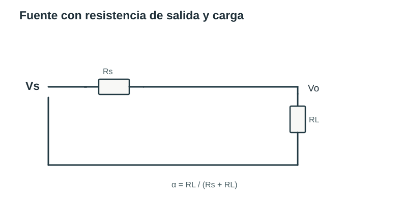
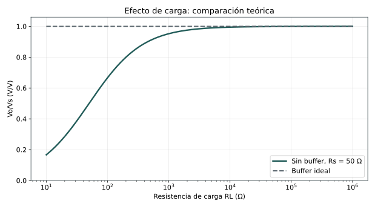
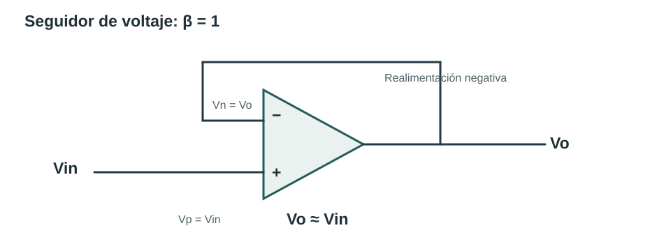
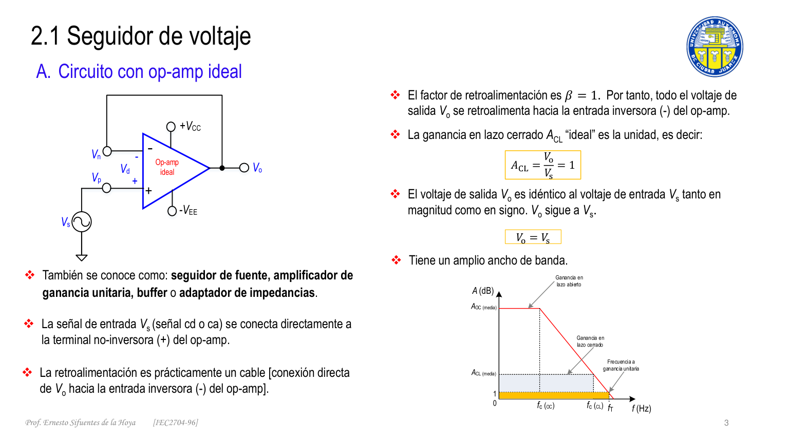
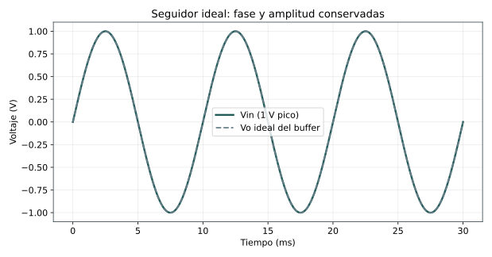
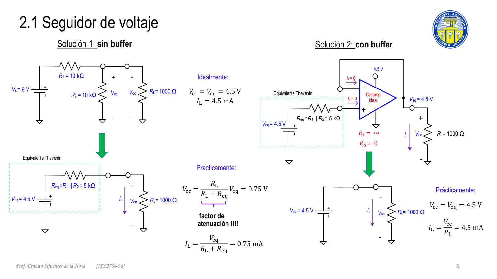
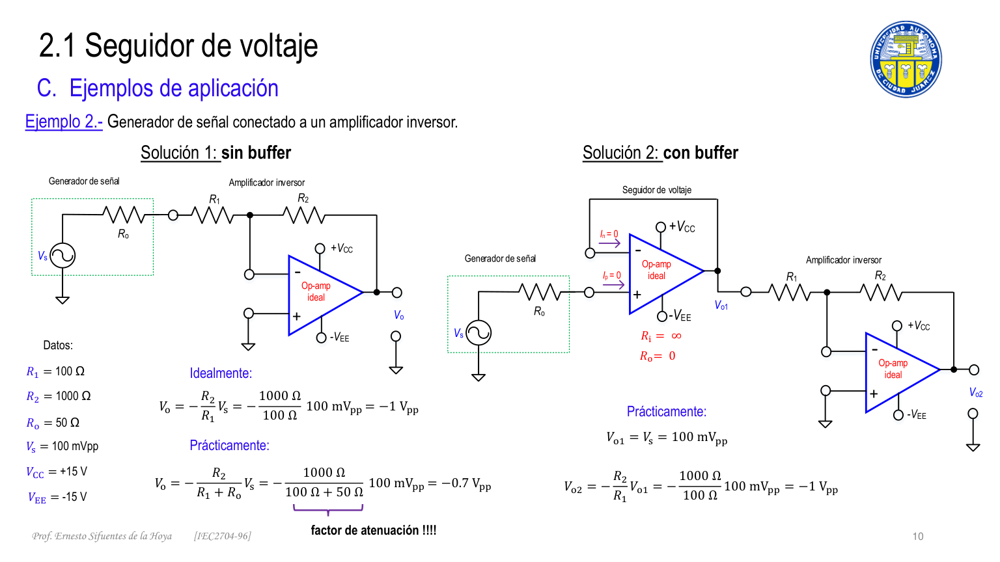

# Lección 4 · Adaptar impedancias {.unnumbered}

¿Cómo se transfiere una señal de voltaje desde una fuente a otro circuito sin que la carga altere apreciablemente la medida? El seguidor de voltaje permite separar eléctricamente dos etapas: **reproduce el voltaje de entrada** pero ofrece, dentro de sus límites reales, una impedancia de entrada elevada y una de salida baja. Esta lección desarrolla el modelo, los dos métodos de análisis, los ejemplos de la presentación y la verificación en Multisim.

::: {#video-l4 .course-actions}
[Ver video de la Lección 4](https://www.youtube.com/watch?v=4DIENz1EHGc){.course-button .course-button-primary target="_blank" rel="noopener"}
[Presentación original (PDF)](../../recursos/semana-06/presentacion-leccion.pdf){.course-button}
[Planificación de la semana (PDF)](../../recursos/semana-06/planificacion.pdf){.course-button}
:::

**Actividad de video — Lección 4.** Vea la presentación en video y elabore **a mano un resumen** que sintetice los conceptos principales, con extensión proporcional al contenido. **Entrega: clase 16 (primera sesión de la semana 6).** Consulte las [entregas de la Semana 6](semana-06.qmd#entregas).

## 2.1. El problema de adaptación de impedancias {#adaptacion-de-impedancias}

Una fuente de señal real puede describirse, en primera aproximación, por su equivalente de Thévenin: una fuente ideal $V_s$ en serie con una resistencia de salida $R_s$. Al conectarla a una carga $R_L$ se forma un divisor de voltaje. Para continua o bajas frecuencias y suponiendo resistencias puras:

$$
I=\frac{V_s}{R_s+R_L},\qquad
V_o=I R_L=V_s\frac{R_L}{R_s+R_L}.
$$

El **factor de transferencia por carga** es

$$
\alpha_L=\frac{V_o}{V_s}=\frac{R_L}{R_s+R_L};\qquad
\varepsilon_L=\left(1-\alpha_L\right)100\%.
$$

Cuando $R_L\gg R_s$, el factor se acerca a uno; cuando $R_L$ es comparable con $R_s$, la señal se atenúa. La fórmula representa un circuito resistivo. En una conexión real, las impedancias varían con la frecuencia y deben emplearse $Z_s(j\omega)$ y $Z_L(j\omega)$ en lugar de resistencias constantes.

{#fig-modelo-carga-l4 fig-alt="Fuente de voltaje con resistencia serie Rs y resistencia de carga RL."}

{#fig-curva-carga-l4 fig-alt="Transferencia sin seguidor para Rs de 50 ohms y comparación con un seguidor ideal."}

**Interpretación física.** No basta con que una fuente tenga el voltaje adecuado en vacío: debe mantenerlo cuando se le demanda corriente. En un sensor, el receptor puede introducir un error sistemático de medida. En una etapa de potencia, la carga puede forzar un suministro de corriente que el op-amp no soporta; adaptar impedancias no implica capacidad ilimitada de manejo de cargas.

## Seguidor de voltaje o buffer {#seguidor-l4}

El seguidor es una configuración de **retroalimentación negativa unitaria**. La señal $V_s$ llega a la entrada no inversora y la salida $V_o$ se conecta directamente a la entrada inversora. El factor de retroalimentación es $\beta=1$. Por ello, esta etapa no está diseñada para aumentar la amplitud de la señal; su función es **aislar la fuente de la carga**.

{#fig-circuito-seguidor-l4 fig-alt="El op amp recibe Vin en la terminal positiva, y la salida regresa directamente a la negativa."}

{fig-alt="Esquema del circuito sobre el seguidor de voltaje."}

### Método 1. Análisis con ganancia abierta finita {#metodo-finito-l4}

Se parte de un modelo *casi ideal*: $I_p\approx I_n\approx0$ y resistencia de salida interna despreciable, **pero** la ganancia en lazo abierto $A_{oc}$ es finita. Por conexión, $V_p=V_s$ y $V_n=V_o$. El modelo del op-amp proporciona

$$
V_o=A_{oc}V_d=A_{oc}(V_p-V_n)=A_{oc}(V_s-V_o).
$$

Agrupando términos se obtiene

$$
V_o(1+A_{oc})=A_{oc}V_s,
\qquad\boxed{A_{CL}=\frac{V_o}{V_s}=\frac{A_{oc}}{1+A_{oc}}}.
$$

La diferencia entre entrada y salida no es estrictamente cero para $A_{oc}$ finita:

$$
V_s-V_o=\frac{V_s}{1+A_{oc}},\qquad
V_d=\frac{V_o}{A_{oc}}.
$$

Por ejemplo, para $A_{oc}=200\,000\ \mathrm{V/V}$ y $V_s=1\ \mathrm V$ en un punto de operación lineal, $A_{CL}=0.999995$ y $V_d\approx5\ \mu\mathrm V$. La igualdad de voltajes es una **aproximación de lazo cerrado**, no una propiedad de cualquier circuito con op-amp.

### Método 2. Análisis con op-amp ideal {#metodo-ideal-l4}

En el límite ideal, $A_{oc}\to\infty$, $I_p=I_n=0$ y, siempre que opere en la región lineal con realimentación negativa, $V_p=V_n$. Como $V_p=V_s$ y $V_n=V_o$, directamente:

$$
\boxed{V_o=V_s,\quad A_{CL}=1\ \mathrm{V/V}}.
$$

Es el **cortocircuito virtual** entre las entradas: no existe un cable que una físicamente ambos terminales y tampoco circula corriente entre ellos. La conexión es funcional por efecto de la retroalimentación. Si el op-amp satura, el análisis ideal deja de ser válido.

{fig-alt="Gráfica temporal de una senoide de un volt pico, con Vin y Vo idénticos."}

### Tutor IA · Demuestre la ganancia del seguidor {#tutor-ganancia-seguidor-l4}

::: {.tutor-box}
::: {.tutor-texto}
Actúe como tutor socrático de Electrónica II y tráteme de usted. Estoy estudiando la Lección 4, seguidor de voltaje. Pídame el esquema, los voltajes de entrada y salida, la ganancia de lazo abierto Aoc y mi primer intento de análisis. Formule solo una pregunta por turno y espere mi respuesta. Guíeme primero para identificar la ruta de retroalimentación, luego para plantear Vo=Aoc(Vp−Vn), y finalmente para deducir la ganancia en lazo cerrado con Aoc finita y su límite ideal. No me proporcione de inmediato la deducción completa. Compruebe unidades en V/V, el signo de la realimentación y las condiciones de operación lineal. Pídame que explique por qué la ganancia próxima a uno no equivale a una salida capaz de suministrar cualquier corriente.
:::

::: {.tutor-acciones}
[Abrir ChatGPT](https://chatgpt.com/){.course-button target="_blank" rel="noopener"}
:::
:::

## Impedancias de entrada y salida {#impedancias-reales-l4}

La impedancia de entrada de un op-amp real es grande, pero no infinita. Como primera aproximación de un seguidor de realimentación negativa, la resistencia de entrada efectiva aumenta y la de salida disminuye respecto al amplificador sin realimentar. Para una realimentación de voltaje idealizada:

$$
R_{in,CL}\simeq R_{in}(1+T),\qquad
R_{out,CL}\simeq \frac{R_{out}}{1+T},\qquad T=A_{oc}\beta.
$$

Estas relaciones son **modelos orientativos**: dependen del tipo de red de realimentación, la frecuencia, el propio op-amp y la carga. La ganancia de lazo $T(j\omega)$ disminuye al aumentar la frecuencia; por ello, el aislamiento tampoco es ideal en todo el espectro. En el laboratorio conviene distinguir:

- **Impedancia de entrada alta:** la etapa extrae muy poca corriente de la fuente.
- **Impedancia de salida baja:** la salida ideal sufre poca caída de voltaje al conectar una carga admisible.
- **Capacidad de corriente y excursión limitada:** un TL084 no equivale a una fuente ideal, particularmente con cargas de decenas de ohms o alimentación simple próxima a los rieles.

## Ejemplo 1. Divisor de 9 V con carga {#ejemplo-1-l4}

La presentación plantea una batería de $9\ \mathrm V$, un divisor con $R_1=R_2=10\ \mathrm{k\Omega}$ y un circuito que requiere aproximadamente $4.5\ \mathrm V$ y una corriente cercana a $4\ \mathrm{mA}$. Se modela la carga como $R_L=1\ \mathrm{k\Omega}$, que a $4.5\ \mathrm V$ demandaría $4.5\ \mathrm{mA}$.

**Paso 1. Divisor sin carga.** El voltaje del equivalente de Thévenin y su resistencia son:

$$
V_{Th}=9\frac{10\,000}{10\,000+10\,000}=4.5\ \mathrm V,
\qquad R_{Th}=R_1\parallel R_2=5\ \mathrm{k\Omega}.
$$

**Paso 2. Conexión directa de la carga.** Debido a la corriente que se demanda, el voltaje cae a

$$
V_{o,\mathrm{sin\ buffer}}=4.5\frac{1000}{5000+1000}
=\boxed{0.75\ \mathrm V},
\quad I_L=\frac{0.75}{1000}=0.75\ \mathrm{mA}.
$$

**Paso 3. Con seguidor ideal.** El divisor no entrega corriente apreciable a la entrada del op-amp, por lo que sigue en $4.5\ \mathrm V$. La salida ideal del seguidor reproduce ese valor; así, $V_o\approx4.5\ \mathrm V$ e $I_L\approx4.5\ \mathrm{mA}$.

{fig-alt="Lámina con el divisor de 9 V, equivalente de Thévenin y dos alternativas de carga."}

| Condición | $V_o$ teórico | $I_L$ teórico | Interpretación |
|:--|--:|--:|:--|
| Divisor sin carga | 4.50 V | 0 | Voltaje nominal en vacío |
| Divisor cargado, sin buffer | 0.75 V | 0.75 mA | Se aprecia una caída importante |
| Divisor con buffer **ideal** | 4.50 V | 4.50 mA | La fuente de alimentación del op-amp aporta la corriente a la carga |

::: {.callout-note}
### Tutor IA · Diagnostique el efecto de carga {#tutor-carga-buffer-l4}

::: {.tutor-box}
::: {.tutor-texto}
Actúe como tutor de Electrónica II y tráteme de usted. Trabajo en la Lección 4, ejemplo del divisor de 9 V con R1=R2=10 kΩ y una carga de 1 kΩ, comparando conexión directa y conexión con seguidor. Pídame primero mi circuito y mis valores calculados, simulados y medidos, si los tengo. Haga una sola pregunta por turno y espere mi respuesta. Ayúdeme a obtener el equivalente de Thévenin, a identificar la atenuación debida a la carga y a distinguir la potencia que suministra el op-amp de la que proporciona el divisor. Revise las unidades V, mA y kΩ y el margen de corriente y voltaje de salida del modelo real. No invente resultados experimentales y no me entregue los números finales antes de que yo intente el cálculo.
:::

::: {.tutor-acciones}
[Abrir ChatGPT](https://chatgpt.com/){.course-button target="_blank" rel="noopener"}
:::
:::

## Consideración de implementación

El resultado de $4.5\ \mathrm V$ corresponde al **modelo ideal empleado en la presentación**. No debe asumirse que un TL084 alimentado con una sola batería de 9 V pueda reproducir esa tensión y proporcionar 4.5 mA en todas las condiciones. Verifique alimentación permitida, rango de modo común, excursión y corriente de salida en la hoja de datos. Para **alimentar de forma estable** un microcontrolador o sensor, un regulador de tensión apropiado suele ser una solución más adecuada que un divisor seguido de un op-amp.
:::

## Ejemplo 2. Generador de señales y amplificador inversor {#ejemplo-2-l4}

La presentación compara un generador de impedancia de salida $R_o=50\ \Omega$ conectado a un inversor con $R_1=100\ \Omega$ y $R_2=1000\ \Omega$. La señal del generador tiene $100\ \mathrm{mV_{pp}}$. En el modelo ideal del inversor, con una fuente sin resistencia serie, la ganancia sería $-R_2/R_1=-10$.

**Sin buffer**, la resistencia del generador se suma a $R_1$ en el trayecto de entrada. La ganancia con respecto a la fuente ideal se reduce:

$$
V_{o,1}=-\frac{R_2}{R_o+R_1}V_s
=-\frac{1000}{50+100}(0.1\ \mathrm{V_{pp}})
\approx -0.667\ \mathrm{V_{pp}}.
$$

**Con buffer ideal**, $R_o$ queda separado de la entrada del inversor. La tensión de excitación en la entrada de la segunda etapa es aproximadamente la del generador:

$$
V_{o,2}=-\frac{R_2}{R_1}V_s
=-10(0.1\ \mathrm{V_{pp}})
=-1.0\ \mathrm{V_{pp}}.
$$

El signo negativo indica **inversión de fase**; en un osciloscopio se observaría una amplitud pico a pico positiva con la forma de onda invertida. La presentación redondea el caso sin buffer a $-0.7\ \mathrm{V_{pp}}$.

{fig-alt="Esquemas de un generador de 50 ohm conectado al inversor y un seguidor como etapa intermedia."}

## Aplicación a instrumentación: sensor y ADC {#sensor-adc-l4}

Los [ejercicios de la Lección 4](ejercicios-l4.qmd) plantean un sensor de temperatura **TMP36** con impedancia de salida aproximada $R_s=100\ \Omega$ y una entrada analógica de Arduino modelada en el enunciado mediante $R_e=10\ \mathrm{k\Omega}$. Si se aplicara literalmente ese modelo **resistivo**, el factor de carga sería:

$$
\alpha_L=\frac{10\,000}{10\,000+100}=0.990099,
\qquad \varepsilon_L\approx0.9901\%.
$$

Con un seguidor ideal entre sensor y entrada analógica, el factor de carga tendería a desaparecer, siempre que el op-amp elegido admita la alimentación y las tensiones del sistema. **Importante:** la entrada analógica de un microcontrolador también involucra muestreo, capacitancia y tiempos de adquisición; el valor fijo $R_e$ procede del **modelo didáctico del ejercicio**, no de una garantía universal de las entradas Arduino.

## Reproducción de los ejemplos en Multisim {#simulaciones-l4}

Primero observe los esquemas y resultados de las diapositivas 9, 11 y 12 de la [presentación](../../recursos/semana-06/presentacion-leccion.pdf). Después abra las parejas de archivos con las mismas condiciones de excitación y registre la razón $V_o/V_s$ y, para señales senoidales, la amplitud y la fase. Los archivos `.ms13` y `.ms14` requieren una versión compatible de NI Multisim.

| Caso de estudio | Sin buffer | Con buffer |
|:--|:--|:--|
| Ejemplo 1: divisor de voltaje | [Simulación sin buffer (.ms14)](../../recursos/semana-06/simulaciones/ejercicio-1-sin-buffer.ms14){download="ejercicio-1-sin-buffer.ms14"} | [Simulación con buffer (.ms14)](../../recursos/semana-06/simulaciones/ejercicio-1-con-buffer.ms14){download="ejercicio-1-con-buffer.ms14"} |
| Ejemplo 2: entrada de inversor | [Simulación sin buffer (.ms14)](../../recursos/semana-06/simulaciones/ejercicio-2-sin-buffer.ms14){download="ejercicio-2-sin-buffer.ms14"} | [Simulación con buffer (.ms14)](../../recursos/semana-06/simulaciones/ejercicio-2-con-buffer.ms14){download="ejercicio-2-con-buffer.ms14"} |

[Práctica 3: seguidor de voltaje](practica-03-seguidor.qmd){.course-button} [Ejercicio de diseño: TMP36–Arduino](ejercicios-l4.qmd){.course-button}

## Síntesis y preguntas para estudiar {#sintesis-l4}

1. Justifique por qué una impedancia de entrada alta evita que la fuente se cargue, pero no garantiza que la **salida** pueda alimentar cualquier carga.
2. Demuestre $A_{CL}=A_{oc}/(1+A_{oc})$ y explique por qué $V_p\approx V_n$ solo resulta válido en la región lineal con realimentación negativa.
3. Explique por qué una fuente de 9 V con dos resistencias de $10\ \mathrm{k\Omega}$ no conserva $4.5\ \mathrm V$ al conectar una carga de $1\ \mathrm{k\Omega}$.
4. Distinga la amplitud en $\mathrm{V_{pp}}$ de la medida en $\mathrm{V_{RMS}}$, y anticipe qué cambia al insertar el buffer entre el generador y el inversor.
5. Consulte la documentación del TL084 y determine las restricciones más importantes para reproducir los circuitos reales de la práctica.
