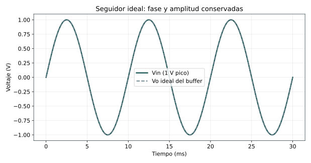

# Práctica 3 · Seguidor de voltaje (Buffer) {.unnumbered}

La práctica verifica la **ganancia unitaria** y la **reducción del efecto de carga** mediante simulación y medición experimental. Corresponde a la sesión 2 (clase 17) de la Semana 6 y se basa en la guía original del curso.

::: {.course-actions}
[Guía oficial de la Práctica 3 (PDF)](../../recursos/semana-06/practica-original.pdf){.course-button .course-button-primary}
[Volver a la Lección 4](adaptar-impedancias.qmd){.course-button}
:::

## Objetivo y material {#objetivo-practica-3}

Comprobar la relación $V_o\approx V_{in}$ de un seguidor TL084 y comparar la atenuación por efecto de carga antes y después de insertar el buffer. Según la guía: Multisim, TL084 o similar, dos resistencias de $47\ \Omega$, y resistencias de $470\ \Omega$, $1\ \mathrm{k\Omega}$, $10\ \mathrm{k\Omega}$, $1\ \mathrm{M\Omega}$; protoboard, fuente dual, generador, osciloscopio y multímetro.

## Fundamento de la medición

La conexión directa de salida a entrada inversora produce

$$
V_o=\frac{A_{oc}}{1+A_{oc}}V_{in}\approx V_{in}.
$$

Sin buffer, un generador con resistencia de salida $R_o$ entrega a la carga $R_L$:

$$
V_o=V_{in}\frac{R_L}{R_o+R_L}.
$$

Para una senoide de pico $V_p=1\ \mathrm V$ y frecuencia $100\ \mathrm{Hz}$, se espera $V_{RMS}=V_p/\sqrt{2}\approx0.707\ \mathrm V$ **solo si la onda medida es senoidal sin distorsión**. Una carga muy pequeña puede exigir al op-amp más corriente que la permitida.

## Procedimiento A. Ganancia unitaria por simulación {#experimento-a-l4}

1. Abra el circuito [TL084 seguidor de voltaje (.ms13)](../../recursos/semana-06/simulaciones/tl084-seguidor-de-voltaje.ms13){download="tl084-seguidor-de-voltaje.ms13"} o reconstruya la figura 2 de la guía.
2. Configure $V_{in}(t)=1\operatorname{sen}(2\pi\cdot100t)\ \mathrm V$, alimentación y puntos de medición según el circuito de la guía.
3. Observe en el osciloscopio y en el graficador $V_{in}$ y $V_o$ simultáneamente. Registre las amplitudes pico, la fase, $V_{RMS}$ y la forma de onda.
4. Compare $A_{CL}=V_{o,p}/V_{in,p}$ con la ganancia ideal de una unidad y explique cualquier discrepancia.

{fig-alt="Senoide de 1 V pico a 100 Hz, comparando entrada y salida ideales."}

## Procedimiento B. Efecto de carga sin buffer {#experimento-b-l4}

1. Reproduzca la figura 4a de la guía mediante la [simulación del efecto de carga (.ms13)](../../recursos/semana-06/simulaciones/simulacion-del-efecto-de-carga.ms13){download="simulacion-del-efecto-de-carga.ms13"}.
2. Mantenga la señal de entrada senoidal de $1\ \mathrm V$ pico y $100\ \mathrm{Hz}$. Según la guía, varíe $R_L$ entre $47$, $470$, $1000$, $10\,000$ y $1\,000\,000\ \Omega$.
3. Calcule con $V_o/V_{in}=R_L/(R_o+R_L)$ la atenuación teórica y complete la tabla 1 original con las lecturas RMS de Multisim.
4. Explique por qué $V_o$ disminuye conforme $R_L$ se aproxima a $R_o$.

## Procedimiento C. Efecto de carga con buffer {#experimento-c-l4}

1. Abra [Adaptador de impedancias con un seguidor (.ms13)](../../recursos/semana-06/simulaciones/adaptador-de-impedancias-con-un-seguidor-de-voltaje.ms13){download="adaptador-de-impedancias-con-un-seguidor-de-voltaje.ms13"} o implemente el circuito de la figura 5a.
2. Mantenga la misma excitación e idénticos cinco valores de carga; complete la tabla 2 de la guía.
3. Compare las dos tablas (sin/con buffer) y examine los casos en que la corriente solicitada por la carga altera el resultado real del TL084.

## Procedimiento D. Comprobación en protoboard {#experimento-d-l4}

La guía solicita repetir el ensayo con un generador configurado para resistencia de salida de $50\ \Omega$, la señal $V_{in}(t)=1\operatorname{sen}(2\pi\cdot100t)\ \mathrm V$ y las cinco cargas anteriores. Mida $V_{in}$ **en el punto de referencia definido** y $V_o$ en el receptor. Registre alimentación, salida del generador, osciloscopio y voltaje RMS. La corriente demandada puede aproximarse por $I_{L,p}=V_{o,p}/R_L$.

::: {.callout-warning}
## Límite práctico importante

Una carga de $47\ \Omega$ con $1\ \mathrm V$ pico requeriría $21.3\ \mathrm{mA}$ pico en un buffer ideal. Antes de conectar el TL084, **verifique su capacidad de salida y las condiciones de alimentación**. Si el dispositivo no admite esa corriente, utilice la prueba únicamente en simulación ideal o ajuste la excitación/carga con supervisión docente. No atribuya un recorte o una desviación a una falla del principio de adaptación sin revisar las especificaciones.
:::

## Registro de resultados {#tabla-resultados-practica-3}

La siguiente tabla reproduce los cinco valores de carga de la guía. Complete por separado el cálculo, la simulación y la medición. No invente medidas para celdas experimentales no obtenidas.

| $R_L$ (Ω) | $V_{o,RMS}$ sin buffer | $V_{o,RMS}$ con buffer | Error de carga sin buffer (%) | Error con buffer (%) |
|--:|:--:|:--:|:--:|:--:|
| 47 | — | — | — | — |
| 470 | — | — | — | — |
| 1 000 | — | — | — | — |
| 10 000 | — | — | — | — |
| 1 000 000 | — | — | — | — |

Calcule la atenuación para condiciones consistentes mediante

$$
\varepsilon_L=\frac{|V_{in,RMS}-V_{o,RMS}|}{|V_{in,RMS}|}\,100\%.
$$

Documente también las limitaciones de carga, la impedancia de salida del generador y cualquier ajuste hecho durante la práctica.

## Aplicación adicional: acondicionamiento de sensor {#aplicacion-sensor-practica-3}

La figura 6 y tabla 4 del documento original utilizan un **sensor con resistencia de salida**, un buffer y un amplificador no inversor posterior. Dibuje el trayecto de la señal, calcule la ganancia del segundo bloque $1+R_2/R_1$ y razone por qué el seguidor desacopla la fuente de esta etapa. Reporte voltajes en cada nodo y errores de carga, antes de atribuir toda la amplificación al seguidor.

### Tutor IA · Interprete la Práctica 3 {#tutor-practica-3-seguidor}

::: {.tutor-box}
::: {.tutor-texto}
Actúe como tutor de laboratorio de Electrónica II y tráteme de usted. Estoy realizando la Práctica 3, seguidor TL084 y efecto de carga con y sin buffer, con una señal de 1 V pico a 100 Hz. Pídame la tabla de los cinco valores de carga (47 Ω, 470 Ω, 1 kΩ, 10 kΩ y 1 MΩ), los voltajes RMS obtenidos, la resistencia de salida del generador y la configuración de las fuentes. Revise conmigo una fila por turno; espere mi respuesta antes de continuar. Ayúdeme a calcular la atenuación porcentual comparando señales de la misma definición, a separar el valor teórico del simulado y del medido, y a explicar por qué una carga muy pequeña puede exigir demasiada corriente al TL084. Si el caso excede las especificaciones, indíqueme que no se monte físicamente sin verificación y supervisión docente. No invente mediciones ni complete el reporte por mí.
:::

::: {.tutor-acciones}
[Abrir ChatGPT](https://chatgpt.com/){.course-button target="_blank" rel="noopener"}
:::
:::

## Evidencia e informe {#informe-practica-3}

Incluya el esquema de cada ensayo, cálculos teóricos, archivos Multisim, capturas temporales, tablas de mediciones, comparación entre modelo ideal y comportamiento real, posibles causas de error y conclusiones. El [reporte de la Práctica 3](../07/semana-07.qmd#entregas) se entrega conforme a la planificación de la Semana 7.
