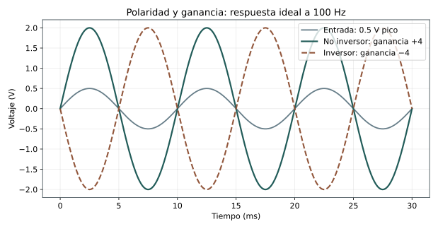
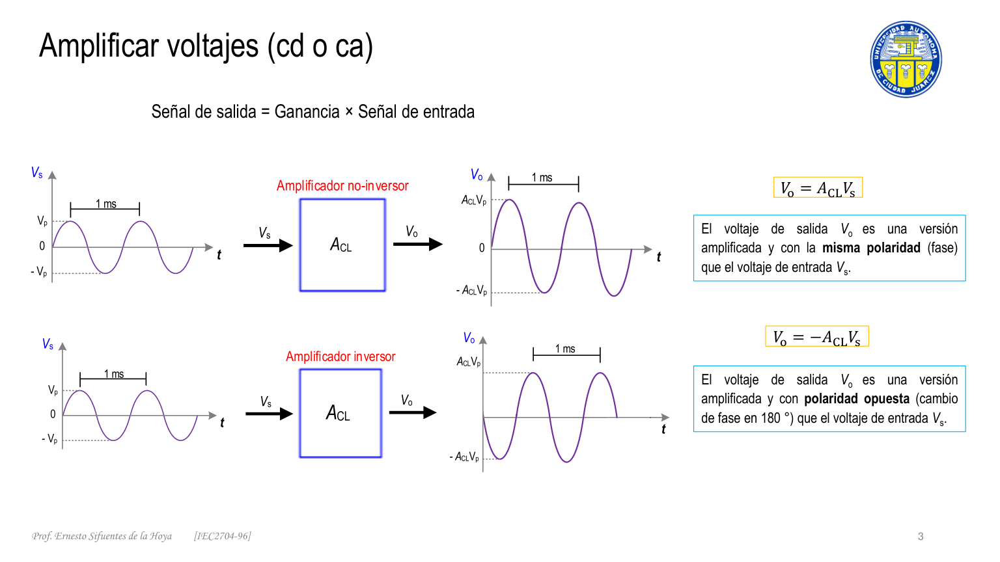
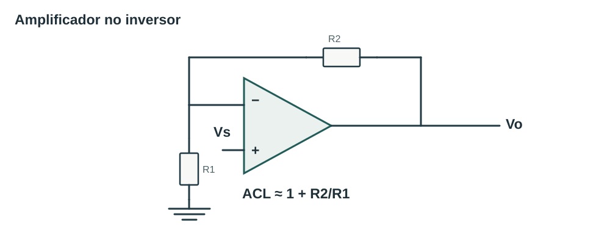
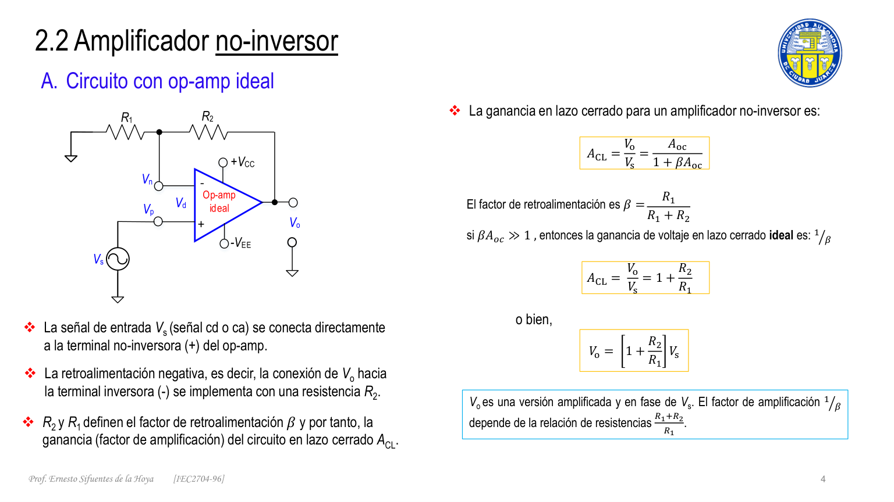
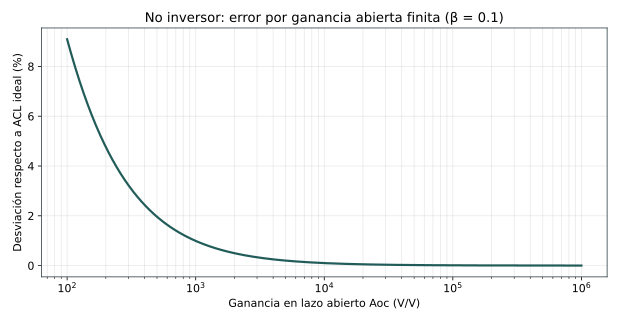
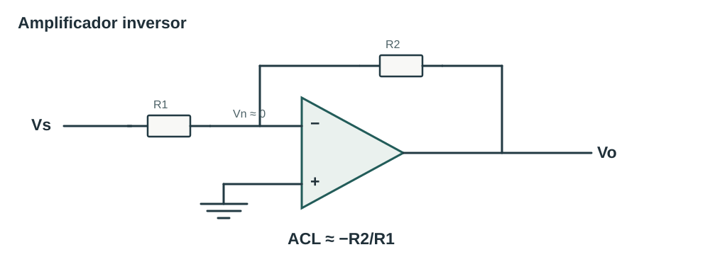
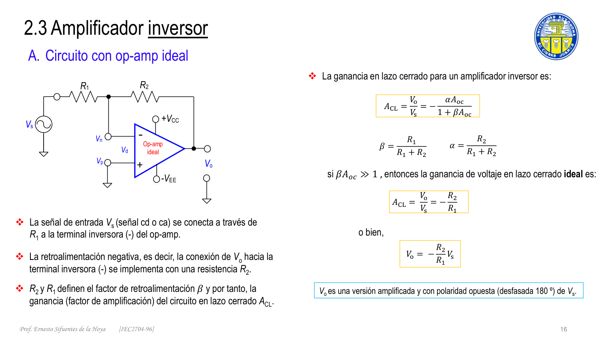
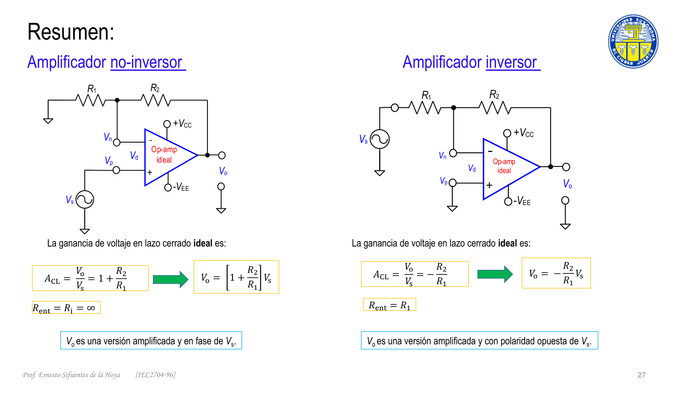

# Lección 5 · Amplificar e invertir voltajes {.unnumbered}

En la Lección 4 se utilizó la retroalimentación negativa para obtener ganancia unitaria y aislar dos circuitos. Ahora se emplean **redes resistivas de realimentación** para fijar la magnitud y el signo de la ganancia. Se estudiarán dos configuraciones fundamentales: **amplificador no inversor** (salida en fase) y **amplificador inversor** (salida con polaridad opuesta). El desarrollo sigue las dos técnicas de análisis y los ejemplos de la presentación docente.

::: {#video-l5 .course-actions}
[Ver video de la Lección 5](https://www.youtube.com/watch?v=N_pxayWx7eg){.course-button .course-button-primary target="_blank" rel="noopener"}
[Presentación original de la Lección 5 (PDF)](../../recursos/semana-07/presentacion-leccion.pdf){.course-button}
[Planificación de la Semana 7](../../recursos/semana-07/planificacion.pdf){.course-button}
[Práctica 4](practica-04-amplificadores.qmd){.course-button}
:::

**Actividad de video — Lección 5.** Vea la presentación en video y elabore **a mano un resumen** que sintetice los conceptos principales, con extensión proporcional al contenido. **Entrega: clase 19 (primera sesión de la semana 7).** Consulte las [entregas de la Semana 7](semana-07.qmd#entregas).

## Panorama de las dos configuraciones {#panorama-l5}

La ecuación general de una etapa lineal es $V_o=A_{CL}V_s$, donde $A_{CL}$ representa la ganancia de voltaje en lazo cerrado. Si $A_{CL}>0$, la salida conserva el signo de la entrada; si $A_{CL}<0$, una entrada positiva produce una salida negativa, siempre dentro de los límites de operación.

{#fig-polaridad-l5 fig-alt="Tres curvas: senoide de entrada, amplificación positiva y amplificación negativa."}

{fig-alt="Esquema que compara la amplificación sin invertir y con inversión."}

En ambas configuraciones deben verificarse **primero** las fuentes de alimentación, el rango de modo común, la excursión de salida, la frecuencia y la capacidad de corriente. El op-amp ideal permite obtener ecuaciones sencillas, pero no elimina las restricciones de un componente real.

## 2.2. Amplificador no inversor {#amplificador-no-inversor-l5}

La señal $V_s$ se aplica directamente a la entrada **no inversora** $(+)$. La resistencia $R_2$ conecta la salida con la entrada inversora $(-)$ y $R_1$ conecta este último nodo a tierra. La red resistiva devuelve una fracción de la salida:

$$
V_p=V_s,\qquad V_n=\beta V_o,\qquad
\beta=\frac{R_1}{R_1+R_2}.
$$

{#fig-no-inversor-l5 fig-alt="Op amp no inversor: señal en terminal positiva y divisor R2 R1 conectado a terminal negativa."}

{fig-alt="Esquema y expresiones de la ganancia del amplificador no inversor."}

### Método 1. Modelo con ganancia abierta finita {#no-inversor-finito-l5}

Utilice el modelo lineal del op-amp $V_o=A_{oc}(V_p-V_n)$. Sustituyendo $V_p=V_s$ y $V_n=\beta V_o$:

$$
V_o=A_{oc}(V_s-\beta V_o)
\quad\Longrightarrow\quad
V_o(1+\beta A_{oc})=A_{oc}V_s.
$$

De ahí se obtiene la expresión completa para lazo cerrado:

$$
\boxed{A_{CL}=\frac{V_o}{V_s}=\frac{A_{oc}}{1+\beta A_{oc}}},
\qquad
V_d=V_p-V_n=\frac{V_s}{1+\beta A_{oc}}.
$$

La **ganancia de lazo** es $T=\beta A_{oc}$. Si $|T|\gg1$ y el circuito está en la región lineal, la sensibilidad de $A_{CL}$ ante una variación de $A_{oc}$ es pequeña. Si la frecuencia aumenta y $|A_{oc}(j\omega)|$ disminuye, el resultado ideal puede dejar de ser suficiente.

### Método 2. Análisis ideal mediante LCK {#no-inversor-ideal-l5}

Suponga $I_p=I_n=0$ y un cortocircuito virtual $V_n\approx V_p=V_s$. Como no entra corriente al terminal inversor, la corriente que llega por $R_2$ coincide con la que circula por $R_1$:

$$
\frac{V_o-V_s}{R_2}=\frac{V_s}{R_1}.
$$

Despejando:

$$
\boxed{A_{CL,\mathrm{ideal}}=1+\frac{R_2}{R_1}},
\qquad
\boxed{V_o=\left(1+\frac{R_2}{R_1}\right)V_s}.
$$

Por tanto, la ganancia ideal del no inversor es mayor o igual a uno si $R_1$ y $R_2$ son resistencias positivas. En el modelo ideal, la impedancia de entrada es elevada porque la señal llega directamente al terminal no inversor; la impedancia de salida disminuye con la realimentación.

### Ejemplo 1. Efecto de una ganancia abierta finita {#ejemplo-1-l5}

Con $R_1=20\ \mathrm{k\Omega}$, $R_2=180\ \mathrm{k\Omega}$ se tiene $\beta=0.1$ y $A_{CL,\mathrm{ideal}}=10$. La ganancia real calculada con el modelo anterior depende de $A_{oc}$:

| $A_{oc}$ (V/V) | $\beta A_{oc}$ | $A_{CL}$ calculada (V/V) | Desviación frente a 10 (%) |
|--:|--:|--:|--:|
| 100 | 10 | 9.0909 | 9.091 |
| 1 000 | 100 | 9.9010 | 0.990 |
| 10 000 | 1 000 | 9.9900 | 0.100 |
| 100 000 | 10 000 | 9.9990 | 0.010 |
| 1 000 000 | 100 000 | 9.9999 | 0.001 |

Los valores se calculan mediante el modelo de ganancia finita, evitando aproximaciones por redondeo. La tendencia importante es que al aumentar la ganancia de lazo, la desviación disminuye.

{#fig-error-real-l5 fig-alt="La desviación decrece cuando la ganancia abierta aumenta."}

### Ejemplo 2. Comprobación del cortocircuito virtual {#ejemplo-2-l5}

Utilice $A_{oc}=200\,000\ \mathrm{V/V}$, $R_1=20\ \mathrm{k\Omega}$, $R_2=180\ \mathrm{k\Omega}$ y $V_s=1\ \mathrm V$.

$$
A_{CL}=\frac{200\,000}{1+20\,000}=9.99950,
\quad V_o\approx9.99950\ \mathrm V,
\quad V_n=0.1V_o\approx0.99995\ \mathrm V.
$$

Por consiguiente, $V_p=1\ \mathrm V$ y $V_d=V_p-V_n\approx49.9975\ \mu\mathrm V$. Los dos terminales tienen **tensiones casi iguales** en operación lineal. La condición de ejemplo de la presentación supone alimentación de $\pm15\ \mathrm V$; aun así, hay que verificar la excursión real disponible con el modelo de op-amp utilizado.

[Archivo Multisim del cortocircuito virtual (.ms14)](../../recursos/semana-07/simulaciones/ejemplo-2-comprobacion-cortocircuito-virtual.ms14){.course-button download="ejemplo-2-comprobacion-cortocircuito-virtual.ms14"}

### Ejemplo 3. Ganancia no inversora ajustable {#ejemplo-3-l5}

Considere $1\le A_{CL}\le5$ con un potenciómetro de $100\ \mathrm{k\Omega}$ empleado como $R_2$. Para $A_{CL,\mathrm{max}}=5$:

$$
R_1=\frac{R_{2,\mathrm{max}}}{A_{CL,\mathrm{max}}-1}
=\frac{100\ \mathrm{k\Omega}}{5-1}=\boxed{25\ \mathrm{k\Omega}}.
$$

Si $R_2$ varía de $0$ a $100\ \mathrm{k\Omega}$, la ganancia ideal pasa de 1 a 5. Con $V_s=0.05\ \mathrm V$ pico, la salida queda entre $0.05$ y $0.25\ \mathrm V$ pico. En la práctica, la conexión del potenciómetro debe evitar un circuito abierto que deje la realimentación indefinida.

[Simulación original de ganancia variable (.ms14)](../../recursos/semana-07/simulaciones/ejemplo-3-amplificador-ganancia-variable-b.ms14){.course-button download="ejemplo-3-amplificador-ganancia-variable-b.ms14"}

### Ejemplo 4. Dos opciones con TL084 {#ejemplo-4-l5}

Para $V_s(t)=0.5\operatorname{sen}(2\pi100t)\ \mathrm V$ (valor pico) y alimentación indicada de $\pm15\ \mathrm V$, el material presenta estas opciones:

| $R_1$ | $R_2$ | $A_{CL}$ ideal | Amplitud esperada $V_{o,p}$ |
|--:|--:|--:|--:|
| 10 kΩ | 100 kΩ | +11 | 5.5 V pico |
| 100 kΩ | 10 kΩ | +1.1 | 0.55 V pico |

En un osciloscopio, ambas formas de onda se esperan **en fase**. La salida solo reproducirá esos valores si el modelo del TL084 admite tal amplitud y la carga no provoca saturación o recorte. La [Práctica 4](practica-04-amplificadores.qmd) amplía la comprobación por variación de resistencias.

### Tutor IA · Deduzca el no inversor {#tutor-no-inversor-l5}

::: {.tutor-box}
::: {.tutor-texto}
Actúe como tutor socrático de Electrónica II y tráteme de usted. Estoy estudiando la Lección 5, amplificador no inversor. Pídame las conexiones de R1 y R2, la excitación en Vp, el modelo del op-amp y mi primer desarrollo. Presente una sola pregunta por turno y espere mi respuesta. Lléveme a identificar el factor beta, a aplicar el modelo con ganancia abierta finita y después a obtener, justificando sus hipótesis, la expresión ideal 1+R2/R1. Revise si la salida está en fase, si la ganancia se expresa en V/V, y si es válida la aproximación Vp≈Vn. Con mis datos, ayúdeme a anticipar saturación y limitaciones de amplitud. No proporcione el resultado final sin que yo haya intentado cada paso.
:::

::: {.tutor-acciones}
[Abrir ChatGPT](https://chatgpt.com/){.course-button target="_blank" rel="noopener"}
:::
:::

## 2.3. Amplificador inversor {#amplificador-inversor-l5}

La fuente $V_s$ se conecta a través de $R_1$ al terminal inversor $(-)$. La resistencia de realimentación $R_2$ conecta ese terminal a la salida; la entrada no inversora $(+)$ se referencia a tierra. La corriente que ingresa por $R_1$ debe circular, aproximadamente, a través de $R_2$ porque el op-amp ideal no absorbe corriente de entrada.

{#fig-inversor-l5 fig-alt="Señal a través de R1 a terminal negativa, realimentación R2 y terminal positiva a tierra."}

{fig-alt="Circuito inversor y expresiones de ganancia del circuito."}

### Método 1. Superposición y modelo finito {#inversor-finito-l5}

La tensión en el nodo inversor proviene tanto de la fuente como de la salida. Si no entra corriente al op-amp, por superposición:

$$
V_n=\underbrace{\frac{R_2}{R_1+R_2}}_{\alpha}V_s
+\underbrace{\frac{R_1}{R_1+R_2}}_{\beta}V_o,
\qquad V_p=0.
$$

Como $V_o=A_{oc}(V_p-V_n)=-A_{oc}(\alpha V_s+\beta V_o)$, resulta

$$
\boxed{A_{CL}=-\frac{\alpha A_{oc}}{1+\beta A_{oc}}},
\quad\alpha=\frac{R_2}{R_1+R_2},\quad
\beta=\frac{R_1}{R_1+R_2}.
$$

Este modelo permite calcular el error de la ganancia cuando $A_{oc}$ no es infinita. La polaridad negativa surge de la conexión de la entrada y el cierre de lazo, no de una convención arbitraria.

### Método 2. Nodo de suma y tierra virtual {#inversor-ideal-l5}

En régimen lineal con realimentación negativa, $V_p=0$ y por cortocircuito virtual $V_n\approx0$. La corriente por la resistencia de entrada es $I_1=(V_s-V_n)/R_1$, y la que circula por la resistencia de retorno es $I_2=(V_n-V_o)/R_2$. Por LCK, $I_1=I_2$:

$$
\frac{V_s-0}{R_1}=\frac{0-V_o}{R_2},
\quad\boxed{A_{CL,\mathrm{ideal}}=-\frac{R_2}{R_1}},
\quad\boxed{V_o=-\frac{R_2}{R_1}V_s}.
$$

El nodo $V_n$ es **tierra virtual**: está casi a 0 V sin conectarse físicamente a tierra. En el modelo ideal, la impedancia que ve el generador es aproximadamente $R_{in}=R_1$, por lo que la **resistencia de salida de la fuente** debe tenerse en cuenta si es apreciable. Ese fue el motivo del buffer estudiado en la Lección 4.

### Ejemplo 6. Error por ganancia abierta finita {#ejemplo-6-l5}

La presentación utiliza $R_1=10\ \mathrm{k\Omega}$ y $R_2=100\ \mathrm{k\Omega}$: la ganancia ideal es $-10$, mientras que $\alpha=10/11$, $\beta=1/11$. Por ejemplo, con $A_{oc}=1000$:

$$
A_{CL}=-\frac{(10/11)1000}{1+(1/11)1000}
=\boxed{-9.8901\ \mathrm{V/V}}.
$$

Al aumentar $A_{oc}$ a $200\,000$, la ganancia calculada se acerca a $-10$. Contraste este error con el del ejemplo 1 y explique por qué **ambas configuraciones mejoran su precisión relativa** al aumentar la ganancia de lazo.

### Ejemplo 7. Tierra virtual y salida negativa {#ejemplo-7-l5}

Para $R_1=10\ \mathrm{k\Omega}$, $R_2=100\ \mathrm{k\Omega}$, $V_s=1\ \mathrm V$ y $A_{oc}=200\,000$:

$$
A_{CL}= -\frac{(10/11)200\,000}{1+(1/11)200\,000}
\approx -9.99945,
\quad V_o\approx-9.99945\ \mathrm V.
$$

En el modelo realimentado de continua, $V_n=-V_o/A_{oc}\approx49.997\ \mu\mathrm V$, una diferencia muy pequeña respecto a tierra. Sin retroalimentación, el mismo modelo de gran ganancia impulsaría la salida hacia saturación. Compruebe que $V_o$ calculado cabe en la excursión permitida.

[Simulación de tierra virtual (.ms14)](../../recursos/semana-07/simulaciones/ejemplo-7-amplificador-inversor-cc-virtual-b.ms14){.course-button download="ejemplo-7-amplificador-inversor-cc-virtual-b.ms14"}

### Ejemplos 8 y 9. Diseño y comprobación {#ejemplo-8-9-l5}

**Ejemplo 8.** Para una ganancia inversora de $-5$, elija $R_1=20\ \mathrm{k\Omega}$ y $R_2=100\ \mathrm{k\Omega}$. Si $V_s$ tiene $0.05\ \mathrm V$ pico, $V_o$ tiene magnitud $0.25\ \mathrm V$ pico **e inversión de fase**: $V_o(t)=-0.25\operatorname{sen}(2\pi ft)\ \mathrm V$.

**Ejemplo 9.** En la comprobación con TL084 y la tarjeta NI myDAQ, la presentación compara $R_1=10\ \mathrm{k\Omega}$, $R_2=100\ \mathrm{k\Omega}$ (ganancia $-10$), frente a $R_1=100\ \mathrm{k\Omega}$, $R_2=10\ \mathrm{k\Omega}$ (ganancia $-0.1$). Para $V_s(t)=0.5\operatorname{sen}(2\pi100t)$, las salidas ideales tienen amplitudes pico de $5\ \mathrm V$ y $0.05\ \mathrm V$, respectivamente, y están invertidas.

### Tutor IA · Analice el inversor y la tierra virtual {#tutor-inversor-l5}

::: {.tutor-box}
::: {.tutor-texto}
Actúe como tutor de Electrónica II y tráteme de usted. Estoy estudiando la Lección 5, configuración inversora. Solicite el esquema, R1, R2, la referencia de tierra, la alimentación y mi ecuación del nodo de suma. Guíeme con una pregunta a la vez; espere mi respuesta para continuar. Primero determine conmigo qué terminal está realmente a tierra y cuál tiene una tierra virtual; después use LCK para comprobar signo y magnitud de Vo/Vin. Si quiero, contraste el caso ideal con ganancia abierta finita usando los datos de la lección. No suponga que el voltaje RMS tenga signo ni que la fase de 180 grados implique un valor RMS negativo. Concluya preguntándome cómo validaría el resultado en Multisim.
:::

::: {.tutor-acciones}
[Abrir ChatGPT](https://chatgpt.com/){.course-button target="_blank" rel="noopener"}
:::
:::

## Comparación y límites de la operación real {#comparacion-l5}

| Característica | No inversor | Inversor |
|:--|:--|:--|
| Terminal de la fuente | Directamente a $(+)$ | A través de $R_1$ hacia $(-)$ |
| Ganancia ideal | $1+R_2/R_1$ | $-R_2/R_1$ |
| Signo para resistencias positivas | Positivo: en fase | Negativo: fase invertida |
| Impedancia de entrada ideal | Muy elevada | Aproximadamente $R_1$ |
| Nodo en entrada inversora | Voltaje cercano a $V_s$ | Tierra virtual, $V_n\approx0$ |
| Utilidad típica | Amplificar sin cargar la fuente | Amplificar/invertir y sumar corrientes |

{fig-alt="Diapositiva docente con comparación de amplificador inversor y no inversor."}

En un op-amp real hay que verificar, al menos, los siguientes límites: **excursión y saturación de salida**, tensión de entrada admisible, corriente de salida y carga, **producto ganancia-ancho de banda**, *slew rate*, tensiones de offset y corrientes de polarización. Con el modelo de un polo dominante y producto ganancia-ancho de banda aproximadamente constante:

$$
f_{CL}\approx\frac{GBW}{\text{ganancia de ruido}},
\quad \text{ganancia de ruido}=1+\frac{R_2}{R_1}
$$

para ambos circuitos resistivos en las condiciones aproximadas del modelo (en el inversor la **ganancia de señal** es $-R_2/R_1$, que no debe confundirse con la ganancia de ruido). Además, una señal senoidal de frecuencia $f$ y pico $V_p$ requiere una pendiente máxima de $2\pi fV_p$. Si excede el *slew rate* disponible, aparecerá distorsión incluso sin saturación por amplitud.

## Simulaciones y verificación de la Lección 5 {#simulacion-l5}

Abra cada archivo y reproduzca las condiciones numéricas del ejemplo correspondiente; compare primero el cálculo ideal, después el modelo finito y finalmente la simulación del TL084.

| Archivo original | Objetivo de comprobación |
|:--|:--|
| [Ejemplo 2. Cortocircuito virtual (.ms14)](../../recursos/semana-07/simulaciones/ejemplo-2-comprobacion-cortocircuito-virtual.ms14){download="ejemplo-2-comprobacion-cortocircuito-virtual.ms14"} | Medir $V_p$, $V_n$, $V_d$ y $V_o$ del no inversor |
| [Ejemplo 3. Ganancia variable (.ms14)](../../recursos/semana-07/simulaciones/ejemplo-3-amplificador-ganancia-variable-b.ms14){download="ejemplo-3-amplificador-ganancia-variable-b.ms14"} | Barrer el potenciómetro y verificar $A_{CL}$ |
| [Ejemplo 7. Tierra virtual (.ms14)](../../recursos/semana-07/simulaciones/ejemplo-7-amplificador-inversor-cc-virtual-b.ms14){download="ejemplo-7-amplificador-inversor-cc-virtual-b.ms14"} | Comprobar polaridad de salida y nodo inversor |
| [TL084 no inversor (.ms13)](../../recursos/semana-07/simulaciones/tl084-como-amplificador-no-inversor.ms13){download="tl084-como-amplificador-no-inversor.ms13"} | Preparar la Práctica 4 |
| [TL084 inversor (.ms13)](../../recursos/semana-07/simulaciones/tl084-como-amplificador-inversor.ms13){download="tl084-como-amplificador-inversor.ms13"} | Preparar la Práctica 4 |

Registre fuente, alimentación, amplitudes, frecuencia, carga, ganancia y fase. No confunda valores de amplitud **pico**, **pico a pico** y **RMS**. Los circuitos `.ms13` y `.ms14` se abren con una versión compatible de Multisim.

### Tutor IA · Elija entre inversor y no inversor {#tutor-elegir-topologia-l5}

::: {.tutor-box}
::: {.tutor-texto}
Actúe como tutor de diseño de Electrónica II y tráteme de usted. Necesito decidir entre las configuraciones inversora y no inversora para una fuente y una carga concretas. Pídame mi ganancia objetivo con signo, resistencia de la fuente, voltajes de alimentación, amplitud y frecuencia de entrada. Formule una pregunta breve por turno y espere mi respuesta. Ayúdeme a comparar impedancia de entrada, signo de ganancia, resistencias, excursión de salida y limitaciones reales del TL084. Hágame proponer primero una topología y una prueba de simulación; señale inconsistencias sin reemplazar mi diseño por una solución completa. Pídame al final dos razones técnicas para justificar mi elección.
:::

::: {.tutor-acciones}
[Abrir ChatGPT](https://chatgpt.com/){.course-button target="_blank" rel="noopener"}
:::
:::

## Actividades y síntesis {#actividades-leccion-5}

- [Práctica 4. Amplificador no inversor e inversor](practica-04-amplificadores.qmd): guía de montaje, simulación, medidas y reporte.
- [Ejercicios propuestos L5](ejercicios-propuestos-l5.qmd): ganancia ajustable, superposición, ganancia finita, red en T y preamplificador de micrófono.
- [Introducción a adquisición y procesamiento con LabVIEW](adquisicion-con-labview.qmd): actividad de la clase 21, diferenciada de las prácticas con amplificadores.

**Preguntas de comprobación.** ¿Cuál es la diferencia entre tierra virtual y tierra física? ¿Por qué un inversor con $R_1$ pequeña puede cargar un generador? ¿Qué variable altera la fase de salida: el signo de la ganancia o el signo de la fuente? ¿Cómo comprobaría que un pico calculado es físicamente reproducible por el TL084?
