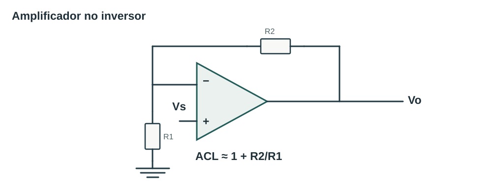
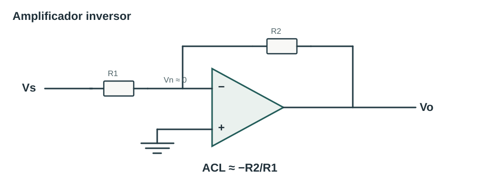

# Práctica 4 · Amplificador inversor y no inversor {.unnumbered}

La Práctica 4, correspondiente a la **clase 20**, contrasta las ganancias de dos circuitos TL084 mediante cálculo, simulación y montaje en protoboard. Se utiliza el mismo enfoque de reporte que las prácticas anteriores: teoría, esquemas, tablas, capturas de osciloscopio, interpretación y conclusiones.

::: {.course-actions}
[Guía original de la Práctica 4 (PDF)](../../recursos/semana-07/practica-original.pdf){.course-button .course-button-primary}
[Guía editable original (Word)](../../recursos/semana-07/practica-original.docx){.course-button}
[Regresar a la Lección 5](amplificar-e-invertir-voltajes.qmd){.course-button}
:::

## Propósito, materiales y precauciones {#material-practica-4}

**Objetivo.** Comprobar la ganancia en lazo cerrado y la polaridad de salida del amplificador no inversor y el inversor. El documento del curso indica: NI Multisim, TL084 o similar, dos resistencias de $1\ \mathrm{k\Omega}$, potenciómetro de $10\ \mathrm{k\Omega}$, protoboard, fuente dual, generador de funciones, osciloscopio y multímetro.

Antes de energizar, identifique la orientación y el pinout del TL084, los terminales de alimentación y el potencial común entre el generador, el osciloscopio y la fuente. No suponga que el op-amp es *rail to rail*. Configure las fuentes de alimentación conforme a la guía y verifique la polaridad antes de insertar el integrado.

## Etapa A. Circuito no inversor {#etapa-a-p4}

En el amplificador no inversor se conecta la entrada $V_{in}$ a $(+)$, mientras que $R_1$ y $R_2$ determinan la señal de realimentación. La ganancia ideal es

$$
A_{CL}=\frac{V_o}{V_{in}}=1+\frac{R_2}{R_1}.
$$

{fig-alt="Op amp no inversor con R1 de realimentación a común y R2 a la salida."}

### Simulación del no inversor

1. Abra [TL084 como amplificador no inversor (.ms13)](../../recursos/semana-07/simulaciones/tl084-como-amplificador-no-inversor.ms13){download="tl084-como-amplificador-no-inversor.ms13"} o arme la figura 3 de la guía.
2. Configure la entrada senoidal indicada en la guía, **1 V pico a 100 Hz**. Seleccione inicialmente $R_2=1\ \mathrm{k\Omega}$, equivalente al 10 % de un potenciómetro de $10\ \mathrm{k\Omega}$.
3. Calcule la ganancia para cada ajuste de $R_2$ de la **tabla 1 original**. Ejecute el circuito y registre $V_{in,RMS}$, $V_{o,RMS}$ y la fase en osciloscopio.
4. Compare los resultados con $A_{CL,\mathrm{ideal}}$. Compruebe los casos de mayor ganancia para detectar recorte de salida antes de interpretar discrepancias.

### Verificación experimental del no inversor

Monte la figura 3 en protoboard y use los ajustes de resistencias de la **tabla 2 original**. Mida realmente el valor de $R_2$ con el multímetro, las amplitudes de entrada y salida y el signo de la ganancia. Capture las dos trazas en el osciloscopio para cada condición y añada fotografías o esquemas del montaje.

## Etapa B. Circuito inversor {#etapa-b-p4}

En el inversor la fuente se conecta a través de $R_1$ al terminal $(-)$; el terminal $(+)$ se conecta a referencia. Bajo el cortocircuito virtual, la corriente que atraviesa $R_1$ circula por $R_2$:

$$
\frac{V_{in}}{R_1}=\frac{-V_o}{R_2},
\qquad \boxed{A_{CL}=-\frac{R_2}{R_1}}.
$$

{fig-alt="Op amp inversor con entrada por R1 a terminal negativo y realimentación R2."}

### Simulación del inversor

1. Abra [TL084 como amplificador inversor (.ms13)](../../recursos/semana-07/simulaciones/tl084-como-amplificador-inversor.ms13){download="tl084-como-amplificador-inversor.ms13"} o arme la figura 5 de la guía.
2. Ajuste el generador según el esquema y comience con $R_2=2\ \mathrm{k\Omega}$, correspondiente al 20 % del potenciómetro de $10\ \mathrm{k\Omega}$.
3. Modifique $R_2$ conforme a la **tabla 3 original**. Para cada caso obtenga la ganancia calculada y medida, la amplitud RMS, la forma de onda y la inversión de fase.
4. Compruebe que la magnitud se ajusta a $R_2/R_1$ antes de sacar conclusiones sobre la capacidad de amplificación.

### Verificación experimental del inversor

Reproduzca la figura 5 en protoboard. Registre valores reales de resistencias, alimentación y voltajes, y complete la **tabla 4 original**. Observe que un amplificador inversor puede tener $|A_{CL}|$ menor que uno aunque también puede presentar ganancia de magnitud mayor que uno. Una relación negativa indica cambio de polaridad, no amplitud RMS negativa.

## Tratamiento de las medidas {#registro-p4}

Use unidades y definiciones consistentes. Si el generador expresa la amplitud pico $V_p$ y el multímetro mide valor eficaz de una senoide no distorsionada:

$$
V_{RMS}=\frac{V_p}{\sqrt2},\quad
|A_{CL,\mathrm{medida}}|=\frac{V_{o,RMS}}{V_{in,RMS}},\quad
\varepsilon_A=\frac{|A_{CL,\mathrm{medida}}-A_{CL,\mathrm{ideal}}|}{|A_{CL,\mathrm{ideal}}|}\,100\%.
$$

La fase de la salida permite asignar el signo de $A_{CL}$, pues **una medida RMS por sí sola no identifica una inversión**.

| Circuito | $R_1$ (Ω) | $R_2$ (Ω) | $A_{CL}$ ideal | $V_{in,RMS}$ | $V_{o,RMS}$ | Fase | Observaciones |
|:--|--:|--:|--:|:--:|:--:|:--:|:--|
| No inversor | — | — | — | — | — | — | — |
| No inversor | — | — | — | — | — | — | — |
| Inversor | — | — | — | — | — | — | — |
| Inversor | — | — | — | — | — | — | — |

La tabla anterior es un **formato de reporte complementario**; no sustituye las tablas 1 a 4 del documento original.

### Tutor IA · Revise las ganancias de la Práctica 4 {#tutor-practica-4-amplificadores}

::: {.tutor-box}
::: {.tutor-texto}
Actúe como tutor de laboratorio de Electrónica II y tráteme de usted. Estoy realizando la Práctica 4 con un TL084, configuraciones inversora y no inversora. Pídame que indique la etapa A o B, mi circuito, valores medidos de R1 y R2, alimentación, Vin,RMS, Vo,RMS y capturas de ambas trazas. Revise conmigo un solo caso por turno y espere mi respuesta. Compruebe el cálculo de ganancia teórica, magnitud a partir de RMS, signo a partir de fase, porcentaje de desviación y posibilidad de recorte; distinga datos calculados, simulados y medidos. Cuando aparezca un resultado contradictorio, solicite la escala de cada canal y compruebe si se confundieron voltajes pico, pico a pico y RMS. No invente datos ni redacte mis conclusiones: pregúnteme qué evidencia las respalda.
:::

::: {.tutor-acciones}
[Abrir ChatGPT](https://chatgpt.com/){.course-button target="_blank" rel="noopener"}
:::
:::

## Resultados esperados y reporte {#resultados-p4}

- **No inversor:** dos senoides en fase; la salida de mayor amplitud si la ganancia es mayor que uno y no ocurre recorte.
- **Inversor:** dos senoides con un desplazamiento relativo aproximado de $180^\circ$; la amplitud depende de $R_2/R_1$.
- **En ambos casos:** si aparece saturación, distorsión o limitación de pendiente, indíquelo como resultado experimental y contraste con el límite de operación del circuito.

Entregue el procedimiento documentado, las simulaciones originales, esquemas, fotografias de montaje, resultados obtenidos, comparación cuantitativa e interpretación. El calendario señala que el **reporte de la práctica 3** se entrega al inicio de esta sesión; la fecha del informe de la práctica 4 deberá confirmarse en la planificación siguiente si no está explícita en la Semana 7.
