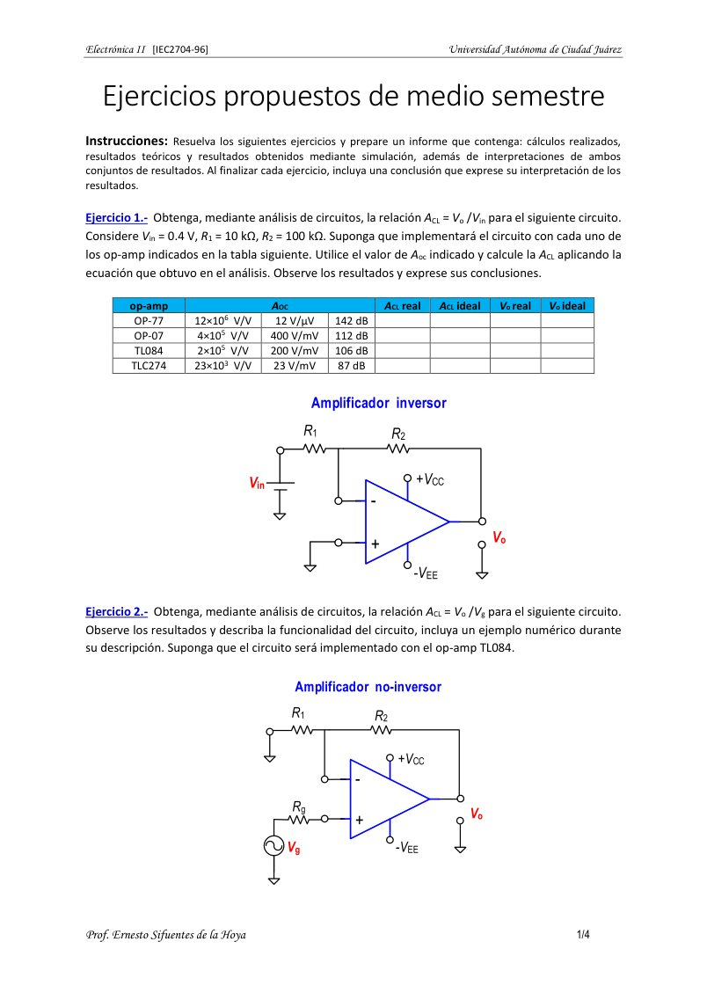
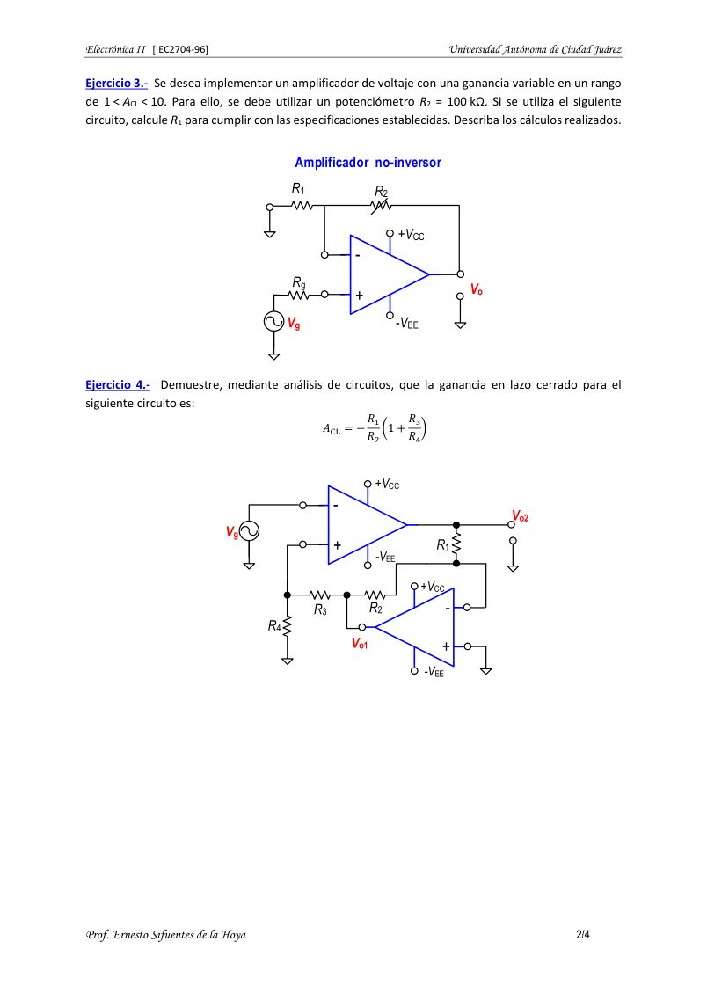
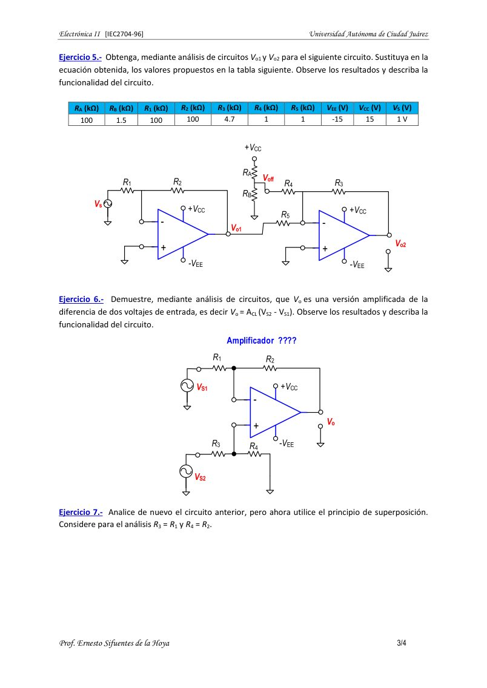
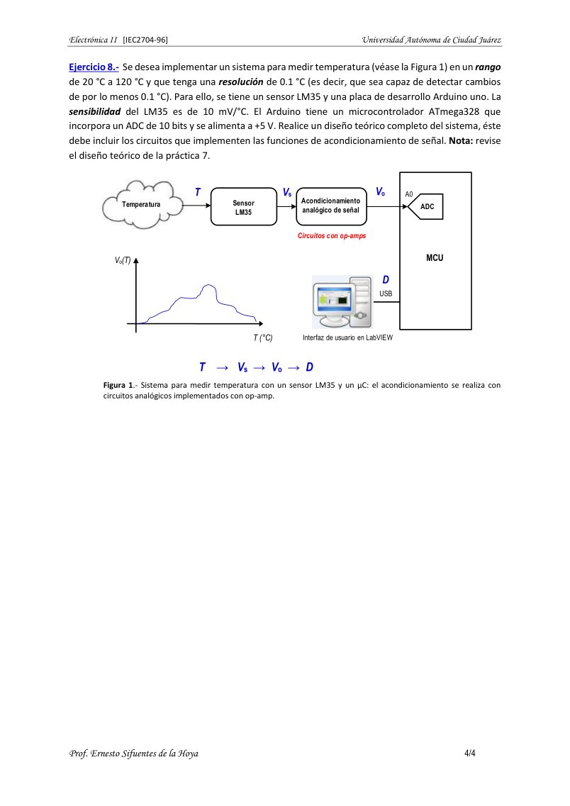

# Ejercicios integradores de medio semestre {.unnumbered}

**Clase 24.** Los ejercicios originales de cuatro páginas solicitan un informe con cálculos, resultados teóricos, simulaciones, comparación e interpretación y **una conclusión por ejercicio**. La entrega señalada en la planificación corresponde a la **clase 3 de la semana 9**. Estos problemas integran conocimientos de las Lecciones 1 a 5 y anticipan ciertas topologías que se estudian posteriormente.

::: {.course-actions}
[Enunciado y circuitos originales (PDF)](../../recursos/semana-08/ejercicios-medio-semestre.pdf){.course-button .course-button-primary}
[Lección 5 · Inversor y no inversor](../07/amplificar-e-invertir-voltajes.qmd){.course-button}
[Lección 3 · Realimentación](../05/retroalimentacion-negativa.qmd){.course-button}
:::

## Método de resolución y formato del informe {#metodo-ejercicios-medio}

Para cada ejercicio: (1) reproduzca o incorpore el **esquema original**; (2) declare las hipótesis del op-amp ideal o de ganancia abierta finita; (3) identifique cada nodo y resistencia; (4) formule LCK, la relación de realimentación o superposición; (5) obtenga una expresión simbólica antes de sustituir valores; (6) realice la simulación; (7) compare teoría y simulación con unidades y condiciones; y (8) interprete qué función realiza el circuito. **No se presentan soluciones completas** para conservar el carácter de trabajo del estudiante.

## Ejercicios 1 y 2 · Ganancia real y redes de entrada {#medio-ejercicios-1-2}

**Ejercicio 1.** Para el amplificador inversor de la primera página use $V_{in}=0.4\ \mathrm V$, $R_1=10\ \mathrm{k\Omega}$ y $R_2=100\ \mathrm{k\Omega}$. Compare $A_{CL}$ ideal y de ganancia abierta finita para OP-77, OP-07, TL084 y TLC274, empleando los **valores de $A_{OC}$ indicados en el enunciado**. La relación útil para revisar su deducción es

$$
A_{CL}=-\frac{A_{OC}R_2}{R_1+R_2+A_{OC}R_1},
\qquad\lim_{A_{OC}\to\infty}A_{CL}=-\frac{R_2}{R_1}.
$$

La derivación de esta relación y la tabla de resultados forman parte del ejercicio. Compruebe al final que la salida calculada no excede los límites de alimentación al realizar la simulación.

**Ejercicio 2.** Analice el amplificador **no inversor** que recibe una fuente $V_g$ a través de una resistencia $R_g$, como se muestra en la figura original. Antes de simplificar, decida si existe corriente apreciable por $R_g$ en el modelo ideal y qué cambia si se considera una resistencia de entrada finita. Incluya un ejemplo numérico con TL084.

{fig-alt="Página primera del cuadernillo de ejercicios integradores, circuitos inversor y no inversor."}

## Ejercicios 3 y 4 · Ganancia ajustable y conexión de etapas {#medio-ejercicios-3-4}

**Ejercicio 3.** Diseñe una ganancia variable $1<A_{CL}<10$ empleando un potenciómetro $R_2=100\ \mathrm{k\Omega}$ en la configuración no inversora. Establezca el recorrido útil de $R_2$ y explique si con un potenciómetro desde cero se cumple de manera estricta el límite inferior y superior.

**Ejercicio 4.** Demuestre a partir del circuito **de dos etapas** del documento que:

$$
A_{CL}=-\frac{R_1}{R_2}\left(1+\frac{R_3}{R_4}\right).
$$

Identifique primero la ganancia de cada etapa y luego el efecto de conectarlas en cascada. La comprobación debe usar la topología dibujada, no una multiplicación de fórmulas sin verificar las conexiones.

{fig-alt="Segunda página del cuadernillo con potenciómetro y cascada de amplificadores."}

## Ejercicios 5 a 7 · Offset, diferencia y superposición {#medio-ejercicios-5-7}

**Ejercicio 5.** Obtenga $V_{o1}$ y $V_{o2}$ del circuito de acondicionamiento con divisor para offset y dos etapas. Use los valores de la tabla de la página 3: $R_A=100\ \mathrm{k\Omega}$, $R_B=1.5\ \mathrm{k\Omega}$, $R_1=R_2=100\ \mathrm{k\Omega}$, $R_3=4.7\ \mathrm{k\Omega}$, $R_4=R_5=1\ \mathrm{k\Omega}$, $V_{EE}=-15\ \mathrm V$, $V_{CC}=+15\ \mathrm V$, $V_S=1\ \mathrm V$. Documente a qué magnitud corresponde cada índice del circuito.

**Ejercicio 6.** Demuestre a partir del esquema que su salida puede expresarse como amplificación de la **diferencia de dos voltajes**, $V_o=A_{CL}(V_{S2}-V_{S1})$. Debe identificar qué igualdades de resistencias permiten la proporcionalidad exacta y en qué condición el op-amp ideal deja de ser una aproximación válida.

**Ejercicio 7.** Reanalice ese circuito por el método de **superposición** con $R_3=R_1$ y $R_4=R_2$, como establece el documento. Calcule por separado la contribución de cada fuente, estableciendo cero voltios para la otra fuente ideal de tensión al superponer.

{fig-alt="Página 3, circuitos de offset y amplificador de diferencia."}

## Ejercicio 8 · Diseño de cadena LM35–Arduino {#medio-ejercicio-8}

Diseñe teóricamente un instrumento para $20$ a $120\ ^\circ\mathrm C$ con resolución solicitada de $0.1\ ^\circ\mathrm C$, sensor **LM35 de 10 mV/°C** y Arduino Uno/ATmega328 con ADC de **10 bits** y alimentación de $+5\ \mathrm V$. Distinga el rango de temperatura de su excursión eléctrica:

$$V_s(T)=\left(10\ \mathrm{mV}/^\circ\mathrm C\right)T,\quad V_s(20^\circ\mathrm C)=0.20\ \mathrm V,\quad V_s(120^\circ\mathrm C)=1.20\ \mathrm V.$$

Compare el incremento de salida del sensor por $0.1\ ^\circ\mathrm C$ con el intervalo de cuantificación del ADC, y justifique si necesita desplazamiento de nivel, amplificación o ambos. Como referencia conceptual, el número mínimo de intervalos requeridos por especificación es $(120-20)/0.1=1000$; un ADC de 10 bits proporciona $1024$ códigos ideales, pero la exactitud depende también del sensor, ruido, acondicionamiento y referencia. **No asuma que usar un ADC de 10 bits garantiza automáticamente 0.1 °C de resolución útil.**

{fig-alt="Problema de diseño de termómetro LM35 y ATmega328 con ADC."}

## Tabla sugerida de comparación {#tabla-evaluacion-medio}

| Ejercicio | Resultado simbólico | Resultado numérico | Simulación | Diferencia e interpretación |
|:--|:--|:--|:--|:--|
| 1 | — | — | — | — |
| 2 | — | — | — | — |
| 3 | — | — | — | — |
| 4 | — | — | — | — |
| 5 | — | — | — | — |
| 6 y 7 | — | — | — | — |
| 8 | — | — | — | — |

La tabla es un apoyo adicional; **no reemplaza** los cálculos ni la conclusión individual que solicita la guía.

### Tutor IA · Ganancia, realimentación y cascadas {#tutor-medio-ganancia-s8}

::: {.tutor-box}
::: {.tutor-texto}
Actúe como tutor de Electrónica II y tráteme de usted. Estoy trabajando los ejercicios integradores 1 a 5 de medio semestre. Solicite primero el número del ejercicio y el circuito concreto. Use una pregunta por turno para ayudarme a identificar nodos, ecuación de LCK, ganancia abierta finita cuando corresponda y límites de saturación. No entregue la fórmula final ni el resultado numérico sin que haya intentado un paso. Pida que distinga los resultados teóricos, simulados y medidos, y que exprese ganancias en V/V y voltajes en V. Espere mi respuesta en cada paso.
:::
::: {.tutor-acciones}
[Abrir ChatGPT](https://chatgpt.com/){.course-button target="_blank" rel="noopener"}
:::
:::

### Tutor IA · Diferencia de señales y diseño térmico {#tutor-medio-termometro-s8}

::: {.tutor-box}
::: {.tutor-texto}
Actúe como tutor socrático de Electrónica II y tráteme de usted. Estoy resolviendo uno de los ejercicios 6, 7 u 8 de medio semestre. Pregúnteme cuál seleccioné. Si elegí 6 o 7, solicite la topología de amplificador de diferencia y mis relaciones de resistencias; acompáñeme con superposición o análisis nodal una pregunta por turno. Si elegí 8, guíeme a partir de 20–120 °C, LM35 10 mV/°C, ADC 10 bits a 5 V y resolución solicitada 0.1 °C. Pídame elaborar el mapa T→Vs→Vo→D y verificar rango, offset, pendiente y cuantificación; no sustituya mi diseño con una solución completa. Distingua resolución teórica de exactitud y espere cada respuesta.
:::
::: {.tutor-acciones}
[Abrir ChatGPT](https://chatgpt.com/){.course-button target="_blank" rel="noopener"}
:::
:::
