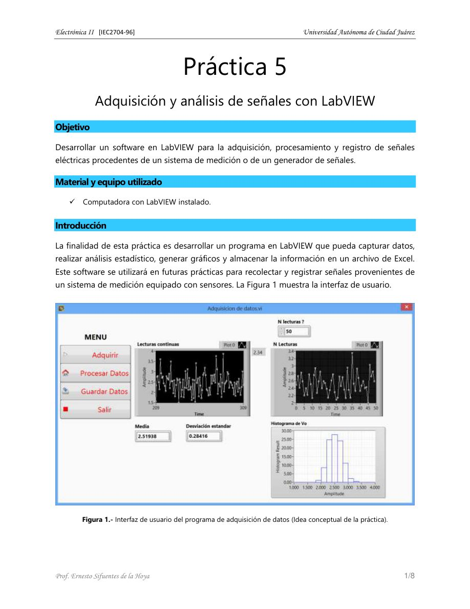
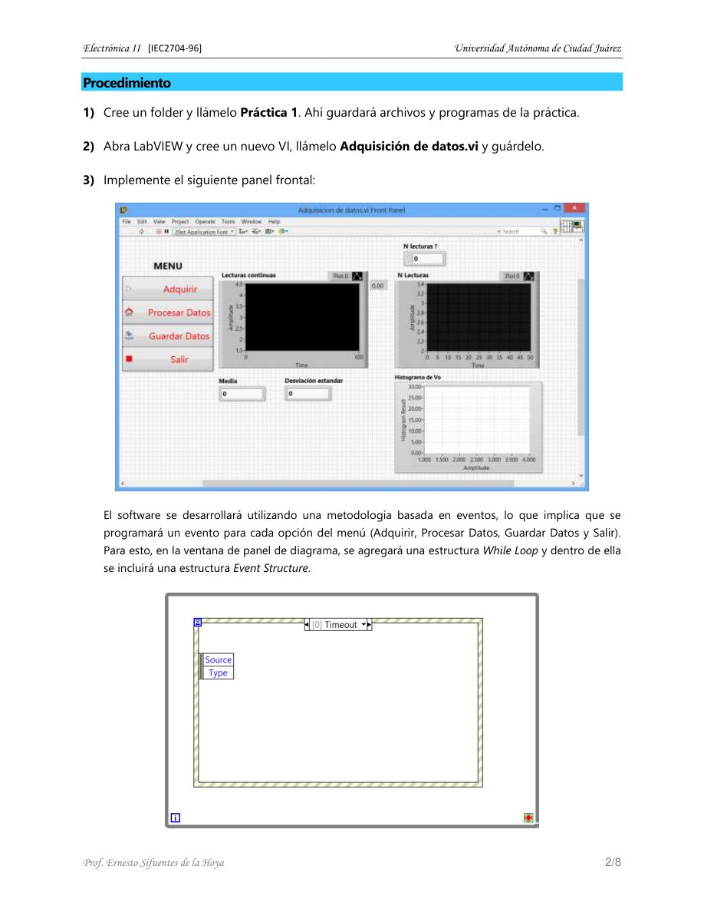
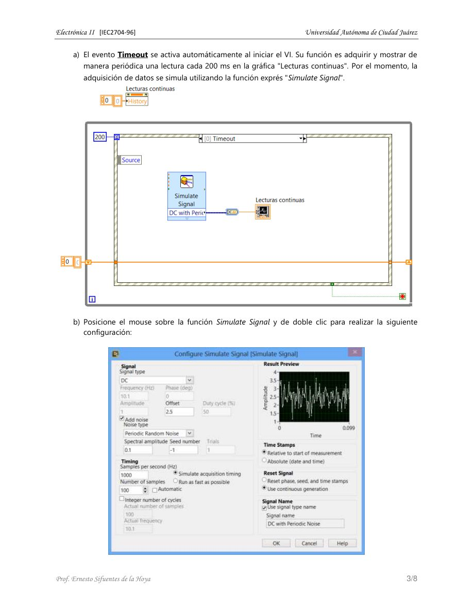
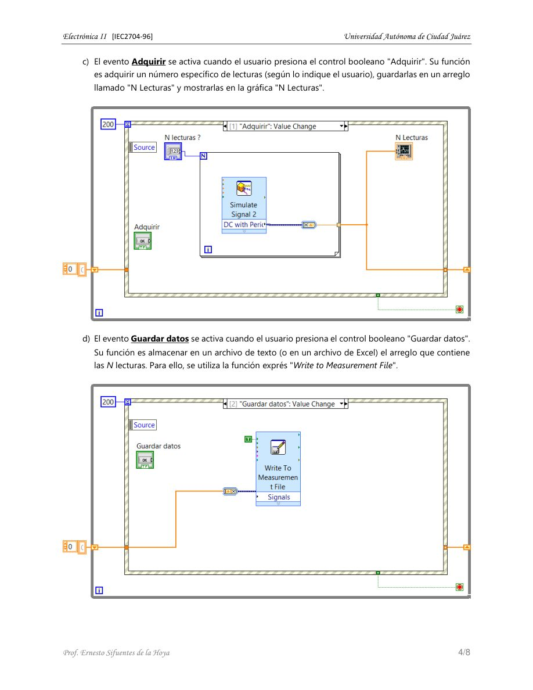
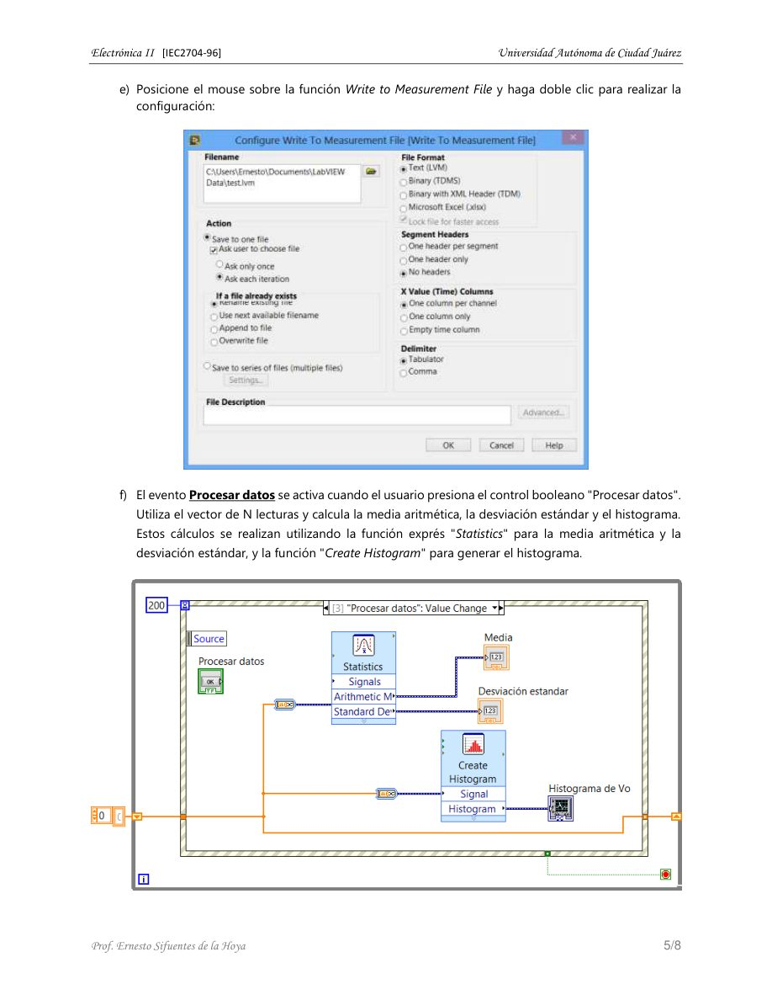
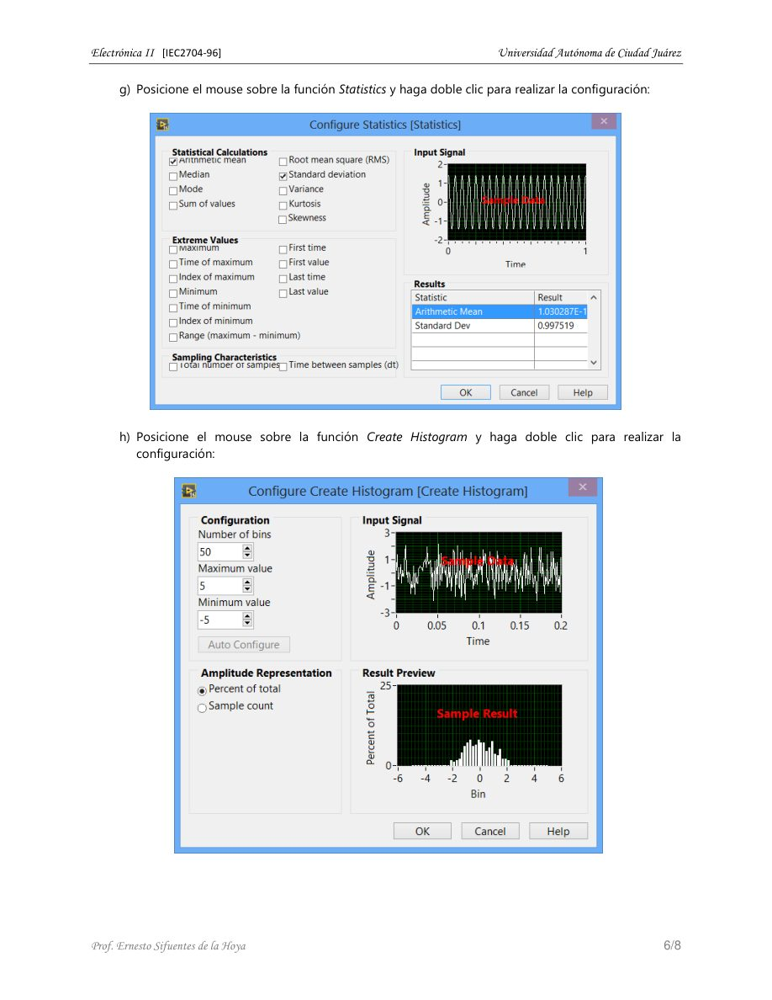
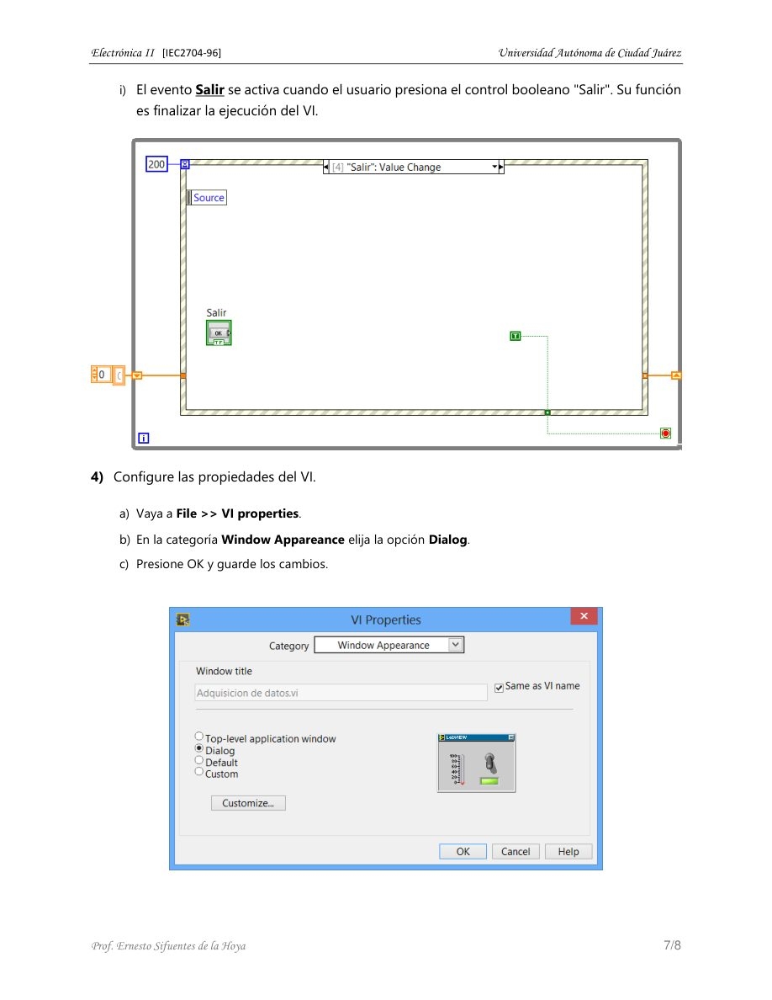
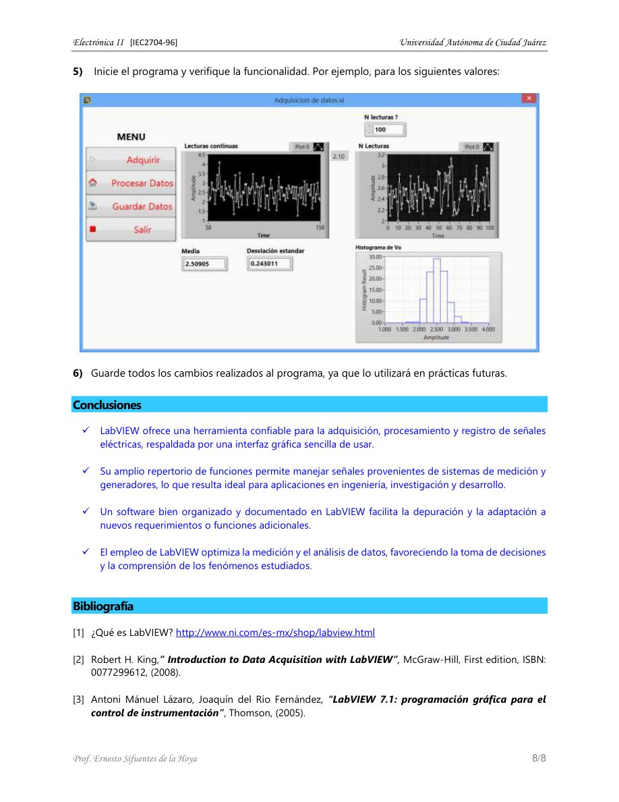

# Práctica 5 · Adquisición y análisis de señales con LabVIEW {.unnumbered}

**Clase 23 · 120 minutos.** El documento original propone desarrollar un VI para obtener datos de una señal, representar las lecturas, calcular la media y desviación estándar, construir un histograma y guardar la información para análisis posterior. La señal se **simula inicialmente**; posteriormente podrá sustituirse por lecturas de un sistema de medición real.

::: {.course-actions}
[Guía original, 8 páginas (PDF)](../../recursos/semana-08/practica-05-labview.pdf){.course-button .course-button-primary}
[Presentación y teoría](software-adquisicion-labview.qmd){.course-button}
[Video de solución indicado en la planificación](https://www.youtube.com/watch?v=r8cLWQdhjlg){.course-button target="_blank" rel="noopener"}
:::

## Objetivo, recursos y productos {#objetivo-practica-5}

**Objetivo original:** desarrollar un programa en LabVIEW para la adquisición, procesamiento y registro de señales eléctricas procedentes de un sistema de medición o generador de señales. El material requerido es una computadora con LabVIEW instalado; en esta etapa se usa *Simulate Signal*.

Al finalizar, deben existir: (a) archivo **Adquisición de datos.vi** funcional; (b) capturas del panel frontal y del diagrama; (c) vector de lecturas exportado; (d) media, desviación e histograma consistentes; y (e) descripción de las pruebas de funcionamiento.

## 1. Panel frontal y arquitectura {#arquitectura-practica-5}

El diseño de la guía presenta un menú con las opciones **Adquirir**, **Procesar Datos**, **Guardar Datos** y **Salir**, además de las gráficas *Lecturas continuas*, *N Lecturas* y un histograma, y de los indicadores estadísticos.

{fig-alt="Panel conceptual de adquisición de datos con menú, gráficos y resultados estadísticos."}

{fig-alt="Guía de práctica con panel frontal y estructura de eventos en un bucle While."}

1. Cree una carpeta de trabajo para la **Práctica 5** y guarde allí el VI. En la página 2 del PDF original aparece «Práctica 1» como nombre de carpeta; aquí se utiliza el número de la práctica actual para mantener ordenados los archivos.
2. Abra LabVIEW, cree un VI nuevo y guárdelo como `Adquisición de datos.vi`.
3. Implemente controles e indicadores. Defina explícitamente el número de lecturas $N$ y las etiquetas de unidades.
4. Inserte un **While Loop** y dentro una **Event Structure** con los casos descritos en la guía.
5. Identifique cómo se conserva el arreglo $\mathbf{x}$ entre eventos; si fuera necesario, utilice un registro de desplazamiento o la arquitectura adecuada para el proyecto, sin sobrescribirlo al cambiar de caso.

## 2. Eventos paso a paso {#eventos-practica-5}

### Evento Timeout: vigilancia continua

Configure un intervalo de **200 ms** y genere una lectura mediante *Simulate Signal*. Muestre las lecturas en la gráfica continua. La guía ilustra tanto la conexión del bloque como la configuración de sus propiedades.

{fig-alt="Diagrama del evento Timeout y propiedades del generador de señal simulada."}

### Evento Adquirir: vector de N lecturas

La pulsación de **Adquirir** inicia la captura del número de muestras elegido; los valores se almacenan en un vector y se representan en la gráfica *N Lecturas*. El dato que luego procesa *Statistics* debe corresponder a ese **mismo vector**, no a una lectura aislada.

### Evento Guardar datos: persistencia

Configure **Write to Measurement File** según la guía; guarde datos en un formato que pueda ser abierto posteriormente. El PDF permite texto o un archivo legible desde Excel. Documente ruta, nombre, encabezados, separador, unidades y orden temporal si están disponibles.

{fig-alt="Lógica de eventos para capturar N lecturas y escribir las lecturas en un archivo."}

### Evento Procesar datos: estadística e histograma

Aplique el bloque **Statistics** para obtener media y desviación estándar, y **Create Histogram** para representar frecuencias. Contraste las salidas con las fórmulas de la [teoría de medición](resultado-de-medida.qmd) y evite confundir desviación estándar con varianza.

{fig-alt="Configuración del guardado y del procesamiento estadístico."}

{fig-alt="Configuración de funciones estadísticas e histograma."}

### Evento Salir: cierre controlado

El botón **Salir** debe terminar el bucle. En *VI Properties → Window Appearance* la guía recomienda la apariencia **Dialog**. Guarde los cambios y compruebe que los controles siguen accesibles.

{fig-alt="Diagrama del evento Salir y panel de propiedades del VI."}

## 3. Pruebas de aceptación {#validacion-practica-5}

| Prueba | Operación | Resultado esperado | Evidencia |
|:--|:--|:--|:--|
| A | Ejecutar el VI | Gráfica continua actualizada, sin bloquear la interfaz | Captura del panel |
| B | Elegir $N$ y pulsar Adquirir | Se almacena y grafica el número indicado de lecturas | Gráfica con $N$ datos |
| C | Pulsar Procesar Datos | Media, desviación e histograma corresponden al vector | Cálculo manual de control |
| D | Pulsar Guardar Datos | El archivo conserva los valores y puede reabrirse | Archivo y captura |
| E | Pulsar Salir | VI termina sin abortarse manualmente | Descripción del cierre |

Un ejemplo didáctico consiste en elegir $N=100$ y comprobar que el programa obtiene exactamente 100 muestras. Si el bloque generador entrega varios puntos por evento, el tamaño del vector dependerá de esa configuración: **no dé por comprobado N sin contarlo**.

{fig-alt="Panel de ejemplo con gráficas, media, desviación e histograma."}

## 4. Informe de laboratorio {#informe-practica-5}

Incluya objetivo, descripción del VI, diagrama de flujo de las funciones, configuración de cada evento, capturas comentadas, tabla de parámetros, resultados estadísticos, archivo exportado y conclusiones. Identifique claramente qué resultados corresponden a **señales simuladas**, sin presentarlos como mediciones de hardware. Conserve el VI: la guía indica que será reutilizado en prácticas posteriores.

### Tutor IA · Revisar la Práctica 5 {#tutor-practica5-s8}

::: {.tutor-box}
::: {.tutor-texto}
Sea tutor de laboratorio de Electrónica II y tráteme de usted. Estoy realizando la Práctica 5, adquisición y análisis de señales con LabVIEW. Pregúnteme qué evento estoy implementando (Timeout, Adquirir, Procesar Datos, Guardar Datos o Salir), solicite captura del panel frontal y del diagrama y haga una pregunta cada vez. Ayúdeme a comprobar la cantidad de lecturas, la secuencia de eventos, el uso del mismo arreglo para cálculos y el archivo exportado. Cuando se trate de media, desviación e histograma, exíjame unidades y que compare con cálculos propios. No invente configuraciones ni datos experimentales; espere mi respuesta y cierre solicitándome una prueba que demuestre el funcionamiento.
:::
::: {.tutor-acciones}
[Abrir ChatGPT](https://chatgpt.com/){.course-button target="_blank" rel="noopener"}
:::
:::
