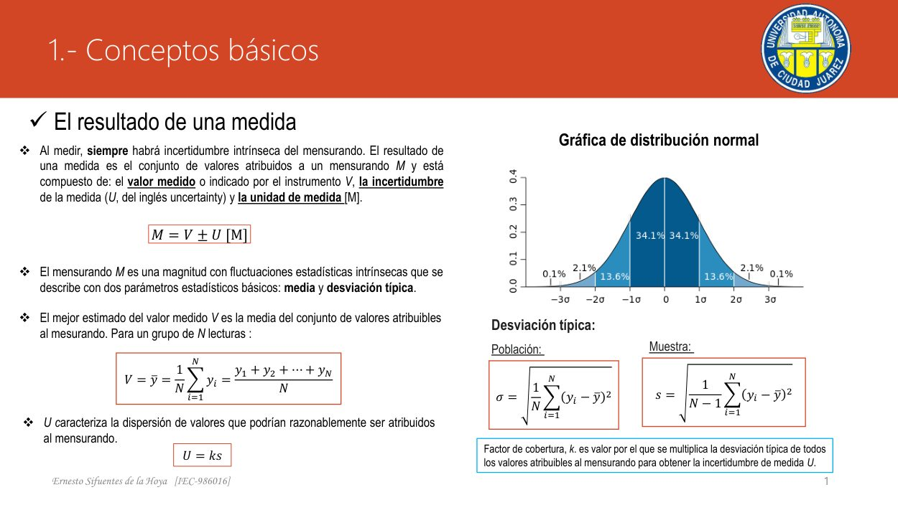
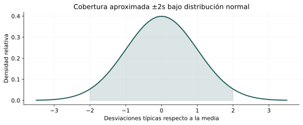
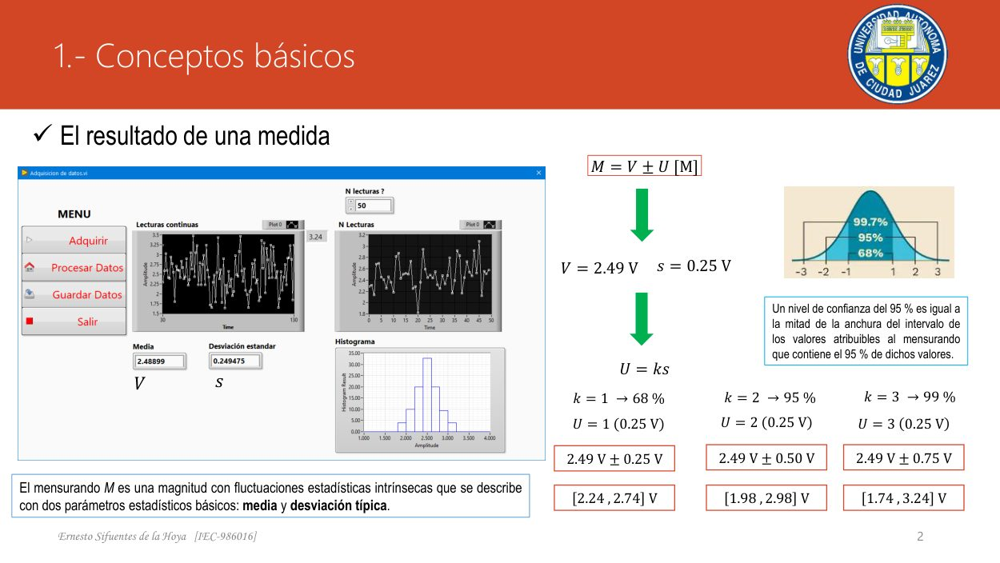

# El resultado de una medida: media, dispersión e incertidumbre {.unnumbered}

Este apunte complementa la adquisición y el procesamiento de datos. Está basado en las dos láminas **El resultado de una medida**, que acompañan los archivos de la semana 8. Una medida sin unidad, condiciones de obtención ni información de dispersión suele resultar insuficiente para comparar teoría y experimento.

::: {.course-actions}
[Apunte original, 2 páginas (PDF)](../../recursos/semana-08/resultado-de-una-medida.pdf){.course-button .course-button-primary}
[Volver al software de adquisición](software-adquisicion-labview.qmd){.course-button}
:::

## 1. Notación y concepto básico {#modelo-medida-s8}

En el material original se expresa el resultado de la medida como

$$\boxed{M=V\pm U\quad[\text{unidad}]}$$

donde $V$ es el valor asignado a la magnitud (habitualmente la media de las lecturas), $U$ una incertidumbre asociada y la unidad identifica la dimensión física. La escritura $M=2.49\pm0.50\ \mathrm V$ no significa que el instrumento «se equivoque exactamente» $0.50\ \mathrm V$; expresa un intervalo asociado al resultado bajo ciertos supuestos.

{fig-alt="Lámina docente sobre resultado de medida e incertidumbre."}

## 2. Estadísticos de una muestra {#estadisticos-medicion-s8}

Dadas $N$ observaciones $y_1,\dots,y_N$, el estimador de la media es

$$\bar y=\frac1N\sum_{i=1}^N y_i.$$

La desviación estándar **poblacional** se define con divisor $N$ si se conocen todos los elementos de la población. Para una muestra, la estimación habitual de dispersión se calcula mediante

$$\boxed{s=\sqrt{\frac1{N-1}\sum_{i=1}^N(y_i-\bar y)^2}}.$$

El factor $N-1$ corresponde al estimador de la varianza muestral. Tanto $s$ como $\bar y$ conservan las unidades de la magnitud medida. Una varianza está expresada en unidades cuadradas.

## 3. ¿Qué representa el factor de cobertura? {#factor-cobertura-s8}

Las láminas presentan el modelo $U=k\,s$ con factores de cobertura indicativos $k=1$, 2 y 3, asociados aproximadamente a 68 %, 95 % y 99 % en una distribución normal. Esas coberturas son **aproximaciones didácticas** y no sustituyen una evaluación metrológica formal.

{fig-alt="Curva de distribución normal con área central dentro de más/menos dos desviaciones."}

En una serie de lecturas es esencial especificar **qué intervalo se desea comunicar**:

- **Dispersión de observaciones individuales:** si $s$ representa las variaciones de las lecturas, $k s$ caracteriza aproximadamente su dispersión bajo el modelo adoptado.
- **Incertidumbre estadística de la media:** si las lecturas son independientes y las condiciones lo justifican, la incertidumbre estándar de la media es $u_A(\bar y)=s/\sqrt N$; la correspondiente incertidumbre expandida tipo A sería $U_A=k\,s/\sqrt N$.
- **Incertidumbre total:** además de la dispersión, deben evaluarse contribuciones de resolución, calibración, deriva, error de ganancia y otros efectos pertinentes. No basta con medir muchas veces para eliminar un error sistemático.

### Ejemplo. Mismo conjunto, dos preguntas distintas

Considere $\bar y=2.49\ \mathrm V$, $s=0.25\ \mathrm V$ y $N=25$ lecturas independientes. Para describir la dispersión de lecturas individuales con $k\approx2$:

$$U_{\mathrm{lectura}}\approx 2(0.25)=0.50\ \mathrm V.$$

Para describir exclusivamente la componente tipo A de incertidumbre de la **media**:

$$u_A(\bar y)=\frac{0.25}{\sqrt{25}}=0.05\ \mathrm V,\qquad U_A\approx 2(0.05)=0.10\ \mathrm V.$$

Estos intervalos responden a preguntas diferentes; ninguno incluye automáticamente la incertidumbre de calibración u otros componentes.

{fig-alt="Ejemplo del material docente con media 2.49 V, desviación típica 0.25 V y coberturas aproximadas."}

## 4. Aplicación al VI de la Práctica 5 {#aplicacion-medida-s8}

Al procesar un vector de $N$ lecturas, documente el origen de la señal, la unidad de la magnitud, $N$, la media, la desviación típica y el criterio para interpretar $U$. Si se registran datos artificiales, indique explícitamente **simulación**, no medición de campo. Use el histograma para describir la dispersión y contraste el resultado con los valores calculados en una hoja de trabajo.

### Tutor IA · Interprete la incertidumbre {#tutor-incertidumbre-s8}

::: {.tutor-box}
::: {.tutor-texto}
Sea mi tutor de Electrónica II, tráteme de usted y formule una sola pregunta por turno. Estoy revisando las dos láminas de El resultado de una medida. Pregunte por N, media, desviación típica y el propósito del resultado: describir una lectura individual o estimar la media. No confunda U=k·s de dispersión de lecturas con la incertidumbre tipo A de la media k·s/raíz(N). Ayúdeme a justificar las unidades, el factor de cobertura y sus supuestos. Si los datos son simulados, no permita que los describa como experimentales. Espere mi respuesta antes de avanzar.
:::
::: {.tutor-acciones}
[Abrir ChatGPT](https://chatgpt.com/){.course-button target="_blank" rel="noopener"}
:::
:::
