# Software de adquisición y procesamiento de señales {.unnumbered}

La clase 22 profundiza en la programación de **instrumentos virtuales (VI)** en LabVIEW. El objetivo no consiste solamente en mostrar datos en una pantalla: un sistema de adquisición debe recibir una señal, asociar cada lectura con las condiciones de muestreo, obtener resultados reproducibles y conservarlos para su interpretación. Esta sección desarrolla el contenido de la presentación de **38 láminas** proporcionada para la semana 8 y prepara la [Práctica 5](practica-05-labview.qmd).

::: {.course-actions}
[Presentación original (PDF)](../../recursos/semana-08/presentacion-adquisicion-procesamiento.pdf){.course-button .course-button-primary}
[Práctica 5](practica-05-labview.qmd){.course-button}
[VI de procesamiento de señales](../../recursos/semana-08/simulaciones/ejemplo-de-procesado-de-senales.vi){.course-button download="ejemplo-de-procesado-de-senales.vi"}
[Video de apoyo · Solución de Práctica 5](https://www.youtube.com/watch?v=r8cLWQdhjlg){.course-button target="_blank" rel="noopener"}
:::

**Material audiovisual disponible.** El video corresponde a la **resolución de la Práctica 5**, no a una lección con resumen obligatorio. La planificación de Semana 8 solo pide revisar ese video durante la práctica; el resumen manuscrito que se asigna como trabajo extraclase es el de la [Lección 6](../09/sumar-y-amplificar-voltajes.qmd#video-l6), con entrega en la primera sesión de Semana 9.

## 1. Del voltaje a la información {#cadena-adquisicion-labview}

La entrada puede proceder de un **generador de señales**, una simulación numérica o un instrumento de adquisición; después se ejecutan operaciones de registro y procesamiento. En las primeras pruebas de la práctica se utiliza *Simulate Signal*, por lo que no se necesita conectar aún un sensor.

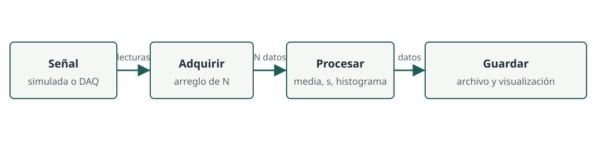{fig-alt="Cuatro bloques: origen de señal, adquirir N lecturas, procesar media y dispersión, guardar y visualizar."}

Si el muestreo es uniforme, cada lectura $x[n]$ representa un instante definido por la frecuencia de muestreo $f_s$:

$$
 t_n=t_0+nT_s,\qquad T_s=\frac{1}{f_s},\qquad n=0,1,\ldots,N-1.
$$

La duración comprendida entre la primera y la última muestra es $(N-1)T_s$. El intervalo de observación utilizado para organizar $N$ muestras suele expresarse como $NT_s$. Por ejemplo, con $f_s=250\ \mathrm{muestras/s}$ y $N=500$ se captura una ventana de aproximadamente $2\ \mathrm{s}$.

**No confunda tres tasas**: la velocidad de lectura del ADC, la frecuencia a la que un VI actualiza la pantalla y el periodo con el que el usuario ordena iniciar otra captura. En la práctica, el evento *Timeout* actualiza periódicamente una lectura; esto no equivale automáticamente a la frecuencia interna de adquisición de cualquier dispositivo DAQ.

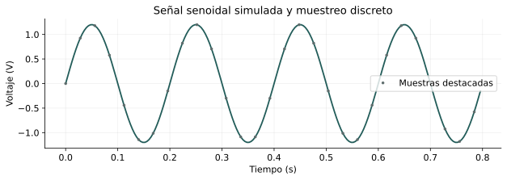{fig-alt="Curva senoidal de ejemplo con instantes discretos destacados."}

## 2. Instrumentos virtuales y modelo de programación {#estructura-vi}

LabVIEW (Laboratory Virtual Instrument Engineering Workbench) es un entorno de programación gráfica orientado a instrumentación y automatización. Un programa se organiza como un *VI*, cuya representación habitual incluye dos vistas:

| Elemento | Función | Ejemplo en una interfaz |
|:--|:--|:--|
| **Panel frontal** | Interacción del operador mediante controles e indicadores | Botón Adquirir, gráfica, promedio, archivo de salida |
| **Diagrama de bloques** | Describe las operaciones y la conexión entre datos | Generación → muestreo → arreglo → estadística |
| **Controles** | Producen valores para el programa | Número de lecturas $N$, amplitud, frecuencia |
| **Indicadores** | Muestran resultados calculados | Forma de onda, histograma, media y desviación |
| **Conectores y cables** | Transportan datos tipados entre nodos | Cable numérico, booleano, arreglo, señal dinámica |
| **SubVI** | Encapsula un procedimiento reutilizable | Cálculo o proceso común para varias interfaces |

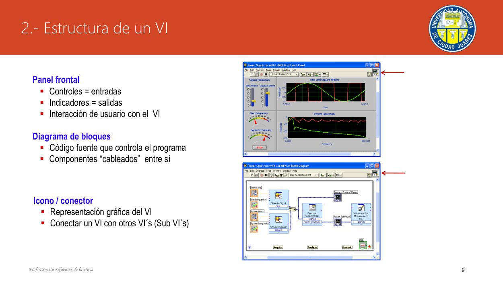{fig-alt="Diapositiva docente que distingue panel frontal, controles, indicadores y diagrama de bloques."}

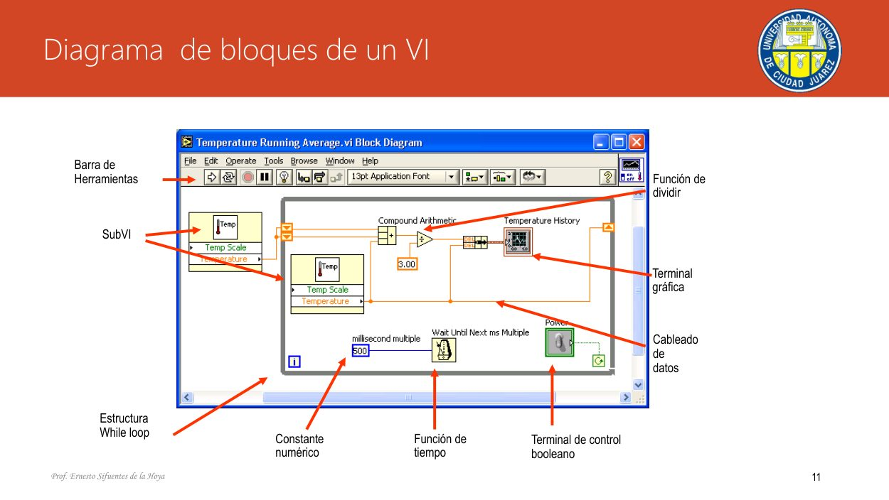{fig-alt="Ejemplo de diagrama de bloques de LabVIEW con cableado y subVI."}

### Flujo de datos

En LabVIEW, un nodo puede ejecutarse cuando dispone de los datos requeridos. Por tanto, la posición izquierda-derecha de los elementos no determina por sí sola el orden de ejecución. Para garantizar dependencias entre operaciones deben existir **cables o estructuras** que hagan explícita esa dependencia. Por ejemplo, no conviene ordenar *Guardar datos* antes de que el arreglo de lecturas esté construido.

## 3. Tipos de datos, estructuras y depuración {#tipos-datos-labview}

Entre los tipos básicos de la presentación se encuentran: **Boolean**, numéricos enteros, numéricos en punto flotante, cadenas (*strings*) y arreglos. Los tipos se distinguen en el diagrama mediante cables y terminales de apariencia diferente. La presentación también introduce los puntos de coerción (*coercion dots*), que indican conversiones de tipo.

Una señal de voltaje puede expresarse como dato escalar $x$, arreglo $\mathbf{x}=[x_0,\ldots,x_{N-1}]$ o conjunto de muestras con información temporal. La elección determina qué funciones pueden recibirla y cómo reconstruir la gráfica.

**Operaciones recomendadas al depurar:** identificar flechas de ejecución rotas, revisar tipos incompatibles, usar *Highlight Execution* cuando sea apropiado, consultar ayuda contextual y examinar si una estructura impide que los datos lleguen a un indicador.

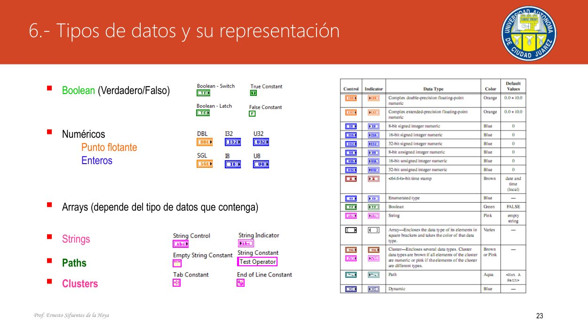{fig-alt="Tipos de datos de LabVIEW y convenciones de representación en el diagrama."}

## 4. Programación por eventos {#programacion-eventos}

Un programa basado en **Event Structure** atiende acciones tales como la pulsación de un botón, un cambio de valor o la expiración de un temporizador. La clase ilustra su inserción dentro de un **While Loop**. En una interfaz sencilla, cada evento produce una operación concreta:

| Evento | Acción del programa | Evidencia observable |
|:--|:--|:--|
| **Timeout** | Simular una lectura y actualizar la gráfica continua cada 200 ms, según el guion de Práctica 5 | La gráfica se renueva periódicamente |
| **Adquirir** | Obtener $N$ valores y almacenarlos en un arreglo | La gráfica de $N$ lecturas cambia |
| **Procesar datos** | Calcular media, desviación típica y distribución de frecuencias | Se actualizan los indicadores y el histograma |
| **Guardar datos** | Escribir el arreglo en un archivo | Se genera un archivo que puede reabrirse |
| **Salir** | Terminar el bucle de ejecución | El VI se detiene de manera controlada |

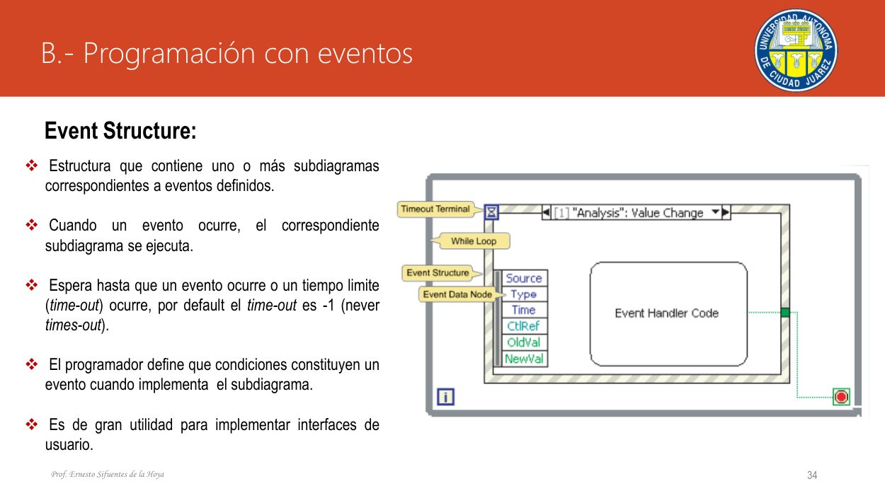{fig-alt="Estructura Event Structure y explicación de la ejecución basada en eventos."}

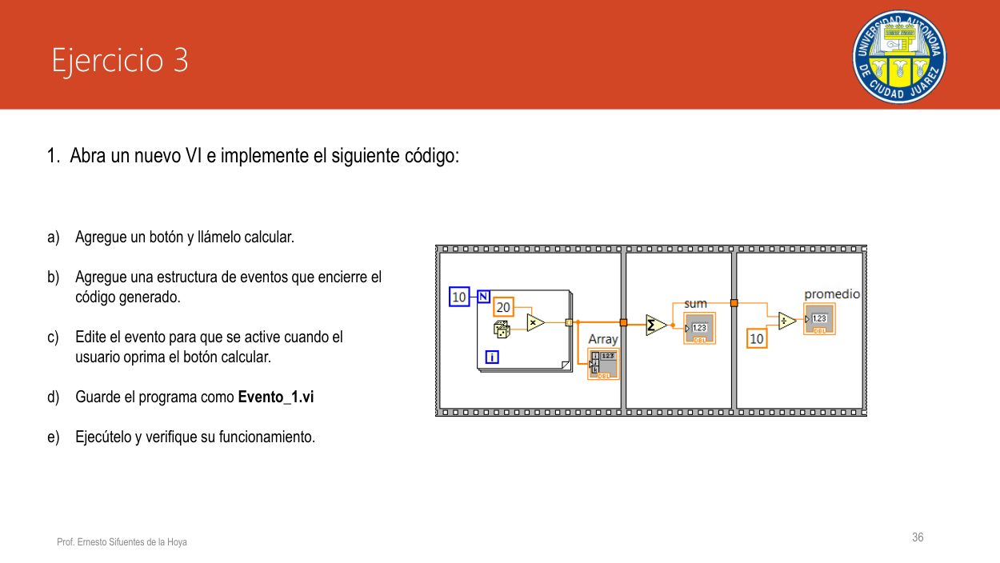{fig-alt="Ejercicio original con botón Calcular y evento asociado."}

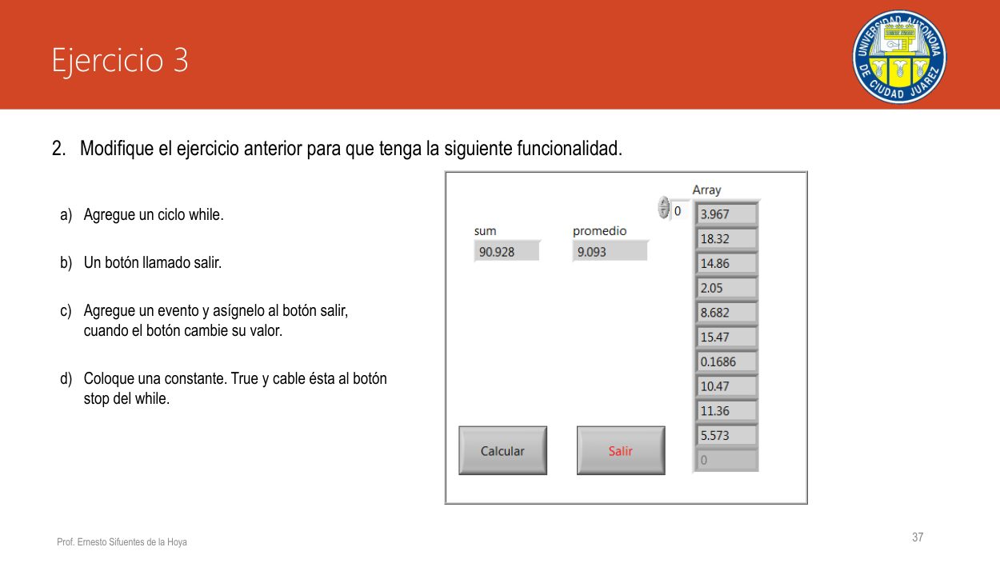{fig-alt="Ejercicio LabVIEW con ciclo While y botón Salir."}

**Precaución de diseño:** una operación extensa dentro de la estructura de eventos puede bloquear temporalmente la interfaz. Si la adquisición real requiere tareas paralelas o tasas elevadas, la arquitectura deberá revisarse. En esta lección se usa el modelo introductorio de la guía original.

## 5. De una señal continua a sus estadísticas {#estadistica-senales-labview}

Una vez adquirido el vector $x[0],\ldots,x[N-1]$, su media aritmética es

$$
\boxed{\bar{x}=\frac{1}{N}\sum_{n=0}^{N-1}x[n]}
$$

y la desviación estándar muestral, para $N>1$, es

$$
\boxed{s=\sqrt{\frac{1}{N-1}\sum_{n=0}^{N-1}\bigl(x[n]-\bar{x}\bigr)^2}}.
$$

El histograma muestra cuántas lecturas caen en cada intervalo de amplitud. Sirve para identificar concentración, asimetría o valores atípicos; **no es por sí mismo una prueba de normalidad**. Para que un informe se pueda reproducir, indique el número de muestras, el criterio de bins, las unidades y las condiciones de generación o medición.

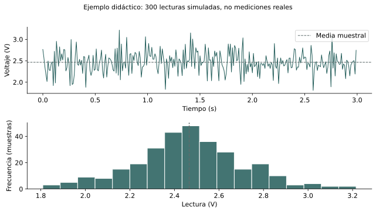{fig-alt="Lecturas simuladas contra tiempo y histograma; media indicada con línea discontinua."}

### Ejemplo numérico 1. Estadística con cinco lecturas

Suponga que una adquisición simulada entrega $[2.1,2.2,2.0,2.3,2.4]\ \mathrm V$. La media es $\bar{x}=2.2\ \mathrm V$. Las desviaciones respecto a la media son $[-0.1,0,-0.2,0.1,0.2]\ \mathrm V$ y la suma de sus cuadrados es $0.10\ \mathrm{V}^2$. Por ello,

$$s=\sqrt{\frac{0.10}{4}}=0.1581\ \mathrm V.$$

La mediana de este conjunto coincide con la media, pero eso no sucederá en general. Compare en LabVIEW los resultados del bloque *Statistics* con los cálculos manuales.

### Ejemplo numérico 2. Señal senoidal y espectro

Para una señal $x(t)=A\sin(2\pi ft)$, la frecuencia $f$ mide el número de ciclos por segundo. Si se desean analizar componentes hasta $100\ \mathrm{Hz}$, el criterio de Nyquist exige $f_s>200\ \mathrm{muestras/s}$ como condición necesaria bajo muestreo ideal y limitación de banda. Debe emplearse un filtro antialiasing apropiado cuando se miden señales reales con componentes por encima de $f_s/2$.

El espectro discreto puede obtenerse mediante la transformada discreta de Fourier:

$$X[k]=\sum_{n=0}^{N-1}x[n]e^{-j2\pi kn/N},\quad k=0,\ldots,N-1.$$

La frecuencia asignada al índice $k$ es $f_k=k f_s/N$, mientras que el espaciamiento entre líneas espectrales es $\Delta f=f_s/N$. Este último no es la exactitud en frecuencia del instrumento.

::: {.course-actions}
[Ejercicio original: Espectro de una señal senoidal (VI)](../../recursos/semana-08/simulaciones/espectro-de-una-senal-senoidal.vi){.course-button download="espectro-de-una-senal-senoidal.vi"}
[Ejercicio original: Gráfica de temperatura (VI)](../../recursos/semana-08/simulaciones/grafica-de-temperatura.vi){.course-button download="grafica-de-temperatura.vi"}
:::

## 6. Ejercicios guiados de la presentación {#ejercicios-clase-22}

### Ejercicio A. Espectro de una señal senoidal

1. Cree el VI **Espectro de una señal senoidal.vi** siguiendo la lámina 32 y compare con el archivo descargable.
2. Ubique los controles que definen la señal y los indicadores usados para mostrar resultados.
3. Ejecute y cambie una sola variable por prueba. Describa qué ocurre con la gráfica y el espectro.
4. Agregue una captura que muestre los valores empleados y una interpretación con unidades.

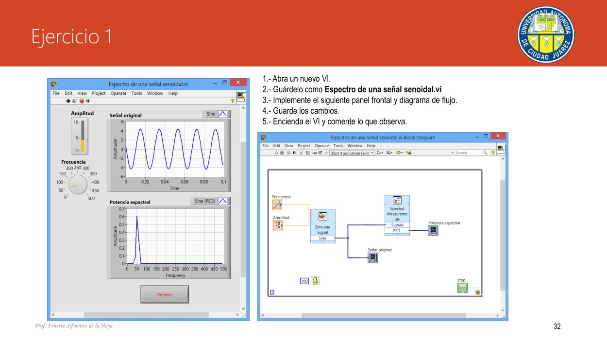{fig-alt="Panel frontal y diagrama de flujo propuestos para el VI de espectro senoidal."}

### Ejercicio B. Gráfica de temperatura

Repita la metodología para **Grafica de temperatura.vi** (lámina 33). Identifique la señal que se utiliza para representar temperatura, sus ejes y la relación entre controles y datos visualizados. No interprete valores generados artificialmente como medidas de un sensor real.

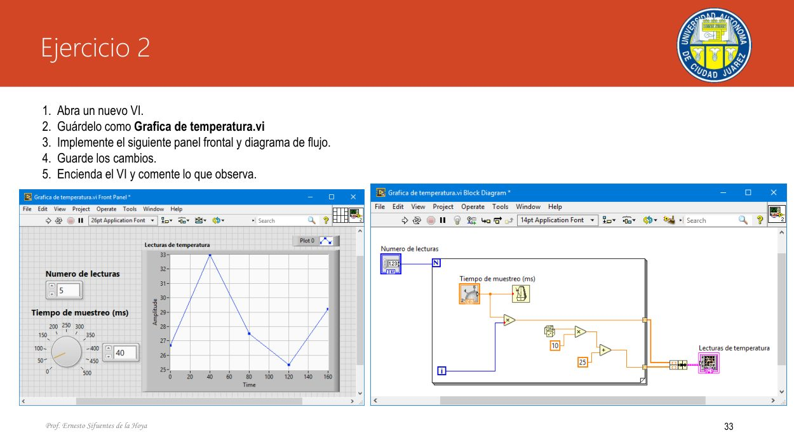{fig-alt="Diagrama original del ejercicio de temperatura."}

### Ejercicio C. Calcular y Salir

Implemente un VI que atienda el botón **Calcular** y, después, agregue un *While Loop* y el botón **Salir**. Explique por qué el bucle no debe depender solamente de detener manualmente la ejecución con *Abort*. Use las láminas 36 y 37 como pauta.

## 7. Comprobación, reporte y autoevaluación {#evaluacion-software-8}

Una evidencia técnica mínima debe incluir: imagen del panel frontal, imagen del diagrama de bloques, nombre del VI, parámetros utilizados, resultados, unidades y una explicación de cómo se produjo el dato. Concluya indicando qué entradas son simuladas y qué partes del flujo podrán utilizarse más adelante con NI myDAQ.

### Tutor IA · Reconocer el flujo de datos {#tutor-flujo-labview-s8}

::: {.tutor-box}
::: {.tutor-texto}
Actúe como tutor de Electrónica II y tráteme de usted. Estoy en la semana 8, estudiando la presentación Software de adquisición y procesamiento de señales. Pídame una captura o descripción de mi VI y guíeme para identificar panel frontal, controles, indicadores, diagrama de bloques, tipos de datos y flujo de ejecución. Formule UNA pregunta por turno y espere mi respuesta. No invente la configuración de una función que no se vea en mi captura. Cuando encuentre una conexión incorrecta, ayúdeme a inferir el problema antes de darme una solución. Al finalizar, pídame que justifique cómo comprobaría la operación del VI.
:::
::: {.tutor-acciones}
[Abrir ChatGPT](https://chatgpt.com/){.course-button target="_blank" rel="noopener"}
:::
:::

### Tutor IA · Muestreo y espectro {#tutor-muestreo-espectro-s8}

::: {.tutor-box}
::: {.tutor-texto}
Actúe como tutor socrático de Electrónica II y tráteme de usted. Estoy resolviendo el ejercicio de espectro de una señal senoidal en LabVIEW, semana 8. Solicite mi frecuencia de señal, frecuencia de muestreo, número de muestras y la gráfica obtenida. Pregunte de manera secuencial por periodo de muestreo, Nyquist y espaciamiento espectral, sin resolver los cálculos por mí mientras no lo intente. Revise unidades Hz, s y muestras. Si sospecho aliasing, oriénteme a modificar solo un parámetro y observar el resultado. Distinga una señal simulada de datos de laboratorio y espere cada respuesta.
:::
::: {.tutor-acciones}
[Abrir ChatGPT](https://chatgpt.com/){.course-button target="_blank" rel="noopener"}
:::
:::
