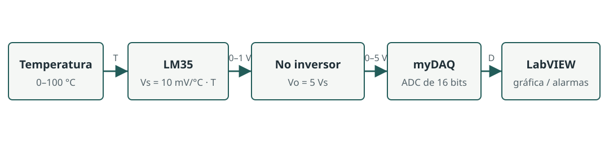
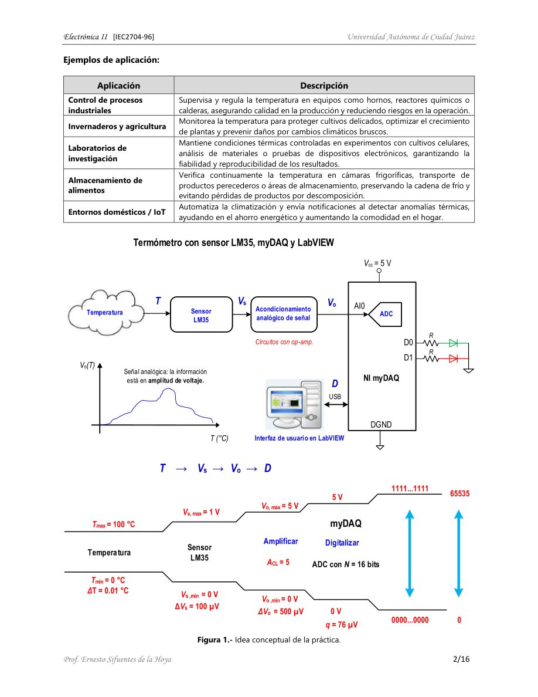
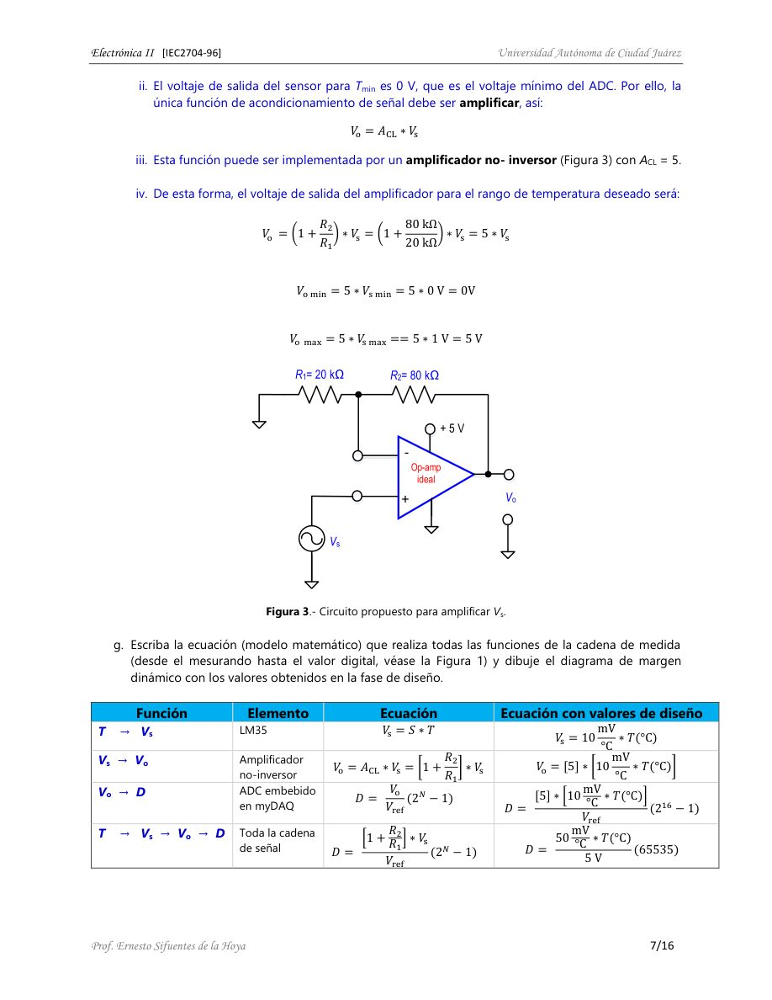
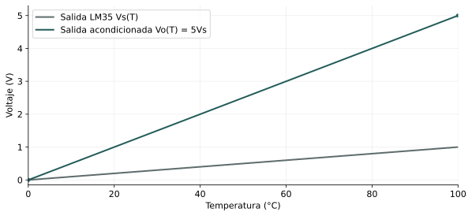
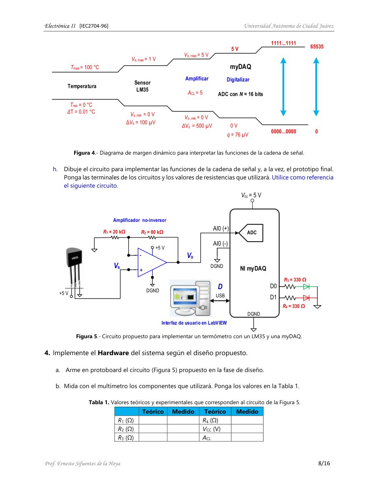
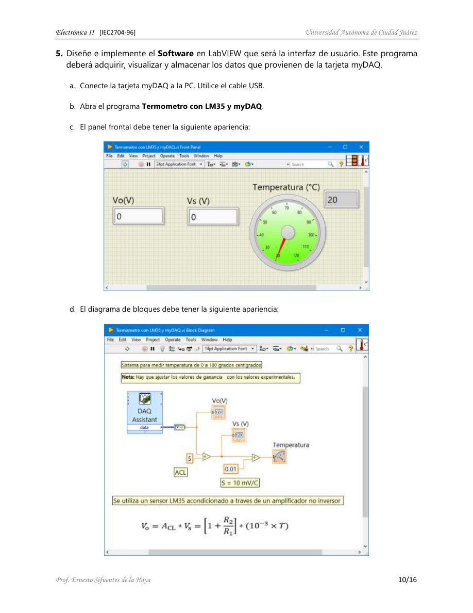
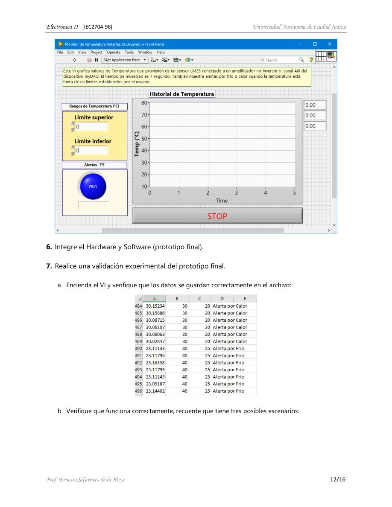

# Práctica 6 · Termómetro con LM35 y NI myDAQ (opción 1) {.unnumbered}

**Clase 26 · 120 minutos.** La guía original de **16 páginas** plantea diseñar, construir e integrar un sistema para medir temperatura con el sensor **LM35**, un acondicionador con amplificador operacional, una tarjeta **NI myDAQ** y una interfaz en **LabVIEW**. Se visualizan y guardan datos, y se encienden dos indicadores LED cuando la temperatura se encuentra fuera de límites programados.

::: {.course-actions}
[Guía de la Práctica 6 (PDF)](../../recursos/semana-09/practica-06-termometro-lm35.pdf){.course-button .course-button-primary}
[Lección 5 · No inversor](../07/amplificar-e-invertir-voltajes.qmd#amplificador-no-inversor-l5){.course-button}
[Práctica 5 · Software de adquisición](../08/practica-05-labview.qmd){.course-button}
:::

## 1. Especificaciones y material {#especificaciones-practica-6}

| Parámetro | Especificación indicada en la guía |
|:--|:--|
| Temperatura de operación | 0 a 100 °C |
| Resolución de temperatura deseada | 0.01 °C (objetivo de diseño) |
| Sensibilidad del LM35 | 10 mV/°C |
| Cadencia de monitoreo | 1 muestra por segundo |
| Señal analógica acondicionada | Objetivo de 0 a 5 V |
| Conversión | NI myDAQ, resolución nominal de ADC de 16 bits |
| Interfaz | LabVIEW; presentación, archivo, dos alarmas de límites |

La lista original incluye: computadora con LabVIEW, NI myDAQ, software de los programas de práctica (se indica descargarlo del aula virtual), sensor LM35, dos LEDs, dos resistencias de aproximadamente $330\ \Omega$, una resistencia cercana a $80\ \mathrm{k\Omega}$ (comercial $82\ \mathrm{k\Omega}$), otra cercana a $20\ \mathrm{k\Omega}$ (comercial $22\ \mathrm{k\Omega}$), un op-amp **TLC274**, protoboard, cables y cautín o fuente térmica para las pruebas. **Los programas `.vi` de la Práctica 6 que la guía remite al aula virtual no estaban incluidos en el ZIP entregado**; consulte su plataforma de curso para obtenerlos.

## 2. Sistema de medida y función de cada etapa {#cadena-lm35-mydaq}

{#fig-cadena-termometro-9 fig-alt="Temperatura 0-100 °C, LM35 de 10 mV por grado, amplificador no inversor de ganancia 5, NI myDAQ y visualización con LabVIEW."}

{fig-alt="Diagrama original del termómetro con ADC, LM35, LEDs y sistema de adquisición."}

| Conversión | Función de la etapa | Magnitud de salida |
|:--|:--|:--|
| $T\to V_s$ | El LM35 traduce temperatura a voltaje | $V_s=ST$ |
| $V_s\to V_o$ | El no inversor incrementa la amplitud | $V_o=A_{CL}V_s$ |
| $V_o\to D$ | El ADC traduce voltaje en códigos digitales | $D\approx \mathrm{round}[(V_o/V_{ref})(2^N-1)]$ |
| $D\to T_{est}$ | El programa recupera temperatura estimada y compara límites | $T_{est}=V_o/(A_{CL}S)$ |

Estas ecuaciones se basan en el modelo **ideal** y requieren calibración y verificación del intervalo de entrada real configurado en la myDAQ.

## 3. Diseño teórico por etapas {#diseno-termometro-6}

### 3.1. Sensor LM35

La relación nominal de salida es

$$
\boxed{V_s(T)=S\,T},\qquad S=10\ \mathrm{mV}/^\circ\mathrm C=0.010\ \mathrm V/^\circ\mathrm C.
$$

Por tanto, $V_s(0^\circ\mathrm C)=0\ \mathrm V$ y $V_s(100^\circ\mathrm C)=1.00\ \mathrm V$. Para la resolución deseada $\Delta T=0.01\ ^\circ\mathrm C$:

$$\Delta V_s=S\Delta T=100\ \mu\mathrm V.$$

Este valor es el **incremento nominal de salida del sensor** que corresponde a 0.01 °C; no constituye una afirmación de exactitud a ese nivel.

### 3.2. Margen dinámico requerido

El material original calcula

$$MD=\frac{T_{max}-T_{min}}{\Delta T}=\frac{100}{0.01}=10\,000\ \text{intervalos},$$

$$MD_{dB}=20\log_{10}(10\,000)=80\ \mathrm{dB}.$$

La cifra de 80 dB expresa la razón de amplitudes ligada al objetivo de diseño. No garantiza por sí misma una relación señal-ruido real de 80 dB. Como $\lceil\log_2(10\,000)\rceil=14$, se requieren al menos 14 bits ideales para representar esa cantidad de intervalos, siempre que el rango de entrada esté adecuadamente aprovechado.

### 3.3. Acondicionador no inversor

El sensor entrega 0–1 V y se pretende una señal acondicionada 0–5 V. La ganancia buscada es

$$
\boxed{A_{CL}=1+\frac{R_2}{R_1}=5}.
$$

La guía propone $R_1=20\ \mathrm{k\Omega}$ y $R_2=80\ \mathrm{k\Omega}$, con lo que $V_o=5V_s$ y una sensibilidad acondicionada de

$$S_o=A_{CL}S=50\ \mathrm{mV}/^\circ\mathrm C.$$

La selección de valores comerciales modifica la ganancia: por ejemplo, con $R_1=20\ \mathrm{k\Omega}$ y $R_2=82\ \mathrm{k\Omega}$, $A_{CL}=5.1$; con $R_1=22\ \mathrm{k\Omega}$ y $R_2=82\ \mathrm{k\Omega}$, $A_{CL}\approx4.727$. **Use la ganancia calculada a partir de las resistencias efectivamente instaladas y medidas.**

{fig-alt="Amplificador no inversor de ganancia cinco y modelo de cadena T-Vs-Vo-D."}

{fig-alt="Rectas 0 a 1V de sensor y 0 a 5V tras amplificación de ganancia 5 para 0-100C."}

### 3.4. ADC y cuantificación

Para un intervalo de entrada **idealizado de 0 a 5 V** y $N=16$ bits, el tamaño nominal del intervalo de cuantificación resulta

$$
q\approx\frac{5\ \mathrm V}{2^{16}}=76.29\ \mu\mathrm V.
$$

La conversión a temperatura, con ganancia de 5, corresponde a un intervalo ideal

$$\Delta T_{ADC}=\frac{q}{S_o}=\frac{76.29\ \mu\mathrm V}{50\ \mathrm{mV}/^\circ\mathrm C}\approx 0.00153\ ^\circ\mathrm C.$$

Sin embargo, la **resolución efectiva**, ruido, rango bipolar/unipolar disponible, exactitud de la referencia y linealidad deben obtenerse de la configuración y características reales de NI myDAQ. La resolución de cuantificación **no es** la exactitud del termómetro: el LM35 tiene errores de sensor y el acondicionamiento también introduce desviaciones.

A modo de conversión ideal de códigos (tomando extremos incluidos),

$$
D\approx\mathrm{round}\left(\frac{V_o}{5\ \mathrm V}\,65535\right),
\quad T_{est}\approx\frac{V_o}{0.050\ \mathrm{V}/^\circ\mathrm C}.
$$

El uso de 65535 en el cálculo de códigos extremos y el uso de $2^{16}=65536$ para estimar $q$ son convenciones próximas pero no idénticas; para un informe instrumental preciso use la función de transferencia especificada por el hardware y su modo de operación.

{fig-alt="Diagrama de especificaciones 0-100 grados, 0-1V, ganancia cinco, 0-5V y myDAQ."}

### 3.5. Tabla de predicción ideal

| Temperatura (°C) | $V_s$ (V) | $V_o$ ideal (V) | $D$ ideal aproximado |
|--:|--:|--:|--:|
| 0 | 0.00 | 0.00 | 0 |
| 25 | 0.25 | 1.25 | 16 384 |
| 50 | 0.50 | 2.50 | 32 768 |
| 75 | 0.75 | 3.75 | 49 151 |
| 100 | 1.00 | 5.00 | 65 535 |

Los códigos de la tabla están redondeados y corresponden al **modelo idealizado unipolar 0–5 V**; no son lecturas verificadas de una myDAQ.

### Tutor IA · Diseñar la cadena LM35–ADC {#tutor-cadena-lm35-s9}

::: {.tutor-box}
::: {.tutor-texto}
Actúe como tutor socrático de Electrónica II y tráteme de usted. Estoy diseñando la cadena de la Práctica 6: LM35 de 10 mV/°C, rango 0–100 °C, resolución deseada 0.01 °C, acondicionador no inversor y NI myDAQ. Solicite primero mi diagrama T→Vs→Vo→D y pregunte de forma secuencial por sensibilidad, márgenes, ganancia, resistencias, cuantificación y conversión a temperatura. Una pregunta por turno, espere mi respuesta y revise coherencia de unidades. Distinga resolución teórica, ruido y exactitud, y advierta que el ADC y el amplificador reales deben operar en un rango permitido. No proporcione todos los cálculos de una vez.
:::
::: {.tutor-acciones}
[Abrir ChatGPT](https://chatgpt.com/){.course-button target="_blank" rel="noopener"}
:::
:::

## 4. Montaje eléctrico e integración con NI myDAQ {#montaje-lm35-s9}

En el prototipo de la página 8, el voltaje del LM35 se aplica a la entrada no inversora del TLC274 y la salida acondicionada a una entrada analógica de myDAQ. Las salidas digitales controlan LEDs mediante resistencias limitadoras; se debe compartir la referencia eléctrica de acuerdo con las conexiones del equipo y las indicaciones del fabricante.

**Verificaciones antes de energizar:**

1. Identifique pinout y orientación del LM35 y TLC274; compruebe los terminales reales en las hojas de datos de la versión disponible.
2. Mida las resistencias instaladas y registre sus valores, así como la fuente de alimentación y referencia común.
3. Compruebe los límites de tensión de las entradas analógicas de myDAQ y que la polaridad y referencia correspondan a su configuración.
4. Verifique que la excursión del TLC274 permita la salida requerida. **No suponga operación rail-to-rail hasta 5 V** con alimentación de 5 V; la saturación cercana al riel puede impedir que el sistema alcance el extremo alto teórico.
5. Compruebe el funcionamiento de cada LED y su resistencia en una prueba independiente, evitando conectar cargas superiores a la capacidad permitida de las líneas digitales.

**Seguridad térmica.** La guía emplea un cautín para aumentar la temperatura del sensor; evite cualquier contacto entre la herramienta caliente y la cubierta, protoboard, aislantes o conductores. Prefiera una fuente de calor moderada y controlada, mantenga separación física y vigile que el sensor permanezca dentro de sus límites especificados.

## 5. Interfaz LabVIEW y procesamiento {#software-practica-6}

El documento original indica abrir los VI de *Termómetro con LM35 y myDAQ* y *Monitor de Temperatura (Interfaz de Usuario)*, que se distribuyen por aula virtual. La interfaz debe:

- mostrar temperatura y gráfica con **una lectura por segundo**;
- permitir establecer un límite inferior $T_{inf}$ y un límite superior $T_{sup}$;
- guardar las medidas en un archivo que pueda revisarse;
- señalar tres condiciones: **normal** ($T_{inf}\le T\le T_{sup}$), **calor** ($T>T_{sup}$) y **frío** ($T<T_{inf}$);
- activar la salida digital/LED correspondiente solo cuando se cumpla su condición de alerta.

{fig-alt="Panel de interfaz y diagrama de LabVIEW que comunica con NI myDAQ."}

La lógica de los límites puede describirse con dos variables booleanas:

$$a_{calor}=\begin{cases}1&T>T_{sup}\\0&T\le T_{sup},\end{cases}\quad
 a_{frio}=\begin{cases}1&T<T_{inf}\\0&T\ge T_{inf}.\end{cases}$$

Con límites válidos $T_{inf}<T_{sup}$, no deberían activarse ambas alarmas al mismo tiempo. Compruebe además el comportamiento al cruzar exactamente cada límite y ante fallas de adquisición.

## 6. Validación experimental {#validacion-practica-6}

El documento solicita diez combinaciones de temperatura y voltajes $T$, $V_s$ y $V_o$, además de fotografías y capturas de la interfaz. Complete con **medidas reales**, sin utilizar la tabla de predicción como si hubiera sido obtenida en el laboratorio.

| Ensayo | $T$ de referencia (°C) | $V_s$ medido (V) | $V_o$ medido (V) | $T_{est}$ (°C) | Alarma y observación |
|--:|:--:|:--:|:--:|:--:|:--|
| 1 | — | — | — | — | — |
| 2 | — | — | — | — | — |
| 3 | — | — | — | — | — |
| 4 | — | — | — | — | — |
| 5 | — | — | — | — | — |
| 6 | — | — | — | — | — |
| 7 | — | — | — | — | — |
| 8 | — | — | — | — | — |
| 9 | — | — | — | — | — |
| 10 | — | — | — | — | — |

Si existe un instrumento de temperatura de referencia, utilícelo para calcular $e_T=T_{est}-T_{ref}$ en los puntos probados. Si no existe, describa que únicamente se verificó consistencia entre la cadena eléctrica y el modelo, **sin atribuir exactitud en °C no demostrada**.

{fig-alt="Pautas originales de validación y registro de datos."}

### Verificación de las tres alarmas

| Condición | Resultado esperado | Captura original |
|:--|:--|:--|
| $T_{inf}\le T\le T_{sup}$ | Ambos LEDs apagados | [Estado normal](../../recursos/semana-09/figuras/guia-06-termometro-lm35-p13.jpg) |
| $T>T_{sup}$ | Alarma de calor y LED rojo | [Alerta por calor](../../recursos/semana-09/figuras/guia-06-termometro-lm35-p14.jpg) |
| $T<T_{inf}$ | Alarma de frío y LED verde | [Alerta por frío](../../recursos/semana-09/figuras/guia-06-termometro-lm35-p15.jpg) |

### Tutor IA · Verificar el prototipo y las alarmas {#tutor-alarmas-lm35-s9}

::: {.tutor-box}
::: {.tutor-texto}
Actúe como tutor de laboratorio de Electrónica II y tráteme de usted. Estoy realizando la Práctica 6 con LM35, TLC274, NI myDAQ y LabVIEW. Solicite el esquema real, alimentación, valores de resistencias medidos, configuración de entrada de la DAQ, límites programados y uno de mis registros reales T, Vs, Vo. Revise un dato por turno: ganancia calculada y medida, posible saturación, conversión a temperatura, estado de alarmas y coherencia de las conexiones digitales. Espere cada respuesta. No afirme que se alcanzó una exactitud de 0.01 °C sin evidencia de calibración; distinga resolución de ADC, exactitud y ruido. No invente pruebas y pida fotografías/capturas cuando sean necesarias.
:::
::: {.tutor-acciones}
[Abrir ChatGPT](https://chatgpt.com/){.course-button target="_blank" rel="noopener"}
:::
:::

## 7. Reporte y preguntas de retroalimentación {#reporte-practica-6}

Entregue definición de especificaciones, diagrama conceptual, justificación de componentes, cálculos teóricos de la cadena $T\to V_s\to V_o\to D$, esquemas eléctricos, medidas de componentes, diez registros, validación de las tres alarmas, capturas del software, discusión y conclusiones.

La guía original propone contestar siete cuestiones de retroalimentación: dificultades durante la práctica; resolución de myDAQ en bits; cantidad de entradas analógicas; intervalo de cuantificación; finalidad de la práctica; relevancia formativa; y cálculo de resolución de voltaje/temperatura si se reemplazara la DAQ por Arduino Nano con ADC de 10 bits y referencia de 3.3 V. Consulte **el texto completo de la página 16** para responder sin cambiar las condiciones.

**Nota didáctica:** la Práctica 6 enlaza con la [Práctica 5](../08/practica-05-labview.qmd), pero no es simplemente un ejercicio de programación: requiere integrar y verificar la **cadena analógica de medición** antes de interpretar el dato digital.
