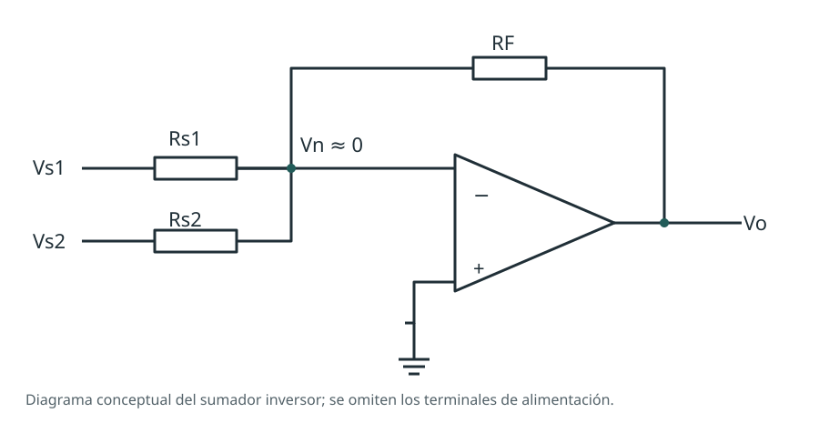
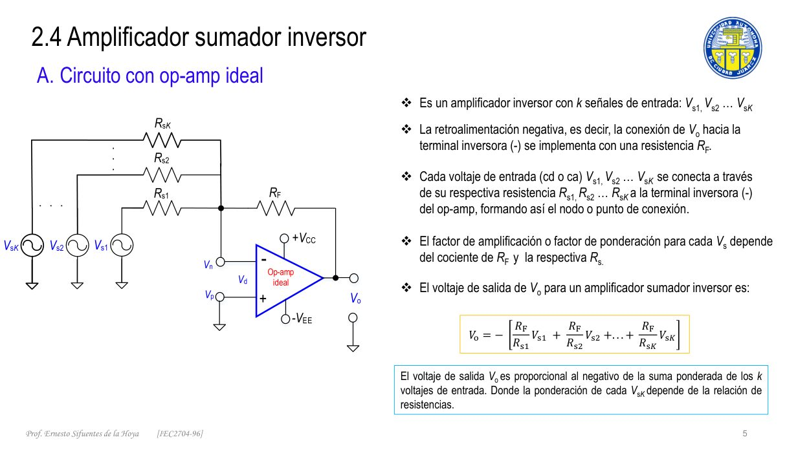
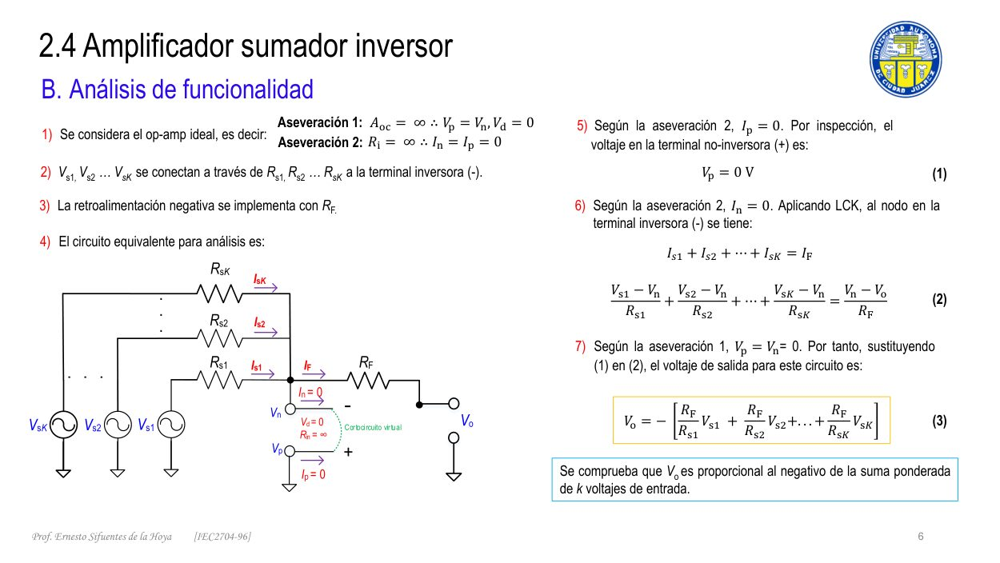
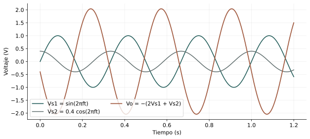
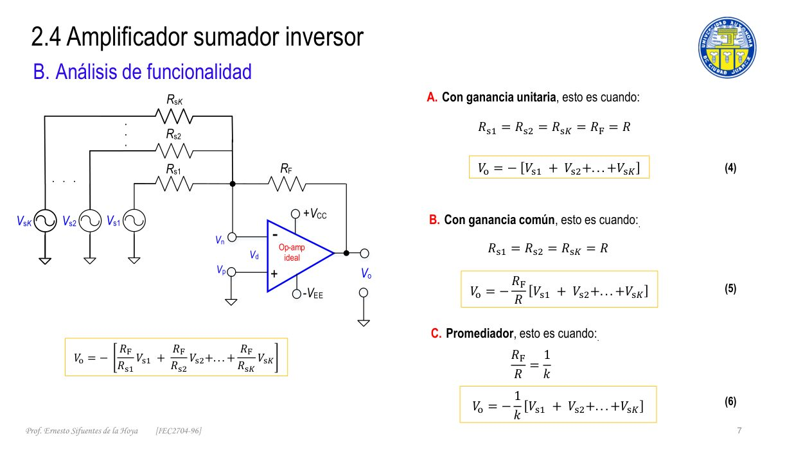
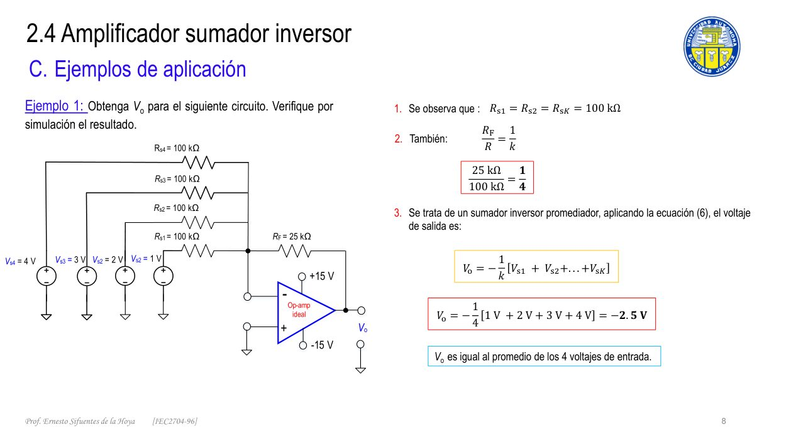
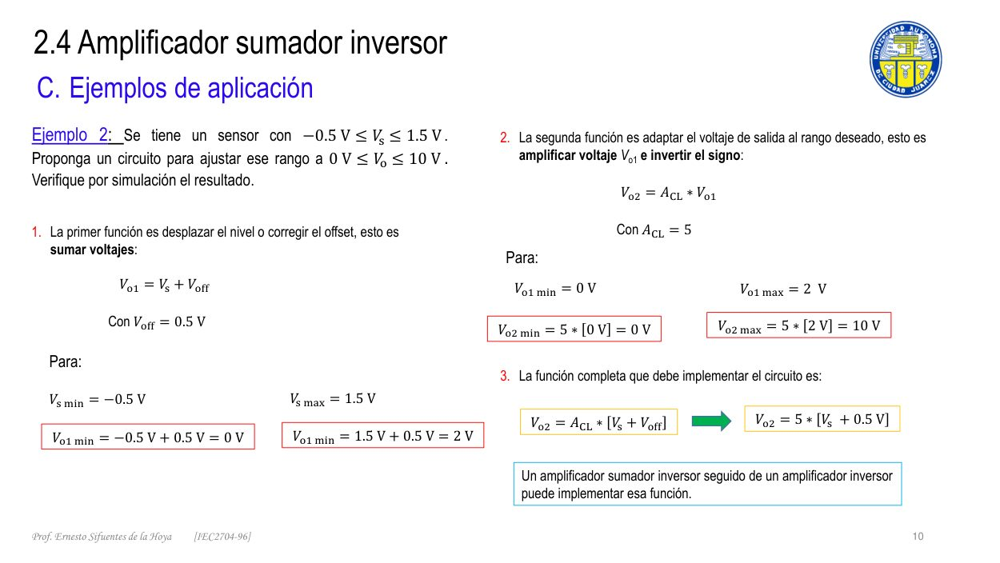
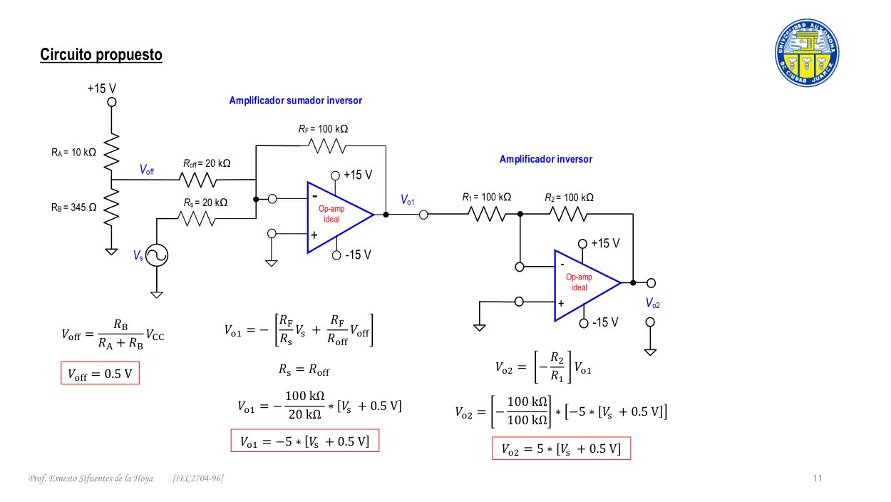
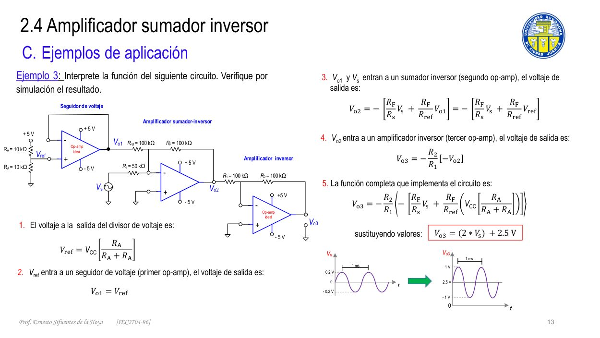

# Lección 6 · Sumar y amplificar voltajes {.unnumbered}

La Lección 6 estudia el amplificador sumador inversor y su aplicación al acondicionamiento de señales: suma algebraica de varias entradas, suma ponderada, promediado, cambio de escala y desplazamiento de nivel. El desarrollo sigue los apartados de las **15 láminas** de la presentación original: A) circuito ideal, B) análisis de funcionalidad, C) ejemplos y D) diseño/simulación.

::: {#video-l6 .course-actions}
[Ver video de la Lección 6](https://www.youtube.com/watch?v=sBOazMfdvmU){.course-button .course-button-primary target="_blank" rel="noopener"}
[Presentación de Lección 6 (PDF)](../../recursos/semana-09/presentacion-leccion-06.pdf){.course-button}
[Ejercicios propuestos L6](ejercicios-propuestos-l6.qmd){.course-button}
[Práctica 6 · Termómetro LM35](practica-06-termometro-lm35.qmd){.course-button}
:::

**Actividad de video — Lección 6.** Vea la presentación en video y elabore **a mano un resumen** que sintetice los conceptos principales, con extensión proporcional al contenido. **Entrega: clase 25 (primera sesión de la semana 9).** Consulte las [entregas de la Semana 9](semana-09.qmd#entregas).

## 1. Repaso: inversor y no inversor {#repaso-ganancias-l6}

En la [Lección 5](../07/amplificar-e-invertir-voltajes.qmd) se dedujeron las ganancias ideales

$$
\boxed{A_{CL,inv}=-\frac{R_2}{R_1}},\qquad
\boxed{A_{CL,noinv}=1+\frac{R_2}{R_1}}.
$$

La topología inversora usa un nodo de suma al que se conectan la resistencia de entrada y la realimentación. Al introducir **múltiples resistencias de entrada** y mantener una sola resistencia de realimentación, el circuito combina señales en el mismo nodo.

El sumador puede combinar voltajes continuos y señales variables; la capacidad de procesar simultáneamente varias señales está limitada por la excursión de salida, la banda pasante, la alimentación y las condiciones de entrada del op-amp real.

## 2. Configuración del sumador inversor {#sumador-configuracion-l6}

{#fig-sumador-inversor-l6 fig-alt="Amplificador sumador inversor con entradas Vs1 y Vs2 por resistencias Rs1 y Rs2, nodo inversor, RF de salida a nodo, entrada positiva a tierra."}

{fig-alt="Circuito de varias entradas del circuito de la Lección 6."}

Cada señal $V_{s,i}$ llega al terminal inversor mediante $R_{s,i}$, mientras que $R_F$ comunica la salida $V_o$ con ese nodo. El terminal no inversor se conecta a tierra. Los supuestos del modelo ideal en régimen lineal son:

$$I_p=I_n=0,\quad A_{OC}\rightarrow\infty,\quad V_p\approx V_n=0.$$

La última igualdad, llamada **tierra virtual**, depende de que la realimentación sea negativa y de que el dispositivo no esté saturado. No significa que el terminal inversor esté físicamente unido a tierra.

## 3. Deducción por Ley de Corrientes de Kirchhoff {#deduccion-l6}

Considere $K$ fuentes con resistencias $R_{s1},R_{s2},\ldots,R_{sK}$. Las corrientes de entrada vistas hacia el nodo inversor son:

$$I_{s,i}=\frac{V_{s,i}-V_n}{R_{s,i}}.$$

Por realimentación, la corriente que sale hacia $V_o$ se escribe como

$$I_F=\frac{V_n-V_o}{R_F}.$$

Aplicando LCK al nodo (sin corriente hacia la entrada ideal del op-amp):

$$
\frac{V_{s1}-V_n}{R_{s1}}+\frac{V_{s2}-V_n}{R_{s2}}+\cdots+
\frac{V_{sK}-V_n}{R_{sK}}=\frac{V_n-V_o}{R_F}.
$$

Con $V_n=0$ se obtiene

$$\sum_{i=1}^{K}\frac{V_{s,i}}{R_{s,i}}=-\frac{V_o}{R_F}$$

y por tanto

$$
\boxed{V_o=-R_F\sum_{i=1}^{K}\frac{V_{s,i}}{R_{s,i}}=
-\left(\frac{R_F}{R_{s1}}V_{s1}+\cdots+\frac{R_F}{R_{sK}}V_{sK}\right)}.
$$

**Interpretación física.** La ponderación de cada señal es $w_i=R_F/R_{s,i}$, una magnitud adimensional. Al disminuir la resistencia de una entrada, su contribución a la corriente del nodo y a la salida aumenta, suponiendo que la fuente tenga resistencia interna despreciable o conocida.

{fig-alt="Diapositiva con LCK del nodo inversor y deducción de salida del sumador."}

### Ejemplo didáctico: suma ponderada de dos señales {#ejemplo-ponderacion-l6}

Para $R_F=100\ \mathrm{k\Omega}$, $R_{s1}=50\ \mathrm{k\Omega}$, $R_{s2}=100\ \mathrm{k\Omega}$, y tensiones $V_{s1}=0.5\ \mathrm V$, $V_{s2}=1.0\ \mathrm V$:

$$
V_o=-\left(\frac{100}{50}\cdot0.5+\frac{100}{100}\cdot1.0\right)=-2.0\ \mathrm V.
$$

Se trata de un ejemplo nuevo de aplicación de la ecuación, no de un resultado experimental. Verifique que una salida de $-2\ \mathrm V$ esté dentro de los límites del amplificador elegido antes de construir el circuito.

{fig-alt="Dos formas de onda de entrada y una salida obtenida de combinar -2Vs1-Vs2, ilustración sintética."}

### Tutor IA · Deducir la suma ponderada {#tutor-deduccion-sumador-l6}

::: {.tutor-box}
::: {.tutor-texto}
Actúe como tutor de Electrónica II, Lección 6, y tráteme de usted. Estoy deduciendo la relación de salida de un sumador inversor con K fuentes. Solicite mi esquema, los valores de RF, resistencias de entrada, señales y fuente de alimentación. Haga una sola pregunta por turno: primero justifique el nodo de tierra virtual; después compruebe por LCK los sentidos de las corrientes y la aparición del signo menos; por último haga que yo construya la suma ponderada. Espere mi respuesta antes de avanzar. No suponga datos, no resuelva directamente y cierre solicitando cómo verificaría la salida por simulación.
:::
::: {.tutor-acciones}
[Abrir ChatGPT](https://chatgpt.com/){.course-button target="_blank" rel="noopener"}
:::
:::

## 4. Tres modos de funcionamiento {#funcionalidad-sumador-l6}

La lámina 7 diferencia las siguientes aplicaciones según la relación de resistencias:

### A. Sumador de pesos unitarios

Si todas las resistencias de entrada son iguales a $R_F=R$, cada fuente tiene ponderación uno:

$$\boxed{V_o=-(V_{s1}+V_{s2}+\cdots+V_{sK})}.$$

### B. Sumador con ganancia común

Si $R_{s1}=R_{s2}=\cdots=R_{sK}=R$:

$$\boxed{V_o=-\frac{R_F}{R}(V_{s1}+V_{s2}+\cdots+V_{sK})}.$$

La ganancia común puede ser mayor o menor que uno en magnitud. La suma algebraica conserva los signos originales de las fuentes, y el circuito invierte el resultado.

### C. Promediador inversor

Si además $R_F/R=1/K$, entonces

$$\boxed{V_o=-\frac1K\sum_{i=1}^{K}V_{s,i}=-\bar V_s}.$$

Se obtiene el **negativo** del promedio. Si se desea un promedio positivo respecto a tierra, puede añadirse una etapa inversora de ganancia $-1$, siempre que sus límites eléctricos permitan hacerlo.

{fig-alt="Resumen original de tres modalidades del amplificador sumador inversor."}

## 5. Ejemplo 1 de la presentación: promedio de cuatro voltajes {#ejemplo1-l6}

La lámina 8 usa cuatro voltajes de entrada $1$, $2$, $3$ y $4\ \mathrm V$, todos conectados a través de resistencias de $100\ \mathrm{k\Omega}$, y una resistencia de realimentación de $25\ \mathrm{k\Omega}$. Puesto que

$$\frac{R_F}{R_s}=\frac{25}{100}=\frac14,$$

se obtiene

$$\boxed{V_o=-\frac14(1+2+3+4)=-2.5\ \mathrm V}.$$

El valor $-2.5\ \mathrm V$ **no es el promedio positivo**, sino su versión invertida. Esta distinción es indispensable al interpretar el papel del signo en un op-amp.

{fig-alt="Sumador de cuatro entradas, resistencias 100k y RF25k, salida -2.5V."}

## 6. Ejemplo 2: cambio de escala y corrección de offset {#ejemplo2-l6}

**Problema original.** Una señal de sensor varía de $-0.5$ a $1.5\ \mathrm V$ y se desea obtener de $0$ a $10\ \mathrm V$. La conversión analógica de escala y offset debe describirse mediante una función afín:

$$V_o=mV_s+b.$$

Con los extremos requeridos,

$$m=\frac{10-0}{1.5-(-0.5)}=5,
\qquad b=0-5(-0.5)=2.5\ \mathrm V.$$

Por tanto, la relación exigida es

$$\boxed{V_o=5V_s+2.5\ \mathrm V=5(V_s+0.5\ \mathrm V)}.$$

Esto establece el diseño **antes** de elegir resistencias: el circuito debe trasladar el cero de la señal $-0.5\ \mathrm V$ y amplificar un intervalo de $2\ \mathrm V$ hasta un intervalo de $10\ \mathrm V$.

### Implementación original con dos etapas

La presentación utiliza primero un **sumador inversor** con $R_s=R_{off}=20\ \mathrm{k\Omega}$ y $R_F=100\ \mathrm{k\Omega}$. Una referencia $V_{off}=0.5\ \mathrm V$ se obtiene de un divisor resistivo. Entonces

$$V_{o1}=-5(V_s+V_{off})=-5(V_s+0.5\ \mathrm V).$$

Una segunda etapa inversora con resistencias iguales $R_1=R_2=100\ \mathrm{k\Omega}$ invierte esa señal:

$$V_{o2}=-V_{o1}=5(V_s+0.5\ \mathrm V).$$

**Compruebe extremos:** con $V_s=-0.5\ \mathrm V$ la salida es 0 V; con $V_s=1.5\ \mathrm V$ la salida es 10 V. Al desarrollar las expresiones, **conserve los paréntesis**: $5(V_s+0.5\ \mathrm V)$ y $5V_s+0.5\ \mathrm V$ no representan lo mismo.

{fig-alt="Ejemplo original de acondicionamiento del rango -0.5 a 1.5V hacia 0 a 10V."}

{fig-alt="Circuito de dos etapas con sumador inversor, divisor para Voff y segunda etapa inversora."}

### Tabla de validación analítica

| $V_s$ (V) | $V_{off}$ (V) | $V_{o1}$ (V) | $V_{o2}$ (V) |
|--:|--:|--:|--:|
| −0.5 | 0.5 | 0 | 0 |
| 0 | 0.5 | −2.5 | 2.5 |
| 0.5 | 0.5 | −5.0 | 5.0 |
| 1.5 | 0.5 | −10.0 | 10.0 |

La tabla expresa resultados **ideales** de diseño. Para cada op-amp real se debe comprobar el rango de modo común, la alimentación y la excursión de salida. Aun con alimentación $\pm15\ \mathrm V$, el resultado debe verificarse con el modelo real empleado.

### Tutor IA · Diseñar escala y offset {#tutor-offset-l6}

::: {.tutor-box}
::: {.tutor-texto}
Sea tutor socrático de Electrónica II, Lección 6; tráteme de usted. Estoy diseñando un acondicionador para transformar Vs de -0.5 a 1.5 V en Vo de 0 a 10 V. Pregúnteme primero por la forma Vo=mVs+b y haga que yo calcule pendiente y ordenada al origen. Después pregúnteme por las dos etapas sumador inversor e inversor, el significado de Voff, las relaciones de resistencias y las condiciones de alimentación. Una pregunta por turno y espere mi respuesta. Compruebe los dos extremos del rango, los signos y la correcta agrupación de 5(Vs+0.5 V). No invente simulaciones ni entregue toda la solución de inmediato.
:::
::: {.tutor-acciones}
[Abrir ChatGPT](https://chatgpt.com/){.course-button target="_blank" rel="noopener"}
:::
:::

## 7. Ejemplo 3: seguidor, sumador e inversor {#ejemplo3-l6}

La lámina 13 integra **tres etapas**. Primero, un divisor de voltaje suministra una referencia $V_{ref}$; un seguidor de voltaje la aísla del siguiente circuito. Después, un sumador inversor combina $V_s$ y $V_{ref}$ y, finalmente, una etapa inversora produce el resultado deseado.

En términos generales:

$$
V_{ref}=V_{CC}\frac{R_B}{R_A+R_B},\qquad V_{o1}=V_{ref},
$$

$$
V_{o2}=-\left(\frac{R_F}{R_s}V_s+\frac{R_F}{R_{ref}}V_{o1}\right),
\qquad V_{o3}=-\frac{R_2}{R_1}V_{o2}.
$$

Con los valores representados en la presentación, el circuito realiza la transformación

$$\boxed{V_{o3}=2V_s+2.5\ \mathrm V}.$$

Por ejemplo, si $V_s(t)=0.2\sin(2\pi 1000t)\ \mathrm V$, entonces $V_{o3}(t)=2.5+0.4\sin(2\pi1000t)\ \mathrm V$. La señal se encuentra centrada en $2.5\ \mathrm V$ y su amplitud pico es $0.4\ \mathrm V$, siempre que se mantenga el régimen lineal.

{fig-alt="Tres etapas con divisor de referencia, buffer, sumador e inversor; relación Vo3=2Vs+2.5V."}

## 8. Simulaciones originales y criterios de comparación {#simulaciones-l6}

Se proporcionaron los archivos Multisim de los tres ejemplos, así como un circuito de ejercicio y su versión resuelta. Conserve las simulaciones originales, observe las fuentes y resistencias y efectúe modificaciones **sobre copias** para no perder el circuito inicial.

::: {.course-actions}
[Ejemplo 1 · Promediador (.ms14)](../../recursos/semana-09/simulaciones/ejemplo-1-amplificador-sumador-inversor.ms14){.course-button download="ejemplo-1-amplificador-sumador-inversor.ms14"}
[Ejemplo 2 · Offset (.ms14)](../../recursos/semana-09/simulaciones/ejemplo-2-amplificador-sumador-inversor.ms14){.course-button download="ejemplo-2-amplificador-sumador-inversor.ms14"}
[Ejemplo 3 · Cadena de tres etapas (.ms14)](../../recursos/semana-09/simulaciones/ejemplo-3-amplificador-sumador-inversor.ms14){.course-button download="ejemplo-3-amplificador-sumador-inversor.ms14"}
:::

| Comparación | Predicción ideal | Evidencia que se requiere en Multisim |
|:--|:--|:--|
| Ejemplo 1 | $V_o=-2.5\ \mathrm V$ | Tensión de salida, valores de las cuatro fuentes |
| Ejemplo 2 | $V_o=0$ y $10\ \mathrm V$ en extremos | Tensiones de ambas etapas, fuente de referencia y alimentación |
| Ejemplo 3 | $V_o=2V_s+2.5\ \mathrm V$ | Niveles de offset, amplitudes y forma de onda |

Si la salida simulada no coincide, inspeccione primero las **conexiones reales** de los circuitos, no únicamente los parámetros de una tabla. El modelo del op-amp puede imponer saturación o limitaciones no contempladas por el ideal.

## 9. Aplicaciones y limitaciones del sumador {#aplicaciones-sumador-l6}

El sumador inversor permite mezclar canales analógicos, sumar señales de referencia, compensar offsets y establecer ganancias distintas para cada fuente. Entre sus limitaciones están la carga que impone cada resistencia de entrada, la impedancia de las fuentes, el ruido y la tolerancia de resistencias. Para entradas de frecuencia elevada o señales grandes, deben verificarse **ancho de banda** y *slew rate*; para señales de continua, el **offset del amplificador** puede convertirse en error relevante.

Como evaluación de la lección, resuelva los [Ejercicios propuestos L6](ejercicios-propuestos-l6.qmd), explique los pesos de las entradas y compare sus resultados con los archivos `.ms14` originales. Entre las referencias recomendadas se encuentran Carter y Mancini, Franco, Coughlin y Driscoll, y Savant *et al.*; conserve los datos bibliográficos del PDF original si necesita citarlos en un informe.

### Tutor IA · Interpretar simulaciones del sumador {#tutor-simulacion-sumador-l6}

::: {.tutor-box}
::: {.tutor-texto}
Sea tutor de Electrónica II y tráteme de usted. Estoy comparando las simulaciones de los Ejemplos 1, 2 o 3 de la Lección 6. Pídame elegir el ejemplo y proporcionar el esquema Multisim con los valores de fuentes, resistencias y alimentación; después solicite mi cálculo teórico. Formule una sola pregunta por turno y espere mi respuesta. Ayúdeme a validar el signo, la ganancia de cada fuente, los offsets y las posibles saturaciones. Si el ejemplo incluye varias etapas, pídame comprobar la salida de una etapa antes de avanzar a la siguiente. No suponga que tengo resultados medidos ni invente el contenido de mis capturas.
:::
::: {.tutor-acciones}
[Abrir ChatGPT](https://chatgpt.com/){.course-button target="_blank" rel="noopener"}
:::
:::
