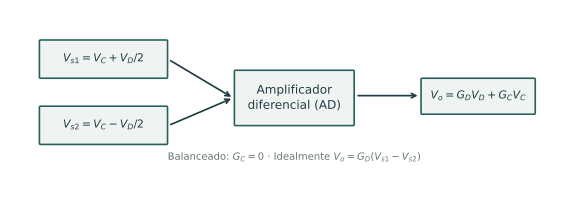
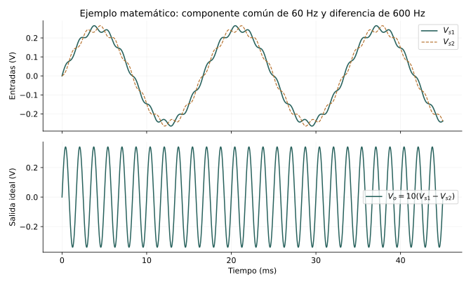
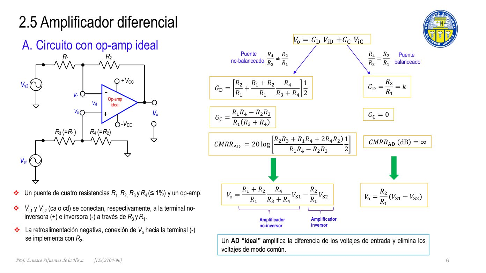
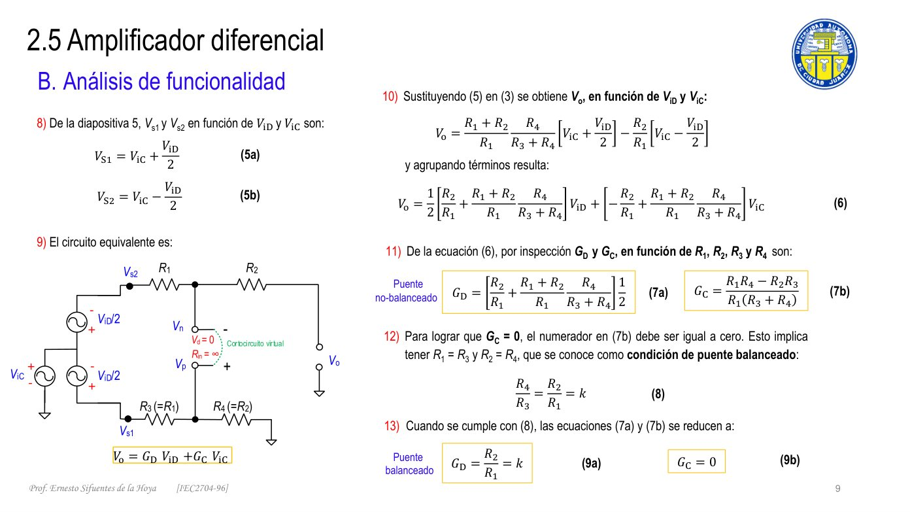
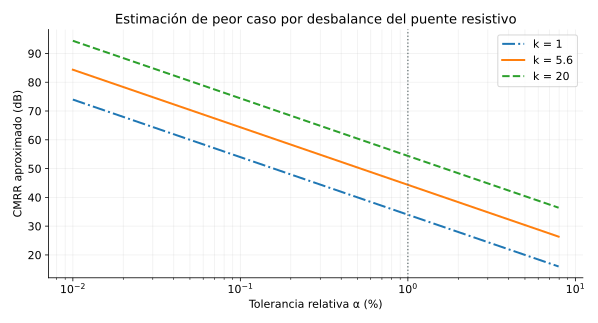
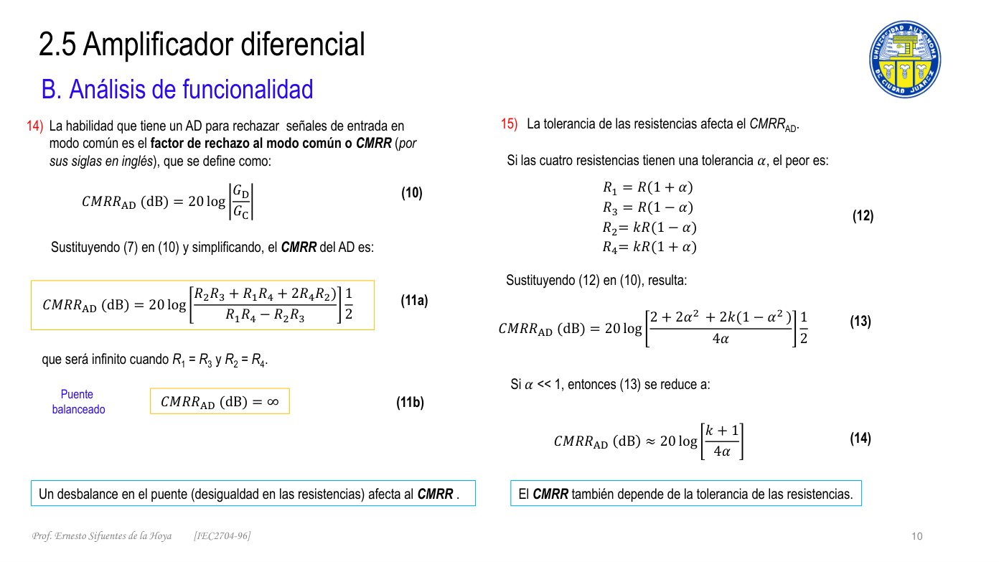
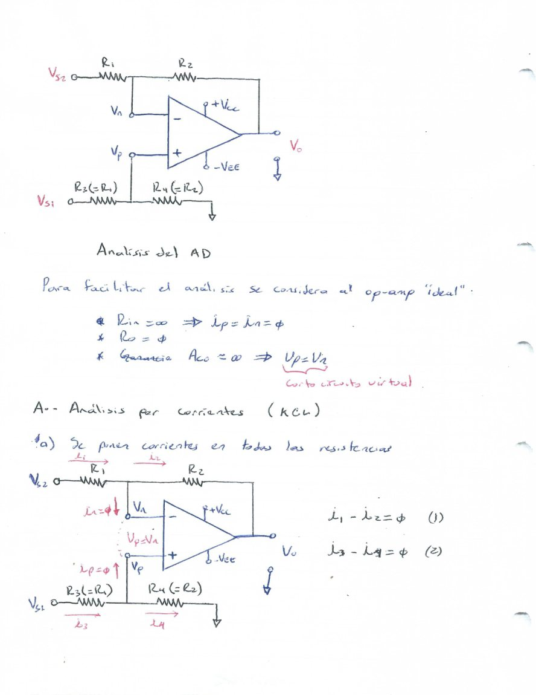
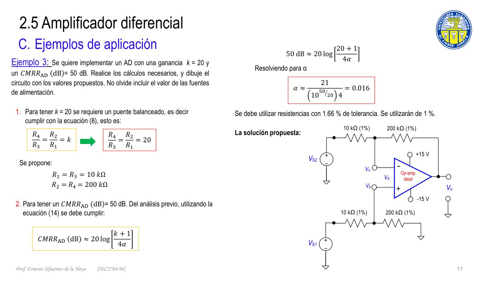
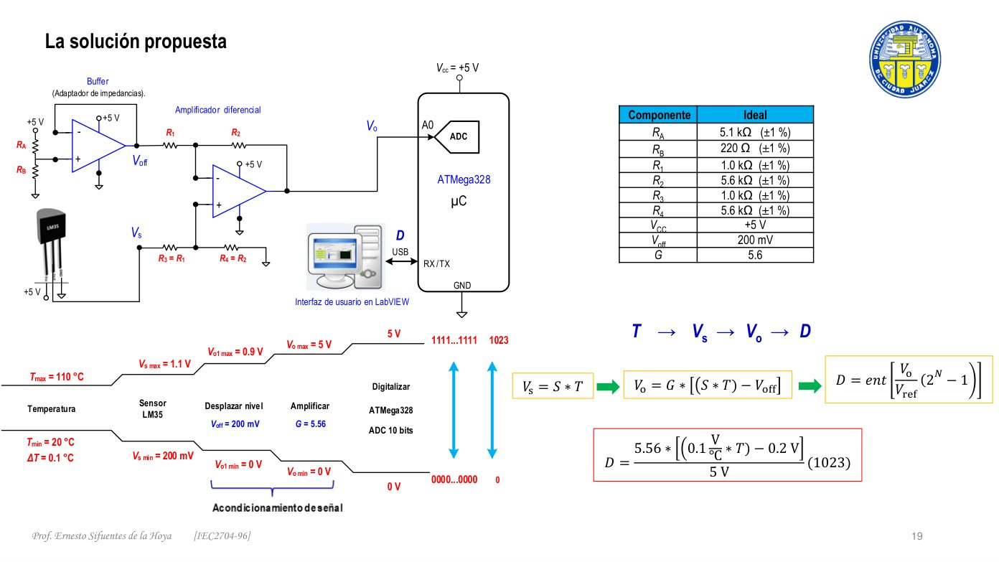

# Lección 7 · Restar y amplificar voltajes: amplificador diferencial (2.5) {.unnumbered}

La primera parte de la Lección 7 estudia el *amplificador diferencial* (AD) implementado con un amplificador operacional y cuatro resistencias. También se estudia el amplificador de instrumentación, desarrollado por separado en la [semana 11](../11/amplificador-instrumentacion.qmd).

::: {#video-l7-parte-1 .course-actions}
[Ver video de la Lección 7 · Parte 1](https://www.youtube.com/watch?v=96MRWQ4XVJw){.course-button .course-button-primary target="_blank" rel="noopener"}
[Presentación original L7, 41 diapositivas](../../recursos/semana-10/presentacion-leccion-07.pdf){.course-button}
[Apuntes manuscritos del profesor](teoria-basica-ad.qmd){.course-button}
[Ejercicios L7 (AD)](ejercicios-l7-ad.qmd){.course-button}
[Práctica 8 experimental](../11/practica-08-amplificador-diferencial.qmd){.course-button}
:::

**Actividad de video — Lección 7, parte 1.** Vea la presentación en video y elabore **a mano un resumen** que sintetice los conceptos principales, con extensión proporcional al contenido. **Entrega: clase 28 (primera sesión de la semana 10).** Consulte las [entregas de la Semana 10](semana-10.qmd#entregas-semana-10).

## 1. ¿Por qué restar voltajes? {#ad-justificacion}

Una señal útil puede aparecer superpuesta a un voltaje que afecta por igual a ambos conductores (ruido de red, acoplamiento ambiental o diferencias de potencial comunes). Interesa amplificar **la diferencia** de las señales y rechazar la contribución común. Por ejemplo, si dos terminales presentan $V_{s1}=2.013\ \mathrm V$ y $V_{s2}=1.987\ \mathrm V$, la diferencia es apenas $26\ \mathrm{mV}$, aunque ambas tensiones estén cerca de $2\ \mathrm V$.

Definimos explícitamente:

$$
V_{iD}=V_{s1}-V_{s2},\qquad V_{iC}=\frac{V_{s1}+V_{s2}}{2}.
$$

Al despejar los voltajes originales:

$$
\boxed{V_{s1}=V_{iC}+\frac{V_{iD}}2},\qquad
\boxed{V_{s2}=V_{iC}-\frac{V_{iD}}2}.
$$

Las dos componentes son **modos de excitación**, no fuentes físicas independientes. La respuesta lineal del AD se representa mediante

$$\boxed{V_o=G_DV_{iD}+G_CV_{iC}},$$

donde $G_D$ es la ganancia en modo diferencial y $G_C$ la ganancia en modo común, ambas en V/V. Idealmente $G_C=0$.

{fig-alt="Diagrama funcional con expresiones para entrada diferencial y común y salida de amplificador diferencial."}

{fig-alt="Gráficas calculadas que muestran dos entradas con modo común y la salida del modelo diferencial ideal."}

### Tutor IA · Identificar ambos modos {#tutor-modos-ad-s10}

::: {.tutor-box}
::: {.tutor-texto}
Actúe como tutor socrático de Electrónica II. Tráteme de usted. Estoy estudiando la Lección 7, sección 2.5, y debo diferenciar voltaje diferencial ViD y voltaje común ViC. Presénteme un par de voltajes numéricos y pregunte primero cómo hallar ViD; espere mi respuesta. Después revise ViC, descomponga las entradas en componentes común/diferencial y compruebe mis unidades. Pídame interpretar la salida Vo=GD ViD+GC ViC sin asignar GC=0 automáticamente. Haga una pregunta por turno, no muestre toda la solución antes de mi intento y concluya pidiéndome explicar qué señal deseada preserva el AD.
:::
::: {.tutor-acciones}
[Abrir ChatGPT](https://chatgpt.com/){.course-button target="_blank" rel="noopener"}
:::
:::

## 2. Topología de cuatro resistencias {#ad-topologia}

En el circuito original, $V_{s1}$ llega a la entrada **no inversora** a través de $R_3$ y $V_{s2}$ llega a la entrada **inversora** por $R_1$. $R_4$ conecta la entrada no inversora con la referencia, y $R_2$ realimenta la salida a la terminal inversora. Una relación precisa entre las dos parejas de resistencias permite cancelar idealmente el modo común.

{fig-alt="Diapositiva del circuito con el circuito restador resistivo de cuatro resistencias y un amplificador operacional."}

**Hipótesis de análisis:** op-amp ideal, operación no saturada, realimentación negativa estable, corrientes $I_+=I_-=0$ y voltajes $V_+=V_-$ (corto virtual). Estas aproximaciones no sustituyen la verificación con TL084/TLC274 u otro dispositivo real.

### 2.1. Tensión de entrada no inversora

Como no entra corriente en $V_+$, $R_3$ y $R_4$ forman un divisor:

$$\frac{V_{s1}-V_+}{R_3}=\frac{V_+}{R_4}
\ \Longrightarrow\quad
\boxed{V_+=\frac{R_4}{R_3+R_4}V_{s1}}.$$

### 2.2. Corrientes en el nodo inversor

Aplicando la ley de corrientes de Kirchhoff (LCK):

$$\frac{V_{s2}-V_-}{R_1}=\frac{V_--V_o}{R_2}.$$

Si $V_-=V_+$, despejamos:

$$V_o=\left(1+\frac{R_2}{R_1}\right)V_+-\frac{R_2}{R_1}V_{s2}.$$

Sustituyendo el divisor se obtiene la **ecuación general del AD**:

$$
\boxed{V_o=\left(1+\frac{R_2}{R_1}\right)
\frac{R_4}{R_3+R_4}V_{s1}
-\frac{R_2}{R_1}V_{s2}}.
$$

Esta ecuación es válida bajo las hipótesis citadas aunque las resistencias no estén perfectamente igualadas.

{fig-alt="Expresiones de salida del amplificador diferencial y deducción de ganancias según relaciones resistivas."}

### 2.3. Condición de puente balanceado

Definamos $k=R_2/R_1$ y $m=R_4/(R_3+R_4)$. La salida es

$$V_o=(1+k)m\,V_{s1}-kV_{s2}.$$

Para eliminar el término común debe cumplirse $(1+k)m=k$, equivalente a

$$
\boxed{\frac{R_4}{R_3}=\frac{R_2}{R_1}=k}.
$$

Entonces la ecuación se simplifica a

$$\boxed{V_o=k(V_{s1}-V_{s2})=kV_{iD}},\quad G_D=k,\quad G_C=0.$$

La igualdad de las *razones* es la condición fundamental. Escoger $R_1=R_3$ y $R_2=R_4$ es una manera sencilla de realizarla, no la única.

## 3. Ganancia diferencial, ganancia común y CMRR {#ad-cmrr}

Sustituyendo $V_{s1}=V_{iC}+V_{iD}/2$ y $V_{s2}=V_{iC}-V_{iD}/2$ en la ecuación general se obtienen:

$$\boxed{G_D=\frac12\left[\frac{R_2}{R_1}+\left(1+\frac{R_2}{R_1}\right)\frac{R_4}{R_3+R_4}\right]},$$

$$\boxed{G_C=\left(1+\frac{R_2}{R_1}\right)\frac{R_4}{R_3+R_4}-\frac{R_2}{R_1}
=\frac{R_1R_4-R_2R_3}{R_1(R_3+R_4)}}.$$

La capacidad de discriminar entre ambos modos se mide por la relación de rechazo al modo común:

$$
\boxed{\operatorname{CMRR}_{AD}=\left|\frac{G_D}{G_C}\right|},
\qquad
\boxed{\operatorname{CMRR}_{AD,\mathrm{dB}}=20\log_{10}\left|\frac{G_D}{G_C}\right|}.
$$

No se expresa en dB cada ganancia aislada para hacer el cociente: primero se calcula $G_D/G_C$ como razón adimensional, y después se aplica el logaritmo. En el puente perfectamente balanceado, el modelo predice $G_C=0$ y CMRR infinito. **El AD físico no tiene CMRR infinito:** influyen el CMRR propio del op-amp, tolerancias, impedancia de las fuentes, frecuencia y montaje.

Para pares con tolerancia relativa $\alpha\ll 1$, la aproximación de peor caso presentada por el profesor es

$$\operatorname{CMRR}_{AD,\mathrm{dB}}\approx20\log_{10}\left(\frac{k+1}{4\alpha}\right).$$

{fig-alt="Curvas teóricas de CMRR aproximado frente a tolerancia resistiva para k=1,5.6 y 20."}

{fig-alt="Relaciones para el CMRR de puente balanceado y desbalanceado, y aproximación mediante tolerancia alfa."}

**Ejemplo breve.** Si $k=5.6$ y $\alpha=0.01$, la aproximación resulta $20\log_{10}[6.6/0.04]\approx44.35\ \mathrm{dB}$. Es una cota aproximada del desbalance de resistencias, **no una especificación garantizada de todo el circuito**.

### Tutor IA · Deducir el AD y su CMRR {#tutor-deduccion-ad-s10}

::: {.tutor-box}
::: {.tutor-texto}
Sea mi tutor socrático de Electrónica II y hábleme de usted. Tengo el circuito AD con R1/R2 en la entrada inversora y R3/R4 en la no inversora. Solicite mis valores y pídame aplicar LCK primero en el nodo positivo y luego en el negativo. Una pregunta por turno y espere mi respuesta. Ayúdeme a deducir Vo=f(Vs1,Vs2), después GD, GC, condición de puente balanceado y CMRR en V/V y dB. Compruebe polaridades, paréntesis, unidades y condiciones de operación. Si doy GC=0 sin verificar relaciones, pídame justificarlo. No me entregue una solución completa al inicio.
:::
::: {.tutor-acciones}
[Abrir ChatGPT](https://chatgpt.com/){.course-button target="_blank" rel="noopener"}
:::
:::

## 4. Resistencia de entrada y límites prácticos {#ad-impedancia}

En la excitación diferencial simétrica de un puente balanceado, el resultado desarrollado en los apuntes es

$$\boxed{R_{iD}=2R_1}.$$

Por tanto, un restador con $R_1=1\ \mathrm{k\Omega}$ presenta una impedancia diferencial aproximada de $2\ \mathrm{k\Omega}$, que puede cargar considerablemente la fuente. Elevar todas las resistencias disminuye el efecto de carga, pero aumenta la contribución de ruido térmico y la sensibilidad a corrientes de polarización.

**Limitaciones del AD de cuatro resistencias:** su ganancia depende de parejas de resistencias; las tolerancias reducen el CMRR; y su impedancia de entrada es finita. Estas dificultades motivan el [amplificador de instrumentación de tres op-amp](../11/amplificador-instrumentacion.qmd).

{fig-alt="Página manuscrita del circuito con el circuito diferencial y sus cuatro resistencias."}

## 5. Ejemplos demostrativos de la presentación {#ad-ejemplos}

### Ejemplo 1 · Comprobación del corto virtual

La presentación solicita reconocer la función del circuito y verificar $V_+=V_-$ con el TLC274 alimentado de manera unipolar. Resuelva primero el divisor del terminal positivo; use luego la LCK del nodo negativo y compare ambos voltajes por simulación. El corto virtual no significa que las entradas estén **conectadas físicamente** ni que el op-amp pueda trabajar fuera de su intervalo de modo común.

### Ejemplo 2 · Adaptar una señal de 0.5–1.5 V a 0–10 V

Se desea el mapeo afín

$$V_s=0.5\ \mathrm V\mapsto V_o=0\ \mathrm V,\qquad V_s=1.5\ \mathrm V\mapsto V_o=10\ \mathrm V.$$

Por dos puntos, la pendiente es $10\ \mathrm{V/V}$ y el desplazamiento necesario:

$$\boxed{V_o=10(V_s-0.5\ \mathrm V)}.$$

Para el amplificador diferencial, utilice $V_{s1}=V_s$, $V_{s2}=0.5\ \mathrm V$, $R_1=R_3=10\ \mathrm{k\Omega}$ y $R_2=R_4=100\ \mathrm{k\Omega}$. De acuerdo con la polaridad de los terminales, evalúe $V_o=10(V_s-0.5\ \mathrm V)$ y compruebe los extremos de salida antes de simular.

### Ejemplo 3 · Ganancia 20 y CMRR de diseño de 50 dB

Para $k=20$ se propone $R_1=R_3=10\ \mathrm{k\Omega}$ y $R_2=R_4=200\ \mathrm{k\Omega}$. El criterio aproximado $50\ \mathrm{dB}$ implica

$$\alpha\lesssim\frac{k+1}{4\,10^{50/20}}\approx0.0166=1.66\%.$$

La propuesta de emplear resistores de **1 %** es coherente con esa aproximación, siempre que el resto del circuito no sea la limitación dominante.

{fig-alt="Ejemplo de diseño con ganancia k20 y CMRR objetivo de 50 dB."}

### Ejemplo 4 · LM35, corrección de nivel y digitalización

La presentación propone medir de $20$ a $110\ ^\circ\mathrm C$ con un LM35, un AD y un ADC de 10 bits. El sensor ideal entrega $0.200$ a $1.100\ \mathrm V$, intervalo útil de $0.900\ \mathrm V$. Para distribuir ese intervalo en $0$ a $5\ \mathrm V$:

$$\boxed{V_o=\frac5{0.900}(V_s-0.200\ \mathrm V)\approx5.556(V_s-0.200\ \mathrm V)}.$$

El número de intervalos requeridos a resolución de $0.1\ ^\circ\mathrm C$ es $90/0.1=900$, inferior a $2^{10}=1024$. Esto es una comprobación **ideal de cuantificación**, no de exactitud de temperatura. En la diapositiva 19 se muestran el diseño propuesto y el ADC de 10 bits.

{fig-alt="Cadena de acondicionamiento y digitalización LM35, amplificador diferencial, ADC de microcontrolador."}

## 6. Simulación, comparación e interpretación {#ad-simulacion}

Realice los ejemplos con Multisim y compare **tres situaciones**: (i) $V_{iD}\neq0$, $V_{iC}=0$; (ii) $V_{iD}=0$, $V_{iC}\neq0$; (iii) ambas componentes presentes. Efectúe un segundo ensayo cambiando una resistencia ±1 % y observe cómo aparece la respuesta común. Para cada caso, anote amplitud, componente en fase o inversión de polaridad, límites de alimentación y diferencias entre el cálculo y la simulación.

| Magnitud | Cálculo ideal | Simulación | Interpretación |
|:--|:--|:--|:--|
| $V_{iD}$ (V) | Por definir | Por medir | Diferencia de entradas |
| $V_{iC}$ (V) | Por definir | Por medir | Señal compartida |
| $G_D$ (V/V) | Ecuación resistiva | $V_o/V_{iD}$ en prueba diferencial | Ganancia útil |
| $G_C$ (V/V) | Ecuación resistiva | $V_o/V_{iC}$ en prueba común | Acoplamiento residual |
| CMRR (dB) | A partir de $G_D/G_C$ | A partir de ganancias simuladas | Capacidad de rechazo |

No use la salida de un circuito saturado para inferir una ganancia lineal.

### Tutor IA · Interpretar las simulaciones L7 {#tutor-simulacion-ad-s10}

::: {.tutor-box}
::: {.tutor-texto}
Actúe como asesor de simulación de Electrónica II y tráteme de usted. Estoy revisando las simulaciones de la Lección 7, sección 2.5, de un amplificador diferencial. Pídame el esquema, valor de las cuatro resistencias, modelo del op-amp, alimentaciones y una tabla de Vs1, Vs2 y Vo. Con una sola pregunta en cada turno ayúdeme a separar ViD y ViC, predecir ganancia, verificar saturación y localizar desbalance en resistencias. Distinga claramente cálculos, simulaciones y mediciones reales. No invente resultados y solicite una conclusión en mis palabras.
:::
::: {.tutor-acciones}
[Abrir ChatGPT](https://chatgpt.com/){.course-button target="_blank" rel="noopener"}
:::
:::

## 7. Cierre de la lección

Un AD es **restador y amplificador** porque el puente balanceado transforma $V_{s1}$ y $V_{s2}$ en una señal proporcional a su diferencia. Su desempeño queda determinado tanto por $G_D$ como por el pequeño pero no nulo $G_C$, y debe evaluarse con el CMRR. En la [Práctica 8](../11/practica-08-amplificador-diferencial.qmd) se medirán experimentalmente las tres magnitudes y su dependencia con la frecuencia.
