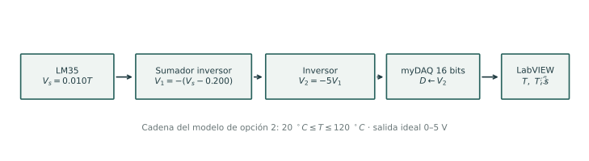
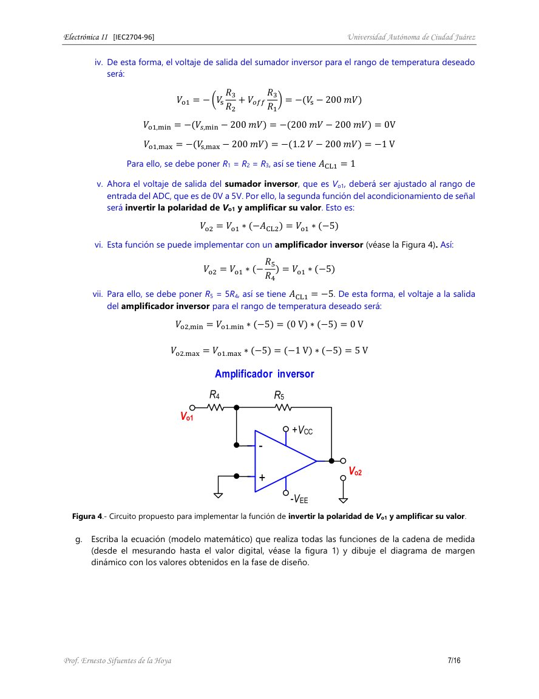
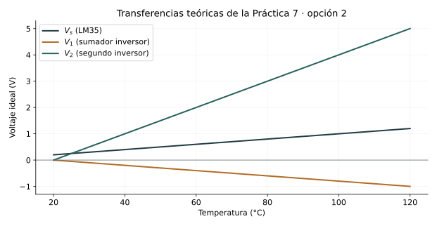
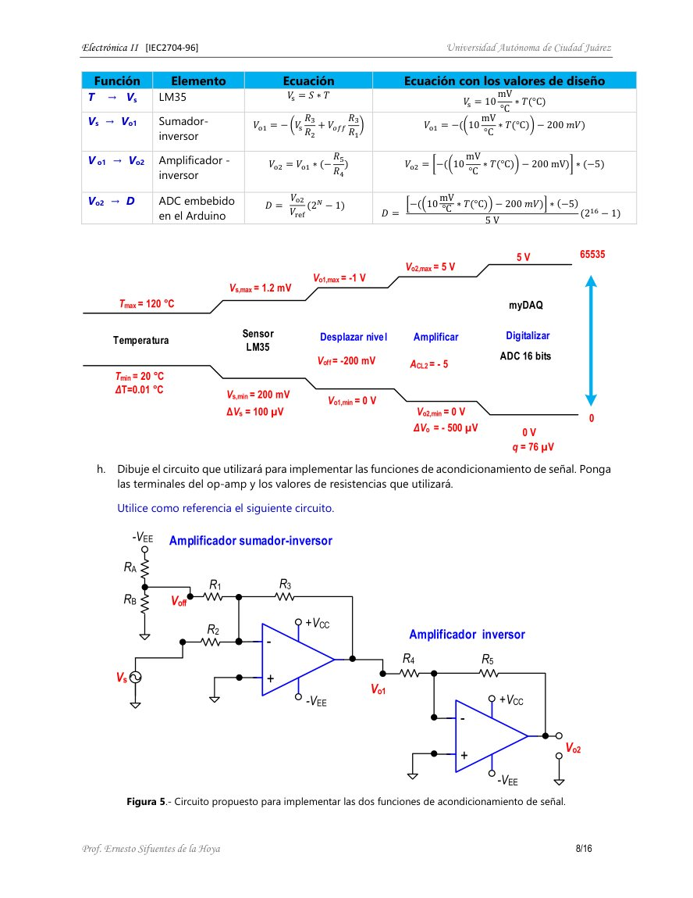
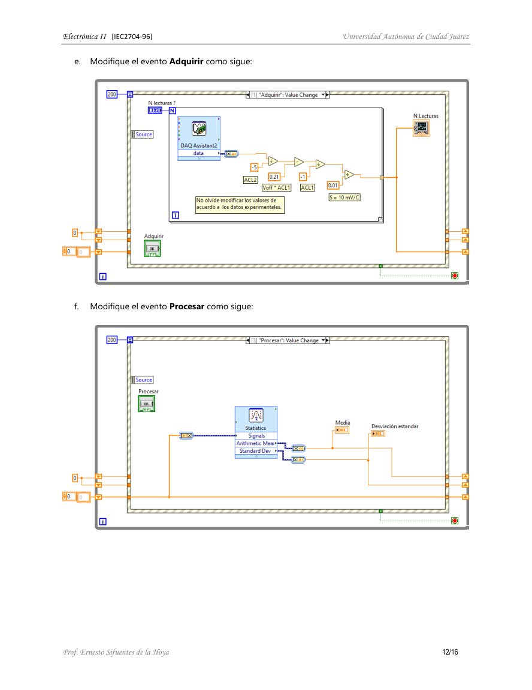

# Práctica 7 · Termómetro con LM35 y NI myDAQ (opción 2) {.unnumbered}

**Clase 29 · 120 minutos.** El objetivo del documento original es desarrollar un termómetro que utilice un sensor LM35, dos etapas basadas en op-amp y NI myDAQ para visualizar, procesar y registrar datos de temperatura en LabVIEW. A diferencia de la **Práctica 6 (opción 1)**, esta opción implementa la corrección de nivel y la amplificación mediante **un sumador inversor seguido de un amplificador inversor**.

::: {.course-actions}
[Guía original de 16 páginas (PDF)](../../recursos/semana-10/practica-07-termometro-opcion-2.pdf){.course-button .course-button-primary}
[Repasar sumador, Lección 6](../09/sumar-y-amplificar-voltajes.qmd){.course-button}
[Práctica 5 · LabVIEW](../08/practica-05-labview.qmd){.course-button}
[Tutor IA de la semana](../../tutor-ia.qmd#consignas-semana-10){.course-button}
:::

## 1. Especificaciones y cadena de señal {#p7-especificaciones}

El diseño desarrollado utiliza el intervalo de **20–120 °C** para determinar la ganancia y la escala de adquisición. Para trabajar con otro intervalo será necesario recalcular las ganancias y los extremos de las tablas.

| Especificación de la solución desarrollada | Valor |
|:--|:--|
| Mesurando y sensor | Temperatura; LM35, salida nominal 10 mV/°C |
| Intervalo seleccionado para el análisis | 20–120 °C, acorde con el diseño numérico de la guía |
| Resolución objetivo | 0.01 °C (requisito de diseño, **no exactitud demostrada**) |
| Adquisición | NI myDAQ y programa de LabVIEW |
| Acondicionamiento | Sumador inversor con desplazamiento de nivel + amplificador inversor de ganancia −5 |
| Procesamiento | Lecturas continuas y bloques de 20 muestras, media, desviación estándar, archivo de resultados |

{fig-alt="Cadena didáctica LM35 a ADC con dos inversores, adquisición y estadísticas."}

El modelo de bloques es $T\to V_s\to V_{o1}\to V_{o2}\to D\to\hat T$. La señal eléctrica medida en cada etapa debe conservar sus unidades: °C, V, V, V, código digital y °C estimados.

## 2. Sensor y margen dinámico {#p7-margen-dinamico}

Para el LM35 ideal:

$$\boxed{V_s(T)=S\,T},\qquad S=10\ \mathrm{mV}/^\circ\mathrm C=0.010\ \mathrm{V}/^\circ\mathrm C.$$

En los extremos seleccionados:

$$V_{s,\min}=0.200\ \mathrm V,\qquad V_{s,\max}=1.200\ \mathrm V.$$

El intervalo útil es $\Delta T_{FS}=100\ ^\circ\mathrm C$, por lo que para un objetivo $\delta T=0.01\ ^\circ\mathrm C$:

$$M=\frac{\Delta T_{FS}}{\delta T}=\frac{100}{0.01}=10\,000\ \text{intervalos}.$$

$$M_{dB}=20\log_{10}(10\,000)=80\ \mathrm{dB},\qquad N_{\min}=\lceil\log_2(10\,000)\rceil=14\ \text{bits ideales}.$$

La variación nominal del sensor para un intervalo de 0.01 °C es $\delta V_s=S\delta T=100\ \mu\mathrm V$. El valor de 80 dB es una relación de amplitudes vinculada al **objetivo de resolución**; no equivale a una SNR medida de 80 dB.

## 3. Diseño del acondicionador de dos etapas {#p7-etapas}

### 3.1. Primera etapa: sumador inversor y referencia negativa

La guía propone el sumador inversor con dos señales: el voltaje del LM35 y una referencia $V_{off}$ negativa. Para un sumador de dos entradas:

$$V_{o1}=-\left(\frac{R_3}{R_2}V_s+\frac{R_3}{R_1}V_{off}\right).$$

Con $R_1=R_2=R_3=10\ \mathrm{k\Omega}$ y $V_{off}=-0.200\ \mathrm V$:

$$\boxed{V_{o1}=-(V_s-0.200\ \mathrm V)}.$$

De este modo, la primera etapa convierte $0.200\ \mathrm V\mapsto0$ y $1.200\ \mathrm V\mapsto-1.000\ \mathrm V$. **Es una inversión de polaridad deliberada**: el segundo amplificador recuperará el signo positivo.

### 3.2. Generación de la referencia $V_{off}$

La figura original utiliza un divisor $R_A=6.8\ \mathrm{k\Omega}$, $R_B=100\ \Omega$, alimentado desde $-15\ \mathrm V$. Según la disposición del divisor y tomando la referencia en el nodo previsto, el valor ideal es cercano a

$$V_{off}\approx -15\frac{100}{6800+100}\ \mathrm V\approx-0.2174\ \mathrm V.$$

La guía fija **−200 mV como referencia nominal**, pero el divisor sugerido con valores estándar entrega aproximadamente −217 mV. Es necesario **medir el offset real**, considerar un ajuste/calibración y utilizar su valor al reconstruir temperatura; no se debe asumir −200 mV exactos sin comprobarlo.

{fig-alt="Guía del profesor con diagramas de sumador inversor y segundo amplificador inversor."}

### 3.3. Segunda etapa: inversión de signo y escala

Para el inversor:

$$V_{o2}=-\frac{R_5}{R_4}V_{o1}.$$

La guía selecciona $R_4=20\ \mathrm{k\Omega}$ y $R_5=100\ \mathrm{k\Omega}$, por tanto la ganancia es −5 y

$$\boxed{V_{o2}=5(V_s-0.200\ \mathrm V)=0.050T-1.000},$$

con $V_{o2}$ expresado en voltios y $T$ en °C. La relación inversa usada para visualizar temperatura es

$$\boxed{\hat T\,(^\circ\mathrm C)=20+\frac{V_{o2}}{0.050\ \mathrm V/^\circ\mathrm C}}.$$

En un prototipo calibrado, utilice los valores medidos de las resistencias y del offset en la expresión real, no solo los nominales.

{fig-alt="Gráfica de voltajes Vs, Vo1 y Vo2 frente a 20 a 120 grados Celsius."}

{fig-alt="Guía original con dos etapas opamp y valores esperados en la cadena del termómetro."}

### 3.4. Tabla de comprobación teórica

| $T$ (°C) | $V_s$ (V) | $V_{o1}$ (V) | $V_{o2}$ (V) |
|--:|--:|--:|--:|
| 20 | 0.200 | 0.000 | 0.000 |
| 40 | 0.400 | −0.200 | 1.000 |
| 60 | 0.600 | −0.400 | 2.000 |
| 80 | 0.800 | −0.600 | 3.000 |
| 100 | 1.000 | −0.800 | 4.000 |
| 120 | 1.200 | −1.000 | 5.000 |

**Advertencia física:** la tabla utiliza op-amps ideales y un intervalo ADC 0–5 V idealizado. Verifique límites de modo común, excursión de salida del TL084/TLC274 con las alimentaciones realmente empleadas, configuración bipolar o diferencial de myDAQ y continuidad de tierras. No suponga que una salida puede alcanzar exactamente todos los rieles de alimentación.

### Tutor IA · Diseñar el acondicionamiento {#tutor-practica7-diseno-s10}

::: {.tutor-box}
::: {.tutor-texto}
Actúe como tutor socrático de Electrónica II y tráteme de usted. Resolvemos el diseño de la Práctica 7 (opción 2): LM35 nominal de 10 mV/°C, rango de cálculo 20–120 °C, sumador inversor con referencia negativa, segundo inversor de ganancia −5 y myDAQ. Pídame primero los extremos Vs y espere mi respuesta. Después pida Vo1, Vo2, las razones de resistencias, la polaridad de Voff y una comprobación de la referencia obtenida con 6.8 kΩ y 100 Ω desde −15 V. Una pregunta por turno; no dé la solución completa y distinga entre valores propuestos y medidos. Advierta que la guía también dice 20–100 °C en un paso y solicite confirmar el rango usado en el informe.
:::
::: {.tutor-acciones}
[Abrir ChatGPT](https://chatgpt.com/){.course-button target="_blank" rel="noopener"}
:::
:::

## 4. Digitalización y temperatura estimada {#p7-adc}

Para un modelo ideal con $N=16$ bits y ventana de entrada **hipotética unipolar 0–5 V**, el incremento nominal sería

$$q\approx\frac{5\ \mathrm V}{2^{16}}=76.3\ \mu\mathrm V.$$

Con sensibilidad acondicionada $S_o=0.050\ \mathrm V/^\circ\mathrm C$:

$$\delta T_{q}\approx\frac{q}{S_o}\approx0.00153\ ^\circ\mathrm C.$$

Esto indica capacidad **teórica** de discriminar códigos, no una exactitud real de 0.00153 °C. La exactitud incluye error y ruido del LM35, resistencias, referencia, amplificador y tarjeta. La myDAQ puede configurarse en modos y rangos distintos: documente el rango **efectivamente seleccionado**, sin utilizar la ecuación unipolar de manera automática.

Para un ejemplo de cuantificación con extremos incluidos:

$$D\approx\operatorname{round}\left(\frac{V_{o2}}{5\ \mathrm V}(2^{16}-1)\right).$$

No interprete el entero digital como lectura directa en °C: el programa debe invertir la cadena de transferencia o usar una calibración obtenida experimentalmente.

## 5. Montaje e integración eléctrica {#p7-montaje}

La figura 6 de la guía corresponde al montaje completo: LM35, red generadora de referencia con buffer, sumador inversor, inversor y entrada diferencial AI0 de NI myDAQ. Verifique primero el circuito en Multisim y **después** realice el montaje físico.

| Elemento | Valor nominal indicado | Verificación requerida |
|:--|:--|:--|
| $R_A,R_B$ | 6.8 kΩ y 100 Ω | Medir $V_{off}$ real; no confiar solo en −200 mV nominal |
| $R_1,R_2,R_3$ | 10 kΩ cada una | Confirmar que la primera etapa tiene ponderaciones unitarias |
| $R_4,R_5$ | 20 kΩ y 100 kΩ | Confirmar $A_{CL2}=-5$ |
| Alimentación de op-amps | +15 V y −15 V (guía) | Medir tensiones y comprobar conexión de pines según hoja de datos |
| Entrada NI myDAQ | AI0(+), AI0(−) en figura 6 | Verificar polaridad, referencia y rango permitido |

**Secuencia de pruebas:** medir $V_s$ con el sensor a temperatura ambiente; medir $V_{off}$; medir $V_{o1}$; medir $V_{o2}$; verificar que la temperatura calculada sea coherente; conectar myDAQ y comenzar adquisición. Evite tocar con cautín el encapsulado del sensor. Use calor controlado y mantenga distancia suficiente de cables y protoboard.

## 6. Software de LabVIEW: reutilizar el VI de la Práctica 5 {#p7-labview}

La guía pide copiar `Adquisición de datos.vi` desarrollado en la Práctica 5 y renombrarlo **`Termómetro con LM35 y sumador inversor.vi`**. Se deben adaptar el panel frontal y cuatro eventos:

1. **Timeout:** mostrar lecturas continuas; asociar valores medidos con las variables $V_s$, $V_{o1}$, $V_{o2}$ y la temperatura reconstruida cuando estén disponibles.
2. **Adquirir:** almacenar el vector de muestras; asegurar que el dato no se sobrescriba antes de ser procesado.
3. **Procesar:** calcular media y desviación estándar de $N$ lecturas de temperatura, no de voltaje salvo que se especifique lo contrario.
4. **Guardar:** escribir archivo de medidas y comprobar que las columnas, unidades y número de registros coincidan con lo adquirido.

Si los cuatro voltajes no se miden con canales separados, documente claramente cuáles se **miden** y cuáles se **calculan** a partir de una etapa mediante su modelo. No etiquete valores reconstruidos como mediciones directas de myDAQ.

{fig-alt="Capturas de LabVIEW del procedimiento para adquirir y procesar señales."}

## 7. Validación: grupos de 20 lecturas {#p7-validacion}

La práctica solicita aumentar la temperatura aproximadamente en pasos de $10\ ^\circ\mathrm C$, capturar **20 lecturas por punto** y reportar media y desviación estándar. Las tablas siguientes son formatos de captura, **no resultados experimentales**.

| Punto | $T$ de referencia (°C) | $V_s$ medido (V) | $V_{o1}$ medido (V) | $V_{o2}$ medido (V) | $\bar T$ de 20 lecturas (°C) | $s_T$ (°C) |
|--:|:--:|:--:|:--:|:--:|:--:|:--:|
| 1 | — | — | — | — | — | — |
| 2 | — | — | — | — | — | — |
| 3 | — | — | — | — | — | — |
| 4 | — | — | — | — | — | — |
| 5 | — | — | — | — | — | — |

$$\bar T=\frac1N\sum_{i=1}^NT_i,\qquad s_T=\sqrt{\frac1{N-1}\sum_{i=1}^N(T_i-\bar T)^2},\quad N=20.$$

El valor de $s_T$ caracteriza dispersión de las lecturas del grupo, pero no garantiza exactitud frente a una temperatura de referencia. Si existe termómetro calibrado, calcule $e_T=\bar T-T_{ref}$; de lo contrario, limite las conclusiones a coherencia y repetibilidad.

### Tutor IA · Revisar montaje y resultados {#tutor-practica7-medidas-s10}

::: {.tutor-box}
::: {.tutor-texto}
Sea tutor de laboratorio de Electrónica II y tráteme de usted. Analizo la Práctica 7 con LM35, myDAQ y LabVIEW. Solicite mis valores reales de RA, RB, R1–R5, alimentaciones, Voff, Vs, Vo1 y Vo2, así como el rango de temperatura empleado. Haga una sola pregunta en cada turno. Ayúdeme a verificar la cadena de voltajes, los canales que medí de verdad, la conversión a °C, y la media y desviación estándar de 20 datos. No invente lecturas ni confunda resolución ideal del ADC con exactitud. Si detecta saturación o un problema de tierras, pregúnteme cómo lo comprobé. Termine solicitando una conclusión sobre errores y calibración.
:::
::: {.tutor-acciones}
[Abrir ChatGPT](https://chatgpt.com/){.course-button target="_blank" rel="noopener"}
:::
:::

## 8. Informe y reflexión {#p7-informe}

El reporte debe incluir especificaciones, modelo matemático, diagramas, componentes medidos, capturas de LabVIEW, tabla de resultados de 20 muestras por temperatura, comparación modelo–montaje, evaluación del offset y conclusiones. Responda además el cuestionario final del PDF, incluida la sustitución hipotética de myDAQ por un ESP32 de ADC nominal de 12 bits y referencia de 3.3 V, distinguiendo cuantificación de exactitud real del microcontrolador.

**Secuencia académica:** el reporte de la Práctica 7 se entrega en la **clase 2 de la semana 11**. La práctica se apoya en el VI que el estudiante construyó en la semana 8; dicho archivo no se proporcionó en los ZIP recibidos.
