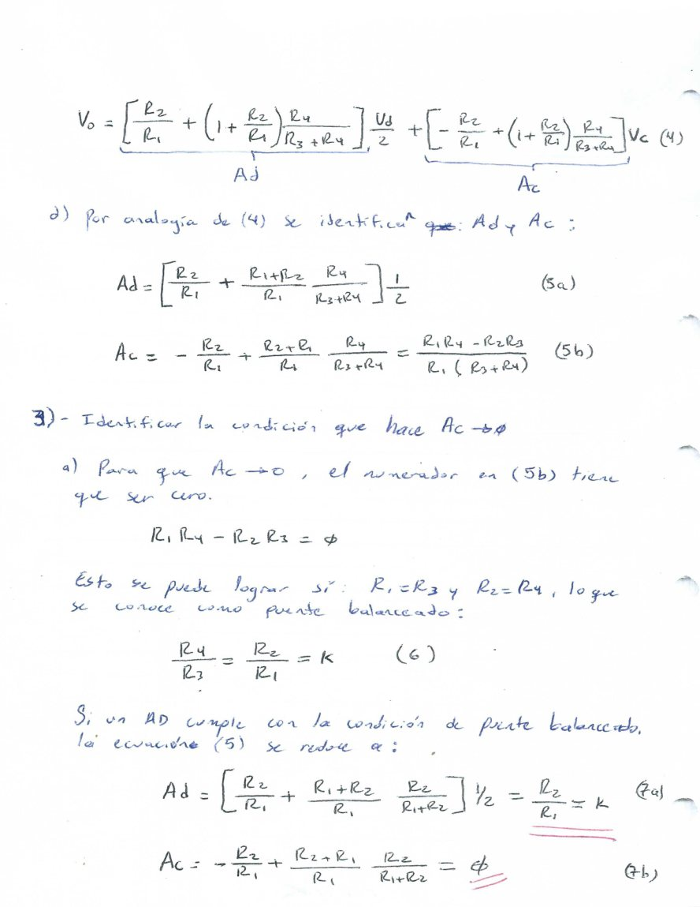

# Teoría básica del amplificador diferencial · Apuntes del profesor {.unnumbered}

**Actividad extraclase de la semana 10.** La planificación solicita transcribir los apuntes manuscritos sobre el amplificador diferencial y entregarlos en la **clase 3 de la semana 13**. Se conserva el documento completo tal como fue recibido, sin reinterpretar ni sustituir la letra del autor.

::: {.course-actions}
[Descargar apuntes manuscritos originales, 12 páginas](../../recursos/semana-10/teoria-basica-amplificador-diferencial.pdf){.course-button .course-button-primary}
[Ver desarrollo matemático completo](amplificador-diferencial.qmd){.course-button}
[Ejercicios L7](ejercicios-l7-ad.qmd){.course-button}
:::

## Ruta de lectura y transcripción {#teoria-ad-lectura}

| Páginas | Contenido principal visible en el manuscrito | Qué conviene demostrar |
|:--|:--|:--|
| 1–4 | Concepto de amplificador diferencial, excitación común y diferencial y relación de rechazo. | Reconocer $V_{iD}$, $V_{iC}$ y el significado del CMRR. |
| 5–8 | Topología de puente resistivo, corto virtual, LCK en ambos nodos y expresión general de salida. | Deducir $V_o=f(V_{s1},V_{s2})$ sin presuponer balance perfecto. |
| 9–11 | Descomposición en modos, ganancias $G_D$ y $G_C$, y balance de resistencias. | Identificar cómo afecta el desbalance al modo común. |
| 12 | Efecto de la tolerancia relativa en el rechazo. | Relacionar resistencia, CMRR y límite de la aproximación. |

{fig-alt="Página manuscrita del profesor que analiza amplificación diferencial, modo común y balance de resistencias."}

## Comprobación de comprensión {#teoria-ad-comprobacion}

Al concluir la transcripción, pruebe a reconstruir sin consultar los apuntes las dos relaciones

$$G_C=\frac{R_1R_4-R_2R_3}{R_1(R_3+R_4)},\qquad \frac{R_4}{R_3}=\frac{R_2}{R_1}\Rightarrow G_C=0$$

y explique por qué pequeñas tolerancias producen una salida residual ante señales idénticas de entrada.

**Importante:** el PDF es un documento manuscrito escaneado; se presenta como imagen de sus páginas y no como transcripción automática literal. Los desarrollos tipográficos adicionales aparecen en la lección correspondiente.
