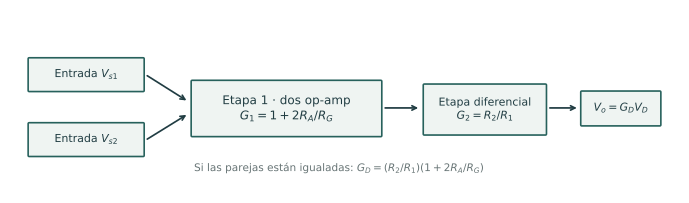
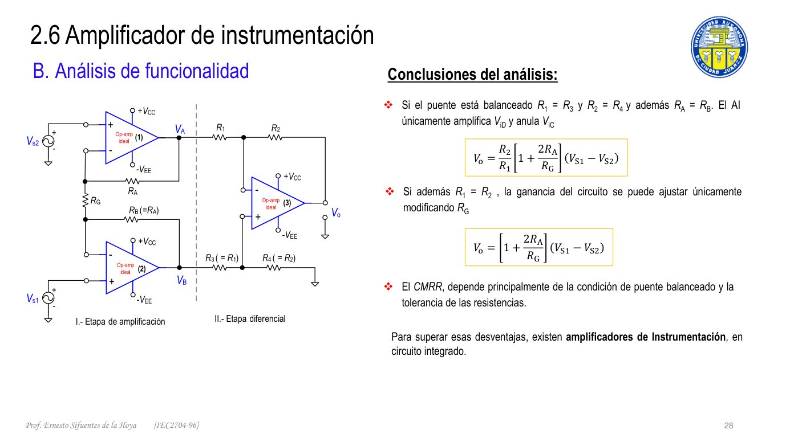
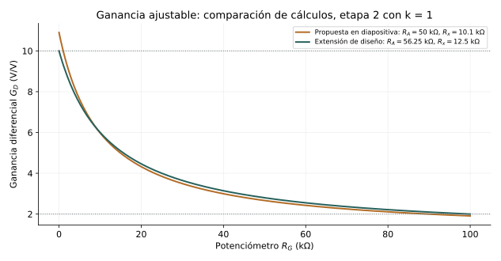
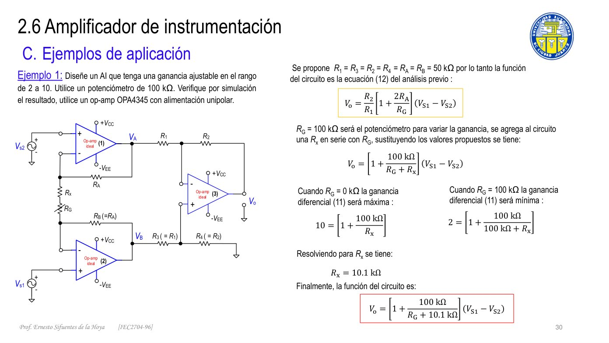
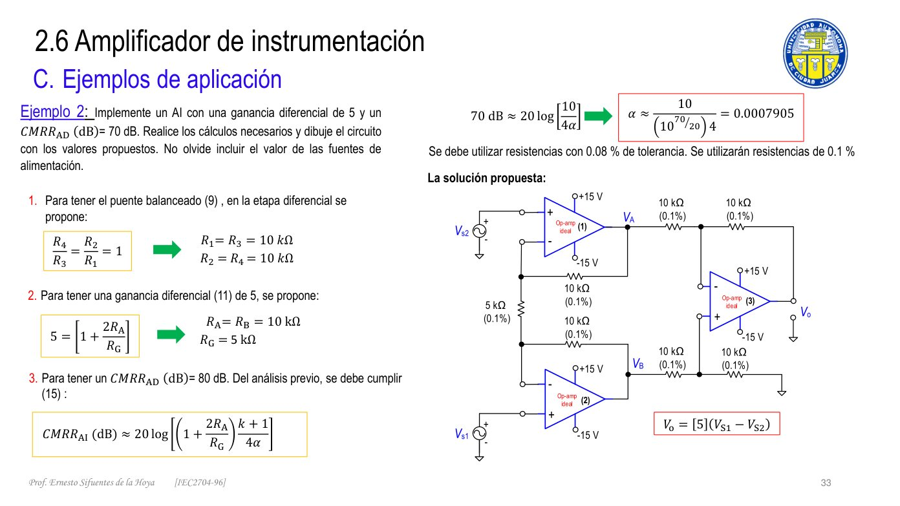

# Lección 7 · Restar y amplificar voltajes: amplificador de instrumentación (2.6) {.unnumbered}

La sección 2.6 continúa la [sección 2.5 sobre amplificador diferencial](../10/amplificador-diferencial.qmd). El objetivo es resolver sus dos principales limitaciones para instrumentación: baja impedancia de entrada y rechazo limitado del modo común cuando las resistencias están desbalanceadas.

::: {#video-l7-parte-2 .course-actions}
[Ver video de la Lección 7 · Parte 2 (desde 1:18:19)](https://www.youtube.com/watch?v=-tf_ELNwyOw&t=4699s){.course-button .course-button-primary target="_blank" rel="noopener"}
[Video L7 · Parte 1 (repaso)](https://www.youtube.com/watch?v=96MRWQ4XVJw){.course-button target="_blank" rel="noopener"}
[Presentación L7 del profesor, págs. 20–41](../../recursos/semana-10/presentacion-leccion-07.pdf){.course-button}
[Cuestionario L7](cuestionario-l7.qmd){.course-button}
[Práctica 8 de laboratorio](practica-08-amplificador-diferencial.qmd){.course-button}
:::

**Actividad de video — Lección 7, parte 2.** Vea la presentación en video y elabore **a mano un resumen** que sintetice los conceptos principales, con extensión proporcional al contenido. **Entrega: clase 31 (primera sesión de la semana 11).** Consulte las [entregas de la Semana 11](semana-11.qmd#entregas-semana-11). El video comienza en el minuto **1:18:19**.

## 1. Del amplificador diferencial al amplificador de instrumentación {#ai-introduccion}

Un amplificador de instrumentación (AI) amplifica una pequeña diferencia entre dos voltajes en presencia de voltajes comunes que pueden ser considerablemente mayores. El circuito clásico de **tres amplificadores operacionales** consta de:

1. **Etapa de entrada:** dos op-amp no inversores con alta impedancia de entrada; sus nodos de realimentación se conectan mediante $R_G$.
2. **Etapa diferencial:** un restador de cuatro resistencias que amplifica la diferencia entre las salidas de la primera etapa.

La topología presentada contiene **siete resistencias**: $R_1$, $R_2$, $R_3$, $R_4$, $R_A$, $R_B$ y $R_G$. Cambiar $R_G$ ajusta la ganancia sin cambiar las parejas resistivas de la segunda etapa.

{fig-alt="Entradas Vs1 y Vs2 hacia etapa de dos opamps, amplificador diferencial y salida Vo."}

{fig-alt="Presentación del circuito: circuito de amplificador de instrumentación de tres operacionales y siete resistencias."}

## 2. Análisis de la etapa de entrada {#ai-primera-etapa}

Para simplificar la demostración tomamos $R_A=R_B=R$ y op-amps ideales en su región lineal. Si $V_{s1}$ y $V_{s2}$ se aplican a los terminales no inversores, el corto virtual establece esos mismos voltajes en los nodos internos de realimentación. Así, la corriente en $R_G$ es

$$I_G=\frac{V_{s1}-V_{s2}}{R_G}.$$

Por LCK en los nodos internos, con las etiquetas $V_A$ y $V_B$ elegidas para preservar la polaridad de la presentación:

$$V_A=V_{s1}+\frac{R}{R_G}(V_{s1}-V_{s2}),$$

$$V_B=V_{s2}-\frac{R}{R_G}(V_{s1}-V_{s2}).$$

Restando:

$$\boxed{V_A-V_B=\left(1+\frac{2R}{R_G}\right)(V_{s1}-V_{s2})}.$$

Por tanto, la **ganancia diferencial de la primera etapa** es

$$\boxed{G_1=1+\frac{2R}{R_G}}.$$

Cuando $V_{s1}=V_{s2}$, la corriente por $R_G$ es cero y ambas salidas de la primera etapa siguen el mismo voltaje común. A diferencia de un restador resistivo simple, ambas señales se aplican a las **entradas no inversoras de alta impedancia** de los operacionales.

## 3. Etapa diferencial y ganancia total {#ai-ganancia-total}

Si la segunda etapa está balanceada, se cumple

$$\frac{R_2}{R_1}=\frac{R_4}{R_3}=k.$$

De acuerdo con la conexión de polaridades de la presentación, su ecuación es $V_o=k(V_A-V_B)$. Sustituyendo la primera etapa:

$$\boxed{V_o=\underbrace{k\left(1+\frac{2R}{R_G}\right)}_{G_D}(V_{s1}-V_{s2})}.$$

En consecuencia,

$$\boxed{G_D=\frac{R_2}{R_1}\left(1+\frac{2R_A}{R_G}\right)}\quad\text{si }R_A=R_B,\quad\frac{R_2}{R_1}=\frac{R_4}{R_3}.$$

En el modelo resistivo ideal y balanceado, $G_C=0$. El signo de salida depende de **qué terminal de la etapa diferencial se identifique como entrada positiva**: una inversión del cableado cambia el signo de $V_o$, aunque no la magnitud de $G_D$.

### Tutor IA · Deducir el AI de tres operacionales {#tutor-deduccion-ai-s11}

::: {.tutor-box}
::: {.tutor-texto}
Sea mi tutor socrático de Electrónica II y tráteme de usted. Estudio el AI clásico de tres op-amp y siete resistencias de la Lección 7, sección 2.6. Primero pregúnteme qué ocurre con los nodos inversores en presencia de realimentación negativa; espere mi respuesta. Después solicite deducir la corriente en RG, los voltajes VA y VB de la primera etapa y la función de la segunda etapa diferencial, una pregunta por turno. Ayúdeme a comprobar las condiciones RA=RB y R2/R1=R4/R3 antes de deducir GD. No invente mediciones ni me entregue toda la demostración antes de mi intento. Revise la polaridad según el esquema que le muestre.
:::
::: {.tutor-acciones}
[Abrir ChatGPT](https://chatgpt.com/){.course-button target="_blank" rel="noopener"}
:::
:::

## 4. Rechazo al modo común y tolerancias {#ai-cmrr}

El AI ideal exhibe $V_o=G_DV_{iD}$ y elimina la componente $V_{iC}$ de ambas entradas. En un circuito real, la etapa diferencial aún depende de su puente resistivo y del CMRR propio de los tres op-amps.

Para parejas resistivas balanceadas se obtiene $G_C=0$ en el modelo ideal. Si existe desbalance, debe calcularse el término residual $G_CV_{iC}$, incluso si $R_G$ se eligió para una ganancia diferencial alta.

La presentación expresa el efecto de una pequeña tolerancia $\alpha$ mediante

$$\operatorname{CMRR}_{AI,\mathrm{dB}}\approx20\log_{10}\left[\left(1+\frac{2R_A}{R_G}\right)\frac{k+1}{4\alpha}\right],\qquad k=\frac{R_2}{R_1},$$

**solo como aproximación de la contribución resistiva** para una etapa de entrada simétrica. Se debe medir o consultar el rechazo propio de los op-amps y su variación con frecuencia antes de atribuir ese CMRR al equipo completo.

| Propiedad | AD de cuatro resistencias | AI de tres op-amp |
|:--|:--|:--|
| Impedancia de entrada | Finita, depende de $R_1$ en excitación diferencial | Elevada; determinada principalmente por las entradas del op-amp |
| Ajuste de ganancia | Requiere modificar parejas y mantener razones | Puede modificarse mediante $R_G$ |
| Rechazo al modo común | Afectado por desbalance del puente | Mejora potencialmente, pero sigue limitado por desbalance y op-amps |
| Complejidad | Un op-amp, cuatro resistencias | Tres op-amps, siete resistencias |

## 5. Ejemplos y proyectos de diseño {#ai-ejemplos}

### Ejemplo 1 · Ganancia ajustable con un potenciómetro

La presentación pide ganancia ajustable entre **2 y 10**, potenciómetro $R_G$ de **100 kΩ**, y propone $R_1=R_2=R_3=R_4=R_A=R_B=50\ \mathrm{k\Omega}$ con una resistencia $R_x=10.1\ \mathrm{k\Omega}$ en serie con el potenciómetro. La fórmula correspondiente es

$$G_D(R_G)=1+\frac{100\ \mathrm{k\Omega}}{R_G+10.1\ \mathrm{k\Omega}}.$$

Con los valores propuestos se obtiene $G_D\approx10.90$ para $R_G=0$ y $G_D\approx1.91$ para $R_G=100\ \mathrm{k\Omega}$. Los extremos nominales de ganancia requieren ajustar la red resistiva.

Para obtener una ganancia nominal ajustable entre 2 y 10 con un potenciómetro de 0–100 kΩ y $k=1$, se resuelve

$$10=1+\frac{2R}{R_x},\qquad2=1+\frac{2R}{R_x+100\ \mathrm{k\Omega}},$$

lo que conduce a $R=56.25\ \mathrm{k\Omega}$ y $R_x=12.5\ \mathrm{k\Omega}$. Los valores normalizados y tolerancias se deben simular antes de implementarlos.

{fig-alt="Curva de GD contra RG para dos opciones de resistencias; se distinguen valores nominales del circuito y la extensión didáctica."}

{fig-alt="Esquema del ejemplo de amplificador de instrumentación con ganancia ajustable."}

### Ejemplo 2 · Ganancia 5 y requisito de CMRR

La presentación propone una segunda etapa con $R_1=R_2=R_3=R_4=10\ \mathrm{k\Omega}$ ($k=1$), $R_A=R_B=10\ \mathrm{k\Omega}$ y $R_G=5\ \mathrm{k\Omega}$; se obtiene

$$G_D=1+\frac{2(10\ \mathrm{k\Omega})}{5\ \mathrm{k\Omega}}=5.$$

Para $70\ \mathrm{dB}$ como objetivo **idealizado por desbalance**, el mismo modelo requiere $\alpha\lesssim 5(1+1)/(4\times10^{70/20})\approx0.000791$, aproximadamente **0.079 %**. Resistencias de 0.1 % darían **unos 68 dB** según esa aproximación, no 70 dB garantizados. La diapositiva 33 mezcla objetivos de 70 y 80 dB; conviene tratar esos datos como consignas para verificar, no como valores automáticamente satisfechos.

{fig-alt="Amplificador de instrumentación con tres opamps, resistencias de 10k, RG de 5k y alimentación dual."}

### Ejemplo 3 · Puente no balanceado

En este ejemplo se modifica una de las resistencias del puente de la etapa final. **Procedimiento:** obtenga primero $V_A$ y $V_B$ por LCK, después calcule $V_o$ con la **ecuación general no balanceada** del AD, y finalmente reorganice en $G_DV_{iD}+G_CV_{iC}$. Compruebe el valor y signo de $G_C$ a partir de la conexión real, en vez de aplicar la fórmula del puente ideal.

### Ejemplo 4 · Medición resistiva mediante divisor y AI

El ejemplo incluye un circuito con una resistencia variable $R_x=2\ \mathrm{k\Omega}(1+x)$, con $0\le x\le0.3$, y un AI. La señal diferencial surge del desbalance de un divisor y la ganancia la aporta el AI. Analice primero ambos divisores, después el AI, y verifique los puntos extremos mediante simulación. Un incremento de resistencia puede alterar la salida de forma **no lineal** si el voltaje del divisor depende racionalmente de $x$.

### Ejemplo 5 · Puente de Wheatstone y sensor resistivo TD5A

La presentación plantea una aplicación con sensor TD5A, un cuarto de puente de Wheatstone y Arduino Uno, para temperatura entre $20$ y $140\ ^\circ\mathrm C$ y resolución deseada de $0.15\ ^\circ\mathrm C$. El esquema plantea la cadena $T\to R_x\to V_{iD}\to V_o\to D$. **No es posible determinar numéricamente $R_x(T)$ con los documentos recibidos**, pues no se incluye una tabla de calibración o función de transferencia específica del TD5A. Se conserva el ejemplo como secuencia de modelado, sin inventar parámetros del sensor.

## 6. Protocolo de simulación L7, parte 2 {#ai-simulacion}

1. Reproduzca la topología de tres amplificadores operacionales; identifique alimentación de cada etapa y polaridad de salida.
2. Inyecte señales diferenciales conocidas y compruebe $G_D$ sin saturación.
3. Aplique señales comunes iguales; mida la salida residual con puente nominal y con desbalance intencional.
4. Varíe $R_G$ en una lista de valores y trace $G_D=f(R_G)$; contraste con la curva calculada.
5. Compare op-amp ideal y OPA4345 en alimentación unipolar como indica la presentación. Verifique el rango de modo común y el margen de salida con el modelo utilizado.

| Caso de prueba | Valores a registrar | Pregunta de interpretación |
|:--|:--|:--|
| $R_G$ mínimo | $G_D$, $V_o$ y saturación | ¿Se alcanza el máximo antes de los límites físicos? |
| $R_G$ máximo | $G_D$ y $V_o$ | ¿Coincide con el mínimo de la ecuación? |
| Modo común | $V_{s1}=V_{s2}$, $V_o$ | ¿Cómo queda afectado el CMRR? |
| Puente desequilibrado | Relaciones de resistencias, $G_C$ | ¿Qué resistencia afecta el resultado? |

### Tutor IA · Diseñar y simular un AI {#tutor-diseno-ai-s11}

::: {.tutor-box}
::: {.tutor-texto}
Actúe como tutor de diseño electrónico y tráteme de usted. Debo simular los ejemplos de la Lección 7, sección 2.6, de amplificador de instrumentación. Pídame primero cuál ejemplo resuelvo y el circuito con sus siete resistencias; espere mi respuesta. Ayúdeme una pregunta por turno a calcular GD, prever polaridad, configurar la fuente y comprobar límites de los op-amp. Para el potenciómetro de 100 kΩ exíjame sustituir ambos extremos en la ecuación real antes de afirmar 2–10. Si analizo CMRR, distinga el efecto del puente del rechazo propio del op-amp. Nunca invente simulaciones y termine pidiéndome una comparación de cálculo y esquema.
:::
::: {.tutor-acciones}
[Abrir ChatGPT](https://chatgpt.com/){.course-button target="_blank" rel="noopener"}
:::
:::

## 7. Cierre de la lección

El amplificador de instrumentación conserva la función diferencial del restador, pero añade dos etapas de entrada de alta impedancia y ofrece un ajuste más sencillo de ganancia. Su correcta selección exige verificar **CMRR, intervalo de modo común, rango de salida, ruido, offset y precisión de resistencias**, en lugar de caracterizarlo únicamente por $G_D$.
