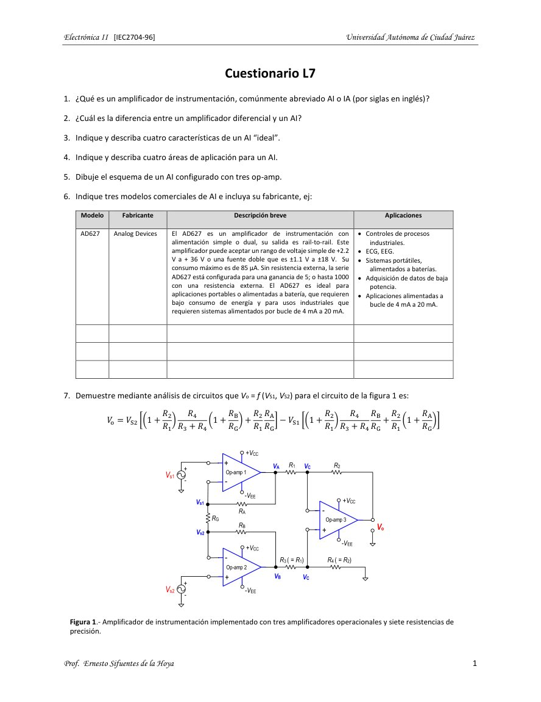

# Cuestionario L7 · Amplificador de instrumentación {.unnumbered}

**Clase 33 · 60 minutos.** El cuestionario original incluye once preguntas sobre el AI de tres op-amp, sus características, aplicaciones, ecuaciones de ganancia, rechazo al modo común y puente de Wheatstone. La planificación pide entregarlo en la **clase 3 de la semana 12**.

::: {.course-actions}
[Cuestionario original completo, 2 páginas](../../recursos/semana-11/cuestionario-l7.pdf){.course-button .course-button-primary}
[Lección 7 · Amplificador de instrumentación](amplificador-instrumentacion.qmd){.course-button}
[Ver presentación L7](../../recursos/semana-10/presentacion-leccion-07.pdf){.course-button}
:::

## Organización del cuestionario {#cuestionario-l7-organizacion}

| Reactivos originales | Qué se solicita | Punto de revisión |
|:--|:--|:--|
| 1–2 | Definir AI y distinguirlo del AD. | Diferencias de impedancia de entrada y configuración. |
| 3–4 | Describir características ideales y cuatro áreas de aplicación. | Separar características del modelo y especificaciones físicas. |
| 5 | Dibujar el AI de tres op-amp. | Etapa de dos no inversores, $R_G$, resistencias de la etapa diferencial. |
| 6 | Identificar tres AI comerciales y fabricantes. | Verificar hojas de datos reales: alimentación, ganancia, CMRR, rango común y consumo. |
| 7 | Demostrar la expresión de $V_o=f(V_{s1},V_{s2})$. | Uso correcto de LCK, polaridades y superposición. |
| 8 | Obtener $G_D$ y $G_C$ en función de las siete resistencias. | Reorganizar en modos diferencial y común. |
| 9 | Simplificar con $R_2/R_1=R_4/R_3=k$ y $R_A=R_B$. | Llegar a la forma balanceada de la ganancia. |
| 10 | Estudiar CMRR debido a desbalance resistivo. | Distinguir límite por resistores del límite del op-amp. |
| 11 | Evaluar un AI conectado a un puente de Wheatstone. | Determinar $V_{s1}$ y $V_{s2}$ antes de aplicar ganancia. |

**Atención al signo:** el circuito del reactivo 7 puede rotular los terminales de entrada de forma distinta a los diagramas de la presentación. Para aceptar el signo de $V_o$, defina qué entrada llega al terminal positivo de la etapa diferencial; una permuta cambia el signo, no la magnitud de la ganancia.

## Reactivos de análisis más exigentes {#cuestionario-l7-analisis}

### Reactivo 7 · Salida del AI

Dibuje el circuito y nombre $V_A,V_B$ a las salidas de la primera etapa. Aplique LCK para hallar ambas salidas; después escriba la expresión general del amplificador diferencial final y sustituya $V_A,V_B$. Mantenga primero $R_A\neq R_B$ y razones no balanceadas, como solicita el enunciado.

### Reactivos 8 a 10 · Ganancias y CMRR

Una vez obtenida la expresión general, reemplace

$$V_{s1}=V_{iC}+\tfrac12V_{iD},\qquad V_{s2}=V_{iC}-\tfrac12V_{iD}.$$

Agrupe coeficientes para identificar $G_D$ y $G_C$. Solo después imponga el balance de razones y $R_A=R_B$. Para CMRR distinga lo que predice la teoría resistiva y lo que requiere el dispositivo comercial.

### Reactivo 11 · Puente de Wheatstone

El diagrama original contiene resistencias de **2.2 kΩ**, una resistencia variable $R_x=2.2\ \mathrm{k\Omega}(1\pm x)$ y un AI; determine los potenciales de los puntos medios del puente antes de hallar $V_o$.

{fig-alt="Primera página del cuestionario de amplificador de instrumentación con esquema original y preguntas."}

### Tutor IA · Preparar el Cuestionario L7 {#tutor-cuestionario-l7-s11}

::: {.tutor-box}
::: {.tutor-texto}
Actúe como tutor socrático de Electrónica II y tráteme de usted. Estoy resolviendo el Cuestionario L7, once preguntas sobre amplificadores de instrumentación. Solicite el número del reactivo, el esquema o mi primer intento. Trabaje con una sola pregunta o pista en cada turno, espere mi respuesta, revise terminología, unidades, LCK y signos de salida. En los reactivos de circuitos no entregue de inmediato toda la derivación; en el de modelos comerciales indíqueme qué parámetros verificar en hojas de datos y pídame fuentes verificables, sin inventarlas. Termine con una pregunta de comprobación conceptual.
:::
::: {.tutor-acciones}
[Abrir ChatGPT](https://chatgpt.com/){.course-button target="_blank" rel="noopener"}
:::
:::

## Criterios de una respuesta bien fundamentada

Use esquemas propios, identificación de terminales, ecuaciones justificadas y referencias a las fuentes consultadas. Cuando proponga un modelo comercial, indique fabricante y, si consultó una hoja de datos, versión o fecha; cuando no disponga de esa información, **no la invente**. El cuestionario se entrega según la planificación en la **clase 3 de la semana 12**.
