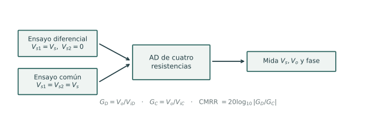
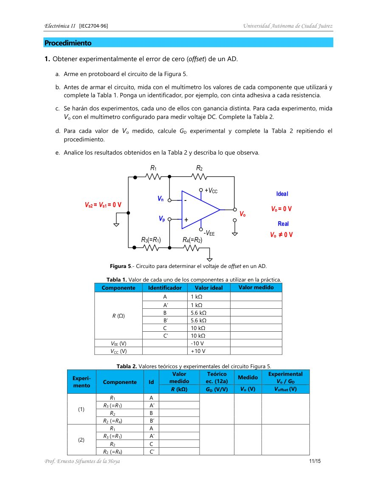
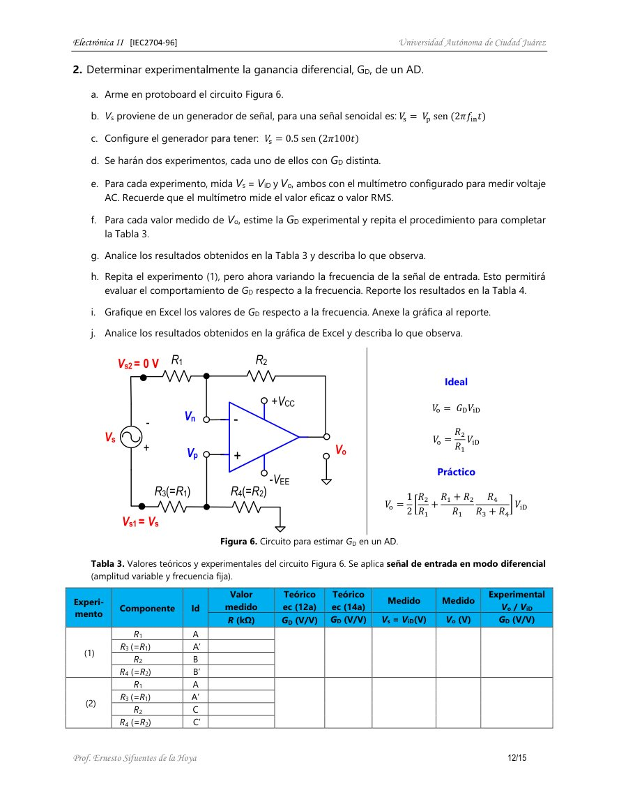
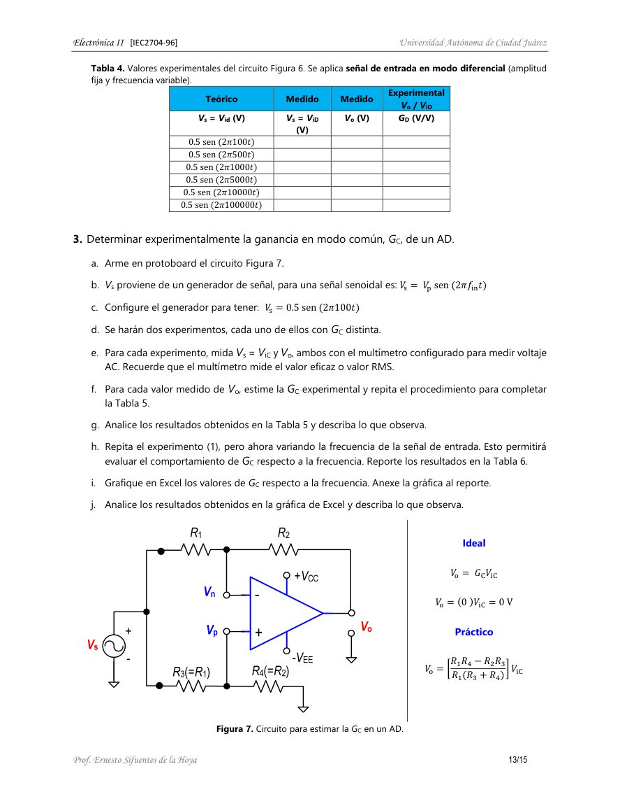

# Práctica 8 · Amplificador diferencial (AD) {.unnumbered}

**Clase 32 · 120 minutos.** La práctica está dedicada a construir y caracterizar un AD de **un op-amp y cuatro resistencias**. Aunque en la clase 31 se estudia el AI de tres op-amp, la **Práctica 8 es sobre el AD**, no sobre el AI. Su objetivo original es estudiar experimentalmente características eléctricas como error de cero, ganancia diferencial, ganancia en modo común y relación de rechazo.

::: {.course-actions}
[Guía original de 15 páginas](../../recursos/semana-11/practica-08-amplificador-diferencial.pdf){.course-button .course-button-primary}
[Lección 7 · AD y CMRR](../10/amplificador-diferencial.qmd){.course-button}
[Teoría básica manuscrita](../10/teoria-basica-ad.qmd){.course-button}
:::

## 1. Equipo y preparación {#p8-equipo}

**Material de la guía:** TL084 o equivalente; dos resistencias de $1\ \mathrm{k\Omega}$, dos de $5.6\ \mathrm{k\Omega}$ y dos de $10\ \mathrm{k\Omega}$ (nominalmente ±1 %); fuente dual; generador de funciones, osciloscopio y multímetro.

Antes de conectar el circuito, identifique físicamente las seis resistencias y regístrelas, no solo por color sino mediante el multímetro:

| Etiqueta en la guía | Valor nominal | Valor medido |
|:--|:--|:--|
| A, A′ | 1 kΩ cada una | — |
| B, B′ | 5.6 kΩ cada una | — |
| C, C′ | 10 kΩ cada una | — |
| $V_{CC}$, $V_{EE}$ | +10 V, −10 V | — |

Revise el pinout del TL084 y la polaridad de su alimentación antes de energizar. Las tensiones de señal no deben forzar entrada o salida fuera de los límites permitidos por el circuito integrado.

{fig-alt="Diferencias de excitación del AD: en modo diferencial Vs1=Vs y Vs2=0; en modo común ambas entradas comparten Vs."}

## 2. Relaciones a comprobar experimentalmente {#p8-modelo}

El análisis ideal de la [lección del AD](../10/amplificador-diferencial.qmd) entrega

$$V_o=\left(1+\frac{R_2}{R_1}\right)\frac{R_4}{R_3+R_4}V_{s1}-\frac{R_2}{R_1}V_{s2}.$$

Para comparar ensayos, utilice

$$\begin{aligned}
V_{iD}&=V_{s1}-V_{s2},&\qquad G_D&=\left.\frac{V_o}{V_{iD}}\right|_{V_{iC}=0},\\
V_{iC}&=\frac{V_{s1}+V_{s2}}2,& G_C&=\left.\frac{V_o}{V_{iC}}\right|_{V_{iD}=0},\\
\mathrm{CMRR}_{dB}&=20\log_{10}\left|\frac{G_D}{G_C}\right|.&&
\end{aligned}$$

Para ensayos prácticos de $G_D$, la guía conecta una entrada a la fuente y la otra a 0 V, de forma que $V_{iD}=V_s$ **pero también existe un modo común $V_{iC}=V_s/2$**. Por ello, la relación medida $V_o/V_s$ es aproximadamente $G_D$ solo si la contribución de $G_C$ es despreciable. Esta distinción es importante al comparar simulación, ecuación general y medidas.

## 3. Experimento 1 · Error de cero (offset) {#p8-offset}

La guía solicita armar el circuito de su Figura 5, unir ambas entradas a referencia y medir la tensión de salida de CC para **dos ganancias distintas**. Utilice las parejas de resistencias indicadas y mantenga constante la alimentación.

{fig-alt="Diagrama de la guía para medir el offset de un amplificador diferencial con cuatro resistencias."}

En el modelo ideal, $V_{s1}=V_{s2}=0$ produce $V_o=0$. En la práctica puede observarse $V_o\neq0$ por la combinación de tensión de offset de entrada del op-amp, corrientes de polarización, desbalance de resistencias, referencias eléctricas y error del instrumento.

Registre: configuración de resistencias, $G_D$ teórica, $V_o$ medido en mV DC, conexión a tierra, y comparación entre los dos montajes. **No divida $V_o$ por $V_{iD}=0$** para intentar obtener ganancia: la ganancia se determina con excitación diferencial no nula; el offset de entrada referido requiere un modelo y una ganancia de ruido apropiados.

| Ensayo | Puente resistivo | $G_D$ teórica | $V_o$ con entradas a 0 V (mV) | Observación |
|:--|:--|:--:|:--:|:--|
| A | R1/R3: — ; R2/R4: — | — | — | — |
| B | R1/R3: — ; R2/R4: — | — | — | — |

### Tutor IA · Interpretar el error de cero {#tutor-p8-offset-s11}

::: {.tutor-box}
::: {.tutor-texto}
Sea tutor de laboratorio de Electrónica II y tráteme de usted. Estoy realizando la Práctica 8 de amplificador diferencial y quiero analizar el error de cero. Solicite el montaje con las dos entradas a tierra, las resistencias realmente medidas, fuente dual y Vo DC. Haga una pregunta por turno. Ayúdeme a identificar posibles causas de Vo distinto de cero, a comparar dos ganancias y a distinguir offset de entrada de offset de salida. No calcule una ganancia como Vo/0 y no invente lecturas. Termine pidiéndome una prueba para separar error de referencia, resistencias y op-amp.
:::
::: {.tutor-acciones}
[Abrir ChatGPT](https://chatgpt.com/){.course-button target="_blank" rel="noopener"}
:::
:::

## 4. Experimento 2 · Ganancia diferencial $G_D$ {#p8-experimento-gd}

La guía prescribe una señal senoidal

$$\boxed{V_s(t)=0.5\sin(2\pi\,100t)\ \mathrm V},$$

con amplitud pico $0.5\ \mathrm V$ y frecuencia $100\ \mathrm{Hz}$. Si no existe componente de CC, el valor RMS **ideal de entrada** es

$$V_{s,\mathrm{RMS}}=\frac{0.5}{\sqrt2}\approx0.3536\ \mathrm V.$$

El multímetro en modo AC puede mostrar valores RMS de acuerdo con sus características y ancho de banda; anote la medida real y compare con la señal mostrada en el osciloscopio. Para cada puente propuesto, calcule

$$G_{D,\mathrm{med}}\approx\frac{V_{o,\mathrm{RMS}}}{V_{s,\mathrm{RMS}}},$$

cuando el modo común sea despreciable y la salida mantenga una forma senoidal. El cociente RMS **pierde el signo de la ganancia**: examine la fase mediante el osciloscopio para determinar la inversión.

{fig-alt="Circuito experimental de la práctica para obtener GD, con generador y tabla de mediciones."}

### Barrido de frecuencia

La tabla de la guía solicita **100, 500, 1 000, 5 000, 10 000 y 100 000 Hz** con amplitud constante. Para cada frecuencia mida o estime $V_{iD,\mathrm{RMS}}$, $V_{o,\mathrm{RMS}}$ y $G_D$.

| $f$ (Hz) | $V_{iD,\mathrm{RMS}}$ (V) | $V_{o,\mathrm{RMS}}$ (V) | $G_D$ medido (V/V) | $G_D$ teórico (V/V) |
|--:|:--:|:--:|:--:|:--:|
| 100 | — | — | — | — |
| 500 | — | — | — | — |
| 1 000 | — | — | — | — |
| 5 000 | — | — | — | — |
| 10 000 | — | — | — | — |
| 100 000 | — | — | — | — |

**Precaución instrumental:** muchos multímetros AC no mantienen la precisión especificada hasta 100 kHz. Antes de graficar una supuesta caída de ganancia del op-amp, verifique el ancho de banda del medidor y contraste con un osciloscopio cuya sonda y configuración sean adecuadas. Compruebe también que la forma de onda no esté distorsionada.

## 5. Experimento 3 · Ganancia común $G_C$ {#p8-experimento-gc}

Conecte **ambas entradas a la misma señal** del generador, con la misma polaridad y referencia. La guía utiliza nuevamente $V_s=0.5\sin(2\pi100t)$ y dos combinaciones resistivas. Entonces

$$V_{iD}=V_{s1}-V_{s2}=0,\qquad V_{iC}=V_s,$$

por lo que el modelo predice $V_o=G_CV_s$. Si la salida residual es pequeña, conviene verificar el piso de ruido y los límites de resolución del instrumento.

Repita las seis frecuencias del ensayo diferencial, documente el desbalance de resistencias y calcule $G_C=V_{o,\mathrm{RMS}}/V_{iC,\mathrm{RMS}}$, respetando el signo si se estudia también la fase.

| $f$ (Hz) | $V_{iC,\mathrm{RMS}}$ (V) | $V_{o,\mathrm{RMS}}$ (V) | $|G_C|$ medido (V/V) |
|--:|:--:|:--:|:--:|
| 100 | — | — | — |
| 500 | — | — | — |
| 1 000 | — | — | — |
| 5 000 | — | — | — |
| 10 000 | — | — | — |
| 100 000 | — | — | — |

{fig-alt="Experimentos de modo común en práctica 8, con frecuencias de barrido y fórmula GC."}

## 6. Experimento 4 · CMRR y su variación con la frecuencia {#p8-cmrr-frecuencia}

El objetivo es combinar resultados de los ensayos 2 y 3 para obtener

$$\boxed{\mathrm{CMRR}(f)_{dB}=20\log_{10}\left|\frac{G_D(f)}{G_C(f)}\right|}.$$

Use el **mismo conjunto de resistencias**, la misma frecuencia y, cuando sea posible, valores comparables de amplitud en ambas pruebas. No combine sin explicarlo la ganancia diferencial de un montaje con la ganancia común de otro.

| $f$ (Hz) | $|G_D(f)|$ | $|G_C(f)|$ | CMRR (dB) | Comentario |
|--:|:--:|:--:|:--:|:--|
| 100 | — | — | — | — |
| 500 | — | — | — | — |
| 1 000 | — | — | — | — |
| 5 000 | — | — | — | — |
| 10 000 | — | — | — | — |
| 100 000 | — | — | — | — |

Al representar $G_D$, $G_C$ y CMRR frente a la frecuencia, indique instrumentos, unidades, incertidumbres relevantes y, cuando $V_o$ no sea distinguible del ruido, **no presente el CMRR como infinito medido**: se trata de un límite de detección del montaje.

### Tutor IA · Revisar $G_D$, $G_C$ y CMRR medidos {#tutor-p8-cmrr-s11}

::: {.tutor-box}
::: {.tutor-texto}
Actúe como tutor de laboratorio de Electrónica II y tráteme de usted. Estoy procesando las tablas 3 a 8 de la Práctica 8 de AD. Solicite primero mis resistencias medidas, configuración de prueba y voltajes RMS de entrada/salida. Una pregunta cada turno. Ayúdeme a separar ensayo diferencial y común, calcular GD, GC y CMRR en dB a cada frecuencia y revisar coherencia de fase, saturación y ancho de banda del multímetro. Nunca invente resultados ni suponga que una señal no detectable representa GC=0 exacto. Exija una interpretación de por qué cambia el rechazo con tolerancia y frecuencia.
:::
::: {.tutor-acciones}
[Abrir ChatGPT](https://chatgpt.com/){.course-button target="_blank" rel="noopener"}
:::
:::

## 7. Informe final y preguntas de reflexión {#p8-informe}

La guía solicita: tablas 1–8, circuitos armados, valores medidos, gráficas de ganancia diferencial, ganancia común y CMRR contra frecuencia, comparación teórico-experimental, fotografías y conclusiones. Incluya las respuestas de retroalimentación sobre el principio de funcionamiento, el error de cero, el puente balanceado, ventajas/desventajas del AD y por qué conviene un CMRR elevado.

Las cifras del libro presentadas como **predicciones** no sustituyen mediciones; anote la fuente de cada dato (cálculo, simulación, multímetro, osciloscopio).
