# Lección 8 · Integrar y diferenciar voltajes (parte 1) {.unnumbered}

En esta lección se estudia cómo un amplificador operacional con resistencias y capacitores puede producir una señal relacionada con la **integral** o con la **derivada temporal** de la entrada. La presentación proporcionada contiene los dos circuitos, ejemplos y simulaciones; la semana 12 solicita la **primera parte** y la simulación de sus ejemplos. La continuación de la lección permanece prevista en la [semana 13](../13/integrar-y-diferenciar-parte-2.qmd).

::: {#video-l8-parte-1 .course-actions}
[Ver video de la Lección 8 · Parte 1](https://www.youtube.com/watch?v=WOLdf93fl-k){.course-button .course-button-primary target="_blank" rel="noopener"}
[Presentación original · 29 diapositivas](../../recursos/semana-12/presentacion-leccion-08-integrar-y-derivar.pdf){.course-button}
[Ejemplos para Multisim](simulaciones-ejemplos-l8.qmd){.course-button}
[Práctica 9](practica-09-termometro-opcion-3.qmd){.course-button}
[Tutor IA](../../tutor-ia.qmd#consignas-semana-12){.course-button}
:::

**Actividad de video — Lección 8, parte 1.** Vea la presentación en video y elabore **a mano un resumen** que sintetice los conceptos principales, con extensión proporcional al contenido. **Entrega: clase 34 (primera sesión de la semana 12).** Consulte las [entregas de la Semana 12](semana-12.qmd#entregas-semana-12).

## 1. Resultados de aprendizaje {#l8-resultados}

Al finalizar, deberá poder: (i) escribir la transferencia de un inversor con impedancias; (ii) deducir las relaciones temporales de integración y diferenciación aplicando LCK y tierra virtual; (iii) predecir la forma de onda, la pendiente, el signo y la saturación; (iv) explicar por qué se modifican los circuitos ideales para limitar la ganancia en frecuencias extremas; y (v) verificar los modelos mediante las simulaciones originales de Multisim.

## 2. Base común: inversor generalizado {#l8-inversor-impedancias}

La Lección 5 estudió el amplificador inversor con resistencias. Ahora se reemplazan las resistencias por impedancias $Z_1(s)$ y $Z_2(s)$, sin cambiar la topología: la entrada no inversora se conecta a la referencia, la entrada se aplica mediante $Z_1$ a $V_n$ y $Z_2$ conecta la salida $V_o$ con ese nodo.

Para un op-amp ideal con realimentación negativa y funcionamiento lineal, $V_n\approx V_p=0$ e $i_n=0$. La ley de corrientes de Kirchhoff (LCK) en $V_n$ da

$$\frac{V_s-V_n}{Z_1}+\frac{V_o-V_n}{Z_2}=0,\qquad\boxed{H(s)=\frac{V_o(s)}{V_s(s)}=-\frac{Z_2(s)}{Z_1(s)}}.$$

Las impedancias fundamentales de la presentación son

$$Z_R=R,\qquad Z_C(s)=\frac{1}{sC},\qquad Z_C(j\omega)=\frac{1}{j\omega C},\qquad \omega=2\pi f.$$

La ecuación en $s$ describe la **transferencia con condiciones iniciales nulas**. Cuando se estudia un capacitor con voltaje inicial distinto de cero, esa condición debe incluirse explícitamente en la respuesta temporal.

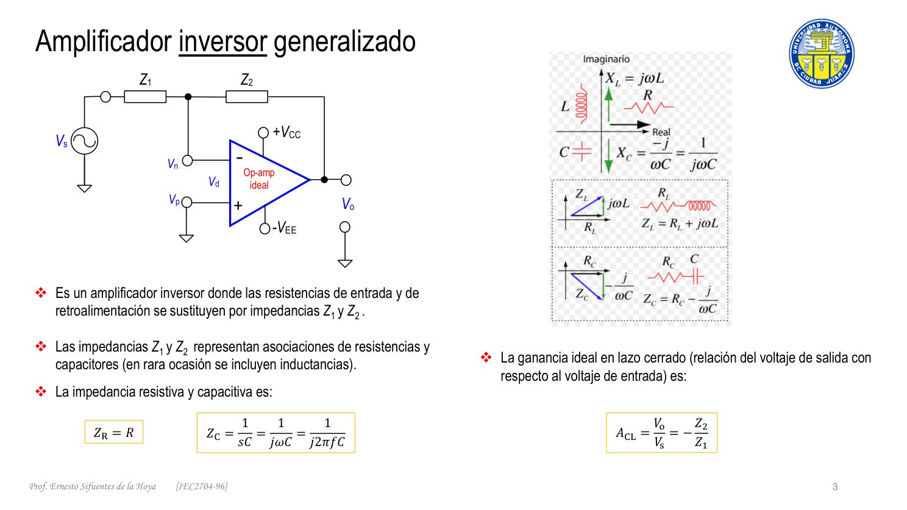{fig-alt="Diapositiva del circuito con amplificador inversor generalizado, impedancias Z1 y Z2, y fórmula Vo/Vs = -Z2/Z1."}

| Configuración | $Z_1$ (entrada) | $Z_2$ (realimentación) | Operación principal |
|:--|:--|:--|:--|
| Integrador inversor ideal | $R_1$ | $1/(sC_F)$ | Integra el voltaje de entrada |
| Derivador inversor ideal | $1/(sC_1)$ | $R_F$ | Deriva el voltaje de entrada |
| Integrador práctico | $R_1$ | $R_F\parallel C_F$ | Controla ganancia a baja frecuencia |
| Derivador práctico | $R_1+C_1$ en serie | $R_F$ | Controla ganancia a alta frecuencia |

## 3. Integrador inversor ideal: circuito y modelo {#l8-integrador-ideal}

### 3.1 Circuito e hipótesis

En el integrador, el resistor $R_1$ transforma la señal $V_s$ en una corriente $i_1$, mientras que el capacitor de realimentación $C_F$ acumula carga. Se supone inicialmente un op-amp ideal, realimentación negativa activa y ausencia de saturación. La terminal no inversora está conectada a tierra y la terminal inversora se mantiene en una **tierra virtual**.

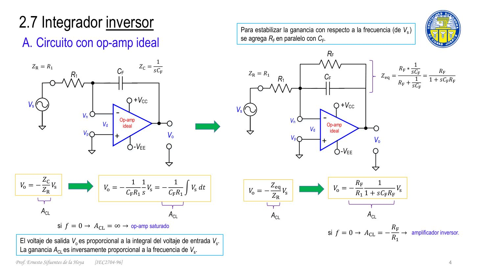{fig-alt="del circuito: R1 en entrada inversora, CF en realimentación y RF paralelo en el integrador práctico."}

### 3.2 Demostración por LCK

Como $V_n\approx0$, la corriente que atraviesa $R_1$ es $i_1=V_s/R_1$. La corriente del capacitor se expresa como

$$i_{C_F}=C_F\frac{d(V_n-V_o)}{dt}=-C_F\frac{dV_o}{dt}.$$

Por LCK, $i_1=i_{C_F}$, de donde

$$\frac{V_s}{R_1}=-C_F\frac{dV_o}{dt}\quad\Longrightarrow\quad\boxed{\frac{dV_o}{dt}=-\frac{V_s(t)}{R_1C_F}}.$$

Al integrar desde $t_0$, con $V_o(t_0)=V_{o0}$:

$$\boxed{V_o(t)=V_{o0}-\frac{1}{R_1C_F}\int_{t_0}^{t}V_s(\tau)\,d\tau}.$$

El parámetro $\tau_I=R_1C_F$ tiene unidades de segundos. Una entrada constante genera una **rampa** con pendiente $m=-V_s/\tau_I$; una entrada rectangular alternada genera una salida triangular por tramos, siempre que la señal y la condición inicial permitan permanecer dentro del margen de salida.

**Dimensiones:** $V_s/(R_1C_F)$ se mide en V/s. Un error frecuente es utilizar $R_1$ en kΩ y $C_F$ en µF sin convertir a Ω y F, y después reportar una pendiente numéricamente incorrecta.

### 3.3 Respuesta a formas de onda

| Entrada $V_s(t)$ | Integración: tendencia de $V_o(t)$ | Cuestión que debe verificar |
|:--|:--|:--|
| Constante positiva | Rampa con pendiente negativa | ¿Cuánto tarda en alcanzar el límite negativo de salida? |
| Constante negativa | Rampa con pendiente positiva | ¿En qué instante cruza 0 V? |
| Rectangular de promedio cero | Tramos lineales alternados | ¿Cuál es el cambio de voltaje en cada semiperiodo? |
| Senoidal | Senoidal integrada con desplazamiento de fase | ¿Cómo depende la amplitud de la frecuencia? |

La presentación destaca la relación para una entrada rectangular simétrica de amplitud $\pm V_p$ y periodo $T_s$:

$$|\Delta V_o|=\frac{V_pT_s}{2R_1C_F}\quad\text{en cada semiperiodo},\qquad V_{o,\mathrm{pico}}=\frac{V_pT_s}{4R_1C_F}\quad\text{si se centra alrededor de cero}.$$

La segunda expresión supone que la triangular resultante se centra en 0 V; **no se deduce por sí sola** sin fijar el estado inicial.

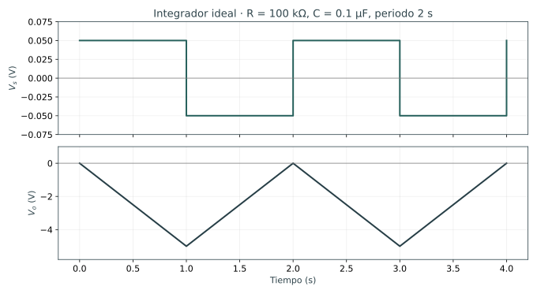{fig-alt="Gráficas calculadas, no mediciones, de entrada rectangular ±50 mV y salida triangular del integrador ideal con periodo 2 s."}

### Tutor IA · Obtener la ecuación del integrador {#tutor-l8-lck-integrador-s12}

::: {.tutor-box}
::: {.tutor-texto}
Actúe como tutor socrático de Electrónica II. Tráteme siempre de usted y formule una sola pregunta por turno. Estoy estudiando el integrador inversor ideal de la Lección 8, con R1 en la entrada y CF en realimentación. Comience preguntándome qué hipótesis justifican Vn≈Vp=0 e In=0; espere mi respuesta. Después pídame expresar I1, la corriente del capacitor con el signo correcto, aplicar LCK y obtener dVo/dt, la integral y el término de condición inicial. No entregue la demostración completa antes de que yo intente cada paso. Compruebe las unidades de R1CF y pídame interpretar la polaridad.
:::
::: {.tutor-acciones}
[Abrir ChatGPT](https://chatgpt.com/){.course-button target="_blank" rel="noopener"}
:::
:::

## 4. Integrador práctico: evitar saturación a baja frecuencia {#l8-integrador-practico}

La ganancia ideal $|H_I(j\omega)|=1/(\omega R_1C_F)$ crece cuando $f$ disminuye. En un op-amp real, una pequeña tensión de offset o corriente de polarización puede producir una rampa lenta hasta saturar la salida, incluso sin señal útil. Por eso la presentación introduce $R_F$ **en paralelo** con el capacitor $C_F$.

$$Z_F(s)=R_F\parallel\frac{1}{sC_F}=\frac{R_F}{1+sR_FC_F}.$$

La transferencia resulta

$$\boxed{H_{I,p}(s)=-\frac{R_F/R_1}{1+sR_FC_F}}.$$

De aquí se identifican la ganancia de continua y la frecuencia de transición:

$$H_{I,p}(0)=-\frac{R_F}{R_1},\qquad \boxed{f_{c,I}=\frac{1}{2\pi R_FC_F}}.$$

Para $f\ll f_{c,I}$ se comporta principalmente como un amplificador inversor de ganancia $-R_F/R_1$; para $f\gg f_{c,I}$ se aproxima al integrador ideal $-1/(sR_1C_F)$. En la vecindad de $f_c$ hay una transición, no una frontera abrupta.

$$|H_{I,p}(j2\pi f)|=\frac{R_F/R_1}{\sqrt{1+(2\pi fR_FC_F)^2}}.$$

### Ejemplo 1 · Señal rectangular de ±50 mV

Datos del ejemplo 1: $R_1=100\ \mathrm{k\Omega}$, $C_F=0.1\ \mu\mathrm F$, $V_p=50\ \mathrm{mV}$, $T_s=2\ \mathrm s$.

$$R_1C_F=(100\times10^3)(0.1\times10^{-6})=0.010\ \mathrm s.$$

Para $0\leq t\leq1$ s, si $V_s=+0.050$ V y $V_o(0)=0$:

$$V_o(t)=-\frac{0.050}{0.010}t=\boxed{-5t\ \mathrm V}.$$

En el siguiente semiperiodo la entrada cambia a $-0.050$ V y la pendiente cambia a $+5$ V/s. Con continuidad $V_o(1)=-5$ V:

$$V_o(t)=-5+5(t-1)=\boxed{5t-10\ \mathrm V},\qquad1\leq t\leq2\ \mathrm s.$$

La salida recorre $0\to-5\to0$ V en un periodo con esa condición inicial. **Antes de simular**, compruebe si el rango de saturación seleccionado permite ese recorrido.

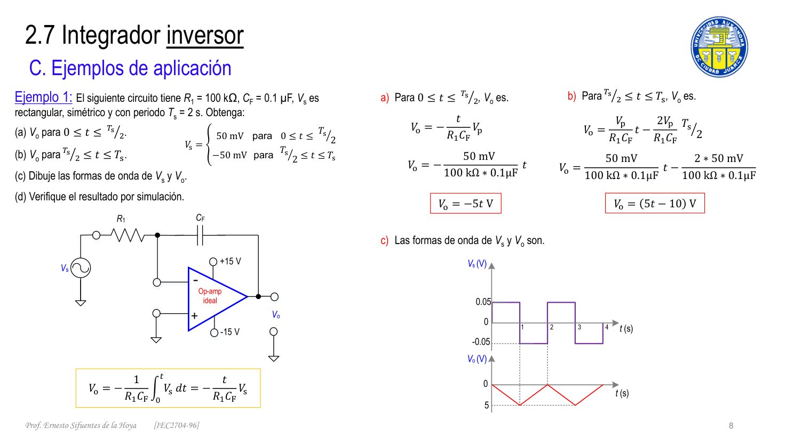{fig-alt="esquema: integrador R1=100 kiloohms, CF=0.1 microfarad, entrada rectangular ±50 milivolts."}

### Ejemplo 2 · Escalón y tiempo de saturación

Datos del ejemplo 2: $R_1=50\ \mathrm{k\Omega}$, $C_F=10\ \mu\mathrm F$, escalón $V_s=2$ V durante 5 s, límite de salida idealizado $-13.5$ V.

$$R_1C_F=0.500\ \mathrm s,\quad m=-\frac{2}{0.500}=\boxed{-4\ \mathrm{V/s}}.$$

A los 2 s, $V_o(2)=-8$ V si $V_o(0)=0$; en el modelo lineal el tiempo para $-13.5$ V es

$$t_{\mathrm{sat}}=\frac{13.5\ \mathrm V}{4\ \mathrm{V/s}}=\boxed{3.375\ \mathrm s}.$$

Después de ese instante, la expresión ideal de integración deja de representar el comportamiento real: la salida queda limitada por la etapa de potencia del op-amp. **No prolongue la rampa matemática por debajo del nivel de saturación.**

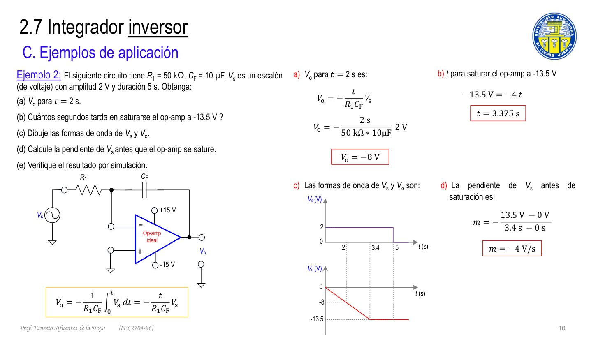{fig-alt="esquema: ejemplo de entrada escalón 2 V, salida de integrador hasta saturación negativa."}

### Ejemplo 3 · Integrador con $R_F$ en paralelo

Datos del ejemplo 3: $R_1=10\ \mathrm{k\Omega}$, $R_F=100\ \mathrm{k\Omega}$ y $C_F=10\ \mu\mathrm F$.

$$R_FC_F=1\ \mathrm s,\quad |H(0)|=10,\quad f_{c,I}=\frac{1}{2\pi(1)}\approx\boxed{0.159\ \mathrm{Hz}}.$$

La ganancia en magnitud para las frecuencias propuestas es

| Frecuencia | Sustitución en $|H|=10/\sqrt{1+(2\pi f)^2}$ | Resultado calculado |
|--:|:--|--:|
| 0 Hz | $10/\sqrt{1+0}$ | 10.000 V/V |
| 1 Hz | $10/\sqrt{1+(2\pi)^2}$ | 1.572 V/V |
| 100 Hz | $10/\sqrt{1+(200\pi)^2}$ | **0.0159 V/V** |

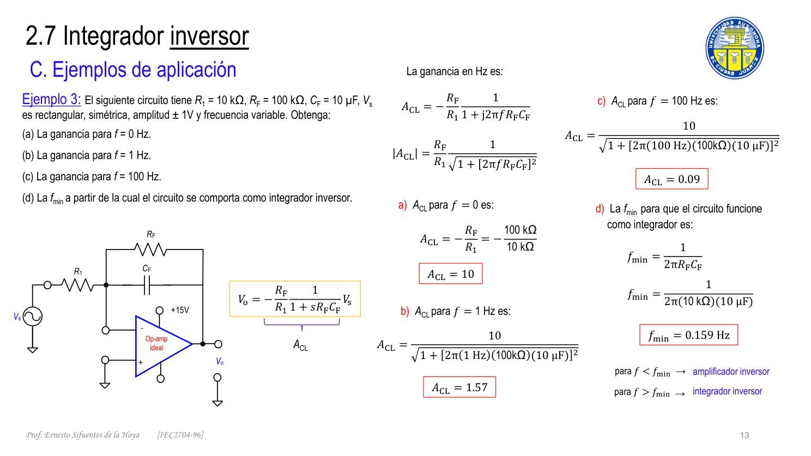{fig-alt="esquema del circuito, con circuito práctico de integrador y valores indicados en el enunciado."}

### Tutor IA · Analizar saturación y ganancia {#tutor-l8-saturacion-integrador-s12}

::: {.tutor-box}
::: {.tutor-texto}
Sea un tutor de Electrónica II, tratándome de usted. Ayúdeme con una pregunta por turno a resolver los ejemplos del integrador de la Lección 8. Primero pídame identificar el ejemplo, los datos y el valor inicial Vo(0). Para una entrada rectangular exíjame calcular R1CF, las pendientes y la continuidad entre intervalos; para el escalón pregunte cuándo se alcanza −13.5 V; para el integrador con RF en paralelo pídame distinguir ganancia en DC, frecuencia de corte y magnitud a 1 y 100 Hz. Pídame contrastar los resultados analíticos con Multisim y explicar qué hipótesis podría generar diferencias. No entregue directamente los resultados.
:::
::: {.tutor-acciones}
[Abrir ChatGPT](https://chatgpt.com/){.course-button target="_blank" rel="noopener"}
:::
:::

## 5. Derivador inversor ideal: circuito y modelo {#l8-derivador-ideal}

El circuito cambia de posición los elementos reactivos: $C_1$ está **en serie en la entrada** y $R_F$ forma la realimentación. Para condiciones ideales,

$$Z_1(s)=\frac1{sC_1},\quad Z_2(s)=R_F,\quad H_D(s)=-sR_FC_1.$$

La corriente que entra al nodo inversor desde el capacitor es

$$i_{C_1}=C_1\frac{d(V_s-V_n)}{dt}\approx C_1\frac{dV_s}{dt}.$$

Aplicando LCK y la condición $V_n\approx0$:

$$\boxed{V_o(t)=-R_FC_1\frac{dV_s(t)}{dt}}.$$

El voltaje de salida responde a la **rapidez de cambio** y no directamente a la amplitud del voltaje de entrada. Una rampa positiva produce una salida negativa constante; una rampa negativa, una salida positiva. Para un escalón ideal, la derivada incluye un impulso matemático: un circuito físico no reproduce un impulso infinito y su salida queda condicionada por ancho de banda y límites de saturación.

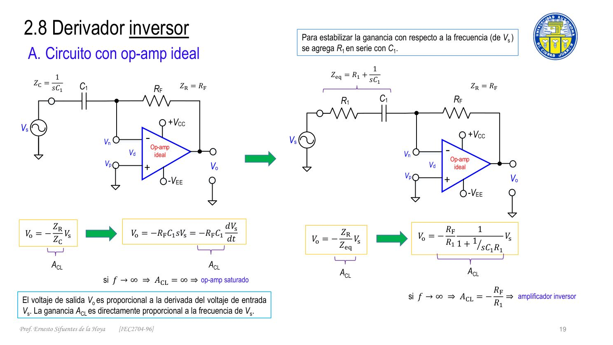{fig-alt="Esquema con capacitor C1 en entrada y resistor RF de realimentación; resistor R1 en serie como corrección."}

| Entrada | Derivada ideal | Salida del derivador inversor |
|:--|:--|:--|
| Constante | 0 | Cero (salvo errores reales) |
| Rampa creciente | Pendiente positiva | Nivel negativo constante |
| Rampa decreciente | Pendiente negativa | Nivel positivo constante |
| Triangular | Pendientes alternadas | Rectangular por tramos |
| Sinusoidal | Cosenoidal escalada por $\omega$ | Señal con fase y amplitud dependientes de $f$ |

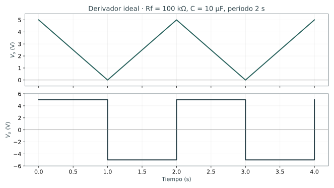{fig-alt="Gráfica teórica de rampa descendente/ascendente y salida alternada de ±5 V; no es medición."}

### Ejemplo 4 · Derivar una señal triangular

Considere $R_F=100\ \mathrm{k\Omega}$ y $C_1=10\ \mu\mathrm F$, de modo que $R_FC_1=1$ s. Con una pendiente $dV_s/dt=-5$ V/s en el primer semiperiodo, $V_o=+5$ V; cuando la pendiente cambia a $+5$ V/s, $V_o=-5$ V. El modelo ideal omite los picos y las transiciones finitas que aparecen en simulaciones más realistas.

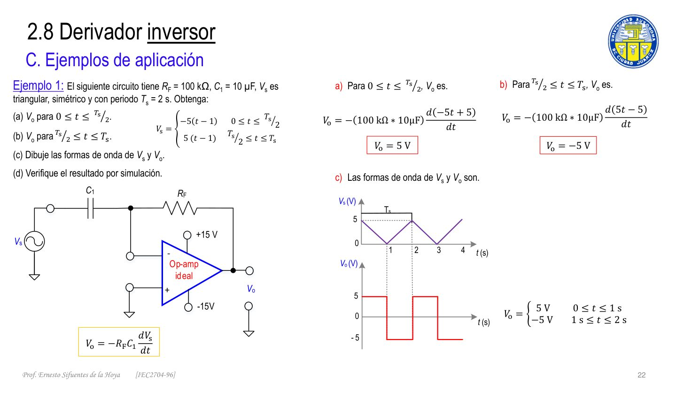{fig-alt="Esquema con Rf=100 kiloohms, C1=10 microfarads y resultado ideal ±5 volts."}

## 6. Derivador práctico: limitar amplificación a alta frecuencia {#l8-derivador-practico}

En el derivador ideal $|H_D(j\omega)|=\omega R_FC_1$, que aumenta indefinidamente con la frecuencia. El ruido de alta frecuencia y el ancho de banda finito del op-amp pueden volver inestable o poco útil el montaje. La presentación coloca un resistor $R_1$ **en serie con $C_1$** en la entrada.

$$Z_{in}(s)=R_1+\frac{1}{sC_1},\qquad \boxed{H_{D,p}(s)=-\frac{sR_FC_1}{1+sR_1C_1}}.$$

Por tanto

$$|H_{D,p}(j2\pi f)|=\frac{R_F/R_1}{\sqrt{1+\bigl[1/(2\pi fR_1C_1)\bigr]^2}},\quad f_{c,D}=\frac1{2\pi R_1C_1}.$$

A frecuencias mucho menores que $f_{c,D}$ se aproxima a $-sR_FC_1$ (derivación); por encima de esa región, la magnitud tiende a $R_F/R_1$. Un diseño real puede requerir además un capacitor pequeño en la realimentación, dependiendo del ruido y estabilidad; no forma parte del circuito simple de la diapositiva.

### Ejemplo 5 · Ganancia del derivador práctico

Para $R_1=1\ \mathrm{k\Omega}$, $R_F=10\ \mathrm{k\Omega}$, $C_1=1\ \mu\mathrm F$:

$$R_1C_1=0.001\ \mathrm s,\quad f_{c,D}\approx\boxed{159.2\ \mathrm{Hz}},\quad \lim_{f\to\infty}|H|=10.$$

| $f$ | $|H_{D,p}|$ calculada | Interpretación |
|--:|--:|:--|
| 1 Hz | **0.0628 V/V** | Diferenciación con poca amplitud de salida |
| 100 Hz | 5.320 V/V | Región de transición |
| 1000 Hz | 9.876 V/V | Cerca del límite de ganancia 10 |

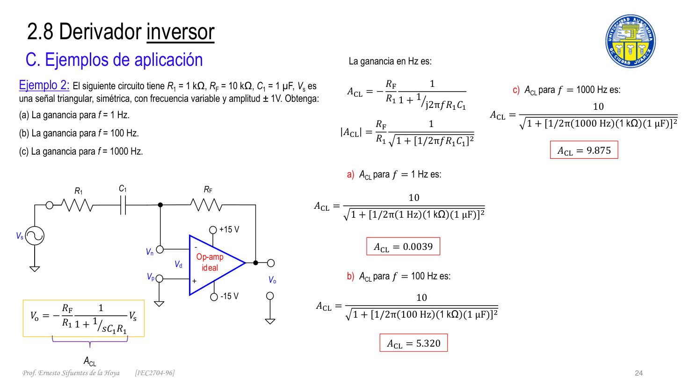{fig-alt="Derivador práctico con resistencia de entrada en serie, valores de R1, RF y C1 y ganancias presentadas."}

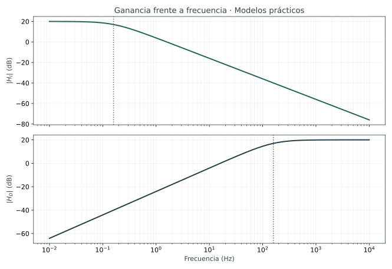{fig-alt="Curvas calculadas de amplitud en decibeles para los circuitos prácticos de los ejemplos, con sus frecuencias de transición."}

### Tutor IA · Deducir y comparar el derivador {#tutor-l8-derivador-s12}

::: {.tutor-box}
::: {.tutor-texto}
Tráteme de usted y actúe como tutor socrático de Electrónica II. Estoy trabajando con el derivador inversor ideal y el práctico, no con el integrador. Pregúnteme primero dónde se ubican C1, R1 y RF en cada circuito y espere. Después ayúdeme, una pregunta por turno, a deducir Vo = −RF C1 dVs/dt por LCK, interpretar por qué una señal triangular genera una rectangular y obtener la transferencia con R1 en serie. Para el ejemplo R1=1 kΩ, RF=10 kΩ y C1=1 µF, pídame calcular fc y las ganancias a 1, 100 y 1000 Hz con unidades. No sustituya mis cálculos: pídame que compare con la diapositiva y la simulación.
:::
::: {.tutor-acciones}
[Abrir ChatGPT](https://chatgpt.com/){.course-button target="_blank" rel="noopener"}
:::
:::

## 7. Comparación técnica y preguntas de comprensión {#l8-comparacion}

| Propiedad | Integrador | Derivador |
|:--|:--|:--|
| Operación temporal ideal | $-\frac1{RC}\int V_s\,dt$ | $-RC\,dV_s/dt$ |
| Elemento de entrada | Resistor | Capacitor |
| Elemento de realimentación | Capacitor | Resistor |
| Región problemática ideal | Bajas frecuencias / continua | Altas frecuencias / ruido |
| Corrección de la presentación | $R_F$ en paralelo con $C_F$ | $R_1$ en serie con $C_1$ |
| Transformación ilustrativa | Rectangular → triangular | Triangular → rectangular |
| Riesgo físico | Deriva por offset y saturación | Amplificación de ruido y saturación |

**Ejercicios de comprobación (sin solución anticipada):** 1) deduzca el signo de la pendiente del integrador cuando $V_s=-0.4$ V; 2) determine $R_1C_F$ para obtener una pendiente de $-2$ V/s al aplicar +0.1 V; 3) explique por qué un capacitor inicial cargado modifica la salida aun cuando $V_s=0$; 4) compare $|H(j\omega)|$ de ambos circuitos al duplicar $f$ dentro de su región aproximada ideal; 5) describa qué límites de un op-amp real observaría al intentar derivar una transición abrupta.

### Tutor IA · Comparar ambas funciones {#tutor-l8-comparacion-s12}

::: {.tutor-box}
::: {.tutor-texto}
Sea tutor de Electrónica II y tráteme de usted. Quiero comparar integrador y derivador. Haga una sola pregunta por turno sobre ubicación de R y C, la expresión de Vo, la unidad de RC, respuesta a escalón, rampa, rectangular y triangular, y los mecanismos de saturación. Antes de cualquier cálculo, pídame justificar el signo de la respuesta. Si confundo frecuencia de transición con un corte absoluto o ganancia en dB con V/V, guíeme con una pista. Cierre solicitándome una tabla escrita por mí, no redactándola usted primero.
:::
::: {.tutor-acciones}
[Abrir ChatGPT](https://chatgpt.com/){.course-button target="_blank" rel="noopener"}
:::
:::

## 8. Simulación, fuentes y entrega {#l8-simulaciones-cierre}

Como actividad de aplicación, implemente los ejemplos de la Lección 8 en Multisim y **entregar las simulaciones de la parte 1 en la clase 36**. Consulte la [guía de simulaciones](simulaciones-ejemplos-l8.qmd), que presenta archivos `.ms14`, configuraciones e indicaciones de qué medir. Los archivos de la presentación se conservan íntegros, incluidas las copias de seguridad en el ZIP docente original.

::: {.course-actions}
[Abrir simulaciones de la Lección 8](simulaciones-ejemplos-l8.qmd){.course-button .course-button-primary}
[Documentos originales](../../recursos/semana-12/presentacion-leccion-08-integrar-y-derivar.pdf){.course-button}
[Agenda de la semana 12](semana-12.qmd){.course-button}
:::

**Bibliografía:** Carter y Mancini, *Op Amps for Everyone* (2017); Sergio Franco, *Design with Operational Amplifiers and Analog Integrated Circuits*, 4.ª ed. (2014).
