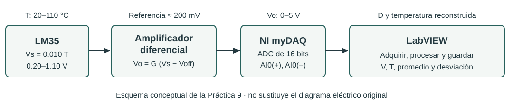
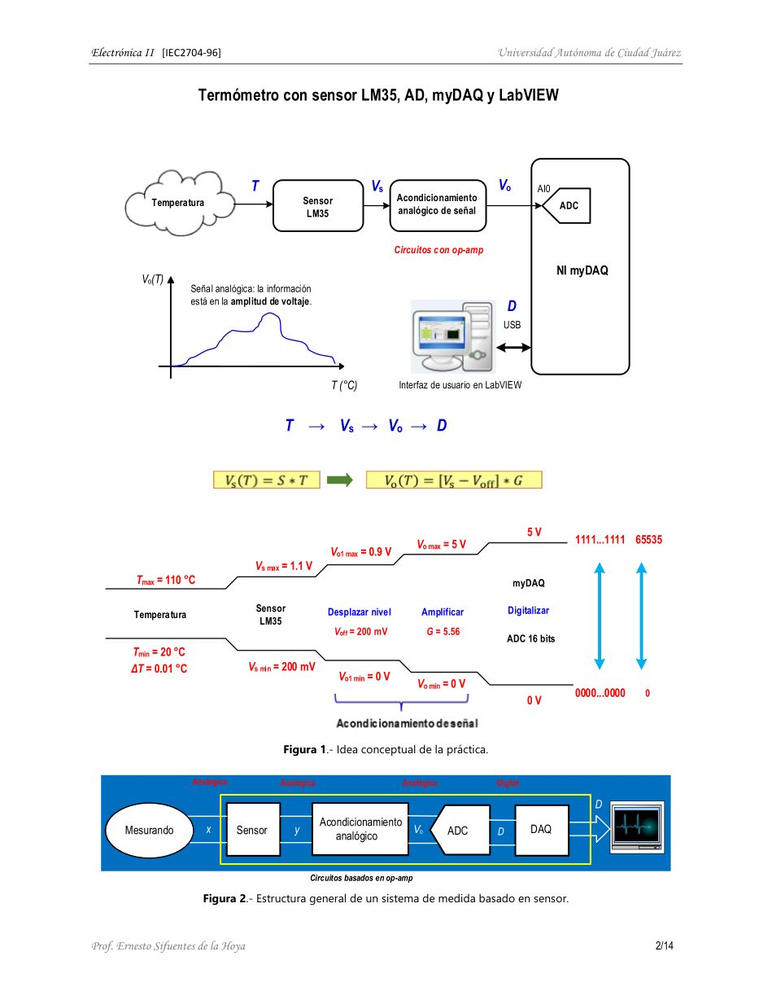
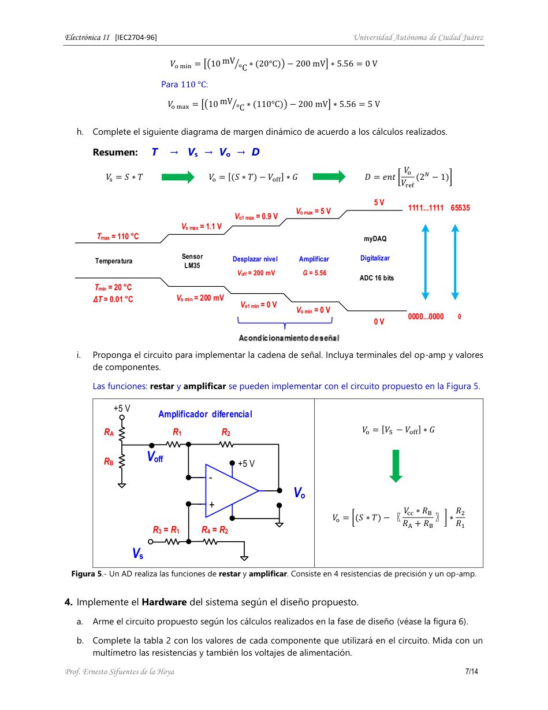
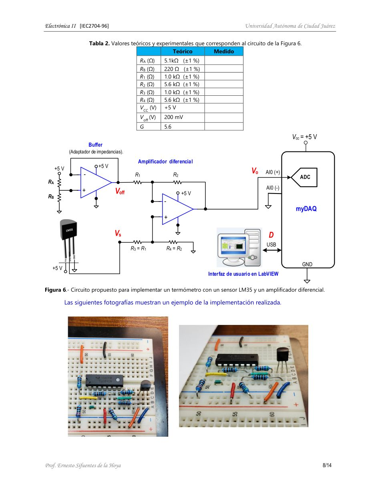
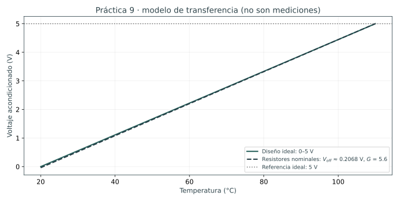
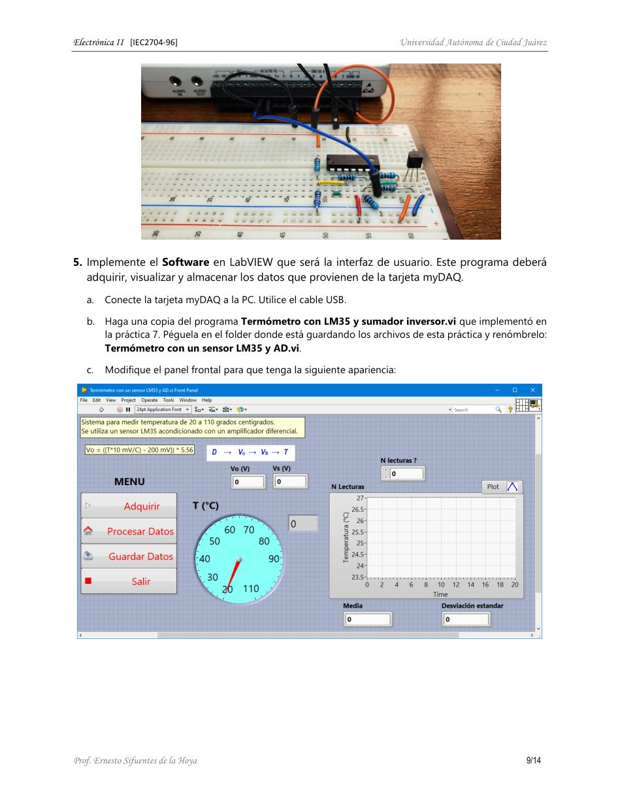
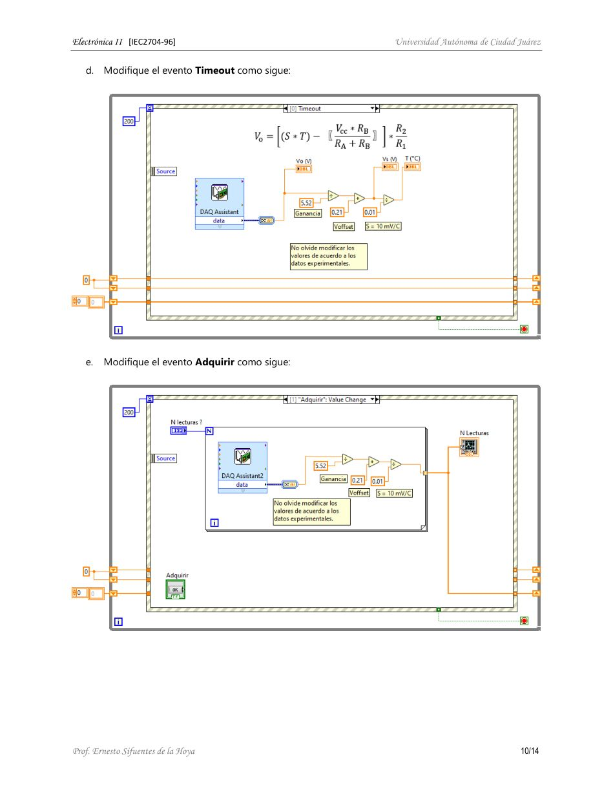
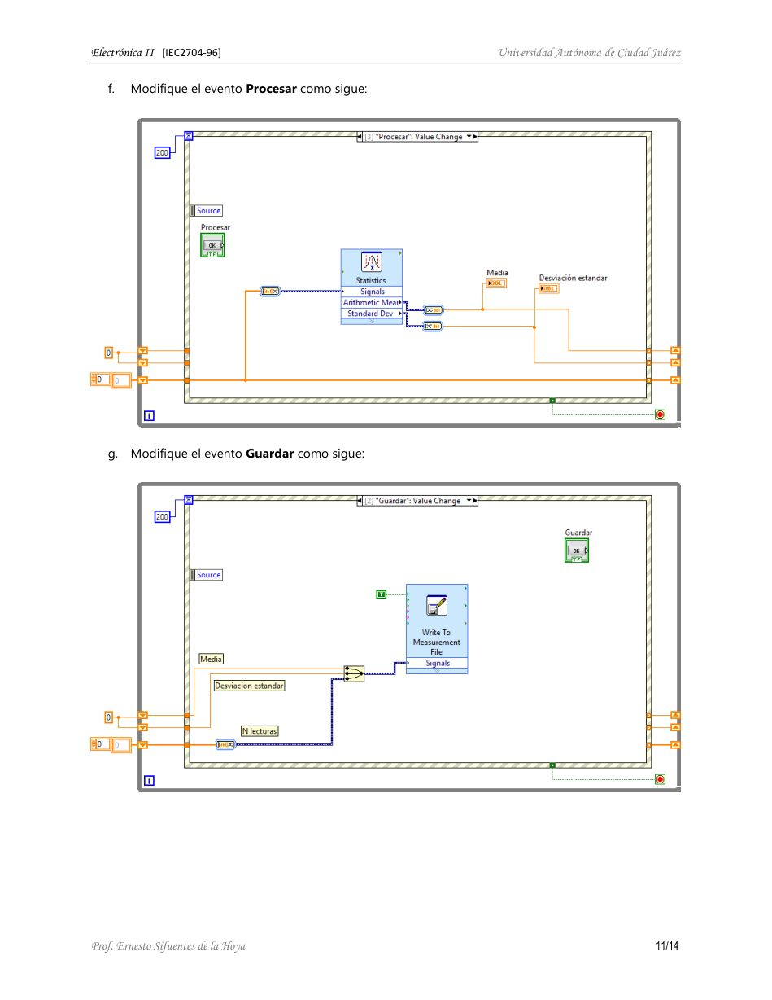
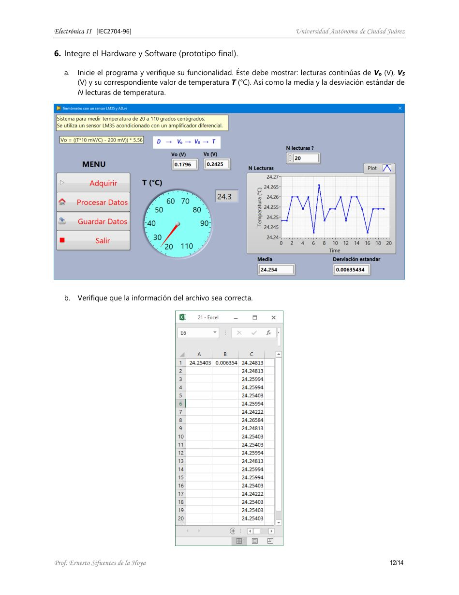

# Práctica 9 · Termómetro LM35 y NI myDAQ (opción 3) {.unnumbered}

**Clases 35 y 36 · 120 + 60 minutos.** La práctica integra los aprendizajes de las tres opciones de termómetro: ahora se obtiene el desplazamiento de nivel y la amplificación con **un amplificador diferencial (AD) de cuatro resistencias**, seguido de la digitalización con NI myDAQ y una interfaz de LabVIEW. La guía original del profesor tiene 14 páginas y es la referencia principal para los montajes y capturas del programa.

::: {.course-actions}
[Práctica 9 original · PDF](../../recursos/semana-12/practica-09-termometro-lm35-opcion-3.pdf){.course-button .course-button-primary}
[Repasar amplificador diferencial](../10/amplificador-diferencial.qmd){.course-button}
[Repasar Práctica 7](../10/practica-07-termometro-opcion-2.qmd){.course-button}
[Agenda de semana 12](semana-12.qmd){.course-button}
[Tutor IA](../../tutor-ia.qmd#consignas-semana-12){.course-button}
:::

## 1. Objetivo y materiales {#p9-objetivo}

**Objetivo indicado en la guía:** desarrollar un termómetro que emplee circuitos con amplificadores operacionales para el procesamiento de señales. El sistema debe medir en el intervalo **20–110 °C**, con una **resolución deseada de 0.01 °C**, utilizando LM35, AD, myDAQ y LabVIEW.

Los materiales señalados son: computadora con LabVIEW instalado, NI myDAQ, amplificador TL084 o TLC274, sensor LM35, resistor de 220 Ω (±1 %), resistor de 5.1 kΩ (±1 %), dos resistores de 1 kΩ (±1 %), dos de 5.6 kΩ (±1 %), elemento de calentamiento controlado (cautín o celda Peltier), protoboard, cables y el VI desarrollado en la Práctica 7.

> **Distinción indispensable:** la resolución objetivo de 0.01 °C describe el incremento deseado del resultado digital. **No significa** que el LM35, el acondicionador o el sistema completo tengan exactitud de ±0.01 °C. La exactitud debe estimarse a partir de especificaciones verificables o comprobarse mediante referencia calibrada.

## 2. Cadena de medida y rangos {#p9-cadena}

El esquema funcional conserva la secuencia $T\rightarrow V_s\rightarrow V_o\rightarrow D\rightarrow\hat T$, pero reduce a **una etapa diferencial principal** el circuito encargado de restar y amplificar.

{fig-alt="Diagrama de bloques con temperatura, sensor LM35, amplificador diferencial, NI myDAQ y programa LabVIEW."}

{fig-alt="Diagrama de origen con rango 20–110 °C, offset 200 mV, ganancia 5.56 y digitalización a 16 bits."}

| Magnitud | Requisito o modelo de la guía | Comprobación |
|:--|:--|:--|
| Temperatura | $20\leq T\leq110\ ^\circ\mathrm C$ | Rango de estudio; no confundir con límites propios del sensor |
| Sensibilidad LM35 idealizada | $S=10\ \mathrm{mV}/^\circ\mathrm C$ | Se debe medir o consultar ficha técnica del ejemplar |
| Voltaje del sensor | $0.200\leq V_s\leq1.100$ V | Se obtiene de $V_s=ST$ |
| Voltaje después de restar offset | $0\leq V_s-V_{off}\leq0.900$ V | $V_{off}$ ideal = 0.200 V |
| Salida ideal propuesta | $0\leq V_o\leq5$ V | Ganancia ideal necesaria $G=5/0.9=5.555\ldots$ |
| Cuantificación del ejemplo | 16 bits y rango **hipotético** de 0–5 V | Debe configurarse correctamente la entrada de myDAQ |

## 3. Modelo matemático: del LM35 al voltaje acondicionado {#p9-modelo}

### 3.1. Sensor, desplazamiento de nivel y ganancia

El modelo del sensor es

$$\boxed{V_s(T)=S\,T},\qquad S=0.010\ \frac{\mathrm V}{^\circ\mathrm C}.$$

Para usar 0–5 V como ventana de acondicionamiento, se desea que $T_{min}=20\ ^\circ\mathrm C$ corresponda a $V_o=0$ y $T_{max}=110\ ^\circ\mathrm C$ a $V_o=5$ V:

$$V_{off}=S\,T_{min}=0.200\ \mathrm V,$$

$$G_{\mathrm{ideal}}=\frac{5\ \mathrm V}{S(T_{max}-T_{min})}=\frac5{0.900}=5.555\ldots\ \mathrm{V/V}.$$

Por tanto,

$$\boxed{V_o=G(V_s-V_{off})=G(ST-V_{off})}.$$

Con el modelo de diseño ideal, la relación inversa para reconstruir temperatura es

$$\boxed{\hat T=\frac{V_o/G+V_{off}}{S}},\quad\text{y si se usan los valores ideales,}\quad \hat T\,[^\circ\mathrm C]=20+18V_o\,[\mathrm V].$$

Es importante incluir las **unidades** en el uso de esta última fórmula: el coeficiente 18 tiene dimensiones de °C/V.

### 3.2. El amplificador diferencial de cuatro resistencias

La práctica utiliza un restador con $R_3=R_1$ y $R_4=R_2$ para igualar razones y obtener la relación ideal

$$\boxed{V_o=\frac{R_2}{R_1}(V_s-V_{off})},\qquad R_1=R_3,\;R_2=R_4.$$

La red de resistores $R_A$ y $R_B$ genera $V_{off}$ a partir de +5 V. La figura 6 agrega un **seguidor de voltaje** para evitar que el circuito de offset se cargue al conectarlo al amplificador diferencial; así se relaciona esta práctica con las lecciones 4 y 7.

{fig-alt="Diagrama original con divisores de referencia, resistencias R1 a R4 y relación Vo = G(Vs−Voff)."}

{fig-alt="Circuito completo de la guía original, con buffer de referencia, amplificador diferencial, sensor y conexión myDAQ."}

### 3.3. Verificación con los componentes nominales indicados

El esquema propone $R_A=5.1\ \mathrm{k\Omega}$, $R_B=220\ \Omega$, $R_1=R_3=1\ \mathrm{k\Omega}$ y $R_2=R_4=5.6\ \mathrm{k\Omega}$. Para el divisor de offset, sin carga por el uso de buffer:

$$V_{off,\mathrm{nom}}=5\ \mathrm V\frac{R_B}{R_A+R_B}=5\frac{220}{5100+220}=\boxed{0.20677\ \mathrm V}.$$

La ganancia nominal del diferencial es

$$G_{\mathrm{nom}}=\frac{5600}{1000}=\boxed{5.6\ \mathrm{V/V}}.$$

El modelo de **componentes nominales, sin corrección de calibración**, predice

$$\boxed{V_{o,\mathrm{nom}}(T)=5.6\,[0.010\,T-0.20677]}\quad\mathrm V.$$

| $T$ (°C) | $V_s$ ideal (V) | $V_o$ de diseño (V) | $V_o$ con valores nominales (V) |
|--:|--:|--:|--:|
| 20 | 0.200 | 0.000 | −0.0379 |
| 40 | 0.400 | 1.111 | 1.0821 |
| 60 | 0.600 | 2.222 | 2.2021 |
| 80 | 0.800 | 3.333 | 3.3221 |
| 100 | 1.000 | 4.444 | 4.4421 |
| 110 | 1.100 | 5.000 | 5.0021 |

En 20 °C la predicción nominal es ligeramente negativa; en 110 °C es ligeramente mayor que 5 V. **No suponga** que el ADC o el op-amp admitirán esos voltajes fuera de rango. En laboratorio debe medirse el offset real, las resistencias y el margen de salida disponible; si procede, ajustar/calibrar la transferencia. La salida calculada con valores nominales **no constituye una medición**.

{fig-alt="Gráfico teórico de Vo frente a temperatura para ganancia ideal 5.5556 y para resistencias nominales 5.6 y offset 0.20677 V."}

A $110\ ^\circ\mathrm C$, la salida nominal del LM35 es $1.10\ \mathrm V$ ($10\ \mathrm{mV}/^\circ\mathrm C$). Para obtener las ganancias y desplazamientos de nivel, utilice los valores efectivos de resistencias y distinga los cálculos nominales de las mediciones.

### Tutor IA · Diseñar el diferencial y la referencia {#tutor-p9-diseno-s12}

::: {.tutor-box}
::: {.tutor-texto}
Sea tutor socrático de la Práctica 9 de Electrónica II y tráteme de usted. Debo diseñar un termómetro de 20 a 110 °C usando LM35, buffer, amplificador diferencial, myDAQ y LabVIEW. Pregúnteme primero los valores del voltaje LM35 en los extremos y espere mi respuesta. Después, una pregunta por turno, ayúdeme a deducir Voff, G, Vo(T) y T(Vo), identificando qué resistores implementan cada función. Exíjame comparar los ideales 200 mV y 5.5556 con el divisor de 5.1 kΩ y 220 Ω y las parejas de 1 kΩ y 5.6 kΩ. Pídame explicar la utilidad del buffer y no permita que confunda especificaciones de diseño con valores medidos o exactitud real.
:::
::: {.tutor-acciones}
[Abrir ChatGPT](https://chatgpt.com/){.course-button target="_blank" rel="noopener"}
:::
:::

## 4. Margen dinámico y cuantificación {#p9-adc}

Con rango $\Delta T=90\ ^\circ\mathrm C$ y paso requerido de $0.01\ ^\circ\mathrm C$, la guía calcula

$$MD=\frac{110-20}{0.01}=9000\ \text{intervalos},\qquad MD_{dB}=20\log_{10}(9000)\approx79.1\ \mathrm{dB}\ (\text{aprox. }80\ \mathrm{dB}).$$

El número mínimo de bits para representar al menos 9000 intervalos en un sistema **ideal**, sin incluir incertidumbre, es $\lceil\log_2(9000)\rceil=14$ bits. Para un modelo de ADC de 16 bits y un rango de referencia **hipotético** 0–5 V:

$$q\approx\frac{5\ \mathrm V}{2^{16}}=76.29\ \mu\mathrm V.$$

La sensibilidad acondicionada ideal es

$$S_o=G_{\mathrm{ideal}}\cdot S\approx55.56\ \frac{\mathrm{mV}}{^\circ\mathrm C},\quad \delta T_{ADC}\approx\frac{q}{S_o}=\boxed{0.00137\ ^\circ\mathrm C\ \text{por cuenta ideal}}.$$

Esto describe **cuantificación nominal**, no temperatura detectable, exactitud, ni número efectivo de bits. En un instrumento real se acumulan no linealidad del sensor, offset, tolerancias, ruido, límite de excursión de salida y errores de adquisición. En LabVIEW, documente el **rango realmente configurado** en NI myDAQ; no asuma que todos los modos de la tarjeta utilizan una ventana unipolar 0–5 V.

Para ilustrar un modelo unipolar ideal (no la codificación universal de cualquier configuración):

$$D\approx\operatorname{round}\left[\frac{V_o}{5\ \mathrm V}(2^{16}-1)\right],\qquad 0\leq D\leq65535.$$

### Tutor IA · Resolución frente a exactitud {#tutor-p9-adc-s12}

::: {.tutor-box}
::: {.tutor-texto}
Tráteme de usted y guíeme con una pregunta por turno para analizar la digitalización de la Práctica 9. Pregunte el rango de temperatura, paso objetivo, margen dinámico en intervalos y dB, bits ideales mínimos y tamaño de una cuenta si el ADC de ejemplo tiene 16 bits en 0–5 V. Antes de aceptar mi resultado pídame unidades. Exíjame distinguir resolución de cuantificación, ruido, incertidumbre y exactitud real, así como comprobar el modo de entrada seleccionado en myDAQ. No invente datos ni dé la solución completa antes de mi intento.
:::
::: {.tutor-acciones}
[Abrir ChatGPT](https://chatgpt.com/){.course-button target="_blank" rel="noopener"}
:::
:::

## 5. Montaje físico: secuencia de verificación {#p9-hardware}

La guía solicita ensamblar el circuito de la figura 6, medir los resistores y voltajes de alimentación y registrarlos antes de integrar el sistema. Utilice el mismo orden de trabajo para localizar errores de signo y referencias:

1. Verifique el **pinout, alimentación permitida y margen de modo común** del TL084 o TLC274 concreto. Un op-amp no necesariamente opera correctamente con salida a 0 y 5 V por el simple hecho de alimentarlo a +5 V.
2. Conecte el LM35 según su hoja de datos, mida $V_s$ a temperatura ambiente y compruebe que resulte coherente con $0.010\,T$ V.
3. Arme el divisor de referencia $R_A$–$R_B$; mida $V_{off}$ **antes y después** del seguidor. Si cambia, investigue carga o cableado.
4. Monte el diferencial de cuatro resistores, manteniendo las razones emparejadas. Registre $R_1,R_2,R_3,R_4$ **medidos**, no solo nominales.
5. Sin conectar myDAQ, verifique con multímetro $V_s$, $V_{off}$ y $V_o$, anotando polaridades y la relación con la predicción matemática.
6. Conecte la entrada AI0(+) y AI0(−) según figura 6 y configuración real de la tarjeta, sin exceder sus límites de entrada ni crear referencias incompatibles.
7. Evite contacto directo del cautín con el encapsulado plástico del LM35; caliente a distancia y cuide los cables, la protoboard y el equipo de adquisición.

| Componente / señal | Nominal de la guía | Medido en laboratorio |
|:--|:--|:--|
| $R_A$, $R_B$ | 5.1 kΩ; 220 Ω | __________ |
| $R_1$, $R_3$ | 1.0 kΩ cada uno | __________ |
| $R_2$, $R_4$ | 5.6 kΩ cada uno | __________ |
| Alimentación y tierra | Verificar +5 V y referencia común | __________ |
| $V_{off}$ | Objetivo 0.200 V; divisor nominal 0.20677 V | __________ |
| Ganancia diferencial | Objetivo 5.5556; nominal 5.6 V/V | __________ |

## 6. Software LabVIEW: reutilización de la Práctica 7 {#p9-labview}

El documento pide hacer una copia del programa `Termómetro con LM35 y sumador inversor.vi` desarrollado en la Práctica 7, guardarlo en la nueva carpeta de trabajo y renombrarlo **`Termómetro con un sensor LM35 y AD.vi`**. Ese VI de trabajo del estudiante **no se encontraba incluido** en el ZIP de esta semana; la guía ofrece capturas para su modificación.

Según las páginas 9–11 del PDF, se actualiza el panel frontal y cuatro eventos:

| Evento / sección | Tarea de software | Comprobación práctica |
|:--|:--|:--|
| Timeout | Refrescar las lecturas continuas | Mostrar $V_o$, $V_s$ y $T$ con unidades, indicando qué variables se miden y cuáles se estiman |
| Adquirir | Tomar un bloque de $N$ lecturas | Confirmar tamaño de vector y tasa de muestreo aplicada |
| Procesar | Obtener media y desviación estándar | Calcular las estadísticas de temperatura en °C, sin mezclar conversiones |
| Guardar | Exportar resultados a archivo | Comprobar columnas, encabezados, unidades y número de filas |

{fig-alt="Guía original del profesor con la apariencia del panel frontal de LabVIEW."}

{fig-alt="Bloques LabVIEW de Timeout y Adquirir indicados en la Práctica 9."}

{fig-alt="Diagramas de LabVIEW indicados para procesar datos y guardar archivos."}

**Verificación de trazabilidad:** si únicamente $V_o$ se adquiere por AI0, el programa puede **estimar** $V_s=V_o/G+V_{off}$ y $T=V_s/S$. No describa estos valores reconstruidos como voltajes medidos por canales adicionales si esos canales no se utilizaron.

### Tutor IA · Revisar el VI sin sustituir el trabajo {#tutor-p9-labview-s12}

::: {.tutor-box}
::: {.tutor-texto}
Actúe como tutor de laboratorio de Electrónica II y hábleme de usted. Voy a modificar en LabVIEW el VI de la Práctica 7 para la Práctica 9. Una pregunta por turno: pídame explicar qué mide AI0 y qué variables calcula el programa; después revise conmigo los eventos Timeout, Adquirir, Procesar y Guardar, las unidades y el nombre del archivo. Solicite capturas o una descripción concreta antes de afirmar que un evento está bien configurado. Para N=20, pídame calcular media y desviación estándar sin inventar datos. No genere un VI inexistente ni afirme haber probado LabVIEW.
:::
::: {.tutor-acciones}
[Abrir ChatGPT](https://chatgpt.com/){.course-button target="_blank" rel="noopener"}
:::
:::

## 7. Validación experimental: grupos de 20 lecturas {#p9-validacion}

La guía solicita incrementos de temperatura de aproximadamente **10 °C** y **20 lecturas por punto**, con registro de $T$, $V_s$, $V_o$, promedio y desviación estándar. La tabla siguiente está vacía deliberadamente: **no contiene mediciones de laboratorio**.

| Punto | Temperatura de referencia (°C) | $V_s$ medido (V) | $V_o$ medido (V) | $\bar T$ para $N=20$ (°C) | $s_T$ (°C) |
|--:|:--:|:--:|:--:|:--:|:--:|
| 1 | ___ | ___ | ___ | ___ | ___ |
| 2 | ___ | ___ | ___ | ___ | ___ |
| 3 | ___ | ___ | ___ | ___ | ___ |
| 4 | ___ | ___ | ___ | ___ | ___ |
| 5 | ___ | ___ | ___ | ___ | ___ |

Para cada grupo,

$$\bar T=\frac1N\sum_{i=1}^N T_i,\qquad s_T=\sqrt{\frac1{N-1}\sum_{i=1}^N (T_i-\bar T)^2},\qquad N=20.$$

Al comparar $\bar T$ con un termómetro de referencia calibrado, puede calcular $e_T=\bar T-T_{ref}$. Sin referencia calibrada, la dispersión informa sobre **repetibilidad** y no permite afirmar un error absoluto. Identifique también posibles problemas de tiempo de estabilización térmica, calentamiento no uniforme y ruido eléctrico.

{fig-alt="Ejemplo original de integración software-hardware del termómetro LM35-AD-myDAQ."}

### Tutor IA · Interpretar medidas reales {#tutor-p9-mediciones-s12}

::: {.tutor-box}
::: {.tutor-texto}
Sea tutor socrático de Electrónica II, con trato de usted. Estoy validando el termómetro LM35–AD–myDAQ de la Práctica 9. Pídame primero mis resistores medidos, Voff, ganancias reales, alimentación, lecturas Vs y Vo y temperaturas. Una pregunta por turno. Guíeme para comparar ecuación teórica, cálculo con valores nominales y medidas, detectar saturación, convertir Vo a temperatura, y calcular media y desviación estándar con N=20. Si no tengo termómetro de referencia, no me permita afirmar exactitud experimental. Pídame formular al final una conclusión breve sobre el error de offset y las mejoras de calibración.
:::
::: {.tutor-acciones}
[Abrir ChatGPT](https://chatgpt.com/){.course-button target="_blank" rel="noopener"}
:::
:::

## 8. Informe, evidencias y retroalimentación {#p9-entrega}

El informe final solicitado por la guía contiene especificaciones, diseño matemático, diagramas, tabla de resistencias medidas, fotografías del montaje, pantallas de LabVIEW, datos y estadísticas, interpretación y conclusiones. Deben contestarse sus siete preguntas de retroalimentación, entre ellas la definición del AD, diferencias con el amplificador de instrumentación, características ideales y aplicaciones. Utilice la [guía original para los enunciados exactos](../../recursos/semana-12/practica-09-termometro-lm35-opcion-3.pdf).

**Agenda de entregas:** en la **clase 35** se entrega el reporte de la **Práctica 8**; en la **clase 36** se continúa la Práctica 9, se entrega el Cuestionario L7 y la simulación de los ejemplos L8 (parte 1). La planificación de la semana 12 **no asigna una fecha explícita de entrega al reporte de la Práctica 9**: mantenga esa distinción hasta que el profesor la indique.

### Tutor IA · Preparar el informe {#tutor-p9-informe-s12}

::: {.tutor-box}
::: {.tutor-texto}
Tráteme de usted y sea tutor de redacción técnica de la Práctica 9 de Electrónica II. Pídame primero el objetivo y la cadena de medida que construí; después, en preguntas separadas, solicite ecuaciones verificadas, datos de resistencias, evidencia del montaje, pantallas de LabVIEW, 20 lecturas por temperatura, resultados y limitaciones. Ayúdeme a diferenciar observaciones experimentales de cálculos y a contestar con mis palabras el cuestionario final sin escribir un reporte ficticio. Verifique que mis conclusiones no atribuyan exactitud de 0.01 °C por tener un ADC de 16 bits.
:::
::: {.tutor-acciones}
[Abrir ChatGPT](https://chatgpt.com/){.course-button target="_blank" rel="noopener"}
:::
:::

**Referencias:** Práctica 9, *Termómetro con LM35 y myDAQ (opción 3)*, Lección 7 (amplificador diferencial) y actividades LabVIEW de las semanas anteriores.
