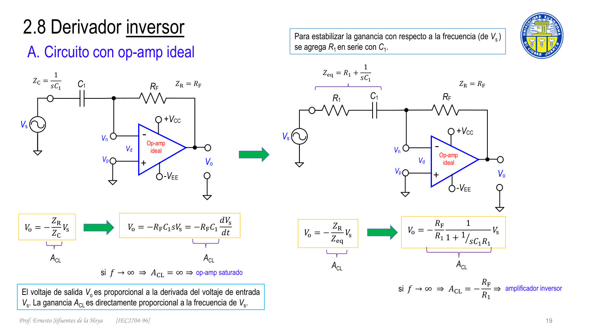
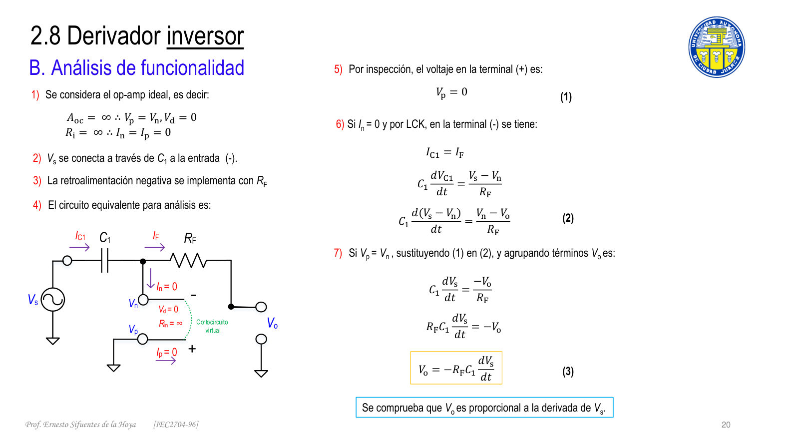
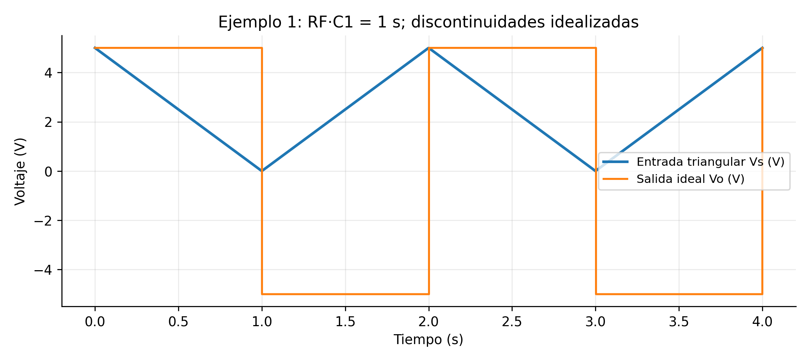
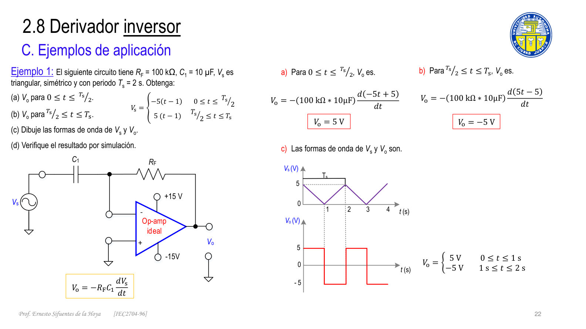
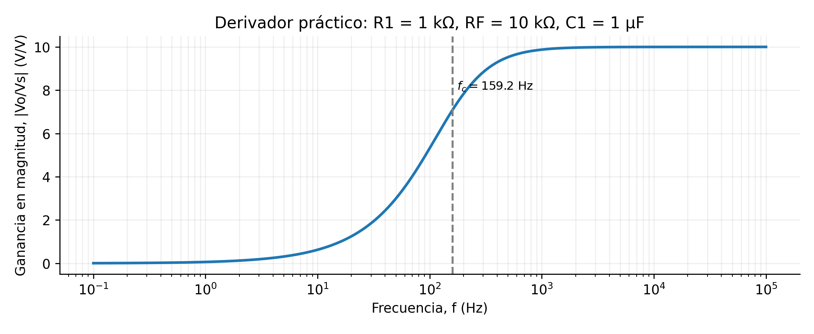
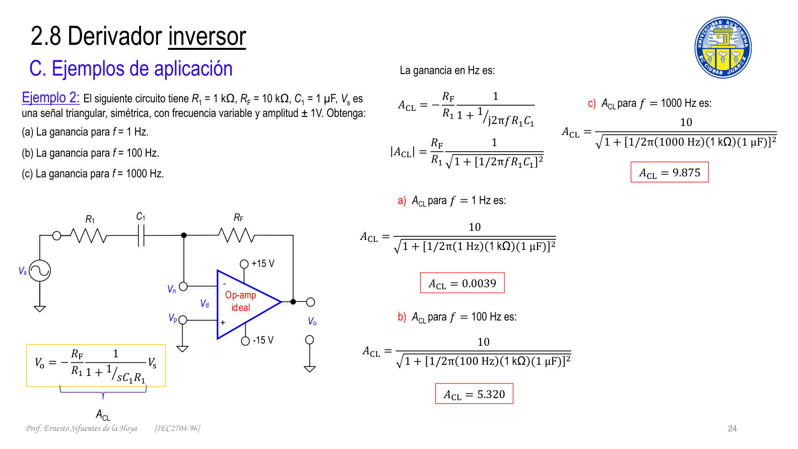

# Lección 8 · Integrar y diferenciar voltajes, parte 2 {.unnumbered}

En la [primera parte](../12/integrar-y-diferenciar-parte-1.qmd) se desarrolló la relación entre integración y derivación y examinó el integrador. En esta segunda parte se profundiza en **cómo un circuito con amplificador operacional produce una salida proporcional a la rapidez de variación de la tensión de entrada**. El análisis comprende: circuito ideal, análisis de funcionalidad, ejemplos, diseño y comprobación por simulación.

::: {#video-l8-parte-2 .course-actions}
[Ver video de la Lección 8 · Parte 2](https://www.youtube.com/watch?v=aGGxoPQJmRg){.course-button .course-button-primary target="_blank" rel="noopener"}
[Presentación original, 29 diapositivas](../../recursos/semana-13/presentacion-leccion-08-parte2.pdf){.course-button}
[Simulaciones de los ejemplos](simulaciones-l8-parte-2.qmd){.course-button}
[Práctica 10](practica-10-amplificador-instrumentacion.qmd){.course-button}
[Tutor IA · Semana 13](../../tutor-ia.qmd#consignas-semana-13){.course-button}
:::

**Actividad de video — Lección 8, parte 2.** Vea la presentación en video y elabore **a mano un resumen** que sintetice los conceptos principales, con extensión proporcional al contenido. **Entrega: clase 37 (primera sesión de la semana 13).** Consulte las [entregas de la Semana 13](semana-13.qmd#entregas-semana-13).

## 1. Objetivos de aprendizaje {#l8-p2-objetivos}

Al concluir esta parte podrá: (i) identificar $C_1$ de entrada y $R_F$ de realimentación; (ii) deducir la relación entrada–salida por ley de corrientes de Kirchhoff (LCK); (iii) predecir el signo de $V_o$ para una pendiente positiva o negativa; (iv) explicar por qué la ganancia del derivador ideal aumenta con la frecuencia y cómo se limita con $R_1$; y (v) verificar en Multisim los dos ejemplos de la presentación.

## 2. Derivador inversor ideal: circuito y análisis por LCK {#l8-p2-ideal}

En el circuito ideal, el capacitor $C_1$ se conecta **en serie con la entrada**, mientras que la resistencia $R_F$ une la salida con la terminal inversora. La terminal no inversora se fija a 0 V. La realimentación negativa permite aproximar $V_n=V_p=0$ e $I_n=I_p=0$, siempre que el op-amp opere dentro de su región lineal.

{fig-alt="Circuito derivador: C1 en entrada inversora, RF entre salida y nodo inversor; en el práctico se inserta R1 en serie con C1."}

Con la convención de corriente del generador hacia el nodo inversor,

$$i_{C_1}(t)=C_1\frac{d(V_s-V_n)}{dt}\simeq C_1\frac{dV_s}{dt}.$$

Como la corriente de entrada al op-amp es despreciable, la LCK exige que toda la corriente del capacitor circule por $R_F$:

$$i_{C_1}=i_F=\frac{V_n-V_o}{R_F}\simeq-\frac{V_o}{R_F}.$$

Por tanto,

$$\boxed{V_o(t)=-R_FC_1\frac{dV_s(t)}{dt}}.$$

La constante $R_FC_1$ tiene unidades de segundos y convierte una pendiente en V/s a una tensión en V. La **polaridad negativa** procede de la configuración inversora: entrada creciente implica salida negativa; entrada decreciente, positiva. Estas igualdades no describen clipping, offset ni el ancho de banda finito.

{fig-alt="Deducción de corriente por capacitor de entrada y resistencia de realimentación en nodo inversor."}

### Función de transferencia y respuesta senoidal

Para condiciones iniciales nulas y $s$ complejo, la impedancia del capacitor es $Z_{C_1}=1/(sC_1)$. Se obtiene

$$H_D(s)=\frac{V_o(s)}{V_s(s)}=-\frac{R_F}{1/(sC_1)}=\boxed{-sR_FC_1}.$$

Con $s=j\omega=j2\pi f$:

$$|H_D(j\omega)|=\omega R_FC_1,\qquad \angle H_D(j\omega)=-90^\circ\quad(f>0).$$

Si $V_s(t)=V_m\sin(\omega t)$, entonces

$$V_o(t)=-\omega R_FC_1V_m\cos(\omega t).$$

La magnitud aumenta $20\ \mathrm{dB}$ por década en el modelo ideal; esto explica por qué una derivada ideal puede amplificar fuertemente el ruido a frecuencias altas. **No** extrapole la recta indefinidamente para un TL084 u otro op-amp real: sus límites de ancho de banda, slew rate y saturación modifican el resultado.

### Tutor IA · Deducir el derivador por LCK {#tutor-l8p2-lck-s13}

::: {.tutor-box}
::: {.tutor-texto}
Actúe como tutor socrático de Electrónica II y tráteme de usted. Analizo el derivador inversor ideal de la Lección 8, parte 2. Haga exactamente una pregunta por turno. Comience pidiéndome ubicar C1, RF y la terminal no inversora en el esquema. Espere mi respuesta antes de revisar el corto virtual, la corriente iC = C d(Vs-Vn)/dt, LCK, signo de Vo y dimensiones de RF C1. Pídame derivar H(s) y la salida ante una sinusoide. No anticipe la ecuación final; señale únicamente el primer error de razonamiento que encuentre.
:::
::: {.tutor-acciones}
[Abrir ChatGPT](https://chatgpt.com/){.course-button target="_blank" rel="noopener"}
:::
:::

## 3. Respuesta del derivador ante distintas señales {#l8-p2-formas-onda}

| $V_s(t)$ | $dV_s/dt$ | Predicción ideal de $V_o(t)$ |
|:--|:--|:--|
| Constante | $0$ | 0 V, salvo offset y errores reales. |
| Rampa creciente con pendiente $m>0$ | $m$ | $-R_FC_1m$, nivel negativo. |
| Rampa decreciente con pendiente $-m$ | $-m$ | $+R_FC_1m$, nivel positivo. |
| Triangular | Pendientes constantes alternadas | Niveles rectangulares alternados. |
| Cuadrada o escalón abrupto | Impulso matemático en cada flanco | Pulsos finitos y posiblemente saturación en el circuito físico. |
| Sinusoidal | Cosenoidal escalada por $2\pi f$ | Sinusoide con ganancia proporcional a $f$ y fase correspondiente. |

Una triangular periódica tiene derivada constante por tramos y cambia de signo en los vértices; en el derivador ideal su salida es rectangular. La tensión de salida puede presentar picos en las conmutaciones si el circuito real amplifica armónicos de alta frecuencia. Las formas de onda de las diapositivas son ilustraciones teóricas, no medidas del alumno.

{fig-alt="Gráfica calculada: entrada que cambia de 5 V a 0 V y regreso cada 2 s; salida ideal alterna entre +5 y -5 V."}

## 4. Ejemplo 1 de la presentación: triangular a rectangular {#l8-p2-ejemplo1}

**Datos del ejemplo:** $R_F=100\ \mathrm{k\Omega}$, $C_1=10\ \mu\mathrm F$, entrada triangular simétrica de periodo $T_s=2\ \mathrm s$.

$$R_FC_1=(100\times10^3)(10\times10^{-6})=1.00\ \mathrm s.$$

La definición por tramos mostrada en el ejercicio puede escribirse, en el primer periodo,

$$V_s(t)=\begin{cases}
-5t+5\ \mathrm V,&0\leq t<1\ \mathrm s,\\
5(t-1)\ \mathrm V,&1\leq t\leq2\ \mathrm s,
\end{cases}$$

con $t$ expresado numéricamente en segundos en cada término. Por derivación,

$$V_o(t)=\begin{cases}
+5\ \mathrm V,&0<t<1\ \mathrm s,\\
-5\ \mathrm V,&1<t<2\ \mathrm s.
\end{cases}$$

Los instantes de cambio de pendiente son discontinuidades de la derivada ideal; una simulación física los redondea. Compruebe que la alimentación elegida permite los niveles ±5 V; no deduzca la forma de onda experimental solamente de la fórmula.

{fig-alt="esquema: enunciado y solución del derivador de entrada triangular."}

### Tutor IA · Verificar el ejemplo triangular {#tutor-l8p2-triangular-s13}

::: {.tutor-box}
::: {.tutor-texto}
Sea tutor de Electrónica II; tráteme de usted. Quiero verificar el ejemplo 1 del derivador (RF=100 kΩ, C1=10 µF, Ts=2 s). Una sola pregunta por turno. Primero pídame convertir RF C1 a segundos; después que escriba la entrada por intervalos, calcule su derivada, determine el signo y nivel de Vo y dibuje ambas señales. No avance si confundo amplitud con pendiente. Pregunte cómo reconocería saturación o transición no ideal en Multisim.
:::
::: {.tutor-acciones}
[Abrir ChatGPT](https://chatgpt.com/){.course-button target="_blank" rel="noopener"}
:::
:::

## 5. Derivador práctico: limitar el crecimiento de ganancia {#l8-p2-practico}

En el modelo ideal, $|H_D|\to\infty$ cuando $f\to\infty$. La configuración práctica incorpora incluir **$R_1$ en serie con $C_1$** para limitar la ganancia en frecuencias altas. El elemento de entrada pasa a ser

$$Z_{\mathrm{in}}(s)=R_1+\frac1{sC_1},\qquad Z_F(s)=R_F.$$

La transferencia se obtiene por la relación de impedancias del inversor:

$$\boxed{H_{D,p}(s)=-\frac{sR_FC_1}{1+sR_1C_1}}.$$

La ganancia en magnitud y la frecuencia de transición son

$$\boxed{|H_{D,p}(j2\pi f)|=\frac{R_F/R_1}{\sqrt{1+\left[1/(2\pi fR_1C_1)\right]^2}}},\qquad \boxed{f_c=\frac1{2\pi R_1C_1}}.$$

- Para $f\ll f_c$ se aproxima a un derivador, $H\simeq-sR_FC_1$.
- Para $f\gg f_c$ tiende al amplificador inversor $H\simeq-R_F/R_1$.
- Alrededor de $f_c$ existe una transición progresiva, no un corte abrupto.

El resistor serie limita la ganancia **del modelo**; la realización real puede requerir también un capacitor de realimentación pequeño, una selección cuidadosa de op-amp y disposición física apropiada para evitar inestabilidad o ruido excesivo. Esa ampliación de diseño no está incluida en el circuito simplificado de las diapositivas.

{fig-alt="Magnitud calculada frente a frecuencia para R1=1 kiloohm, RF=10 kiloohms, C1=1 microfaradio; frecuencia de transición 159.2 Hz."}

## 6. Ejemplo 2: magnitud según frecuencia {#l8-p2-ejemplo2}

**Datos del ejemplo:** $R_1=1\ \mathrm{k\Omega}$, $R_F=10\ \mathrm{k\Omega}$, $C_1=1\ \mu\mathrm F$. Entrada triangular de amplitud $\pm1\ \mathrm V$ y frecuencia variable. Se solicita la magnitud de la ganancia a 1, 100 y 1000 Hz.

$$R_1C_1=0.001\ \mathrm s,\quad f_c=\frac1{2\pi(0.001)}=159.15\ \mathrm{Hz},\quad \frac{R_F}{R_1}=10.$$

| Frecuencia | $|H_{D,p}|$ calculada (V/V) | Interpretación |
|--:|--:|:--|
| 1 Hz | 0.0628 | Se encuentra en la región de diferenciación aproximada. |
| 100 Hz | 5.320 | Transición hacia la ganancia limitada. |
| 1 000 Hz | 9.876 | La magnitud ya está próxima al límite de 10. |

Para interpretar un oscilograma debe comprobarse tanto la magnitud $|H(j\omega)|$ como la fase $\arg H(j\omega)$. La magnitud por sí sola no informa la inversión o el desfase de la salida.

{fig-alt="esquema con resistencia serie de 1 kiloohm, RF 10 kiloohms y capacitor 1 microfaradio; tabla de ganancias."}

### Tutor IA · Ganancia y frecuencia del derivador práctico {#tutor-l8p2-frecuencia-s13}

::: {.tutor-box}
::: {.tutor-texto}
Sea tutor socrático de Electrónica II y utilice el trato de usted. Trabajo el ejemplo 2: R1=1 kΩ, RF=10 kΩ, C1=1 µF; frecuencias 1, 100 y 1000 Hz. Haga una sola pregunta por turno. Solicite deducir la función de transferencia y la magnitud, calcular fc, obtener cada magnitud en V/V y señalar dónde la curva se aproxima al inversor. Pídame comprobar el resultado a 1 Hz mediante una simulación en Multisim y analizar las diferencias entre teoría y simulación. No proporcione una tabla resuelta antes de mis intentos.
:::
::: {.tutor-acciones}
[Abrir ChatGPT](https://chatgpt.com/){.course-button target="_blank" rel="noopener"}
:::
:::

## 7. Diseño, simulación y criterios de verificación {#l8-p2-disenio}

Para evitar errores de comparación entre modelo y simulación, siga este procedimiento:

1. **Identificar la topología.** Verificar que $C_1$ está en la entrada, $R_F$ en realimentación y, si corresponde, $R_1$ en serie con $C_1$; la alimentación del op-amp es independiente de la señal de entrada.
2. **Definir la señal.** Registrar amplitud, offset, frecuencia o periodo, forma de onda, pendiente y fase inicial; no confundir valores pico, pico a pico y RMS.
3. **Predecir la respuesta.** Calcular $R_FC_1$, $f_c$, $|H|$ o los niveles temporales correspondientes, con unidades coherentes.
4. **Ejecutar Multisim.** Comparar $V_s(t)$ y $V_o(t)$ en el mismo registro temporal y, para el ejemplo 2, utilizar un barrido de frecuencia o medición de amplitud y fase con salida no saturada.
5. **Interpretar discrepancias.** Comprobar conectividad, escala vertical, limitación por alimentación, offset, frecuencia, ancho de banda y modelo del op-amp.
6. **Documentar evidencia.** Guardar archivo `.ms14`, cálculos, capturas legibles, datos de configuración y una conclusión técnica breve.

La actividad requiere entregar la **simulación de los ejemplos de L8, parte 2, en la clase 39**. Consulte la [página de simulaciones](simulaciones-l8-parte-2.qmd) y descargue los circuitos allí reunidos.

### Tutor IA · Diagnosticar una simulación que no coincide {#tutor-l8p2-multisim-s13}

::: {.tutor-box}
::: {.tutor-texto}
Tráteme de usted y actúe como tutor técnico de Multisim. Estoy probando un derivador inversor, ideal o práctico. Solicite de una en una la topología, los valores R1, RF y C1, la alimentación, la señal de entrada, el modelo de op-amp y una captura o mediciones de Vs/Vo. Ayúdeme a comparar pendiente y ganancia teóricas con los datos, y a comprobar saturación, offset y amplitudes pico o RMS. No invente capturas ni resultados. Termine pidiéndome una explicación de la primera causa plausible y una prueba para confirmarla.
:::
::: {.tutor-acciones}
[Abrir ChatGPT](https://chatgpt.com/){.course-button target="_blank" rel="noopener"}
:::
:::

## 8. Comprobación conceptual y fuentes {#l8-p2-cierre}

**Preguntas para el alumno:** ¿por qué una entrada con pendiente constante produce un nivel constante de salida? ¿Por qué un derivador ideal es problemático para alta frecuencia? ¿Qué diferencia hay entre ganancia máxima del modelo práctico y máximo voltaje de salida disponible? ¿Por qué una magnitud de ganancia no permite determinar la inversión temporal? ¿En qué circunstancias un resultado matemático correcto no puede observarse en el osciloscopio?

La [guía complementaria](lecturas-integrador-derivador.qmd) incluye una práctica de NI Multisim y una lectura sobre integradores y derivadores; son materiales de profundización, no sustituyen la Práctica 10 oficial.

::: {.course-actions}
[Simular los ejemplos](simulaciones-l8-parte-2.qmd){.course-button .course-button-primary}
[Ver la guía complementaria](lecturas-integrador-derivador.qmd){.course-button}
[Volver a la agenda](semana-13.qmd){.course-button}
:::

