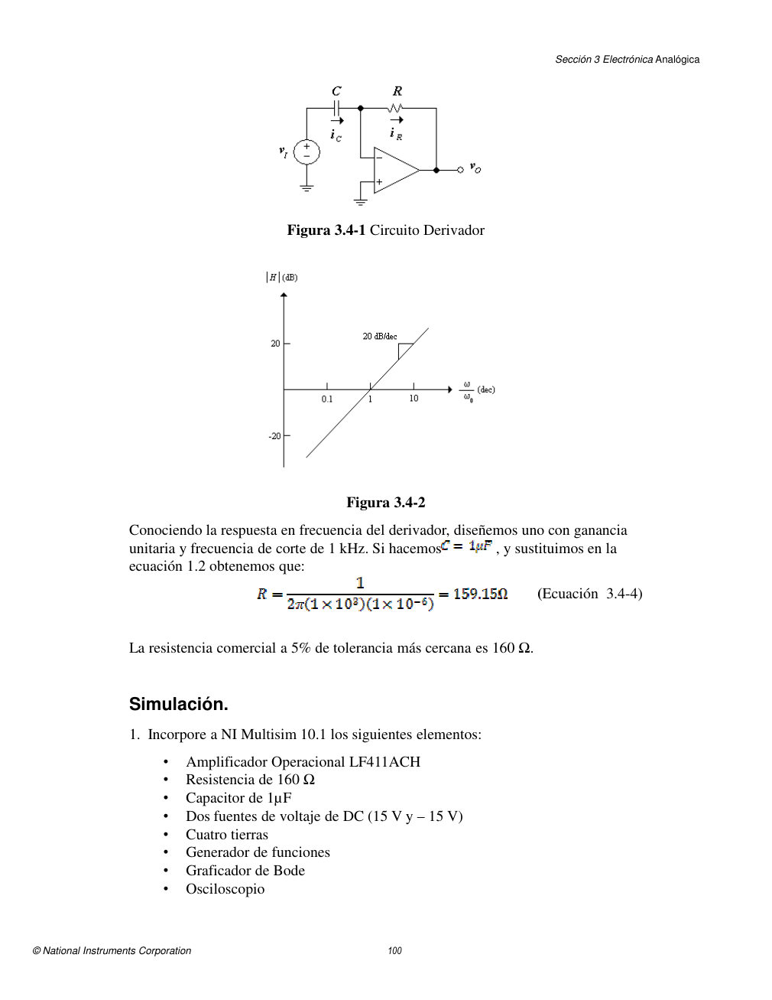

# Material complementario · Integradores y derivadores {.unnumbered}

En los archivos originales de la semana 13 hay dos PDF que amplían el estudio de los circuitos integradores y derivadores. Se conservan como **lecturas y ejercicios complementarios**, sin renumerarlos ni sustituir la **Práctica 10 del amplificador de instrumentación**, que es la prevista en la planificación semanal.

## 1. Guía de simulación de NI Multisim {#complemento-guia-ni}

La guía de 12 páginas presenta el derivador y el integrador con amplificadores operacionales, sus respuestas de Bode y sus formas de onda en el dominio del tiempo; incluye la propuesta opcional de conectar derivador e integrador en cascada para recuperar una señal dentro de las limitaciones de los circuitos.

::: {.course-actions}
[Guía complementaria NI (PDF)](../../recursos/semana-13/guia-derivador-integrador-complementaria.pdf){.course-button .course-button-primary}
:::

{fig-alt="Página 3 de guía complementaria del derivador en NI Multisim."}

**Propuesta voluntaria:** realice un barrido de frecuencia de las dos configuraciones, compare la pendiente asintótica de magnitud y describa por qué la salida real no recupera perfectamente la entrada al conectarlas en cascada (ancho de banda finito, offset, error de fase y saturación).

## 2. Lectura de teoría básica {#complemento-lectura}

El documento de siete páginas extraído de un capítulo sobre circuitos con op-amp explica el integrador ideal y práctico, el derivador y el comportamiento ante señales no sinusoidales. Puede utilizarse para revisar la interpretación física de la transferencia y comprobar los signos.

::: {.course-actions}
[Lectura básica: integradores y derivadores (PDF)](../../recursos/semana-13/lectura-integrador-derivador-teoria-basica.pdf){.course-button .course-button-primary}
[Regresar a Lección 8, parte 2](integrar-y-diferenciar-parte-2.qmd){.course-button}
:::

### Tutor IA · Revisar la guía complementaria {#tutor-l8p2-complemento-s13}

::: {.tutor-box}
::: {.tutor-texto}
Actúe como tutor socrático de Electrónica II y utilice usted. Estoy leyendo la guía complementaria de integradores y derivadores de NI Multisim. Haga una pregunta por turno. Pídame identificar primero el circuito y el resultado que quiero reproducir. Después ayúdeme a explicar cómo cambian ganancia y fase al intercambiar resistor y capacitor en entrada y realimentación. Si propongo una cascada para recuperar la señal, pregunte qué limitaciones impiden la recuperación perfecta. No resuelva el análisis completo sin mis intentos.
:::
::: {.tutor-acciones}
[Abrir ChatGPT](https://chatgpt.com/){.course-button target="_blank" rel="noopener"}
:::
:::
