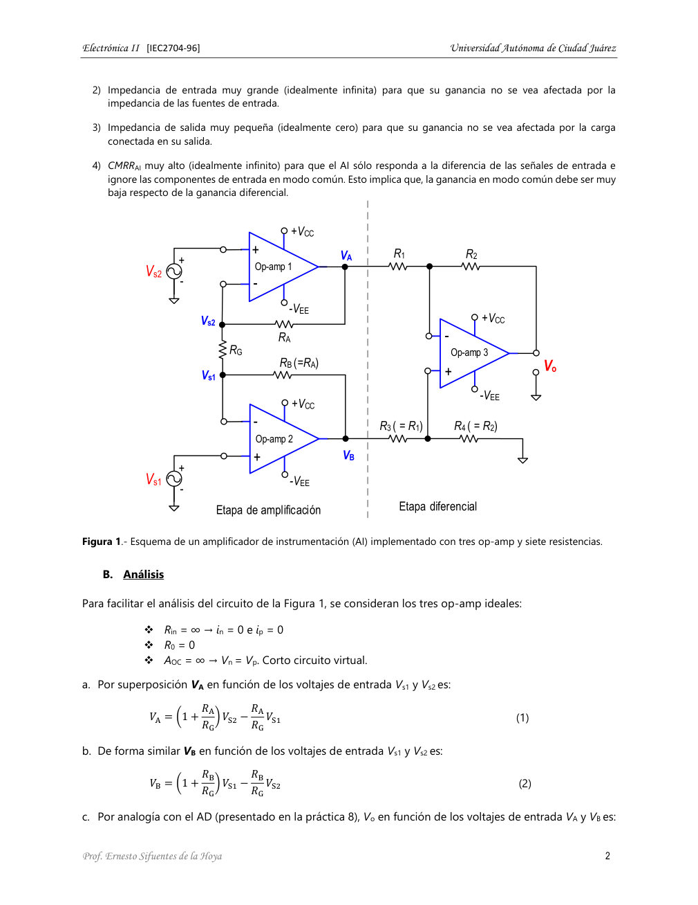
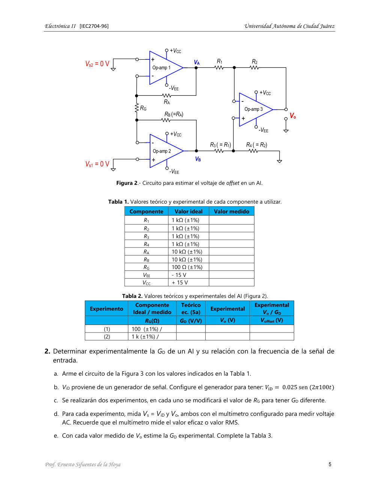
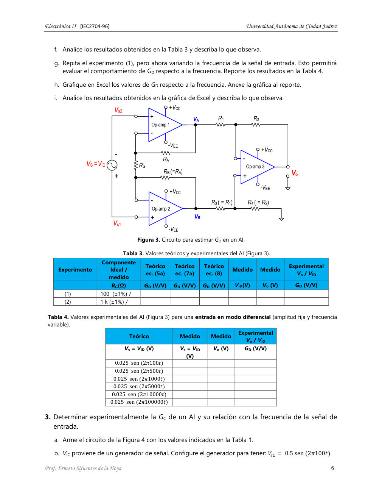
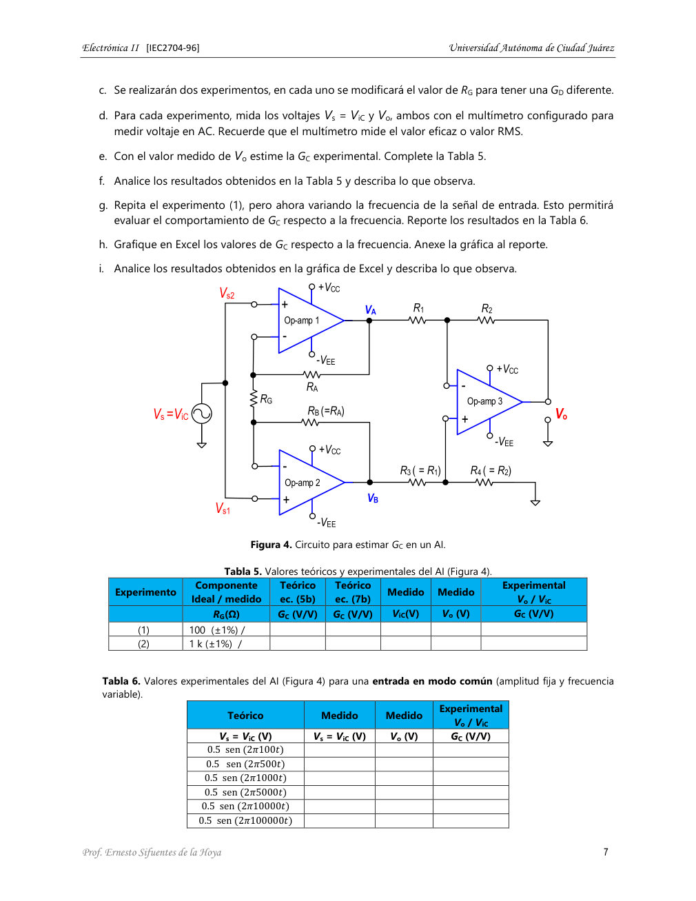
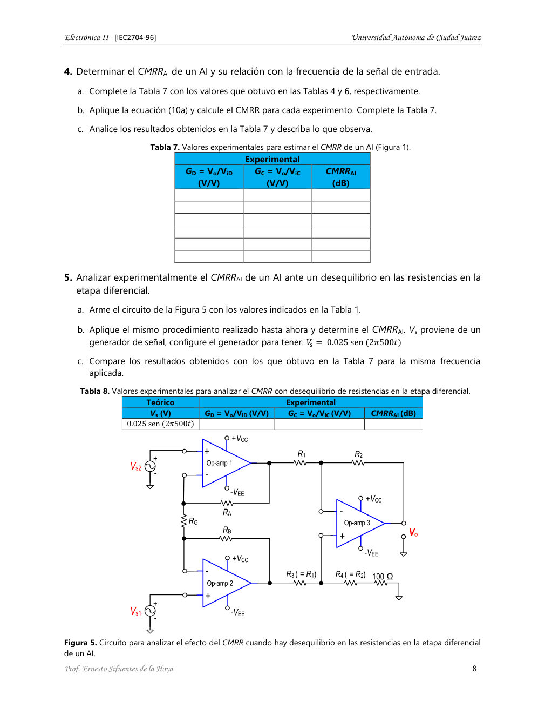

# Práctica 10 · Amplificador de instrumentación (AI) {.unnumbered}

**Semana 13 · Clases 38 y 39** · Guía original: *Práctica 10: Amplificador de Instrumentación*, 9 páginas. Objetivo docente: **comprender y caracterizar un amplificador de instrumentación implementado con tres amplificadores operacionales y siete resistencias**.

En esta práctica se retoman los conceptos de la [Lección 7, sección 2.6](../11/amplificador-instrumentacion.qmd) y se contrastan con la realidad experimental. La medición del **modo diferencial**, el **modo común** y el **rechazo a modo común (CMRR)** debe mantenerse separada: un valor de ganancia calculado no se reporta como valor medido.

::: {.course-actions}
[Guía original de la Práctica 10 (PDF)](../../recursos/semana-13/practica-10-amplificador-instrumentacion.pdf){.course-button .course-button-primary}
[Circuito original Multisim](../../recursos/semana-13/simulaciones/practica-10-amplificador-instrumentacion.ms14){.course-button}
[Lección 7 · AI](../11/amplificador-instrumentacion.qmd){.course-button}
[Tutor IA · Semana 13](../../tutor-ia.qmd#consignas-semana-13){.course-button}
:::

## 1. Material y preparación {#p10-preparacion}

**Material de la guía:** op-amp TL084 o similar; cinco resistencias de 1 kΩ nominalmente ±1 % (cuatro para el puente y una para el valor alternativo de $R_G$), dos de 10 kΩ ±1 %, una de 100 Ω ±1 % y una de 100 Ω ±5 %; fuente dual; generador de funciones; osciloscopio y multímetro. La guía especifica **alimentación ±15 V** para el circuito. La práctica requiere comprobar el rango y el pinout reales del op-amp antes de energizar.

La tabla original propone los siguientes valores (mida **cada resistor**, aunque el nominal sea el mismo):

| Componente | Valor nominal en la guía | Valor medido (complete) |
|:--|:--|:--|
| $R_1,R_2,R_3,R_4$ | 1 kΩ, ±1 % cada uno | — |
| $R_A,R_B$ | 10 kΩ, ±1 % cada uno | — |
| $R_G$ (ensayo A) | 100 Ω, ±1 % | — |
| $R_G$ (ensayo B) | 1 kΩ, ±1 % | — |
| $V_{CC},V_{EE}$ | +15 V, −15 V | — |

La lista de la portada menciona además una resistencia de 100 Ω ±5 %. Consérvela identificada; **no sustituya la de ±1 % sin documentar qué resistencia utilizó**. Los valores medidos se anotan en la Tabla 1 del PDF y servirán para calcular las ganancias teóricas con tolerancias reales.

{fig-alt="Amplificador de instrumentación de tres amplificadores operacionales; dos etapas de entrada y un amplificador diferencial de cuatro resistencias."}

## 2. Modelo de circuito: $G_D$, $G_C$ y CMRR {#p10-modelo}

Fije explícitamente los componentes de señal de acuerdo con los terminales del esquema:

$$V_{iD}=V_{s1}-V_{s2},\qquad V_{iC}=\frac{V_{s1}+V_{s2}}2,\qquad V_o=G_DV_{iD}+G_CV_{iC}.$$

La polaridad se establece mediante $V_{iD}=V_{s1}-V_{s2}$. Distinga la magnitud $|G_D|$ del signo de la respuesta: mantenga la misma convención en los cálculos, compruebe la fase con el osciloscopio y regístrela en las tablas.

Para la etapa de entrada simétrica $R_A=R_B$ y el puente diferencial equilibrado ($R_1=R_3$, $R_2=R_4$), la ecuación (8) de la guía da:

$$\boxed{G_D=\frac{R_2}{R_1}\left(1+\frac{2R_A}{R_G}\right)},\qquad G_C=0\quad\text{(ideal, puente equilibrado)}.$$

Con $R_2/R_1=1$ y $R_A=10\ \mathrm{k\Omega}$, se obtienen **predicciones teóricas**:

| $R_G$ | $G_D$ ideal (V/V) | Para $V_{iD}(t)=0.025\sin(2\pi100t)$ V, amplitud ideal de salida |
|--:|--:|--:|
| 100 Ω | 201 | 5.025 V pico |
| 1 kΩ | 21 | 0.525 V pico |

Estos valores no implican automáticamente que un circuito real alcance esa salida a cualquier frecuencia: revise tensión de alimentación, rango lineal, fase, ancho de banda y errores de cero. La ganancia medida se obtiene con las **resistencias realmente utilizadas** y señales no saturadas.

El rechazo de modo común se calcula a partir de las magnitudes de las ganancias medidas:

$$\boxed{\mathrm{CMRR}_{\mathrm{dB}}=20\log_{10}\left|\frac{G_D}{G_C}\right|}.$$

Si $G_C$ es tan pequeño que no puede distinguirse del ruido, no escriba “CMRR infinito medido”: estime un **límite inferior** para CMRR con el nivel de detección disponible.

Para calcular el rechazo de modo común, primero determine la relación lineal $|G_D/G_C|$ y luego conviértala a decibelios. Los valores expresados en dB no deben combinarse directamente mediante sumas de recíprocos.

### Tutor IA · Modelo y convenciones del AI {#tutor-p10-modelo-s13}

::: {.tutor-box}
::: {.tutor-texto}
Sea tutor socrático de Electrónica II; tráteme de usted y formule solo una pregunta por turno. Quiero analizar el amplificador de instrumentación de tres op-amp y siete resistencias de la Práctica 10. Pídame identificar Vs1, Vs2, VA, VB, R1–R4, RA, RB y RG. Después ayúdeme a definir la polaridad diferencial sin inconsistencias, a justificar el puente equilibrado y a deducir GD=(R2/R1)(1+2RA/RG). Solicite calcular GD para RG=100 Ω y 1 kΩ, sin anticipar los resultados; revise sus unidades y el límite de salida del op-amp.
:::
::: {.tutor-acciones}
[Abrir ChatGPT](https://chatgpt.com/){.course-button target="_blank" rel="noopener"}
:::
:::

## 3. Ensayo 1 · Error de cero (offset) {#p10-offset}

Según la **Figura 2 y Tabla 2 del PDF**, conecte ambas entradas del AI a 0 V, compruebe alimentación dual y mida $V_o$ **en voltaje de CC** con el multímetro. Repita con $R_G=100\ \Omega$ y $1\ \mathrm{k\Omega}$.

{fig-alt="Página 5 de la Práctica 10 con el esquema de error de cero y dos valores de RG."}

El modelo ideal predice $V_o=0$ para entradas nulas. El valor medido puede depender de offset interno, corrientes de polarización, desbalance de resistencias y referencias eléctricas. La guía solicita estimar el offset a partir de $V_o/G_D$ en su Tabla 2: **es una estimación referida a entrada bajo el modelo simplificado**, no la identificación inequívoca de un solo parámetro interno del TL084.

| $R_G$ | $G_D$ nominal | $G_D$ con resistencias medidas | $V_o$ DC medido (mV) | $V_o/G_D$ estimado (mV) |
|--:|--:|:--:|:--:|:--:|
| 100 Ω | 201 | — | — | — |
| 1 kΩ | 21 | — | — | — |

**No** obtenga $G_D$ experimental dividiendo $V_o$ entre $V_{iD}=0$; para medir ganancia necesita una excitación diferencial conocida y no nula.

### Tutor IA · Analizar el offset {#tutor-p10-offset-s13}

::: {.tutor-box}
::: {.tutor-texto}
Tráteme de usted. Actúe como tutor de laboratorio y haga una sola pregunta por turno para interpretar el ensayo de offset de la Práctica 10. Primero solicite los valores medidos de las resistencias y las tensiones de alimentación; luego pida Vo DC para ambos RG. Ayúdeme a distinguir offset de salida de offset referido a entrada y a explicar por qué cambia con GD. No invente mediciones ni permita calcular GD como Vo/0. Cierre sugiriendo una comprobación experimental de una causa de error.
:::
::: {.tutor-acciones}
[Abrir ChatGPT](https://chatgpt.com/){.course-button target="_blank" rel="noopener"}
:::
:::

## 4. Ensayo 2 · Ganancia diferencial $G_D(f)$ {#p10-gd}

La guía establece un generador con señal

$$\boxed{V_{iD}(t)=0.025\sin(2\pi100t)\ \mathrm V},$$

esto es **25 mV pico** a 100 Hz, no 25 mV RMS. Una sinusoide sin offset de esa amplitud tiene un RMS teórico $25/\sqrt2\simeq17.68$ mV. El multímetro AC entrega una indicación RMS conforme a sus características. Para cada $R_G$, mida RMS de entrada y salida, calcule $|G_D|\approx V_{o,\mathrm{RMS}}/V_{iD,\mathrm{RMS}}$ y utilice osciloscopio para confirmar el signo o fase.

El procedimiento de la guía conecta una entrada al generador y la otra a 0 V; entonces también aparece una componente común igual a la mitad de la excitación. La estimación $V_o/V_{iD}\approx G_D$ es válida cuando la contribución de $G_C$ es pequeña. Compare la Tabla 3 (ganancias teóricas y medidas) con las ecuaciones (5a), (7a) y (8) originales.

**Barrido solicitado (Tabla 4):** 100, 500, 1 000, 5 000, 10 000 y 100 000 Hz, manteniendo la amplitud del generador.

| $f$ (Hz) | $V_{iD}$ RMS (V) | $V_o$ RMS (V) | $|G_D|$ medido (V/V) | Observación / fase |
|--:|:--:|:--:|:--:|:--|
| 100 | — | — | — | — |
| 500 | — | — | — | — |
| 1 000 | — | — | — | — |
| 5 000 | — | — | — | — |
| 10 000 | — | — | — | — |
| 100 000 | — | — | — | — |

**Limitación instrumental:** confirme el ancho de banda del multímetro en AC antes de confiar en resultados a 100 kHz; contraste con osciloscopio. A altas frecuencias la ganancia disponible y el slew rate del op-amp también pueden modificar la forma de onda. Indique si observó clipping, ruido o desplazamiento de cero.

{fig-alt="Guía de laboratorio del AI, página 6: conexión diferencial, mediciones y frecuencias de 100 Hz a 100 kHz."}

### Tutor IA · Validar las medidas de $G_D$ {#tutor-p10-gd-s13}

::: {.tutor-box}
::: {.tutor-texto}
Soy estudiante de Electrónica II: sea tutor y tráteme de usted. Haga una pregunta por turno al revisar el experimento 2 de la Práctica 10. Solicite mi RG, la señal de 0.025 sen(2π100t) V, los voltajes RMS medidos y el oscilograma. Pídame calcular primero GD nominal y luego experimental, revisar la conversión pico/RMS y comprobar saturación o ancho de banda. No declare que la ganancia es correcta solo porque la amplitud coincide; pida también comprobar fase y referencia diferencial.
:::
::: {.tutor-acciones}
[Abrir ChatGPT](https://chatgpt.com/){.course-button target="_blank" rel="noopener"}
:::
:::

## 5. Ensayo 3 · Ganancia en modo común $G_C(f)$ {#p10-gc}

La **Figura 4 y Tablas 5–6** emplean las **dos entradas unidas a la misma señal**:

$$\boxed{V_{iC}(t)=0.5\sin(2\pi100t)\ \mathrm V}.$$

Con señales idénticas en fase y amplitud se tiene $V_{iD}=0$ y $V_{iC}=V_s$. Mida $V_o$ RMS y $V_{iC}$ RMS para las dos configuraciones de $R_G$ y repita las **mismas seis frecuencias** del ensayo diferencial. Calcule $|G_C|\simeq V_{o,\mathrm{RMS}}/V_{iC,\mathrm{RMS}}$ cuando la salida sea distinguible del ruido.

| $f$ (Hz) | $V_{iC}$ RMS (V) | $V_o$ RMS (V) | $|G_C|$ medido (V/V) | Nota de resolución |
|--:|:--:|:--:|:--:|:--|
| 100 | — | — | — | — |
| 500 | — | — | — | — |
| 1 000 | — | — | — | — |
| 5 000 | — | — | — | — |
| 10 000 | — | — | — | — |
| 100 000 | — | — | — | — |

En el AI ideal equilibrado, $G_C=0$, pero el circuito real puede mostrar una salida residual por tolerancias, CMRR finito de los op-amp y diferencias dinámicas entre ramas. **No** suponga que “valor cercano a cero” significa “cero exacto”.

{fig-alt="Guía de laboratorio página 7: las dos entradas reciben la misma señal de modo común y se registran seis frecuencias."}

### Tutor IA · Interpretar la respuesta en modo común {#tutor-p10-gc-s13}

::: {.tutor-box}
::: {.tutor-texto}
Sea tutor de laboratorio de Electrónica II, utilice usted y una pregunta por turno. Estoy midiendo GC del amplificador de instrumentación con Vs1=Vs2=0.5 sen(2πft) V. Primero pídame mostrar cómo conecté el generador a ambas entradas y los valores RMS reales. Ayúdeme a distinguir ViD de ViC, calcular GC sin confundirlo con GD, evaluar si Vo supera el ruido y comentar la influencia de la frecuencia y del puente resistivo. No invente datos ni afirme que GC es exactamente cero por el modelo ideal.
:::
::: {.tutor-acciones}
[Abrir ChatGPT](https://chatgpt.com/){.course-button target="_blank" rel="noopener"}
:::
:::

## 6. Ensayo 4 · CMRR y dependencia con frecuencia {#p10-cmrr}

La guía solicita combinar las ganancias experimentales **de la misma configuración y frecuencia**, provenientes de las Tablas 4 y 6, para completar su Tabla 7:

$$\mathrm{CMRR}(f)_{\mathrm{dB}}=20\log_{10}\left|\frac{G_D(f)}{G_C(f)}\right|.$$

| $f$ (Hz) | $|G_D(f)|$ medido | $|G_C(f)|$ medido | CMRR (dB) | Nota técnica |
|--:|:--:|:--:|:--:|:--|
| 100 | — | — | — | — |
| 500 | — | — | — | — |
| 1 000 | — | — | — | — |
| 5 000 | — | — | — | — |
| 10 000 | — | — | — | — |
| 100 000 | — | — | — | — |

Al graficar $G_D(f)$, $G_C(f)$ y CMRR(f) identifique **amplitud aplicada, instrumento, rango y unidades**. Si existe un límite de detección de $V_o$, expréselo como límite en vez de calcular el logaritmo de cero.

## 7. Ensayo 5 · Desbalance de resistencias {#p10-desbalance}

La **Figura 5 y Tabla 8** introducen una perturbación deliberada de la etapa diferencial (resistencia adicional marcada **100 Ω** en el dibujo) y prescriben $V_s(t)=0.025\sin(2\pi500t)$ V. Repita las medidas de ganancia diferencial, común y CMRR según la guía y compare **a 500 Hz** con el montaje equilibrado.

{fig-alt="Guía página 8: introducción de un desequilibrio de 100 ohms en la red diferencial del amplificador de instrumentación."}

Explique qué relación del puente se altera. Un cambio pequeño de $R_2/R_1$ frente a $R_4/R_3$ puede producir $G_C$ no nula y disminuir el rechazo de modo común. Para atribuir el cambio al puente, controle las condiciones de señal, fuente e instrumento y registre los valores **medidos** de las resistencias.

### Tutor IA · Calcular CMRR y analizar desbalance {#tutor-p10-cmrr-s13}

::: {.tutor-box}
::: {.tutor-texto}
Actúe como tutor de Electrónica II, hábleme de usted y formule una sola pregunta por turno. Estoy trabajando las Tablas 7 y 8 de la Práctica 10. Primero pida mis datos de GD y GC para la misma frecuencia y montaje; ayúdeme a obtener CMRR mediante 20 log10(|GD/GC|) y explicar la unidad dB. Luego pregúnteme cómo el resistor adicional de 100 Ω rompe la razón del puente diferencial y qué espero observar en GC. No invente medidas ni acepte CMRR infinito cuando GC está bajo el límite de detección.
:::
::: {.tutor-acciones}
[Abrir ChatGPT](https://chatgpt.com/){.course-button target="_blank" rel="noopener"}
:::
:::

## 8. Informe, retroalimentación y evidencias {#p10-informe}

Incluya en el reporte: circuito real y simulación; identificación y medición de cada resistencia; tensiones de alimentación; tablas **1 a 8** con unidades; cálculos teóricos; capturas de las formas de onda; gráficas de $G_D(f)$, $G_C(f)$ y CMRR(f); comparación equilibrado/desbalanceado; fuentes de error y conclusiones. La guía original añade **diez preguntas de retroalimentación** (página 9) sobre principio de operación, error de cero, ganancia, frecuencia, aplicaciones, puente equilibrado, ventajas y desventajas. Se conservan íntegramente en el PDF.

**Diferencie siempre:** (a) ecuaciones del modelo, (b) datos nominales y predicciones, (c) resultados de simulación y (d) mediciones experimentales. La fecha de entrega se comunicará en clase.

### Tutor IA · Organizar y revisar el informe {#tutor-p10-informe-s13}

::: {.tutor-box}
::: {.tutor-texto}
Sea tutor académico de Electrónica II y tráteme de usted. Estoy preparando el reporte de la Práctica 10. Pídame, con una sola pregunta por turno, el objetivo, los siete resistores medidos, mis tablas 1 a 8, las condiciones de señal y las gráficas de GD, GC y CMRR. Ayúdeme a comprobar que diferencio teoría, simulación y medición, que interpreto offset y desbalance y que no declaro CMRR infinito por falta de resolución. Termine solicitando que yo redacte una conclusión cuantitativa y una limitación del ensayo, sin escribirlas primero por mí.
:::
::: {.tutor-acciones}
[Abrir ChatGPT](https://chatgpt.com/){.course-button target="_blank" rel="noopener"}
:::
:::

::: {.course-actions}
[Volver a la agenda](semana-13.qmd){.course-button .course-button-primary}
[Lección 7 · Amplificador de instrumentación](../11/amplificador-instrumentacion.qmd){.course-button}
[Simulación original AI](../../recursos/semana-13/simulaciones/practica-10-amplificador-instrumentacion.ms14){.course-button}
:::
