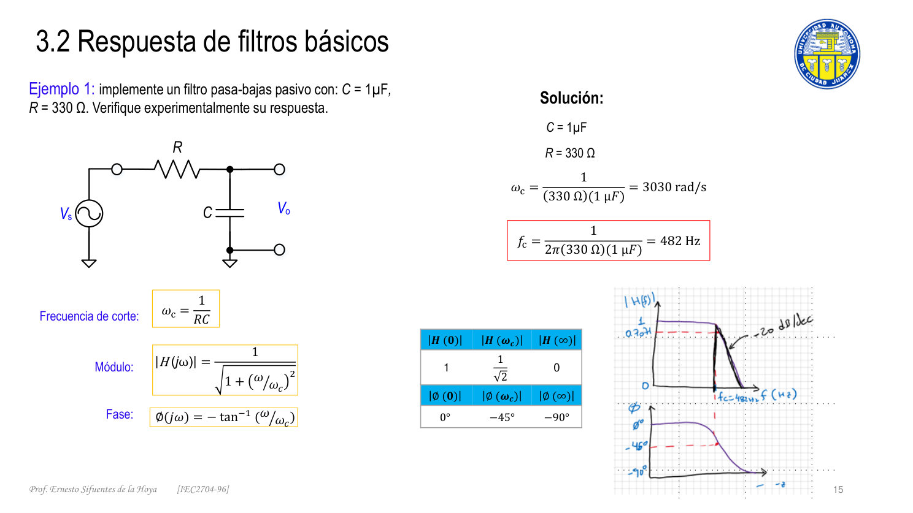

# Experimentos de la Lección 9 · Filtros RC y LabVIEW {.unnumbered}

**Semana 14 · Lección 9 · Reporte de experimentos: clase 42**

La planificación solicita implementar y entregar los experimentos de la Lección 9. Esta página reúne los archivos originales de **Multisim** y **LabVIEW**, y un protocolo para contrastar **transferencia teórica**, **análisis AC** y **respuesta temporal**. Las capturas de la presentación son ejemplos docentes, no mediciones realizadas en esta edición.

## 1. Archivos originales disponibles {#l9-archivos-ms14}

::: {.course-actions}
[RC pasa-bajas · archivo 1 (.ms14)](../../recursos/semana-14/simulaciones/Filtro%20RC%20pasa%20bajas.ms14){.course-button .course-button-primary}
[RC pasa-altas · archivo 1 (.ms14)](../../recursos/semana-14/simulaciones/Filtro%20RC%20pasa%20altas.ms14){.course-button}
[Pasa-bajas RC pasivo (.ms14)](../../recursos/semana-14/simulaciones/Pasa%20Bajas%20RC%20pasivo.ms14){.course-button}
[Pasa-altas RC pasivo (.ms14)](../../recursos/semana-14/simulaciones/Pasa%20Altas%20RC%20pasivo.ms14){.course-button}
:::

Los nombres de los archivos se conservan tal como los entregó el docente. Los cuatro **`.ms14`** pueden requerir una versión compatible de Multisim.

| Recurso LabVIEW | Finalidad orientativa (según el nombre del VI) |
|:--|:--|
| [Magnitud y fase primer orden.vi](../../recursos/semana-14/labview/Magnitud%20y%20fase%20primer%20orden.vi) | Explorar la respuesta de primer orden. |
| [Express VI - Filter.vi](../../recursos/semana-14/labview/Express%20VI%20-%20Filter.vi) | Explorar un bloque de filtrado en LabVIEW. |
| [Express VI - Filter ECG.vi](../../recursos/semana-14/labview/Express%20VI%20-%20Filter%20ECG.vi) | Ejemplo provisto sobre filtrado de ECG. |

**Importante:** estos `.vi` son ejemplos originales de clase. No se afirma haberlos ejecutado ni validado en LabVIEW, y **no reemplazan** los archivos creados por los alumnos durante las prácticas previas.

## 2. Experimento A: pasa-bajas RC {#l9-exp-pb}

**Parámetros de la diapositiva 15:** $R=330\ \Omega$, $C=1\ \mu\mathrm F$; salida sobre el capacitor. Calcule previamente

$$f_c=\frac1{2\pi RC}\approx482.3\ \mathrm{Hz}.$$

1. Abra uno de los archivos de filtro pasa-bajas y verifique que la topología corresponde a $R$ serie y $C$ a tierra.
2. Seleccione una señal senoidal de prueba, registre su **amplitud de entrada** y utilice una referencia común para fases.
3. En tres frecuencias de prueba —por ejemplo, $0.1f_c$, $f_c$, $10f_c$— mida amplitudes de entrada y salida y el retardo temporal $\Delta t$.
4. Calcule $|H|=V_{op}/V_{sp}$, $G_{\mathrm{dB}}=20\log_{10}|H|$ y $\varphi=\varphi_o-\varphi_s$, considerando $\varphi\,[^\circ]=360^\circ f\Delta t$ **con signo**.
5. Obtenga el barrido AC o diagrama de Bode y compare el corte de $-3\ \mathrm{dB}$ y la caída asintótica de $-20\ \mathrm{dB/década}$.

{fig-alt="Ejemplo docente de filtro RC pasa-bajas con resistencia de 330 ohms y capacitor de un microfaradio."}

### Tutor IA · Experimento pasa-bajas {#tutor-l9-exp-pb-s14}

::: {.tutor-box}
::: {.tutor-texto}
Tráteme de usted y guíeme a interpretar un experimento de filtro RC pasa-bajas de 330 Ω y 1 µF, con una sola pregunta por turno. Solicite primero mi frecuencia de corte calculada y después mis amplitudes y fases registradas a tres frecuencias. Pídame contrastar las mediciones con la ecuación teórica y el signo de la fase. Si no aporto datos, ayúdeme a planear la medición, pero no invente resultados ni capturas de Multisim.
:::
::: {.tutor-acciones}
[Abrir ChatGPT](https://chatgpt.com/){.course-button target="_blank" rel="noopener"}
:::
:::

## 3. Experimento B: pasa-altas RC {#l9-exp-pa}

**Parámetros de la diapositiva 19:** $R=330\ \Omega$, $C=1\ \mu\mathrm F$; salida sobre la resistencia. Repita el procedimiento del experimento A, ahora con el modelo

$$H_{PA}(s)=\frac{sRC}{1+sRC},\quad |H|=\frac{f/f_c}{\sqrt{1+(f/f_c)^2}}.$$

Compare la **caída** del pasa-bajas a frecuencias altas contra la **atenuación** del pasa-altas a frecuencias bajas. En $f=f_c$, ambos idealmente presentan magnitud $1/\sqrt2$ pero fases **opuestas** (−45° y +45°).

### Tutor IA · Experimento pasa-altas {#tutor-l9-exp-pa-s14}

::: {.tutor-box}
::: {.tutor-texto}
Actúe como tutor socrático de Electrónica II. Hábleme de usted, una sola pregunta por turno. Estoy comparando la simulación pasa-altas y pasa-bajas con idénticos R y C. Pregunte dónde mido la salida, cómo calculo fc y en qué bandas espero atenuación. Después revise mi tabla de magnitudes y fases, sin dar resultados experimentales ficticios. Exija la explicación de por qué la frecuencia de corte es igual, pero el comportamiento de baja frecuencia cambia.
:::
::: {.tutor-acciones}
[Abrir ChatGPT](https://chatgpt.com/){.course-button target="_blank" rel="noopener"}
:::
:::

## 4. Registro comparativo y reporte {#l9-tablas}

| Filtro | $f$ (Hz) | $V_{sp}$ (V) | $V_{op}$ (V) | $\lvert H\rvert$ (V/V) | $G_{\mathrm{dB}}$ (dB) | $\varphi$ (°) |
|:--|--:|--:|--:|--:|--:|--:|
| Pasa-bajas | $0.1f_c$ | — | — | — | — | — |
| Pasa-bajas | $f_c$ | — | — | — | — | — |
| Pasa-bajas | $10f_c$ | — | — | — | — | — |
| Pasa-altas | $0.1f_c$ | — | — | — | — | — |
| Pasa-altas | $f_c$ | — | — | — | — | — |
| Pasa-altas | $10f_c$ | — | — | — | — | — |

**El reporte de experimentos para clase 42** debe mostrar los diagramas, valores de componentes, ecuaciones, forma de medir amplitud/fase, capturas de Multisim y una comparación argumentada de teoría y simulación. Cierre con una discusión de componentes no ideales, tolerancias y posibles errores de la medición de fase.

## 5. Actividad de síntesis {#l9-comparacion}

Con una señal compuesta de **100 y 600 Hz**, justifique qué filtro sería adecuado para conservar preferentemente la componente de 100 Hz. Use las ganancias teóricas en cada frecuencia y estime la amplitud de ambas componentes de salida. Si el objetivo fuera conservar la de 600 Hz, replantee el filtro y compare. Registre la frecuencia de corte real del circuito que utilice.

### Tutor IA · Integrar teoría y evidencias {#tutor-l9-reporte-s14}

::: {.tutor-box}
::: {.tutor-texto}
Sea mi tutor de Electrónica II, tráteme de usted y haga una sola pregunta por turno. Debo entregar el reporte de los experimentos de filtros de la Lección 9. Solicite mi esquema, tabla de frecuencia, magnitud y fase, capturas y método de cálculo. Guíeme para distinguir lo que predice el modelo de lo que muestra Multisim y para interpretar discrepancias razonables. No escriba conclusiones sin conocer mis evidencias ni genere mediciones ficticias.
:::
::: {.tutor-acciones}
[Abrir ChatGPT](https://chatgpt.com/){.course-button target="_blank" rel="noopener"}
:::
:::
