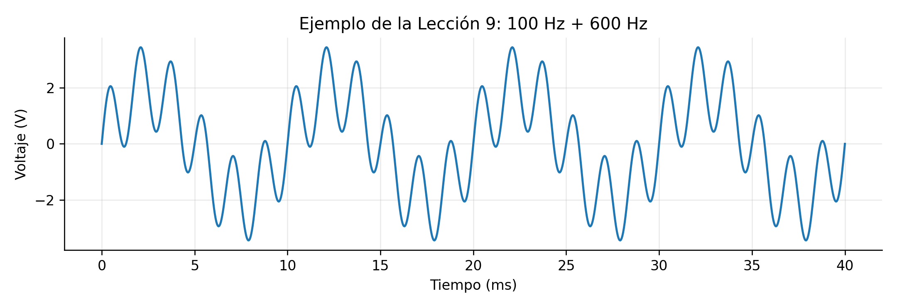
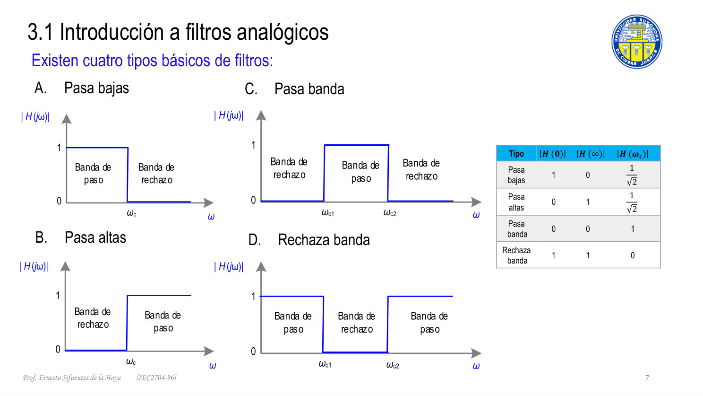
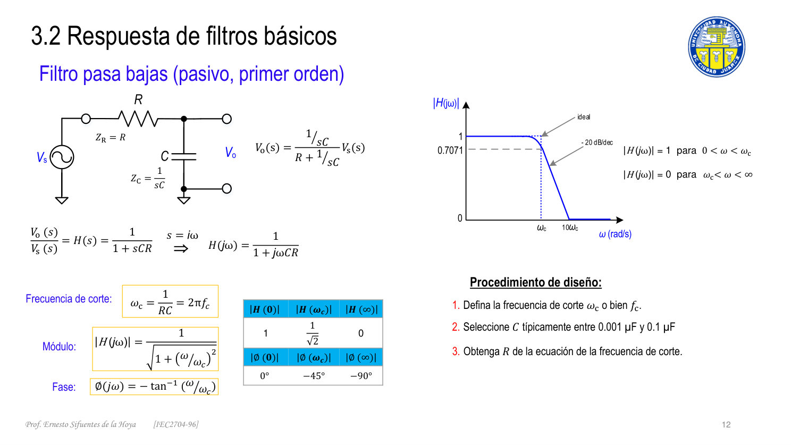
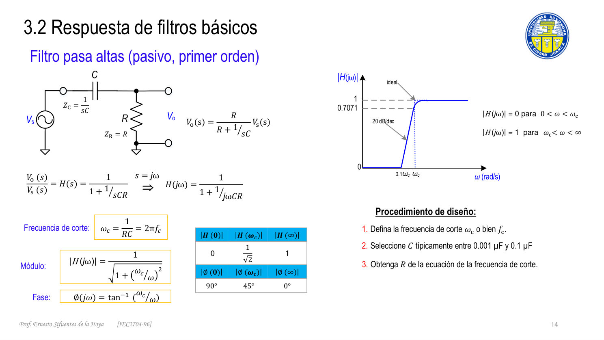
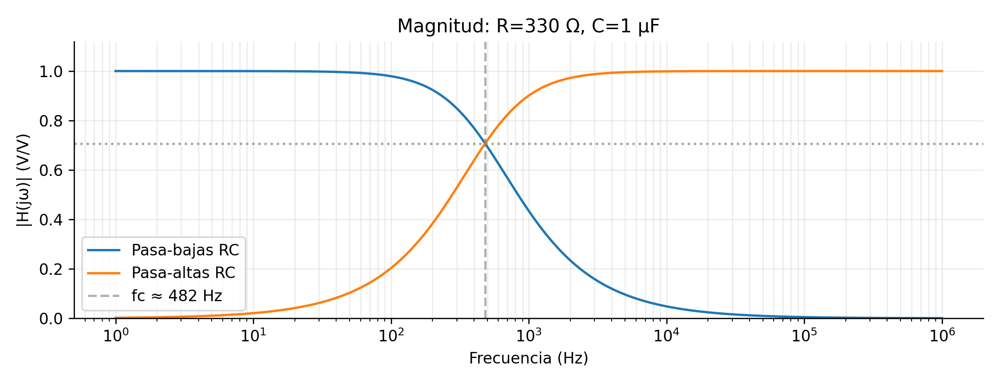
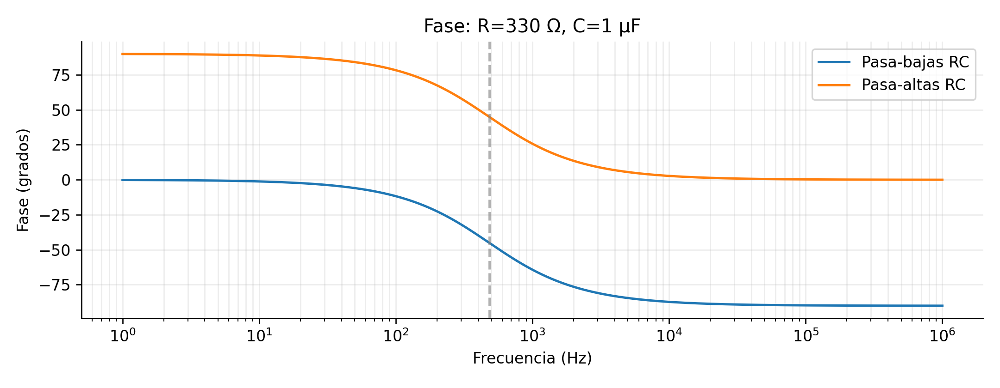
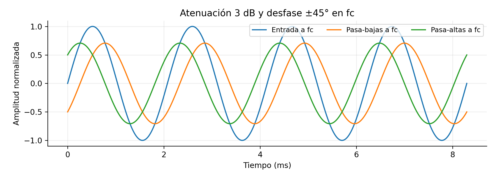
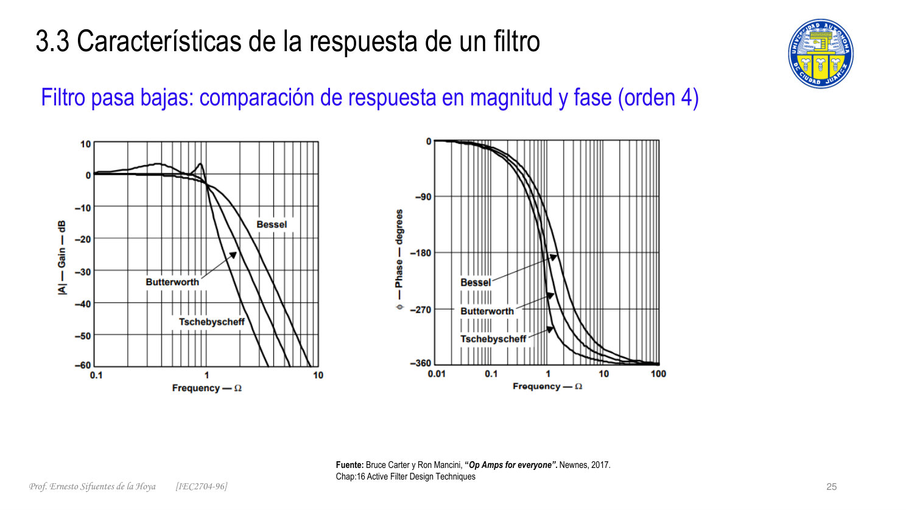

# Lección 9 · Introducción al filtrado analógico de señales {.unnumbered}

En esta lección se desarrollan las **funciones de transferencia**, la **respuesta en magnitud y fase**, el **filtrado RC pasa-bajas y pasa-altas**, la **frecuencia de corte**, la **aproximación de Bode** y las **familias Butterworth, Chebyshev y Bessel**. Todos los resultados señalados como «teóricos» son cálculos de modelo; las capturas del laboratorio deben obtenerse con los archivos originales.

::: {#video-l9-s14 .course-actions}
[Ver video de la Lección 9](https://www.youtube.com/watch?v=WGq5t4VUoQQ){.course-button .course-button-primary target="_blank" rel="noopener"}
[Presentación original L9 (PDF)](../../recursos/semana-14/presentacion-leccion-09.pdf){.course-button}
[Experimentos L9](experimentos-filtros-l9.qmd){.course-button}
[Cuestionario L9](cuestionario-l9.qmd){.course-button}
[Agenda de semana 14](semana-14.qmd){.course-button}
:::

**Actividad de video — Lección 9.** Vea la presentación en video y elabore **a mano un resumen** que sintetice los conceptos principales, con extensión proporcional al contenido. **Entrega: clase 40 (primera sesión de la semana 14).** Consulte las [entregas de la Semana 14](semana-14.qmd#entregas-semana-14). En el resumen explique la frecuencia de corte y describa al menos una gráfica de magnitud y fase.

## 1. ¿Por qué se filtra una señal? {#l9-concepto}

Un filtro electrónico **modifica selectivamente el contenido espectral de una señal**: permite conservar, atenuar o realzar determinadas componentes, a menudo según la frecuencia. Un filtro **pasivo** se construye con resistencias, capacitores y/o inductores; un filtro **activo** agrega elementos activos (por ejemplo, amplificadores operacionales). Sus funciones no son intercambiables: el filtro activo necesita alimentación y está limitado por el ancho de banda y las características del amplificador.

### Tutor IA · Comprensión del video {#tutor-l9-video-s14}

::: {.tutor-box}
::: {.tutor-texto}
Actúe como tutor socrático de la Lección 9 de Electrónica II. Tráteme siempre de usted, con una sola pregunta por turno. Ya vi el video sobre filtrado analógico y debo elaborar un resumen manuscrito. Pídame explicar con mis palabras qué es una banda de paso y por qué existe una frecuencia de corte. Revise mi explicación, pida un ejemplo de una señal con dos componentes frecuenciales y guíeme a distinguir el resumen de una mera transcripción. No redacte el resumen por mí.
:::
::: {.tutor-acciones}
[Abrir ChatGPT](https://chatgpt.com/){.course-button target="_blank" rel="noopener"}
:::
:::

Consideremos una señal de entrada compuesta:

$$\boxed{v_s(t)=2\sin(2\pi100t)+1.5\sin(2\pi600t)\quad [\mathrm V].}$$

Contiene componentes de **100 Hz** y **600 Hz** con amplitudes máximas de **2 V** y **1.5 V**, respectivamente. Una frecuencia de corte situada entre ambas permite atenuar preferentemente una de ellas. No desaparece mágicamente una frecuencia: cada componente se multiplica por una ganancia de magnitud $|H(j2\pi f)|$ y experimenta el desfase $\arg H(j2\pi f)$.

{fig-alt="Señal temporal calculada a partir de 2 sen(2 pi 100 t) + 1.5 sen(2 pi 600 t)."}

| Clasificación | Tipos / interpretación |
|:--|:--|
| **Implementación** | Pasivos R, L y C; activos con op-amp u otros componentes activos. |
| **Selectividad** | Pasa-bajas, pasa-altas, pasa-banda y rechaza-banda. |
| **Orden** | Grado del denominador de la función de transferencia racional reducida: primero, segundo, tercero, etc. |
| **Aproximación** | Butterworth, Chebyshev y Bessel: distintos compromisos entre planitud, transición y respuesta de fase. |

{fig-alt="Diagramas de cuatro respuestas de filtros: pasa bajas, pasa altas, pasa banda y rechaza banda."}

### Tutor IA · Separar componentes espectrales {#tutor-l9-espectro-s14}

::: {.tutor-box}
::: {.tutor-texto}
Sea mi tutor de Electrónica II y tráteme de usted. Me presentan vs(t)=2 sen(2π100t)+1.5 sen(2π600t). Haga solo una pregunta por turno. Pídame primero identificar frecuencias y amplitudes, con unidades. Luego ayúdeme a decidir qué tipo de filtro sería apropiado para conservar preferentemente la componente de 100 Hz. No me dé la selección antes de escuchar mi razonamiento; pídame justificarla con la noción de banda de paso.
:::
::: {.tutor-acciones}
[Abrir ChatGPT](https://chatgpt.com/){.course-button target="_blank" rel="noopener"}
:::
:::

## 2. Función de transferencia, respuesta en magnitud y fase {#l9-transferencia}

Para un sistema lineal e invariante en el tiempo, en condiciones iniciales nulas, la **función de transferencia** es

$$\boxed{H(s)=\frac{V_o(s)}{V_s(s)}}\qquad\Longrightarrow\qquad H(j\omega)=\left.H(s)\right|_{s=j\omega},\quad\omega=2\pi f.$$

La sustitución $s=j\omega$ proporciona la **respuesta sinusoidal en régimen permanente**. Su módulo indica el cociente de amplitudes y su argumento la diferencia de fases:

$$\boxed{|H(j\omega)|=\frac{V_{op}}{V_{sp}}},\qquad \boxed{\varphi(j\omega)=\varphi_o-\varphi_s},\qquad\boxed{G_{\mathrm{dB}}=20\log_{10}|H(j\omega)|}.$$

Si $v_s(t)=V_{sp}\sin(\omega t+\varphi_s)$, entonces $v_o(t)=V_{sp}|H(j\omega)|\sin\left(\omega t+\varphi_s+\varphi(j\omega)\right)$ en régimen permanente. La respuesta temporal transitoria se obtiene, si corresponde, de la transformada inversa de Laplace de $H(s)V_s(s)$.

Las impedancias reactivas explican la dependencia con la frecuencia:

$$Z_R=R,\qquad Z_C(s)=\frac1{sC},\qquad Z_L(s)=sL.$$

**Frecuencia de corte.** Para los RC de primer orden con ganancia unitaria en la banda de paso,

$$\boxed{|H(j\omega_c)|=\frac1{\sqrt2}\approx0.7071},\quad20\log_{10}\left(\frac1{\sqrt2}\right)\approx-3.01\ \mathrm{dB}.$$

Esto significa una reducción de amplitud de aproximadamente **29.3 %** respecto al valor de la banda de paso; para igual impedancia, la potencia cae a la mitad. La transición real no es instantánea: en una década por encima (pasa-bajas) o por debajo (pasa-altas) del corte, la ganancia asintótica cambia **20 dB/década por polo**.

{fig-alt="Circuito RC pasa-bajas, expresiones originales de transferencia y respuesta ideal y real."}

### Tutor IA · Magnitud, decibelios y fase {#tutor-l9-bode-s14}

::: {.tutor-box}
::: {.tutor-texto}
Actúe como tutor socrático de filtros RC; hábleme de usted. Haga una pregunta por turno. Quiero obtener la magnitud lineal, ganancia en dB y desfase a una frecuencia determinada. Primero solicíteme identificar la expresión de H(jω), después sustituir ω=2πf, calcular el módulo, usar 20 log10 y explicar si la salida adelanta o retrasa. Compruebe que mis unidades de frecuencia y mis signos sean coherentes; no entregue el resultado antes de revisar mis operaciones.
:::
::: {.tutor-acciones}
[Abrir ChatGPT](https://chatgpt.com/){.course-button target="_blank" rel="noopener"}
:::
:::

## 3. Filtro RC pasa-bajas de primer orden {#l9-pasabajas}

Considere un resistor $R$ **en serie** desde la fuente hasta el nodo de salida y un capacitor $C$ **del nodo de salida a tierra**. La salida $V_o$ se mide **en el capacitor**. Del divisor de impedancias:

$$V_o(s)=\frac{Z_C}{R+Z_C}V_s(s)=\frac{1}{1+sRC}V_s(s).$$

Por tanto:

$$\boxed{H_{PB}(s)=\frac1{1+sRC}=\frac{\omega_c}{s+\omega_c}},\qquad\boxed{\omega_c=\frac1{RC},\quad f_c=\frac1{2\pi RC}}.$$

$$\boxed{|H_{PB}(j\omega)|=\frac1{\sqrt{1+(\omega/\omega_c)^2}}},\qquad\boxed{\varphi_{PB}=-\tan^{-1}(\omega/\omega_c)}.$$

| Región | Magnitud aproximada | Fase aproximada |
|:--|:--|:--|
| $f\ll f_c$ | 1 V/V, 0 dB | $0^\circ$ |
| $f=f_c$ | 0.7071 V/V, −3.01 dB | $-45^\circ$ |
| $f\gg f_c$ | Tiende a 0; pendiente asintótica −20 dB/década | $-90^\circ$ |

**Ejemplo 1 de la presentación:** $R=330\ \Omega$, $C=1\ \mu\mathrm F$.

$$RC=330\times10^{-6}\ \mathrm s,\quad\omega_c=\frac1{330\times10^{-6}}=3030.3\ \mathrm{rad/s},$$

$$\boxed{f_c=\frac{3030.3}{2\pi}=482.3\ \mathrm{Hz}}.$$

Se solicita **verificar por simulación o medición**, no únicamente repetir el cálculo. Use el archivo original *Filtro RC pasa bajas.ms14* y registre, como mínimo, valores a $0.1f_c$, $f_c$ y $10f_c$.

{fig-alt="Esquema original del filtro RC pasa-bajas con salida sobre el capacitor."}

### Tutor IA · Deducir el filtro pasa-bajas {#tutor-l9-pb-s14}

::: {.tutor-box}
::: {.tutor-texto}
Tráteme de usted y guíeme con preguntas una por una para obtener la transferencia del filtro RC pasa-bajas de primer orden. Parta de R en serie y C a tierra, con salida sobre C. Solicite el divisor de impedancias, la simplificación de H(s), la frecuencia de corte y sus unidades. Después pídame interpretar la salida cuando f es muy pequeña, igual a fc y mucho mayor que fc. Evite resolver todo de una vez y corrija solo el primer error en cada turno.
:::
::: {.tutor-acciones}
[Abrir ChatGPT](https://chatgpt.com/){.course-button target="_blank" rel="noopener"}
:::
:::

## 4. Filtro RC pasa-altas de primer orden {#l9-pasaaltas}

En el filtro pasa-altas se conecta un **capacitor en serie con la entrada**, resistor a tierra y **salida medida sobre el resistor**. Por divisor de impedancias:

$$V_o(s)=\frac{R}{R+1/(sC)}V_s(s),$$

$$\boxed{H_{PA}(s)=\frac{sRC}{1+sRC}=\frac{s}{s+\omega_c}},\qquad\boxed{f_c=\frac1{2\pi RC}}.$$

$$\boxed{|H_{PA}(j\omega)|=\frac{\omega/\omega_c}{\sqrt{1+(\omega/\omega_c)^2}}},\qquad\boxed{\varphi_{PA}=90^\circ-\tan^{-1}(\omega/\omega_c)}.$$

| Región | Magnitud aproximada | Fase aproximada |
|:--|:--|:--|
| $f\ll f_c$ | Tiende a 0; crecimiento +20 dB/década | $+90^\circ$ |
| $f=f_c$ | 0.7071 V/V, −3.01 dB | $+45^\circ$ |
| $f\gg f_c$ | Tiende a 1 V/V, 0 dB | $0^\circ$ |

**Ejemplo 2 de la presentación:** con $R=330\ \Omega$ y $C=1\ \mu\mathrm F$, se obtiene **la misma frecuencia de corte, $f_c\approx482\ \mathrm{Hz}$**, pero la banda de paso se sitúa **por encima** del corte. Es indispensable corroborar la ubicación de la salida en el circuito: medir sobre el capacitor daría un pasa-bajas y no un pasa-altas.

{fig-alt="Esquema original del filtro RC pasa-altas con salida sobre el resistor."}

### Tutor IA · Deducir el filtro pasa-altas {#tutor-l9-pa-s14}

::: {.tutor-box}
::: {.tutor-texto}
Tráteme de usted y actúe como tutor de Electrónica II. Pídame identificar en un filtro RC pasa-altas dónde se sitúan C, R y la salida, una pregunta por turno. Después conduzca el divisor de impedancias, la obtención de H(s), la frecuencia de corte, la fase y el comportamiento a bajas y altas frecuencias. Pregunte cómo se distinguiría de un pasa-bajas con un barrido de frecuencia de Multisim. No adelante mis resultados.
:::
::: {.tutor-acciones}
[Abrir ChatGPT](https://chatgpt.com/){.course-button target="_blank" rel="noopener"}
:::
:::

## 5. Gráficas comparativas calculadas {#l9-graficas}

Las siguientes figuras presentan **resultados del modelo RC ideal** para los componentes de los ejemplos de las diapositivas 15 y 19. No corresponden a mediciones.

{fig-alt="Curvas teóricas de magnitud de dos filtros RC con R de 330 ohms y C de 1 microfaradio."}

{fig-alt="Fase teórica de pasa-bajas entre 0 y menos 90 grados y pasa-altas entre 90 y 0 grados."}

{fig-alt="Tres senoidales de igual frecuencia, entrada y salidas PB y PA con amplitud 0.707 y desfases de más y menos 45 grados."}

**Comprobación adicional para el estudiante.** Con $f=100\ \mathrm{Hz}$ y $f=600\ \mathrm{Hz}$, determine $|H|$ de cada circuito y estime la salida frente a la señal compuesta de la sección 1. Para un filtro real, también afectan la impedancia de la fuente, la carga y las tolerancias de $R$ y $C$.

## 6. Respuesta de filtros básicos: bandas y orden {#l9-bandas}

La presentación distingue cuatro respuestas: **pasa-bajas**, **pasa-altas**, **pasa-banda** y **rechaza-banda**. En un filtro real, la **banda de transición** separa progresivamente las bandas de paso y rechazo; su rapidez no depende solo del valor de $f_c$, sino también del orden y de la aproximación utilizada.

| Respuesta | Región transmitida preferentemente | Aplicación conceptual |
|:--|:--|:--|
| Pasa-bajas | Frecuencias inferiores al corte | Atenuar ruido de alta frecuencia antes de un ADC. |
| Pasa-altas | Frecuencias superiores al corte | Reducir desviaciones lentas y componente de continua. |
| Pasa-banda | Intervalo delimitado por dos cortes | Conservar una banda de interés. |
| Rechaza-banda | Dos intervalos separados, eliminando una banda intermedia | Rechazo de una interferencia en una banda concreta. |

Para un filtro de orden $n$ de tipo pasa-bajas con polos adecuados, el módulo en la zona asintótica de rechazo presenta una pendiente de **$-20n\ \mathrm{dB/década}$**. En un pasa-altas, la pendiente es **$+20n\ \mathrm{dB/década}$** por debajo del corte. El orden $n$ no implica por sí solo una frecuencia exacta de corte ni garantiza una fase lineal.

## 7. Familias Butterworth, Chebyshev y Bessel {#l9-aproximaciones}

Las diapositivas 23 a 29 presentan tres aproximaciones que priorizan objetivos distintos:

| Aproximación | Característica | Compromiso práctico |
|:--|:--|:--|
| **Butterworth** | Magnitud máximamente plana en banda de paso. | Transición menos pronunciada que Chebyshev para un mismo orden y otras especificaciones comparables. |
| **Chebyshev** | Transición más rápida para cierto orden a costa de rizado (tipo I) en banda de paso. | Fase menos lineal y posible sobrepaso en transitorios. |
| **Bessel** | Retardo de grupo aproximadamente plano en banda útil, buena preservación de formas de onda. | Transición más suave en magnitud. |

Para el **pasa-bajas Butterworth normalizado de orden $n$**, el módulo cumple

$$\boxed{|H(j\omega)|=\frac{K}{\sqrt{1+(\omega/\omega_c)^{2n}}}},$$

Aquí $K$ representa la ganancia a bajas frecuencias. La fase de un filtro de orden $n$ se obtiene a partir de los polos y ceros de $H(s)$; no puede deducirse únicamente de la expresión de magnitud.

En segundo orden se emplea habitualmente

$$\boxed{H_{PB,2}(s)=K\frac{\omega_0^2}{s^2+(\omega_0/Q)s+\omega_0^2}},$$

mientras que las formas pasa-altas y pasa-banda reemplazan el numerador respectivamente por $Ks^2$ y $K(\omega_0/Q)s$. El parámetro $Q$ regula el amortiguamiento y la posible resonancia. Estos modelos se desarrollarán con mayor detalle al estudiar filtros de segundo orden.

{fig-alt="Comparación original de magnitud y fase de aproximaciones de filtros de orden cuatro."}

### Tutor IA · Interpretar aproximaciones {#tutor-l9-aproximaciones-s14}

::: {.tutor-box}
::: {.tutor-texto}
Sea mi tutor de Electrónica II y tráteme de usted. Compare conmigo Butterworth, Chebyshev y Bessel haciendo una pregunta por turno. Plantee un caso de adquisición donde interesa mantener la forma de un pulso y otro donde importa una transición muy rápida en frecuencia. Pídame elegir una familia, explicar el motivo y mencionar un compromiso de fase, amplitud o respuesta transitoria. No me proporcione una tabla de respuestas antes de escuchar mis elecciones.
:::
::: {.tutor-acciones}
[Abrir ChatGPT](https://chatgpt.com/){.course-button target="_blank" rel="noopener"}
:::
:::

## 8. Diseño y verificación experimental de primer orden {#l9-metodologia}

**Procedimiento general, como se solicita en la presentación:** (1) definir $f_c$, (2) elegir un valor comercial de $C$, (3) despejar $R=1/(2\pi f_cC)$, (4) seleccionar valores disponibles y calcular el $f_c$ real nominal, (5) montar y simular, (6) medir amplitud y fase en un barrido de frecuencias.

En los ejercicios originales $R=330\ \Omega$ y $C=1\ \mu\mathrm F$; además, el cuestionario propone los **diseños de 1 kHz y 100 Hz** con $R=10\ \mathrm{k\Omega}$. En todos los casos presente cálculos, archivo de simulación, gráfica de Bode y una interpretación física de los resultados.

::: {.course-actions}
[Ir a la guía de experimentos](experimentos-filtros-l9.qmd){.course-button .course-button-primary}
[Consultar cuestionario L9](cuestionario-l9.qmd){.course-button}
[Ver archivos originales Multisim](experimentos-filtros-l9.qmd#l9-archivos-ms14){.course-button}
[Tutor IA de semana 14](../../tutor-ia.qmd#consignas-semana-14){.course-button}
:::

