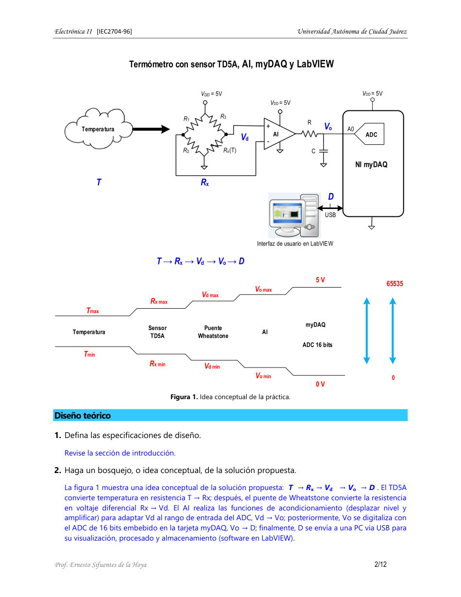
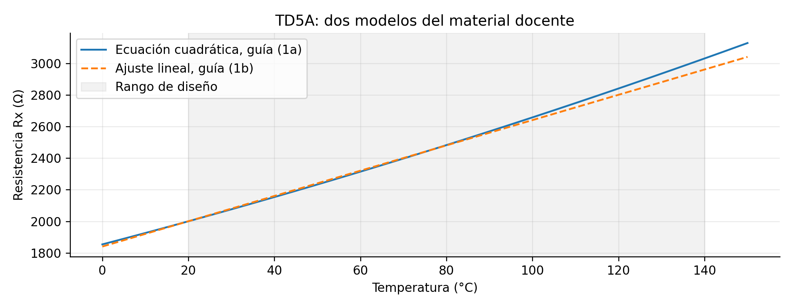
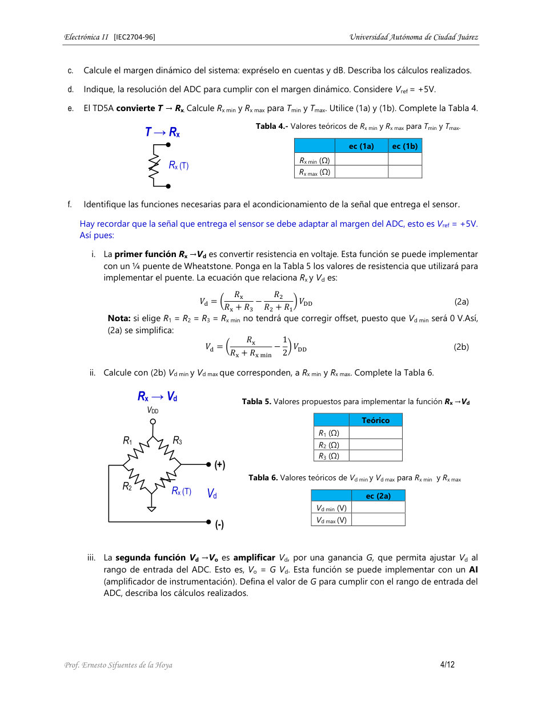
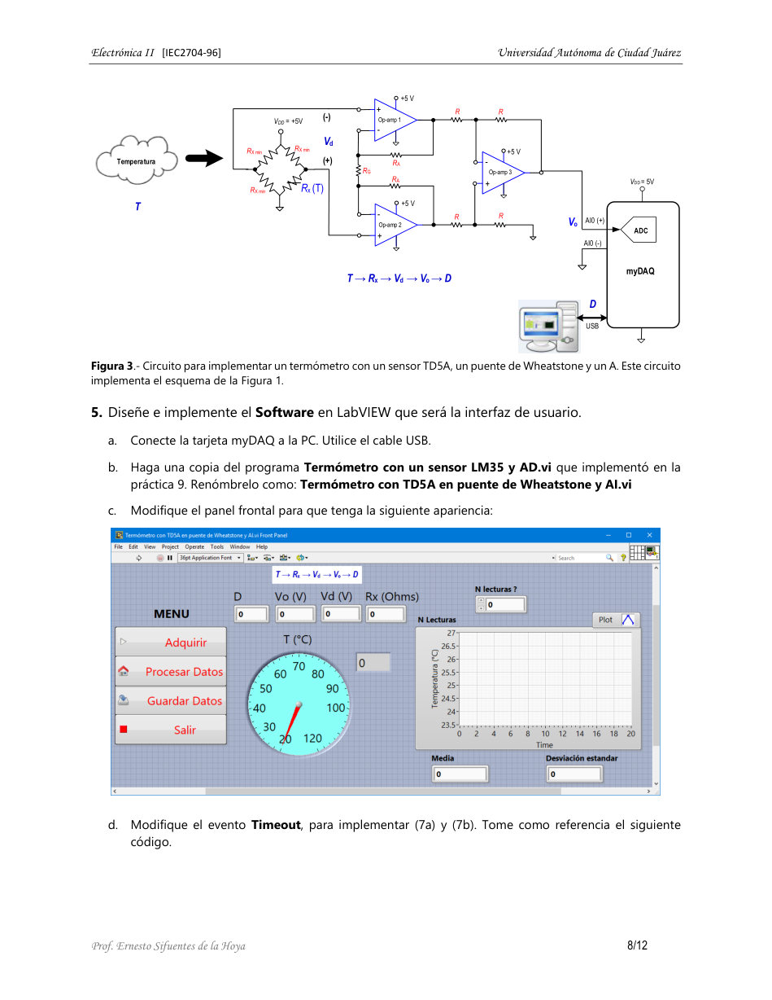
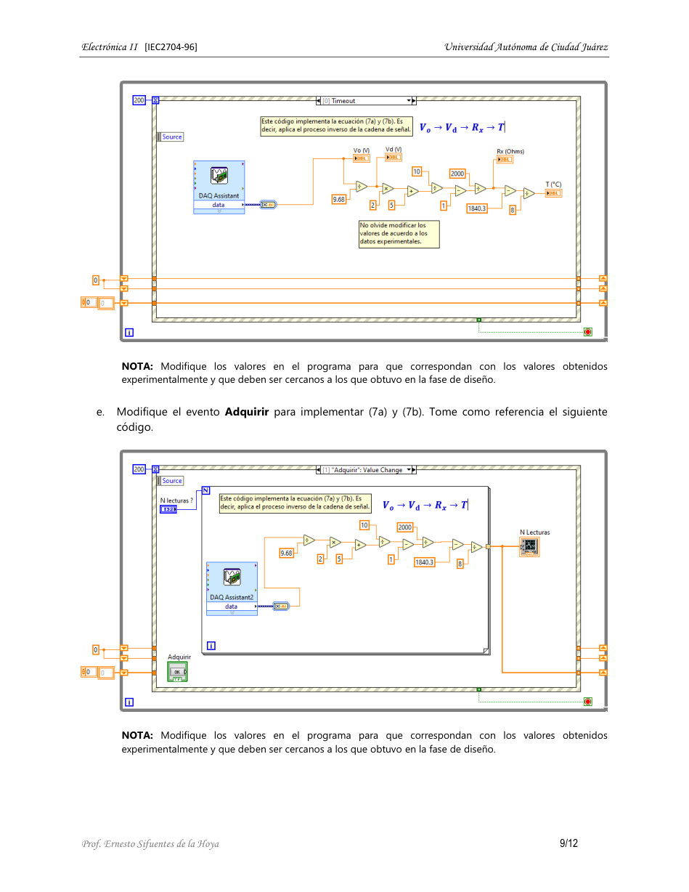

# Práctica 11 · Termómetro TD5A, puente de Wheatstone y amplificador de instrumentación {.unnumbered}

**Semana 14 · Clases 41 y 42 · NI myDAQ + LabVIEW**

**Objetivo.** Diseñar e implementar un termómetro con sensor resistivo **TD5A**, un **cuarto de puente de Wheatstone**, un amplificador de instrumentación (AI), NI myDAQ y LabVIEW, para un intervalo de **20–140 °C** y una resolución objetivo de **0.02 °C**.

::: {.course-actions}
[Guía original Práctica 11 (PDF)](../../recursos/semana-14/practica-11-rtd-puente-ai.pdf){.course-button .course-button-primary}
[Ejemplo original de cálculo de ganancia](../../recursos/semana-14/ejemplo-ganancia-practica-11.pdf){.course-button}
[Hoja de cálculo TD5A (XLSX)](../../recursos/semana-14/sensor-TD5A-ajuste-lineal.xlsx){.course-button}
[Agenda y entregas](semana-14.qmd#entregas-semana-14){.course-button}
:::

## 1. Arquitectura del instrumento {#p11-cadena}

La Figura 1 de la guía propone la cadena de transducción, acondicionamiento y adquisición:

$$\boxed{T\ [^{\circ}\mathrm C]\;\longrightarrow\;R_x(T)\ [\Omega]\;\longrightarrow\;V_d\ [\mathrm V]\;\longrightarrow\;V_o\ [\mathrm V]\;\longrightarrow\;D\ [\mathrm{cuentas}]}.$$

**Bloques:** sensor TD5A → ¼ puente de Wheatstone → AI de tres amplificadores operacionales → ADC de 16 bits de myDAQ → interfaz LabVIEW. Los op-amp propuestos son **TL084 o TLC274**, según la disponibilidad y la guía original. El montaje se realiza solo después de comprobar polaridades, alimentación y rango admisible de las entradas.

{fig-alt="Arquitectura conceptual de la medición de temperatura con sensor TD5A, puente de Wheatstone, amplificador de instrumentación y ADC de la tarjeta myDAQ."}

| Etapa | Variable de entrada | Variable de salida | Operación |
|:--|:--|:--|:--|
| Sensor TD5A | Temperatura $T$ | Resistencia $R_x$ | Transducción resistiva, modelo proporcionado por la guía. |
| Puente de Wheatstone | $R_x$ | Diferencia de voltaje $V_d$ | Conversión y referencia a 20 °C. |
| AI | $V_d$ | Voltaje acondicionado $V_o$ | Ganancia ajustable y rechazo de componente común. |
| myDAQ | $V_o$ | Código $D$ | Conversión analógica–digital (modelo 16 bits de la guía). |
| LabVIEW | $D$ | $T$, $V_o$, $V_d$, $R_x$ | Cálculo inverso, visualización, estadística y registro. |

### Tutor IA · Interpretar la cadena de señal {#tutor-p11-cadena-s14}

::: {.tutor-box}
::: {.tutor-texto}
Actúe como tutor socrático de la Práctica 11, tráteme de usted y haga exactamente una pregunta por turno. Pídame recorrer la cadena T→Rx→Vd→Vo→D del termómetro TD5A. Primero pregunte qué variable transforma el sensor y sus unidades, después cómo el puente convierte resistencia en voltaje y por qué el AI necesita ganancia y rechazo del modo común. Verifique cada paso antes de continuar, sin resolverme el diseño ni inventar mediciones.
:::
::: {.tutor-acciones}
[Abrir ChatGPT](https://chatgpt.com/){.course-button target="_blank" rel="noopener"}
:::
:::

## 2. Especificaciones y modelos del TD5A {#p11-sensor}

La Tabla 1 de la guía atribuye al TD5A un intervalo de operación de **−40 a +150 °C**, sensibilidad nominal de **8 Ω/°C**, exactitud **±0.7 °C** y linealidad **±3 %**. Son **datos reproducidos del documento docente**, no verificados aquí contra una hoja técnica independiente.

La ecuación suministrada por la guía como modelo cuadrático es:

$$\boxed{R_x(T)=1854+7.119T+9.16\times10^{-3}T^2\quad[\Omega].}\tag{1a}$$

El ajuste lineal que la guía pide reproducir en Excel es:

$$\boxed{R_x(T)\approx8T+1840.3\quad[\Omega].}\tag{1b}$$

**Valores calculados** para completar las Tablas 2, 3 y 4 de la guía:

| $T$ (°C) | $R_x$ cuadrática (Ω) | $R_x$ lineal (Ω) | Diferencia lineal − cuadrática (Ω) |
|--:|--:|--:|--:|
| 0 | 1854.000 | 1840.300 | −13.700 |
| 20 | 2000.044 | 2000.300 | +0.256 |
| 140 | 3030.196 | 2960.300 | −69.896 |

{fig-alt="Curvas de resistencia frente a temperatura entre 0 y 150 grados para la relación cuadrática y el ajuste lineal entregados en la guía."}

**Interpretación:** el ajuste lineal simplifica el diseño pero introduce error de modelo, especialmente en el extremo superior; no deben combinarse indistintamente $R_{x,\min}$ de un modelo y $R_{x,\max}$ del otro. El estudiante debe generar su gráfica y ajustar la recta a partir de los puntos que corresponden al rango elegido, como solicita el documento.

### Tutor IA · Comparar los modelos del sensor {#tutor-p11-td5a-s14}

::: {.tutor-box}
::: {.tutor-texto}
Tráteme de usted. Estoy trabajando con los dos modelos del TD5A de la guía: Rx=1854+7.119T+0.00916T² y Rx≈8T+1840.3, con T en °C. Haga una pregunta por turno. Pídame calcular Rx a 20 y 140 °C, verificar unidades y evaluar la diferencia entre modelos. Después pregunte qué efecto tendría esa diferencia sobre la temperatura recuperada. No resuelva mis tablas antes de que presente mis operaciones.
:::
::: {.tutor-acciones}
[Abrir ChatGPT](https://chatgpt.com/){.course-button target="_blank" rel="noopener"}
:::
:::

## 3. Requerimiento de resolución y margen dinámico {#p11-resolucion}

Con $\Delta T=140-20=120\ ^\circ\mathrm C$ y una resolución solicitada de $q_T=0.02\ ^\circ\mathrm C$, el número de intervalos resolubles es

$$N_{\mathrm{intervalos}}=\frac{120}{0.02}=6000,\qquad N_{\mathrm{niveles}}\ge 6001,\qquad \boxed{N_{\min}=\left\lceil\log_2(6001)\right\rceil=13\ \mathrm{bits}.}$$

Un convertidor ideal de 16 bits, con rango unilateral de $0$ a $5\ \mathrm V$, presenta

$$\boxed{q_V=\frac{5}{2^{16}-1}=76.3\ \mu\mathrm V\ /\mathrm{cuenta}},\qquad\boxed{q_{T,\mathrm{ideal}}=\frac{120}{65535}\approx0.00183\ ^\circ\mathrm C/\mathrm{cuenta}}.$$

**Distinción imprescindible:** el resultado anterior es una **resolución teórica de cuantificación** si se aprovecha todo el intervalo del ADC; no demuestra una exactitud de 0.00183 °C ni garantiza 0.02 °C de resolución experimental. El propio documento atribuye al sensor una exactitud nominal ±0.7 °C; además intervienen errores del puente, desbalance, ruido, tolerancias, referencia, op-amp y calibración.

## 4. Conversión de resistencia a voltaje: ¼ puente de Wheatstone {#p11-puente}

La ecuación (2a) proporcionada en la práctica es:

$$\boxed{V_d=\left(\frac{R_x}{R_x+R_3}-\frac{R_2}{R_1+R_2}\right)V_{DD}}.\tag{2a}$$

Para $R_1=R_2=R_3=R_{x,\min}$, se anula idealmente $V_d$ cuando $T=T_{\min}$:

$$\boxed{V_d(T)=\left(\frac{R_x(T)}{R_x(T)+R_{x,\min}}-\frac12\right)V_{DD}}.\tag{2b}$$

**Ejemplo teórico con modelo cuadrático y $V_{DD}=5\ \mathrm V$:** $R_{x,\min}=2000.044\ \Omega$ y $R_{x,\max}=3030.196\ \Omega$; por tanto

$$V_{d,\min}=0\ \mathrm V,\qquad V_{d,\max}\approx\left(\frac{3030.196}{3030.196+2000.044}-0.5\right)(5)\approx0.5119\ \mathrm V.$$

La salida del puente es pequeña y **no alcanza el rango de 0 a 5 V del ADC**. Para utilizar la escala completa debe acondicionarse mediante el AI; esto no convierte el puente en un sensor lineal de temperatura.

{fig-alt="Figura de la guía con circuito y expresiones para elegir resistores del puente de Wheatstone."}

### Tutor IA · Equilibrio del puente {#tutor-p11-puente-s14}

::: {.tutor-box}
::: {.tutor-texto}
Sea mi tutor socrático y hábleme de usted. Estoy diseñando un cuarto puente de Wheatstone de 5 V para un TD5A. Haga solo una pregunta por turno. Pídame identificar los dos divisores, deducir Vd, elegir R1=R2=R3=Rx_min y demostrar que Vd es cero cuando Rx=Rx_min. Después pídame calcular Vd a 140 °C y comprobar el signo de acuerdo con los nodos elegidos. No complete los valores antes que yo.
:::
::: {.tutor-acciones}
[Abrir ChatGPT](https://chatgpt.com/){.course-button target="_blank" rel="noopener"}
:::
:::

## 5. Amplificador de instrumentación: adaptación a 0–5 V {#p11-ganancia}

La etapa de ganancia propuesta usa un AI de **tres op-amp**, con ganancia ajustable mediante $R_G$. En la notación de la guía, cuando las resistencias de la etapa diferencial están emparejadas:

$$\boxed{V_o=GV_d,\qquad G=1+\frac{2R_A}{R_G}.}\tag{3}$$

Para mapear $V_{d,\max}\approx0.5119\ \mathrm V$ a $V_{o,\max}=5\ \mathrm V$ se requiere

$$\boxed{G\approx\frac5{0.5119}\approx9.77\ \mathrm{V/V}}.$$

El **ejemplo original de cálculo de ganancia** redondea a $G\approx10$ y propone $R_A=10\ \mathrm{k\Omega}$ y $R_G\approx2.2\ \mathrm{k\Omega}$. Con los valores comerciales propuestos $G=1+2(10\ \mathrm{k\Omega})/(2.2\ \mathrm{k\Omega})\approx10.09$. Entonces $V_o$ podría llegar a **5.17 V** en la condición máxima teórica; es indispensable comprobar el margen de entrada del ADC y evitar **saturación/recorte**. Como alternativa de cálculo nominal para $G=9.77$, con $R_A=10\ \mathrm{k\Omega}$, resultaría $R_G\approx2.28\ \mathrm{k\Omega}$, sujeto a valores disponibles y validación.

{fig-alt="Montaje de tres amplificadores operacionales que acondiciona la señal diferencial del puente de Wheatstone."}

### Tutor IA · Ajustar la ganancia sin saturación {#tutor-p11-ganancia-s14}

::: {.tutor-box}
::: {.tutor-texto}
Tráteme de usted. Estoy diseñando el amplificador de instrumentación de la Práctica 11, con Vd_max cercano a 0.512 V y ADC nominal de 0 a 5 V. Haga una sola pregunta por turno. Pídame calcular G necesaria, despejar RG de G=1+2RA/RG cuando RA=10 kΩ y comprobar si RG=2.2 kΩ produciría una salida superior a 5 V. No diga el valor final antes de que muestre mis cuentas; haga que proponga una solución para evitar el recorte.
:::
::: {.tutor-acciones}
[Abrir ChatGPT](https://chatgpt.com/){.course-button target="_blank" rel="noopener"}
:::
:::

## 6. Digitalización y ecuación completa de la cadena {#p11-codificacion}

La guía emplea el modelo de código ideal con $N=16$ bits:

$$\boxed{D=\operatorname{ent}\!\left[\frac{V_o}{V_{\mathrm{ref}}}(2^N-1)\right]},\quad0\le D\le65535.\tag{5}$$

El operador $\operatorname{ent}$ representa la conversión a entero indicada en el material; el hardware real puede utilizar un esquema de codificación y rango de medida diferente, según el canal seleccionado. Para el modelo **unipolar, 0–5 V** del enunciado,

$$\boxed{D(T)=\operatorname{ent}\!\left[\frac{G\,V_{DD}}{V_{\mathrm{ref}}}\left(\frac{R_x(T)}{R_x(T)+R_{x,\min}}-\frac12\right)(2^{16}-1)\right]}.\tag{6}$$

Para reconstruir la temperatura desde una lectura medida $V_o$:

$$V_d=\frac{V_o}{G},\qquad x=\frac{V_d}{V_{DD}}+\frac12,\qquad\boxed{R_x=\frac{xR_{x,\min}}{1-x}}.\tag{7a}$$

Con el modelo lineal de la guía:

$$\boxed{T_{\mathrm{estimada}}=\frac{R_x-1840.3}{8}\quad[^{\circ}\mathrm C].}\tag{7b}$$

Si el software recibe solamente un código ideal $D$, entonces puede estimar $V_o\approx D V_{\mathrm{ref}}/(2^{16}-1)$ y aplicar (7a)–(7b). **No use** un ADC real bipolar como si entregase literalmente el código unipolar del esquema. Registre y documente la configuración real de NI myDAQ. En LabVIEW conviene utilizar la tensión adquirida directamente para reducir supuestos innecesarios sobre la codificación de la tarjeta.

### Tutor IA · Invertir la cadena de medición {#tutor-p11-inversion-s14}

::: {.tutor-box}
::: {.tutor-texto}
Sea tutor de Electrónica II y tráteme de usted. Debo despejar Rx a partir de Vo en la cadena TD5A–puente–AI. Una pregunta por turno. Pídame primero encontrar Vd=Vo/G, luego aislar x=Vd/VDD+1/2 en Vd/VDD=Rx/(Rx+Rx_min)-1/2, y finalmente despejar Rx y estimar T mediante el modelo lineal. Revise los dominios y unidades y pregunte qué pasa cuando x se acerca a 1. No dé la fórmula completa antes de que lo intente.
:::
::: {.tutor-acciones}
[Abrir ChatGPT](https://chatgpt.com/){.course-button target="_blank" rel="noopener"}
:::
:::

## 7. Diseño teórico y lista de verificación {#p11-diseno}

Conforme a los apartados 1–3 de la guía, antes del montaje entregue un **diseño teórico** que incluya:

1. Especificaciones de rango, resolución y cadena de señal, indicando modelo de sensor elegido.
2. Tabla de $R_x$ para 0, 20 y 140 °C con **ambas** ecuaciones, gráfica en Excel y comentario de error.
3. Margen dinámico en cuentas y dB y justificación del número mínimo de bits.
4. Selección de $R_1$, $R_2$ y $R_3$, balance del puente y estimaciones $V_{d,\min},V_{d,\max}$.
5. Cálculo de $G$, selección de $R_A$ y $R_G$, revisión de $V_{o,\max}$ y comprobación de límites físicos.
6. Modelo directo $D(T)$ y modelo inverso $T(D)$ o $T(V_o)$, con unidades y dominio válido.
7. Tabla de valores de cada componente **teórico** y espacio reservado para el **medido**. No llene la segunda columna con datos no adquiridos.

::: {.course-actions}
[Hoja de trabajo TD5A (XLSX)](../../recursos/semana-14/sensor-TD5A-ajuste-lineal.xlsx){.course-button}
[Ejemplo original de ganancia (PDF)](../../recursos/semana-14/ejemplo-ganancia-practica-11.pdf){.course-button}
:::

## 8. Procedimiento experimental y aplicación LabVIEW {#p11-experimental}

Los apartados 4–7 de la guía indican el siguiente protocolo:

1. **Circuito:** arme el puente y el AI de la Figura 3, verifique fuente, referencia común, montaje sobre protoboard y componentes antes de conectar NI myDAQ. Compare resistencias y voltajes con el cálculo.
2. **Reutilización de software:** copie el VI desarrollado en la **Práctica 9** (termómetro LM35 y AD) y renómbrelo *Termómetro con TD5A en puente de Wheatstone y AI.vi*, como solicita la guía. El archivo base creado por los estudiantes **no está incluido** en este ZIP.
3. **Panel frontal:** presente $V_o$ (V), $V_d$ (V), $R_x$ (Ω), $T$ (°C), media, desviación estándar y controles de adquisición/registro.
4. **Eventos LabVIEW:** modifique `Timeout` y `Adquirir` para aplicar el modelo inverso; configure `Procesar` para calcular estadísticos y `Guardar` para almacenar las lecturas. Introduzca **valores medidos** de resistores, ganancia y $V_{DD}$, no solo los ideales.
5. **Integración:** compruebe continuidad de lecturas, actualización de indicadores, consistencia entre unidades y capacidad de almacenar datos.
6. **Validación:** cambie la temperatura con cautín o celda Peltier bajo supervisión, evitando contacto directo que dañe el sensor. Registre **10 condiciones distintas**, separadas aproximadamente por **10 °C o más** cuando el montaje y el rango lo permitan. En cada condición adquiera **20 lecturas** y obtenga media y desviación estándar.
7. **Reporte:** complete la tabla de la guía con $V_o$, $V_d$, $R_x$, $T$ y estadísticas; compare comportamiento real con el modelo teórico, identifique límites y explique diferencias.

{fig-alt="Diagramas de la guía docente para implementar ecuaciones de transformación inversa en LabVIEW."}

**Tabla para el reporte (sin datos ficticios):**

| Condición | $V_o$ (V) | $V_d$ (V) | $R_x$ (Ω) | $\overline T$ (°C) | $s_T$ (°C) | $N$ lecturas |
|--:|--:|--:|--:|--:|--:|--:|
| 1 | — | — | — | — | — | 20 |
| 2 | — | — | — | — | — | 20 |
| 3 | — | — | — | — | — | 20 |
| 4 | — | — | — | — | — | 20 |
| 5 | — | — | — | — | — | 20 |
| 6–10 | Completar durante el ensayo | | | | | 20 por condición |

### Tutor IA · Diagnóstico del laboratorio {#tutor-p11-laboratorio-s14}

::: {.tutor-box}
::: {.tutor-texto}
Tráteme de usted y sea tutor de laboratorio de Electrónica II. Estoy construyendo el termómetro TD5A con puente, AI, myDAQ y LabVIEW. Haga una sola pregunta por turno, primero sobre qué señales puedo medir sin riesgo, luego sobre cómo distinguir un puente desbalanceado, un AI saturado, una lectura incorrecta de NI myDAQ o una transformación inversa equivocada. Solicite datos experimentales reales, sus unidades y la configuración de entrada. No invente capturas ni lecturas y no concluya una falla sin evidencias.
:::
::: {.tutor-acciones}
[Abrir ChatGPT](https://chatgpt.com/){.course-button target="_blank" rel="noopener"}
:::
:::

### Tutor IA · Estadística y reporte {#tutor-p11-reporte-s14}

::: {.tutor-box}
::: {.tutor-texto}
Sea tutor de Electrónica II y hábleme de usted. Tengo 20 lecturas por condición y diez condiciones de temperatura para la Práctica 11. Una sola pregunta por turno. Pídame explicar cómo calculo media y desviación estándar, y cómo comparo mis lecturas con un termómetro de referencia si está disponible. Revise las tablas, unidades, dispersión, resolución y exactitud sin confundirlas. Guíeme para redactar conclusiones respaldadas por datos. No fabrique ni complete valores experimentales.
:::
::: {.tutor-acciones}
[Abrir ChatGPT](https://chatgpt.com/){.course-button target="_blank" rel="noopener"}
:::
:::
