# Lección 10 · Filtros activos pasa-bajas de primer orden {.unnumbered}

Los filtros activos de primer orden combinan una red selectiva RC con un amplificador operacional para aislar etapas, proporcionar ganancia o producir inversión de señal. Su respuesta se describe mediante una función de transferencia con un polo. En esta lección se examinan las configuraciones con seguidor, amplificador no inversor e inversor, y se transforma el análisis en un procedimiento reproducible de diseño.

::: {#video-l10-primer-orden .course-actions}
[Video de la Lección 10 · Parte 1](https://www.youtube.com/watch?v=EPXAp3ewIZI){.course-button .course-button-primary target="_blank" rel="noopener"}
[Parte 2](https://www.youtube.com/watch?v=SGVYwoaQvF4){.course-button target="_blank" rel="noopener"}
[Parte 3](https://www.youtube.com/watch?v=L0OUXvLB0_w){.course-button target="_blank" rel="noopener"}
[Agenda de la semana 15](semana-15.qmd){.course-button}
:::

**Actividad de video — Lección 10, primer orden.** Consulte las tres partes y elabore **a mano sus apuntes técnicos**, incorporando los esquemas y las deducciones matemáticas principales, además de una interpretación personal del diseño y de la respuesta en frecuencia. **Entrega: clase 45 (tercera sesión de la semana 15)**, conforme a la planificación. Los materiales complementarios y las actividades se encuentran en [Recursos de la semana 15](semana-15.qmd#recursos-semana-15).

## Objetivos de aprendizaje

- Deducir la función de transferencia de cada circuito mediante LCK o impedancias equivalentes.
- Interpretar magnitud, fase, frecuencia de corte y respuesta al escalón.
- Diseñar filtros a partir de un prototipo normalizado y elegir componentes comerciales.
- Distinguir los resultados del modelo ideal de los obtenidos con un modelo real de op-amp.

## Desarrollo del circuito y de las tres configuraciones

## Fundamentos del análisis de filtros activos

### Función de transferencia

Se considera un circuito lineal e invariante en el tiempo, inicialmente en reposo. La relación entre las transformadas de Laplace del voltaje de salida y el voltaje de entrada define la **función de transferencia**:

$$H(s) = \frac{V_{o}(s)}{V_{s}(s)}.$$

La variable $s = \sigma + j\omega$ es la frecuencia compleja. Cuando interesa conocer cómo responde el sistema a señales senoidales en estado estacionario, se evalúa la función de transferencia sobre el eje imaginario, sustituyendo $s = j\omega$:

$$H(j\omega) = \left. \ H(s) \right|_{s = j\omega}.$$

La respuesta resultante puede expresarse mediante su magnitud y su argumento:

$$H(j\omega) = \left| H(j\omega) \right|\, e^{j\phi(\omega)}.$$

La magnitud indica la relación entre las amplitudes de salida y entrada, y la fase representa el desfase de la salida respecto de la entrada. La ganancia en decibeles se expresa por

$$G_{dB}(\omega) = 20\log_{10}\left| H(j\omega) \right|.$$

Cuando la magnitud es mayor que uno, la ganancia es positiva en decibeles; cuando es menor que uno, la ganancia en decibeles es negativa, lo que indica atenuación.

### Impedancia capacitiva y ley de Kirchhoff

En el dominio del tiempo, la corriente que atraviesa un capacitor ideal está dada por

$$i_{C}(t) = C\frac{dv_{C}(t)}{dt}.$$

Aplicando la transformada de Laplace con condiciones iniciales nulas:

$$I_{C}(s) = sC\, V_{C}(s).$$

Por tanto, la impedancia del capacitor es

$$Z_{C}(s) = \frac{V_{C}(s)}{I_{C}(s)} = \frac{1}{sC}.$$

Esta expresión permite analizar la red RC mediante la misma ley de Ohm utilizada en circuitos resistivos, con la salvedad de que las impedancias dependen de la frecuencia. La **ley de corrientes de Kirchhoff** (LCK) establece que la suma algebraica de las corrientes en un nodo es igual a cero.

### Modelo ideal del amplificador operacional

Para deducir las expresiones de las dos configuraciones se supone un amplificador operacional ideal operando en régimen lineal y con realimentación negativa. En estas condiciones se utilizan las siguientes aproximaciones:

$$A_{OL} \rightarrow \infty,\quad\quad R_{in} \rightarrow \infty,$$

$$I_{p} \approx 0,\quad\quad I_{n} \approx 0,\quad\quad V_{p} \approx V_{n}.$$

La igualdad $V_{p} \approx V_{n}$ suele denominarse **cortocircuito virtual**: las tensiones son prácticamente iguales, pero las dos entradas no están conectadas físicamente entre sí. No debe confundirse con un cortocircuito real, ya que las corrientes de entrada continúan siendo muy pequeñas. Estas aproximaciones dejan de ser válidas si el amplificador se satura o si la frecuencia se acerca a sus límites dinámicos.

## Filtro RC con seguidor de voltaje

### Configuración y principio de operación

La primera configuración se compone de una resistencia $R$ conectada en serie con la fuente $V_{s}$ y un capacitor $C$ conectado desde el nodo de salida de la red RC hasta tierra. El voltaje de dicho nodo se aplica a la entrada no inversora de un amplificador operacional conectado como seguidor de voltaje. La salida del operacional se realimenta directamente a su entrada inversora.

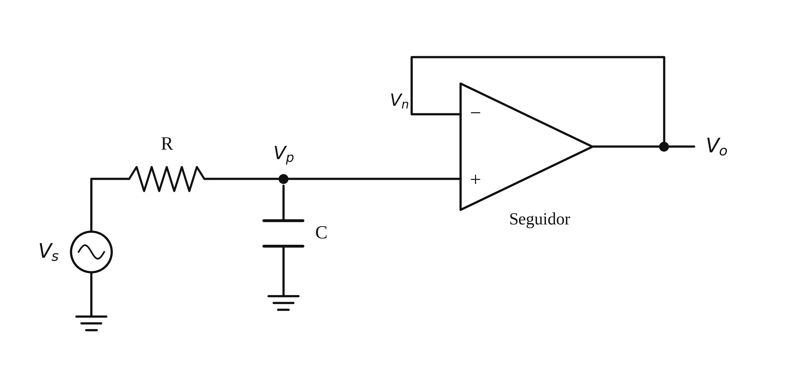{width="92%" fig-alt="Figura 2. Filtro activo pasa-bajas de primer orden formado por una red RC y un seguidor de voltaje."}

La red RC determina la selección de frecuencias; el seguidor proporciona aislamiento entre la red y la carga posterior. En el modelo ideal, el seguidor ofrece una resistencia de entrada muy elevada, una resistencia de salida muy pequeña y ganancia unitaria.

Puesto que la salida está conectada con la entrada inversora, $V_{n}(s) = V_{o}(s)$. La realimentación negativa impone $V_{p}(s) = V_{n}(s)$ y, en consecuencia:

$$V_{o}(s) = V_{p}(s).$$

El problema consiste entonces en determinar primero el voltaje del nodo $V_{p}$ a partir de la fuente $V_{s}$.

### Aplicación de la ley de corrientes de Kirchhoff

La corriente de entrada del operacional ideal es prácticamente nula. Por ello, en el nodo $V_{p}$ únicamente es necesario considerar la corriente de la resistencia y la del capacitor:

$$I_{R}(s) = I_{C}(s) + I_{p}(s)\quad\quad \Rightarrow \quad\quad I_{R}(s) = I_{C}(s).$$

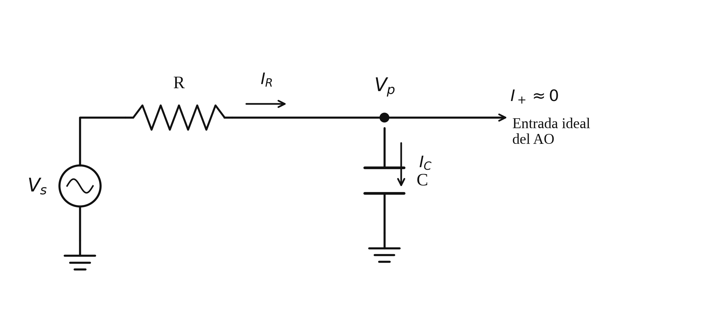{width="92%" fig-alt="Figura 3. Corrientes consideradas al aplicar la LCK al nodo de la red RC."}

La corriente que llega desde la fuente a través de $R$ se escribe como

$$I_{R}(s) = \frac{V_{s}(s) - V_{p}(s)}{R}.$$

La corriente que fluye hacia tierra a través del capacitor es

$$I_{C}(s) = \frac{V_{p}(s)}{Z_{C}(s)} = sC\, V_{p}(s).$$

Al sustituir ambas expresiones en la LCK se obtiene

$$\frac{V_{s}(s) - V_{p}(s)}{R} = sC\, V_{p}(s).$$

Multiplicando los dos miembros por $R$:

$$V_{s}(s) - V_{p}(s) = sRC\, V_{p}(s).$$

Se agrupan los términos que contienen $V_{p}(s)$:

$$V_{s}(s) = V_{p}(s) + sRC\, V_{p}(s) = V_{p}(s)(1 + sRC).$$

Por tanto,

$$\boxed{\frac{V_{p}(s)}{V_{s}(s)} = \frac{1}{1 + sRC}}.$$

Como el seguidor satisface $V_{o}(s) = V_{p}(s)$, la función de transferencia completa resulta

$$\boxed{H_{A}(s) = \frac{V_{o}(s)}{V_{s}(s)} = \frac{1}{1 + sRC}}.$$

La función posee un único polo en el semiplano izquierdo, $s = - 1/(RC)$; por ese motivo se clasifica como un **filtro de primer orden**. Su ganancia para señales de frecuencia prácticamente nula es uno.

### Constante de tiempo y frecuencia de corte

Es conveniente introducir la constante de tiempo

$$\tau = RC.$$

Al sustituirla en la función de transferencia,

$$H_{A}(s) = \frac{1}{1 + s\tau}.$$

La **frecuencia angular de corte** queda definida por

$$\omega_{c} = \frac{1}{\tau} = \frac{1}{RC}\quad\quad\lbrack rad/s\rbrack.$$

La frecuencia ordinaria de corte, expresada en hertz, es

$$\boxed{f_{c} = \frac{\omega_{c}}{2\pi} = \frac{1}{2\pi RC}}.$$

Estas relaciones muestran que el comportamiento frecuencial depende del producto $RC$: incrementar $R$ o $C$ desplaza la frecuencia de corte hacia valores menores; reducirlos desplaza el corte hacia frecuencias mayores. La topología del seguidor no modifica el valor ideal de $f_{c}$.

### Respuesta senoidal: magnitud y fase

Para obtener la respuesta en frecuencia, se sustituye $s = j\omega$:

$$H_{A}(j\omega) = \frac{1}{1 + j\omega RC}.$$

Al calcular el módulo del denominador,

$$|1 + j\omega RC| = \sqrt{1 + (\omega RC)^{2}},$$

se llega a

$$\boxed{\left| H_{A}(j\omega) \right| = \frac{1}{\sqrt{1 + (\omega RC)^{2}}}}.$$

Con $\omega_{c} = 1/(RC)$, esta misma expresión adopta la forma normalizada

$$\boxed{\left| H_{A}(j\omega) \right| = \frac{1}{\sqrt{1 + \left( \omega/\omega_{c} \right)^{2}}}}.$$

El numerador no introduce fase; el denominador tiene argumento $\tan^{- 1}(\omega RC)$. Al tratarse del inverso, la fase del filtro es negativa:

$$\boxed{\phi_{A}(\omega) = - \tan^{- 1}\left( \frac{\omega}{\omega_{c}} \right)}.$$

Finalmente, la ganancia en decibeles se calcula mediante

$$\boxed{G_{A,dB}(\omega) = - 10\log_{10}\left\lbrack 1 + \left( \frac{\omega}{\omega_{c}} \right)^{2} \right\rbrack}.$$

Las expresiones anteriores permiten construir los diagramas de Bode de magnitud y fase sin recurrir primero a una simulación.

### Comportamiento en frecuencias características

**Frecuencias mucho menores que el corte.** Si $\omega \ll \omega_{c}$, entonces $\left( \omega/\omega_{c} \right)^{2}$ es despreciable. Por tanto, la magnitud se aproxima a uno y la fase a cero:

$$\left| H_{A}(j\omega) \right| \approx 1,\quad G_{A,dB} \approx 0\ dB,\quad\phi_{A} \approx 0^{\circ}.$$

**En la frecuencia de corte.** Cuando $\omega = \omega_{c}$, se obtiene

$$\left| H_{A}\left( j\omega_{c} \right) \right| = \frac{1}{\sqrt{2}} \approx 0.7071.$$

En decibeles,

$$20\log_{10}(0.7071) \approx - 3.01\ dB,$$

mientras que el desfase es

$$\phi_{A}\left( \omega_{c} \right) = - \tan^{- 1}(1) = - 45^{\circ}.$$

Por esta razón, el corte se identifica habitualmente como el punto de **3 dB por debajo de la ganancia de la banda de paso**. La potencia sobre una misma resistencia de referencia es entonces la mitad de la correspondiente a la banda de paso.

**Una década por encima del corte.** Cuando $\omega = 10\omega_{c}$:

$$\left| H_{A}\left( j10\omega_{c} \right) \right| = \frac{1}{\sqrt{101}} \approx 0.0995,$$

$$G_{A,dB}\left( 10\omega_{c} \right) \approx - 20.04\ dB,\quad\quad\phi_{A}\left( 10\omega_{c} \right) \approx - {84.3}^{\circ}.$$

**Frecuencia muy elevada.** Cuando $\omega \rightarrow \infty$, la magnitud tiende a cero, la ganancia en decibeles tiende a menos infinito y la fase se aproxima a $- 90^{\circ}$.

  --------------------------------------------------------------------------------------------------------
  Frecuencia normalizada                   Magnitud          Ganancia (dB)            Fase aproximada
  ---------------------------------------- ----------------- ------------------------ --------------------
  $\omega/\omega_{c} \rightarrow 0$        $1$               $0$                      $0^{\circ}$

  $\omega/\omega_{c} = 1$                  $0.7071$          $- 3.01$                 $- 45^{\circ}$

  $\omega/\omega_{c} = 10$                 $0.0995$          $- 20.04$                $- {84.3}^{\circ}$

  $\omega/\omega_{c} \rightarrow \infty$   $0$               $\rightarrow - \infty$   $- 90^{\circ}$
  --------------------------------------------------------------------------------------------------------

### Interpretación del diagrama de Bode

La figura 4 muestra la magnitud exacta y su aproximación asintótica. En la zona $\omega \ll \omega_{c}$ la curva permanece cerca de $0$ dB; alrededor del corte se produce una transición gradual y, para $\omega \gg \omega_{c}$, el filtro atenúa a razón de aproximadamente **20 dB por década**.

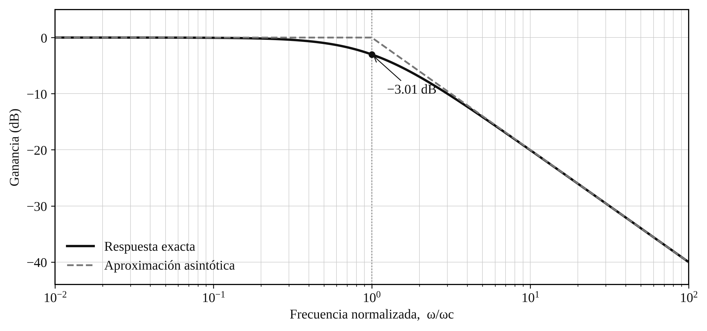{width="92%" fig-alt="Figura 4. Magnitud de un filtro pasa-bajas de primer orden y aproximación asintótica."}

La pendiente se deduce a partir de la aproximación para frecuencias elevadas:

$$\left| H_{A}(j\omega) \right| \approx \frac{\omega_{c}}{\omega}.$$

De este modo,

$$G_{A,dB}(\omega) \approx - 20\log_{10}\left( \frac{\omega}{\omega_{c}} \right).$$

Si la frecuencia se multiplica por diez, la ganancia disminuye aproximadamente $20$ dB. Esta pendiente constituye una característica distintiva de los filtros pasa-bajas de primer orden.

El comportamiento de fase se presenta en la figura 5. La fase comienza cerca de $0^{\circ}$, cruza $- 45^{\circ}$ en la frecuencia de corte y tiende progresivamente a $- 90^{\circ}$. La transición de fase, al igual que la de magnitud, no ocurre de manera instantánea.

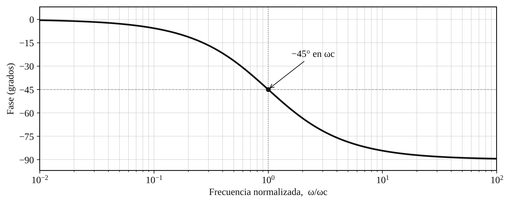{width="92%" fig-alt="Figura 5. Fase de la función de transferencia de un filtro pasa-bajas de primer orden."}

### Respuesta temporal y significado de la constante $RC$

La misma función de transferencia permite comprender cómo responde el circuito cuando el voltaje de entrada cambia bruscamente. Para un escalón de amplitud $V_{S}$ aplicado en $t = 0$, con el capacitor inicialmente descargado, la salida ideal del seguidor es

$$v_{o}(t) = V_{S}\left( 1 - e^{- t/(RC)} \right),\quad\quad t \geq 0.$$

La ecuación demuestra que la salida no cambia instantáneamente: se aproxima exponencialmente al valor final con una rapidez fijada por $\tau = RC$. Al cumplirse $t = \tau$, se alcanza

$$v_{o}(\tau) = V_{S}\left( 1 - e^{- 1} \right) \approx 0.632\, V_{S}.$$

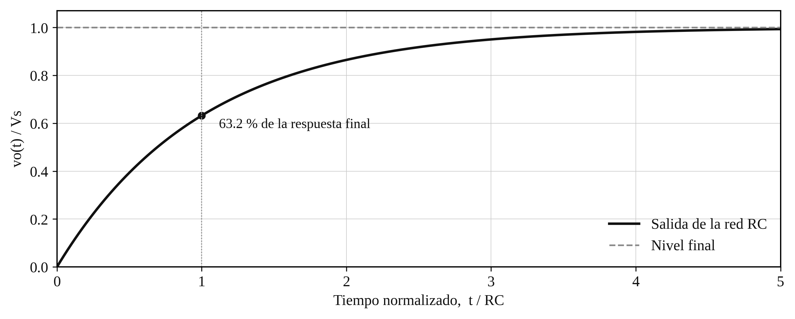{width="92%" fig-alt="Figura 6. Respuesta al escalón de la red RC ideal, expresada en tiempo normalizado."}

Este resultado conecta dos puntos de vista: en el dominio temporal, $RC$ controla la rapidez de respuesta; en el dominio de la frecuencia, el mismo producto fija $\omega_{c} = 1/(RC)$. Un filtro de corte bajo atenúa más las variaciones rápidas de una señal, pero también produce una respuesta más lenta ante cambios reales.

### Ejemplo de diseño: filtro de ganancia unitaria

Se desea obtener un filtro activo pasa-bajas con frecuencia de corte cercana a $1.6$ kHz, empleando un seguidor de voltaje y un capacitor comercial de $10$ nF.

De la ecuación del corte:

$$R = \frac{1}{2\pi f_{c}C}.$$

Al sustituir $f_{c} = 1600\ Hz$ y $C = 10\ nF$:

$$R = \frac{1}{2\pi(1600)\left( 10 \times 10^{- 9} \right)} \approx 9.95\ k\Omega.$$

Puede elegirse $R = 10\ k\Omega$. Con este valor, la frecuencia de corte nominal es

$$f_{c} = \frac{1}{2\pi\left( 10 \times 10^{3} \right)\left( 10 \times 10^{- 9} \right)} \approx 1591.5\ Hz.$$

Para una señal senoidal de $1$ kHz, la magnitud de la transferencia vale

$$\left| H_{A}(j2\pi \cdot 1000) \right| = \frac{1}{\sqrt{1 + (1000/1591.5)^{2}}} \approx 0.8467.$$

Por tanto, una señal de entrada de $1\ V$ de amplitud produciría idealmente unos $0.847\ V$ de amplitud a la salida, con un desfase cercano a $- {32.1}^{\circ}$. Los valores son de diseño teórico; el resultado experimental dependerá de los componentes y del amplificador operacional utilizados.

## Filtro RC con amplificador no inversor

### Incorporación de ganancia en la banda de paso

El seguidor estudiado anteriormente preserva la amplitud de las señales de baja frecuencia, pero no permite amplificarlas. Para obtener una ganancia superior a la unidad se conserva la misma red RC y se sustituye el seguidor por una etapa **no inversora**, formada por el amplificador operacional y dos resistencias de realimentación.

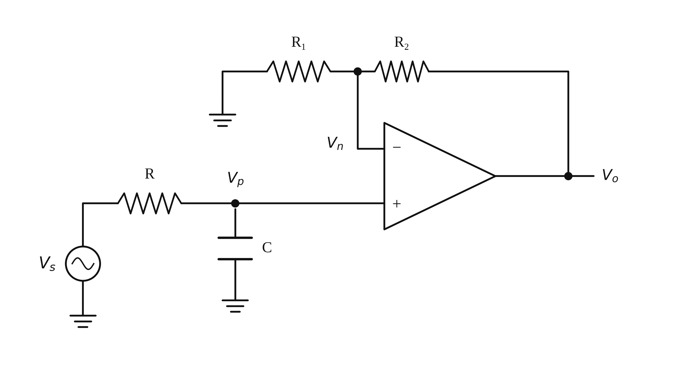{width="92%" fig-alt="Figura 7. Filtro activo pasa-bajas con red RC y amplificador no inversor."}

La entrada no inversora recibe el voltaje filtrado $V_{p}$. La entrada inversora está conectada al divisor resistivo formado por $R_{1}$, conectado hacia tierra, y $R_{2}$, conectado hacia la salida $V_{o}$. Esta red fija la ganancia de baja frecuencia del amplificador, mientras que el producto $RC$ controla el corte del filtro.

El análisis puede dividirse en dos partes: determinar $V_{p}/V_{s}$ por LCK y relacionar después $V_{o}$ con $V_{p}$ mediante la realimentación resistiva.

### Primera relación: red de entrada RC

Como la corriente que entra al terminal no inversor es prácticamente nula, la ecuación nodal es la misma que para el seguidor:

$$\frac{V_{s}(s) - V_{p}(s)}{R} = sC\, V_{p}(s).$$

De ella se obtiene nuevamente

$$\boxed{V_{p}(s) = \frac{V_{s}(s)}{1 + sRC}}.$$

Esta igualdad demuestra que el comportamiento selectivo de la red RC no cambia al sustituir un seguidor ideal por un amplificador no inversor ideal, ya que ambos presentan impedancia de entrada muy elevada.

### Segunda relación: red de realimentación no inversora

Se aplica la LCK en el nodo de la entrada inversora $V_{n}$. Como $I_{n} \approx 0$, las corrientes de las dos resistencias de realimentación deben equilibrarse. Tomando las direcciones de corriente empleadas en el análisis nodal:

$$\frac{0 - V_{n}(s)}{R_{1}} = \frac{V_{n}(s) - V_{o}(s)}{R_{2}}.$$

Multiplicando en cruz:

$$- R_{2}V_{n}(s) = R_{1}V_{n}(s) - R_{1}V_{o}(s).$$

Tras reagrupar,

$$\left( R_{1} + R_{2} \right)V_{n}(s) = R_{1}V_{o}(s).$$

Se despeja $V_{n}(s)$:

$$\boxed{V_{n}(s) = \frac{R_{1}}{R_{1} + R_{2}}V_{o}(s)}.$$

Debido al cortocircuito virtual, $V_{p}(s) = V_{n}(s)$. Por tanto,

$$V_{p}(s) = \frac{R_{1}}{R_{1} + R_{2}}V_{o}(s).$$

Finalmente,

$$\boxed{V_{o}(s) = \left( 1 + \frac{R_{2}}{R_{1}} \right)V_{p}(s)}.$$

La expresión coincide con la ganancia conocida del amplificador no inversor. En condiciones ideales, si las resistencias son positivas, esta ganancia es mayor o igual que la unidad.

### Función de transferencia del filtro activo

Sustituyendo la relación obtenida para $V_{p}(s)$ en la expresión de salida:

$$V_{o}(s) = \left( 1 + \frac{R_{2}}{R_{1}} \right)\frac{V_{s}(s)}{1 + sRC}.$$

Así, la función de transferencia completa es

$$\boxed{H_{B}(s) = \frac{V_{o}(s)}{V_{s}(s)} = \left( 1 + \frac{R_{2}}{R_{1}} \right)\frac{1}{1 + sRC}}.$$

Si se define la ganancia de la etapa no inversora como

$$\boxed{K = 1 + \frac{R_{2}}{R_{1}}},$$

la función de transferencia adopta la forma compacta

$$\boxed{H_{B}(s) = \frac{K}{1 + sRC}}.$$

Esta representación es particularmente útil porque separa dos decisiones de diseño: $K$ establece el nivel de ganancia de la banda de paso y $RC$ establece la posición del polo, es decir, la frecuencia de corte. La separación es válida bajo las hipótesis del modelo ideal; en un circuito real aparecen acoplamientos derivados del ancho de banda y de la carga del amplificador.

### Magnitud, fase y frecuencia de corte

Sustituyendo $s = j\omega$:

$$H_{B}(j\omega) = \frac{K}{1 + j\omega RC}.$$

Para $K > 0$ la magnitud es

$$\boxed{\left| H_{B}(j\omega) \right| = \frac{K}{\sqrt{1 + (\omega RC)^{2}}} = \frac{K}{\sqrt{1 + \left( \omega/\omega_{c} \right)^{2}}}}.$$

La fase conserva la misma dependencia de la red RC:

$$\boxed{\phi_{B}(\omega) = - \tan^{- 1}\left( \frac{\omega}{\omega_{c}} \right)}.$$

También se conserva la frecuencia de corte ideal:

$$\boxed{\omega_{c} = \frac{1}{RC},\quad\quad f_{c} = \frac{1}{2\pi RC}}.$$

En decibeles,

$$G_{B,dB}(\omega) = 20\log_{10}K - 10\log_{10}\left\lbrack 1 + \left( \frac{\omega}{\omega_{c}} \right)^{2} \right\rbrack.$$

El término $20\log_{10}K$ desplaza verticalmente el diagrama de magnitud respecto al seguidor, pero no modifica su pendiente asintótica ni el desfase de la red RC.

### Puntos de interés y representación gráfica

A bajas frecuencias $\left| H_{B} \right| \approx K$, de modo que

$$G_{B,dB}(0) = 20\log_{10}K.$$

En $\omega = \omega_{c}$:

$$\left| H_{B}\left( j\omega_{c} \right) \right| = \frac{K}{\sqrt{2}},$$

$$G_{B,dB}\left( \omega_{c} \right) = 20\log_{10}K - 3.01\ dB.$$

Así, **el punto de corte se mide con respecto al nivel de banda de paso del propio filtro**, no necesariamente con respecto a $0$ dB. Por ejemplo, si $K = 3$, la banda de paso se encuentra aproximadamente en $9.54$ dB y el punto de corte alrededor de $6.53$ dB.

Una década después del corte, la aproximación de primer orden continúa teniendo pendiente de $- 20$ dB/década. La figura 8 ilustra el desplazamiento vertical entre las configuraciones con seguidor y con ganancia no inversora.

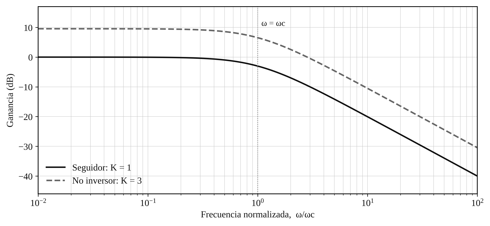{width="92%" fig-alt="Figura 8. Comparación de la magnitud de dos filtros con el mismo producto RC y distinta ganancia de banda de paso."}

La gráfica evidencia que añadir ganancia mediante $R_{1}$ y $R_{2}$ no convierte al filtro en uno de orden mayor: ambas configuraciones conservan un único polo y la misma pendiente de atenuación de alta frecuencia.

### Ejemplo de diseño: filtrado con ganancia

Considérese un filtro activo pasa-bajas con frecuencia de corte nominal cercana a $1.59$ kHz y ganancia de banda de paso $K = 3$. Se seleccionan

$$R = 10\ k\Omega,\quad\quad C = 10\ nF.$$

El corte correspondiente es

$$f_{c} = \frac{1}{2\pi RC} = 1591.5\ Hz.$$

Para la etapa no inversora se necesita

$$3 = 1 + \frac{R_{2}}{R_{1}}\quad\quad \Rightarrow \quad\quad R_{2} = 2R_{1}.$$

Si se elige $R_{1} = 10\ k\Omega$, entonces $R_{2} = 20\ k\Omega$. La función de transferencia ideal queda

$$\boxed{H_{B}(s) = \frac{3}{1 + 10^{- 4}s}}.$$

En la banda de paso, la ganancia es

$$G_{B,dB}(0) = 20\log_{10}3 \approx 9.54\ dB.$$

En la frecuencia de corte se obtiene

$$\left| H_{B}\left( j\omega_{c} \right) \right| = \frac{3}{\sqrt{2}} \approx 2.121,$$

$$G_{B,dB}\left( \omega_{c} \right) \approx 6.53\ dB.$$

  -----------------------------------------------------------------------------------------------------------
  Frecuencia        $\left| H_{A} \right|$, seguidor   $\left| H_{B} \right|$, $K = 3$   Fase común
  ----------------- ---------------------------------- --------------------------------- --------------------
  $100$ Hz          $0.998$                            $2.994$                           $- {3.6}^{\circ}$

  $1$ kHz           $0.847$                            $2.540$                           $- {32.1}^{\circ}$

  $1.5915$ kHz      $0.707$                            $2.121$                           $- 45^{\circ}$

  $10$ kHz          $0.157$                            $0.472$                           $- {81.0}^{\circ}$
  -----------------------------------------------------------------------------------------------------------

Los valores de la tabla son predicciones del modelo ideal. En un montaje real deberán contrastarse con la respuesta medida o simulada, especialmente cuando la amplitud de salida se acerca a los límites de alimentación del operacional.

## Comparación e implicaciones para el diseño

Las dos configuraciones se estudian con el mismo procedimiento, aunque cumplen funciones distintas en el acondicionamiento de señales.

  --------------------------------------------------------------------------------------
  Parámetro                      RC + seguidor               RC + no inversor
  ------------------------------ --------------------------- ---------------------------
  Función de transferencia       $1/(1 + sRC)$               $K/(1 + sRC)$

  Ganancia en la banda de paso   $1$                         $K = 1 + R_{2}/R_{1}$

  Frecuencia de corte            $1/(2\pi RC)$               $1/(2\pi RC)$

  Orden del sistema              Primero                     Primero

  Pendiente de rechazo           $- 20$ dB/década            $- 20$ dB/década

  Fase ideal                     $- \tan^{- 1}(\omega RC)$   $- \tan^{- 1}(\omega RC)$

  Uso principal                  Aislamiento y filtrado      Filtrado y amplificación
  --------------------------------------------------------------------------------------

La configuración con seguidor es adecuada cuando se desea preservar la amplitud de las componentes de baja frecuencia y evitar que la carga posterior modifique apreciablemente la respuesta de la red RC. La configuración no inversora es útil cuando, además del filtrado, la señal debe amplificarse antes de su procesamiento.

El diseño práctico debe considerar, por lo menos, los siguientes aspectos:

1.  **Tolerancia de componentes.** La frecuencia de corte varía con los valores reales de $R$ y $C$. Para pequeñas variaciones, $\Delta f_{c}/f_{c} \approx - \Delta R/R - \Delta C/C$.
2.  **Ancho de banda del operacional.** La aproximación de ganancia constante requiere que el amplificador mantenga su comportamiento lineal dentro de la banda de interés. Una ganancia $K$ alta reduce, en general, el ancho de banda disponible en un operacional compensado de producto ganancia-ancho de banda aproximadamente constante.
3.  **Excursión de salida.** La amplitud amplificada no debe exceder el margen permitido por la alimentación y la carga del dispositivo.
4.  **Slew rate.** A amplitudes y frecuencias elevadas, la velocidad máxima de variación del voltaje de salida puede limitar la fidelidad de la señal.
5.  **Impedancias externas.** Una fuente de señal con resistencia interna y una carga no ideal pueden modificar el comportamiento previsto si no se consideran en el modelo.

Estas observaciones no sustituyen el análisis ideal; permiten identificar cuándo sus resultados pueden aplicarse directamente y cuándo conviene utilizar un modelo más completo o realizar una validación experimental.

## Filtro pasa-bajas activo con amplificador inversor

### Circuito y principio de funcionamiento

La tercera configuración se muestra en la Figura 1. La señal de entrada $V_{s}$ llega a la entrada inversora del amplificador operacional por medio de $R_{1}$. La entrada no inversora se conecta a tierra. La realimentación desde la salida hacia la entrada inversora contiene una resistencia $R_{F}$ **en paralelo** con un capacitor $C$.

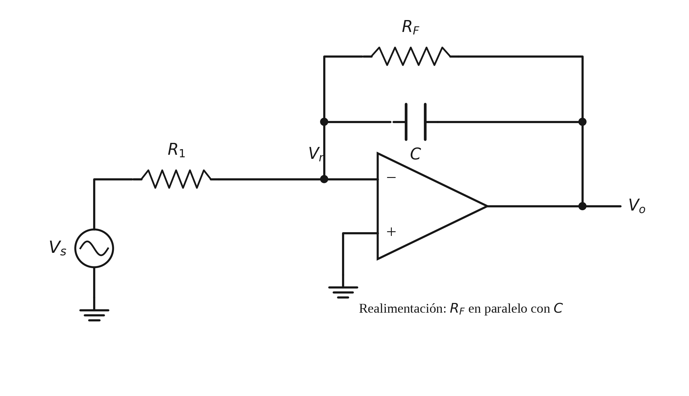{width="92%" fig-alt="Figura 1. Filtro pasa-bajas activo de primer orden con amplificador inversor y realimentación resistiva-capacitiva."}

La resistencia de realimentación proporciona un camino de corriente aun a frecuencia cero y evita la acumulación indefinida de carga que caracterizaría a un integrador ideal. El capacitor modifica la impedancia de realimentación conforme aumenta la frecuencia. Para frecuencias suficientemente bajas, la reactancia capacitiva es muy elevada y predomina $R_{F}$; a frecuencias altas, la impedancia del capacitor disminuye y la realimentación se hace más intensa, por lo que disminuye la magnitud de la ganancia.

Este comportamiento puede anticiparse mediante dos límites:

-   **Bajas frecuencias:** el capacitor se aproxima a un circuito abierto; el sistema se comporta como un amplificador inversor de ganancia $- R_{F}/R_{1}$.
-   **Altas frecuencias:** la impedancia del capacitor disminuye; la ganancia se reduce y, en un intervalo compatible con las limitaciones del operacional, la respuesta se aproxima a la de un integrador inversor.

Para el análisis matemático se supondrá un amplificador operacional ideal, con realimentación negativa estable y funcionamiento dentro de su región lineal.

### Hipótesis del amplificador operacional ideal

Si $A_{OL} \rightarrow \infty$ y la resistencia de entrada es muy elevada, las corrientes que penetran en las terminales de entrada son despreciables:

$$I_{p}(s) = I_{n}(s) \simeq 0.$$

La realimentación negativa mantiene aproximadamente iguales los voltajes de entrada. Como la terminal no inversora está a tierra,

$$V_{p}(s) = 0,\quad\quad V_{n}(s) \simeq V_{p}(s) = 0.$$

Esta condición recibe el nombre de **tierra virtual**. No significa que el nodo inversor esté físicamente conectado a tierra; únicamente expresa que su potencial se mantiene cercano a cero mientras el amplificador opera linealmente. Por tanto, en el nodo inversor puede aplicarse la LCK tomando $V_{n}(s) \simeq 0$.

### Deducción mediante la ley de corrientes de Kirchhoff

Se considera positiva la corriente $I_{R_{1}}$ que llega al nodo inversor a través de $R_{1}$. Las corrientes $I_{R_{F}}$ e $I_{C}$ salen del nodo hacia la salida del amplificador. Como la corriente que entra al operacional es despreciable,

$$I_{R_{1}}(s) = I_{R_{F}}(s) + I_{C}(s).$$

Las corrientes de las tres ramas se expresan mediante sus impedancias:

$$I_{R_{1}}(s) = \frac{V_{s}(s) - V_{n}(s)}{R_{1}},$$

$$I_{R_{F}}(s) = \frac{V_{n}(s) - V_{o}(s)}{R_{F}},$$

$$I_{C}(s) = \frac{V_{n}(s) - V_{o}(s)}{Z_{C}(s)} = sC\,\left\lbrack V_{n}(s) - V_{o}(s) \right\rbrack,$$

con la impedancia capacitiva $Z_{C}(s) = 1/(sC)$. Sustituyendo en la LCK:

$$\frac{V_{s}(s) - V_{n}(s)}{R_{1}} = \frac{V_{n}(s) - V_{o}(s)}{R_{F}} + sC\,\left\lbrack V_{n}(s) - V_{o}(s) \right\rbrack.$$

La tierra virtual permite considerar $V_{n}(s) \simeq 0$, con lo cual

$$\frac{V_{s}(s)}{R_{1}} = - \frac{V_{o}(s)}{R_{F}} - sC\, V_{o}(s).$$

Sacando factor común a $V_{o}(s)$:

$$\frac{V_{s}(s)}{R_{1}} = - V_{o}(s)\left( \frac{1}{R_{F}} + sC \right).$$

Despejando la relación entre salida y entrada,

$$\frac{V_{o}(s)}{V_{s}(s)} = - \frac{1/R_{1}}{1/R_{F} + sC}.$$

Si se multiplica el numerador y el denominador por $R_{F}$, se obtiene

$$\boxed{H_{C}(s) = \frac{V_{o}(s)}{V_{s}(s)} = - \frac{R_{F}}{R_{1}}\frac{1}{1 + sR_{F}C}}.$$

La expresión identifica dos propiedades independientes: el signo negativo procede de la configuración inversora y el denominador de primer grado determina el comportamiento selectivo en frecuencia. El polo se encuentra en

$$s_{p} = - \frac{1}{R_{F}C}.$$

Como $R_{F} > 0$ y $C > 0$, el polo ideal pertenece al semiplano izquierdo y el circuito presenta una respuesta estable de primer orden.

### Método alternativo mediante la impedancia de realimentación

La misma deducción puede realizarse con mayor rapidez utilizando la impedancia equivalente $Z_{F}(s)$ de las ramas de realimentación. En la Figura 2 se muestran $R_{F}$ y $C$ conectados entre el nodo inversor y la salida.

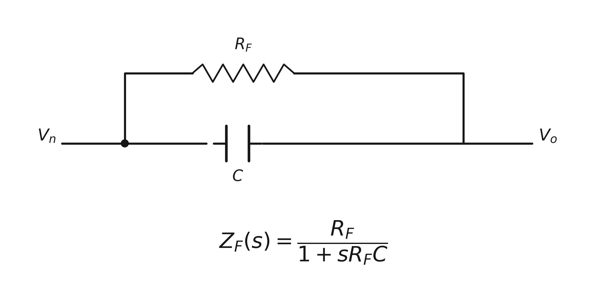{width="92%" fig-alt="Figura 2. Equivalencia de la resistencia y el capacitor conectados en paralelo en la realimentación."}

Para dos impedancias en paralelo,

$$\frac{1}{Z_{F}(s)} = \frac{1}{R_{F}} + \frac{1}{1/(sC)} = \frac{1}{R_{F}} + sC.$$

Por tanto,

$$Z_{F}(s) = \frac{1}{1/R_{F} + sC} = \frac{R_{F}}{1 + sR_{F}C}.$$

La ganancia del amplificador inversor ideal es $H_{C}(s) = - Z_{F}(s)/R_{1}$. Al sustituir,

$$H_{C}(s) = - \frac{R_{F}}{R_{1}\left( 1 + sR_{F}C \right)},$$

que coincide exactamente con el resultado obtenido por LCK. Ambos métodos son equivalentes: el primero expone explícitamente la distribución de corrientes; el segundo facilita el análisis cuando se conoce la impedancia de una red de realimentación.

## Función de transferencia, ganancia y frecuencia de corte

### Representación canónica

Definamos la magnitud de la ganancia de banda de paso,

$$K = \frac{R_{F}}{R_{1}} > 0,$$

y la constante de tiempo,

$$\tau = R_{F}C.$$

La función de transferencia se puede escribir como

$$\boxed{H_{C}(s) = - \frac{K}{1 + s\tau}}.$$

También es posible expresarla mediante la frecuencia angular de corte $\omega_{c} = 1/\tau$:

$$\boxed{H_{C}(s) = - K\,\frac{\omega_{c}}{s + \omega_{c}}},\quad\quad\omega_{c} = \frac{1}{R_{F}C}.$$

La frecuencia ordinaria de corte es

$$\boxed{f_{c} = \frac{1}{2\pi R_{F}C}}.$$

Estas ecuaciones muestran que la magnitud de la ganancia de paso depende de $R_{F}/R_{1}$, mientras que la frecuencia de corte depende de $R_{F}C$. Sin embargo, ambos parámetros no son completamente independientes, pues $R_{F}$ aparece en las dos expresiones. Si se modifica $R_{F}$ para cambiar la ganancia, también cambiará la frecuencia de corte a menos que se ajuste $C$.

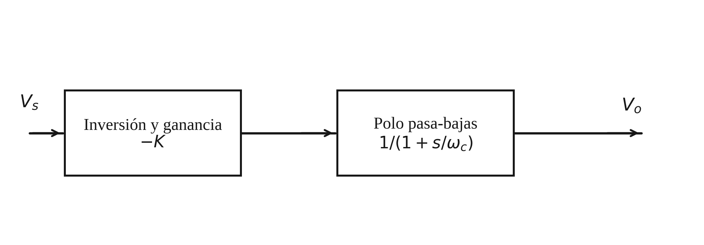{width="92%" fig-alt="Figura 3. Descomposición conceptual de la función de transferencia: ganancia inversora y un polo pasa-bajas."}

La descomposición representada en la Figura 3 ayuda a interpretar el circuito: una ganancia de signo negativo multiplica a la respuesta dinámica de un sistema pasa-bajas de primer orden. Este modelo permite comparar directamente la topología inversora con las dos topologías no inversoras de la parte I.

### Límites de frecuencia y comportamiento integrador

Cuando la frecuencia tiende a cero, $s \rightarrow 0$ y la respuesta se reduce a

$$H_{C}(0) = - \frac{R_{F}}{R_{1}} = - K.$$

Por ello, las señales de baja frecuencia se amplifican e invierten según la relación resistiva. En cambio, para frecuencias suficientemente elevadas respecto de $\omega_{c}$,

$$\left| sR_{F}C \right| \gg 1\quad \Rightarrow \quad 1 + sR_{F}C \simeq sR_{F}C.$$

Así,

$$H_{C}(s) \simeq - \frac{R_{F}/R_{1}}{sR_{F}C} = - \frac{1}{sR_{1}C}.$$

Esta es la función de transferencia de un **integrador inversor ideal**. La aproximación resulta útil para interpretar la topología, pero no debe extrapolarse arbitrariamente a frecuencias donde el amplificador operacional real pierda ganancia de lazo o deje de conservar el comportamiento ideal supuesto.

## Respuesta en frecuencia: módulo y fase

### Sustitución de $s = j\omega$

La respuesta senoidal de régimen permanente se obtiene sustituyendo $s = j\omega$:

$$H_{C}(j\omega) = - \frac{K}{1 + j\omega\tau} = - \frac{K}{1 + j\omega/\omega_{c}}.$$

El módulo de un cociente de números complejos es el cociente de sus módulos. Como el signo negativo no afecta la magnitud,

$$\left| H_{C}(j\omega) \right| = \frac{K}{\sqrt{1 + (\omega\tau)^{2}}}.$$

Por tanto,

$$\boxed{\left| H_{C}(j\omega) \right| = \frac{K}{\sqrt{1 + \left( \omega/\omega_{c} \right)^{2}}}}.$$

Expresando la magnitud en decibeles,

$$G_{dB}(\omega) = 20\log_{10}K - 10\log_{10}\left\lbrack 1 + \left( \frac{\omega}{\omega_{c}} \right)^{2} \right\rbrack.$$

El primer término determina el nivel de la banda de paso y el segundo describe la atenuación creciente al aumentar la frecuencia.

### Frecuencias representativas

**Por debajo del corte**, cuando $\omega \ll \omega_{c}$:

$$\left| H_{C}(j\omega) \right| \simeq K,\quad\quad G_{dB} \simeq 20\log_{10}K.$$

**En la frecuencia de corte**, $\omega = \omega_{c}$:

$$\left| H_{C}\left( j\omega_{c} \right) \right| = \frac{K}{\sqrt{2}} \simeq 0.7071K.$$

Por tanto, la ganancia relativa a la banda de paso se reduce en

$$20\log_{10}\frac{\left| H_{C}\left( j\omega_{c} \right) \right|}{K} = 20\log_{10}\left( \frac{1}{\sqrt{2}} \right) \simeq - 3.01\ dB.$$

**Por encima del corte**, $\omega \gg \omega_{c}$:

$$\left| H_{C}(j\omega) \right| \simeq K\frac{\omega_{c}}{\omega}.$$

En consecuencia, al multiplicar la frecuencia por diez, la ganancia cae aproximadamente $20\ dB$. La pendiente asintótica de la banda de rechazo es $- 20\ dB/década$, característica de los filtros de primer orden.

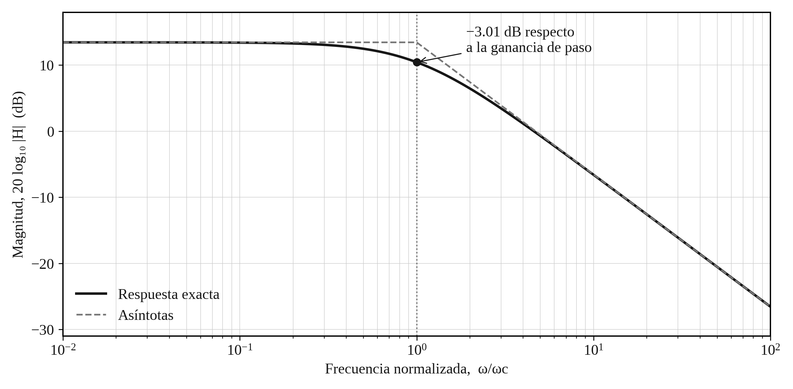{width="92%" fig-alt="Figura 4. Respuesta de magnitud y aproximación asintótica del filtro inversor de primer orden; el ejemplo ilustrado considera una magnitud de ganancia de paso K=4.7."}

Es importante observar que la expresión *frecuencia de corte* no indica una frontera donde el filtro deja de transmitir abruptamente. La atenuación crece de manera continua y la frecuencia $f_{c}$ es el punto convencional en el que la magnitud se ha reducido $3.01\ dB$ respecto de su nivel de baja frecuencia.

### El efecto del signo inversor sobre la fase

El denominador $1 + j\omega/\omega_{c}$ introduce un ángulo positivo $\tan^{- 1}\left( \omega/\omega_{c} \right)$. Como aparece en el denominador de la función de transferencia, su contribución a la fase es negativa:

$$\phi_{polo}(\omega) = - \tan^{- 1}\left( \frac{\omega}{\omega_{c}} \right).$$

Sin embargo, el circuito también es **inversor**: el factor $- K$ equivale a una inversión de $180^{\circ}$. Una representación válida de la fase total es

$$\boxed{\phi_{C}(\omega) = 180^{\circ} - \tan^{- 1}\left( \frac{\omega}{\omega_{c}} \right)}.$$

De forma equivalente, si se usa una fase continua negativa, puede escribirse $- 180^{\circ} - \tan^{- 1}\left( \omega/\omega_{c} \right)$; ambas expresiones representan el mismo ángulo módulo $360^{\circ}$. En un diagrama de fase referido únicamente a la respuesta del polo, se representa $\phi_{polo}$, que cambia de $0^{\circ}$ a $- 90^{\circ}$. Es necesario indicar qué convención se ha adoptado al interpretar una simulación.

En particular, cuando $\omega = \omega_{c}$, el polo aporta $- 45^{\circ}$, mientras que la fase total del circuito se puede expresar como $135^{\circ}$ (equivalente a $- 225^{\circ}$).

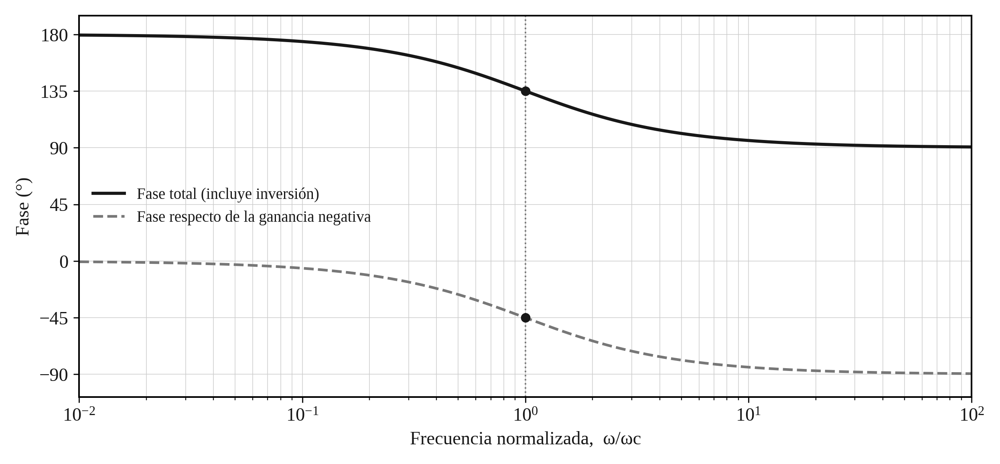{width="92%" fig-alt="Figura 5. Fase del filtro inversor de primer orden: fase total y contribución del polo referida a la ganancia negativa."}

### Interpretación conjunta de los diagramas de Bode

En la banda de paso, la magnitud tiende a $K$ y el circuito invierte la señal. Al aproximarse a la frecuencia de corte, comienzan a hacerse evidentes tanto la reducción de ganancia como el desfase asociado al almacenamiento de energía en el capacitor. En la región de alta frecuencia la ganancia decrece aproximadamente a razón de $20\ dB$ por cada década.

  --------------------------------------------------------------------------------------------------------------------
  Región                    Magnitud aproximada    Magnitud relativa en dB                           Fase del polo
  ------------------------- ---------------------- ------------------------------------------------- -----------------
  $\omega \ll \omega_{c}$   $K$                    $0\ dB$                                           $0^{\circ}$

  $\omega = \omega_{c}$     $K/\sqrt{2}$           $- 3.01\ dB$                                      $- 45^{\circ}$

  $\omega \gg \omega_{c}$   $K\omega_{c}/\omega$   $- 20\log_{10}\left( \omega/\omega_{c} \right)$   $- 90^{\circ}$
  --------------------------------------------------------------------------------------------------------------------

La magnitud absoluta en decibeles se obtiene sumando $20\log_{10}K$ a la magnitud relativa de la tabla. La fase total añade la inversión del amplificador, tal como se explicó anteriormente.

## Respuesta temporal del filtro inversor

La función de transferencia también proporciona información sobre cómo responde el circuito ante cambios de entrada. A partir de

$$\left( 1 + sR_{F}C \right)V_{o}(s) = - \frac{R_{F}}{R_{1}}V_{s}(s),$$

se obtiene la ecuación diferencial, con condiciones iniciales nulas:

$$R_{F}C\frac{dv_{o}(t)}{dt} + v_{o}(t) = - \frac{R_{F}}{R_{1}}v_{s}(t).$$

Cuando se aplica un escalón $v_{s}(t) = V_{0}u(t)$, la solución para $t \geq 0$ es

$$\boxed{v_{o}(t) = - KV_{0}\left( 1 - e^{- t/\tau} \right)},\quad\quad\tau = R_{F}C.$$

La salida no salta de manera instantánea al valor final, sino que evoluciona exponencialmente hacia $- KV_{0}$. En $t = \tau$ alcanza aproximadamente el $63.2\%$ del cambio total; después de unas cinco constantes de tiempo se aproxima estrechamente al estado estacionario.

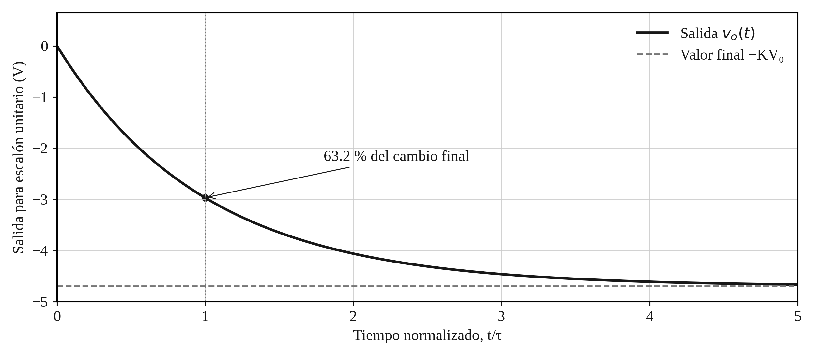{width="92%" fig-alt="Figura 6. Respuesta al escalón de un filtro inversor de primer orden para ganancia K=4.7 y entrada positiva de amplitud unitaria."}

Esta respuesta permite relacionar dos interpretaciones del mismo sistema: una constante de tiempo grande implica una transición temporal lenta y una frecuencia de corte pequeña; una constante de tiempo pequeña produce una respuesta más rápida y un corte más elevado.

## Ejemplo completo: diseño de un filtro inversor de primer orden

Se requiere un filtro pasa-bajas activo con magnitud de ganancia en baja frecuencia de $4\ V/V$, inversión de fase y frecuencia de corte de $f_{c} = 1\ kHz$. Se adopta una fuente con impedancia suficientemente baja para excitar una resistencia de entrada de $10\ k\Omega$ y un amplificador operacional alimentado de modo que su salida no se sature.

### Cálculo de los componentes

Las especificaciones son

$$\left| K_{s} \right| = 4,\quad\quad f_{c} = 1000\ Hz.$$

Se selecciona

$$R_{1} = 10\ k\Omega.$$

Para satisfacer la ganancia de banda de paso:

$$R_{F} = \left| K_{s} \right|R_{1} = 4(10\ k\Omega) = 40\ k\Omega.$$

La capacitancia necesaria se obtiene de la frecuencia de corte:

$$C = \frac{1}{2\pi f_{c}R_{F}} = \frac{1}{2\pi(1000)(40\, 000)} \simeq 3.98\ nF.$$

Si se dispone de un capacitor comercial de $3.9\ nF$, la frecuencia de corte efectiva pasa a ser

$$f_{c,real} = \frac{1}{2\pi(40\, 000)\left( 3.9 \times 10^{- 9} \right)} \simeq 1020\ Hz.$$

La diferencia es de aproximadamente el $2.0\%$ respecto de la especificación nominal. Si la aplicación exige un corte más próximo a $1\ kHz$, puede utilizarse una combinación de capacitores, otro valor comercial o un elemento ajustable, siempre recalculando los parámetros del circuito.

### Función de transferencia diseñada

Con los valores ideales,

$$H_{ideal}(s) = - \frac{4}{1 + 1.5915 \times 10^{- 4}s}.$$

Utilizando el capacitor comercial de $3.9\ nF$,

$$\boxed{H_{real}(s) = - \frac{4}{1 + 1.56 \times 10^{- 4}s}}.$$

La constante de tiempo es $\tau = 156\ \mu s$ y la frecuencia angular de corte nominal con los componentes elegidos es $\omega_{c} = 1/\tau \simeq 6410\ rad/s$.

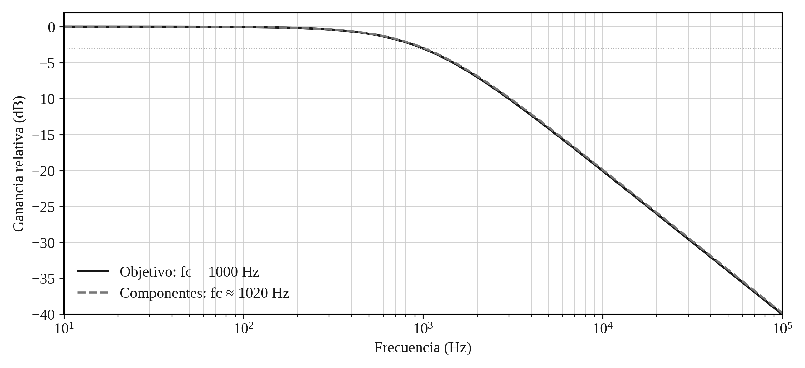{width="92%" fig-alt="Figura 10. Comparación de la respuesta pasa-bajas calculada para un corte de 1 kHz y la obtenida al emplear un capacitor comercial de 3.9 nF."}

### Comprobación de magnitud y fase

A frecuencias muy bajas, la magnitud de ganancia es cuatro y el nivel de banda de paso es

$$20\log_{10}(4) \simeq 12.04\ dB.$$

En la frecuencia de corte efectiva, la magnitud es

$$\left| H\left( j\omega_{c} \right) \right| = \frac{4}{\sqrt{2}} \simeq 2.828\ V/V,$$

que equivale a $9.03\ dB$ de ganancia absoluta, es decir, $3.01\ dB$ menos que en la banda de paso. La contribución del polo a la fase es de $- 45^{\circ}$; si se incluye la inversión, la fase total puede representarse como $135^{\circ}$.

Si se aplica una señal senoidal de $100\ mV$ de amplitud a frecuencia muy baja, se espera una salida de aproximadamente $400\ mV$ de amplitud e invertida, mientras el amplificador permanezca en régimen lineal. En la frecuencia de corte, la amplitud de salida disminuye a unos $283\ mV$.

La respuesta temporal ante un escalón de $100\ mV$ parte de cero y se aproxima a $- 400\ mV$ con una constante de tiempo de $156\ \mu s$. Estas predicciones proporcionan criterios concretos para comparar el modelo teórico con una simulación.

## De las especificaciones al circuito

### Especificaciones fundamentales

Para iniciar el diseño se debe establecer qué componentes de frecuencia se desean transmitir y cuáles se pretenden atenuar. En un filtro pasa-bajas, las componentes de baja frecuencia atraviesan la red con una ganancia aproximadamente constante, mientras que las componentes por encima de la frecuencia de corte presentan una atenuación creciente.

Las especificaciones principales son:

-   **Tipo de respuesta:** pasa-bajas y orden del filtro. En este capítulo se considera el primer orden.
-   **Frecuencia de corte** $f_{c}$**:** frecuencia a la que la magnitud cae a $1/\sqrt{2}$ de la ganancia de banda de paso, equivalente a una reducción de $3.01\, dB$.
-   **Ganancia de banda de paso** $K$**:** razón nominal entre las amplitudes de salida y entrada cuando $f \ll f_{c}$.
-   **Familia de aproximación:** Butterworth, Chebyshev o Bessel, según las condiciones que se impongan a las respuestas en frecuencia y en el tiempo.
-   **Condiciones de realización:** valores comerciales, márgenes de alimentación, impedancias, ancho de banda y otras limitaciones del amplificador operacional.

Para un filtro de **primer orden** con respuesta Butterworth, el prototipo normalizado contiene un único polo real. Las distinciones entre familias de aproximación adquieren mayor importancia al aumentar el orden. Por ejemplo, Butterworth se caracteriza por una magnitud máximamente plana en la banda de paso; Chebyshev admite ondulaciones para obtener una transición más pronunciada, mientras que Bessel prioriza una respuesta de fase y retardo de grupo favorable. Estas características deben elegirse de acuerdo con la aplicación, en lugar de suponer que existe una aproximación universalmente mejor.

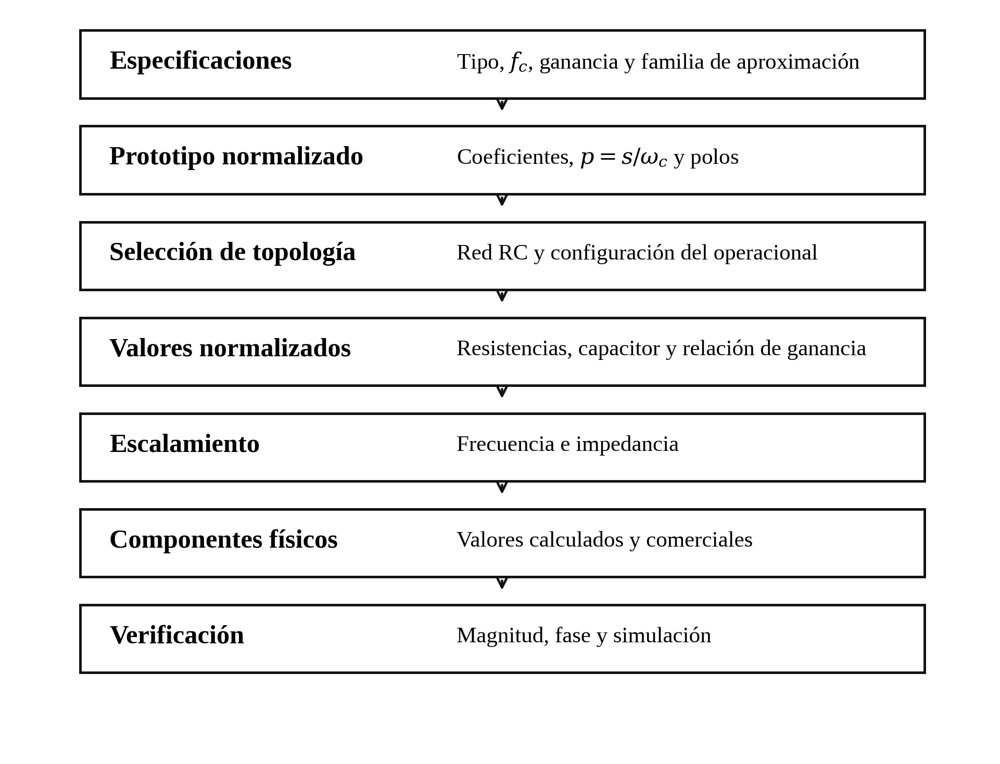{width="92%" fig-alt="Figura 1. Secuencia de diseño de un filtro analógico, desde las especificaciones hasta la comprobación de su respuesta."}

La Figura 1 presenta la secuencia que se seguirá. El procedimiento separa la **forma de la respuesta** ---fijada por el prototipo--- de su **ubicación en frecuencia** y de los valores físicos de los componentes.

### Función de transferencia objetivo

La función de transferencia de un filtro pasa-bajas de primer orden puede escribirse como

$$H(s) = K\frac{\omega_{c}}{s + \omega_{c}},$$

donde $s$ representa la variable compleja de Laplace, $K > 0$ es la ganancia de baja frecuencia y $\omega_{c}$ es la frecuencia angular de corte, dada por

$$\omega_{c} = 2\pi f_{c}.$$

Dividiendo entre $\omega_{c}$, se obtiene una forma equivalente:

$$\boxed{H(s) = \frac{K}{1 + s/\omega_{c}}}.$$

El polo del filtro se sitúa en

$$s_{p} = - \omega_{c}.$$

Este polo es real y negativo, de modo que el sistema ideal es estable. La respuesta está gobernada por una sola constante de tiempo, $\tau = 1/\omega_{c}$. El signo de la ganancia será positivo cuando el circuito se realice con un seguidor o un amplificador no inversor; una configuración inversora exigiría incorporar el signo negativo correspondiente.

## Prototipo normalizado de primer orden

### Normalización de la frecuencia

Trabajar directamente con valores expresados en hercios, ohmios y faradios dificulta la comparación entre diseños. En su lugar se introduce la variable adimensional

$$p = \frac{s}{\omega_{c}}.$$

Para la aproximación Butterworth de primer orden se toma la frecuencia angular normalizada $\omega_{cn} = 1\, rad/s$ y la función de transferencia de ganancia unitaria

$$\boxed{H_{n}(p) = \frac{1}{p + 1}}.$$

Esta expresión representa el **prototipo normalizado**. Cuando se desea una ganancia de banda de paso distinta de la unidad se multiplica por $K$:

$$H_{n}(p) = \frac{K}{p + 1}.$$

El polo se encuentra en $p = - 1$, como ilustra la Figura 2. El prototipo describe la forma relativa de la respuesta independientemente de cuál sea la frecuencia de corte física del filtro final.

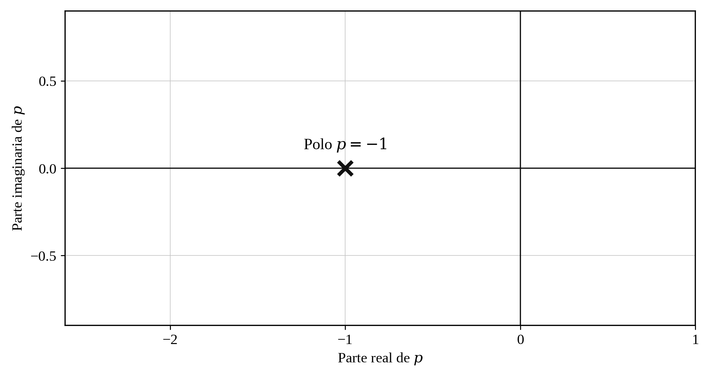{width="92%" fig-alt="Figura 2. Plano complejo de la variable normalizada: posición del polo del filtro Butterworth de primer orden."}

### Desnormalización de la función de transferencia

La sustitución $p = s/\omega_{c}$ devuelve el prototipo al dominio físico:

$$H(s) = \frac{K}{s/\omega_{c} + 1} = \frac{K\omega_{c}}{s + \omega_{c}}.$$

Esta transformación cambia la escala horizontal de la respuesta en frecuencia, sin alterar su forma. En particular, si dos filtros tienen la misma ganancia $K$ y son ambos de primer orden, sus diagramas de magnitud tienen idéntica geometría cuando se representan frente a $f/f_{c}$.

En una realización RC de ganancia positiva, la función de transferencia adopta la forma

$$H(s) = \frac{K}{1 + sRC}.$$

Al comparar denominadores,

$$RC = \frac{1}{\omega_{c}},$$

y, en consecuencia,

$$\boxed{f_{c} = \frac{1}{2\pi RC}}.$$

Esta relación muestra que existe una familia de parejas $(R,C)$ capaces de proporcionar la misma frecuencia de corte. El valor de una resistencia puede elegirse con criterios prácticos y, a partir de él, determinar el capacitor requerido.

## Escalamiento de frecuencia e impedancia

### Red normalizada

Un prototipo RC de primer orden puede representarse mediante componentes normalizados

$$R_{n} = 1\,\Omega,\quad\quad C_{n} = 1\, F.$$

Se trata de una elección matemática, no de una propuesta de construcción con un capacitor de un faradio. Para el prototipo,

$$\omega_{cn} = \frac{1}{R_{n}C_{n}} = 1\, rad/s.$$

El objetivo es transformar esta red en otra que utilice una frecuencia de corte y un nivel de impedancia convenientes.

### Factor de escalamiento de frecuencia

El factor de frecuencia $F_{F}$ se define como el cociente entre la frecuencia angular de corte deseada y la normalizada:

$$F_{F} = \frac{\omega_{c}}{\omega_{cn}}.$$

Como en nuestro prototipo $\omega_{cn} = 1\, rad/s$,

$$\boxed{F_{F} = \omega_{c} = 2\pi f_{c}}.$$

Numéricamente, un filtro de $1\, kHz$ necesita $F_{F} \simeq 6283.19$, mientras que uno de $500\, Hz$ requiere $F_{F} \simeq 3141.59$. Los factores se manejan en las fórmulas de escalamiento conforme a la normalización de referencia; los valores finales se expresan en unidades eléctricas.

### Factor de escalamiento de impedancia

El factor de impedancia, denotado aquí $Z_{s}$ y llamado también **FEZ**, permite elegir niveles de resistencias razonables. Al aplicarlo a una resistencia normalizada,

$$\boxed{R = Z_{s}R_{n}}.$$

La capacitancia se transforma de manera inversa tanto con la frecuencia como con la impedancia:

$$\boxed{C = \frac{C_{n}}{Z_{s}F_{F}} = \frac{C_{n}}{Z_{s}\, 2\pi f_{c}}}.$$

La Figura 3 muestra conceptualmente ambas transformaciones.

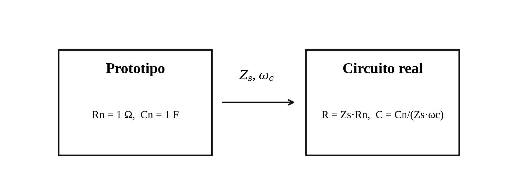{width="92%" fig-alt="Figura 3. Conversión del prototipo normalizado a un circuito físico mediante los factores de frecuencia e impedancia."}

Es importante comprobar que el producto de los componentes transformados responde al objetivo:

$$RC = \left( Z_{s}R_{n} \right)\left( \frac{C_{n}}{Z_{s}F_{F}} \right) = \frac{R_{n}C_{n}}{F_{F}} = \frac{1}{\omega_{c}}.$$

Por ello, el producto $RC$ fija la frecuencia de corte independientemente del factor de impedancia elegido. Sin embargo, **el escalamiento no elimina las limitaciones físicas**: resistencias demasiado grandes hacen más relevantes las corrientes de polarización y el ruido; resistencias excesivamente pequeñas pueden cargar la fuente o sobrecargar la salida del amplificador operacional.

## Realización con un amplificador operacional no inversor

### Estructura general

Para obtener una respuesta pasa-bajas de primer orden y ganancia positiva puede conectarse una red RC a la entrada no inversora de un amplificador operacional. La red RC determina la frecuencia de corte; la realimentación resistiva fija la ganancia de banda de paso.

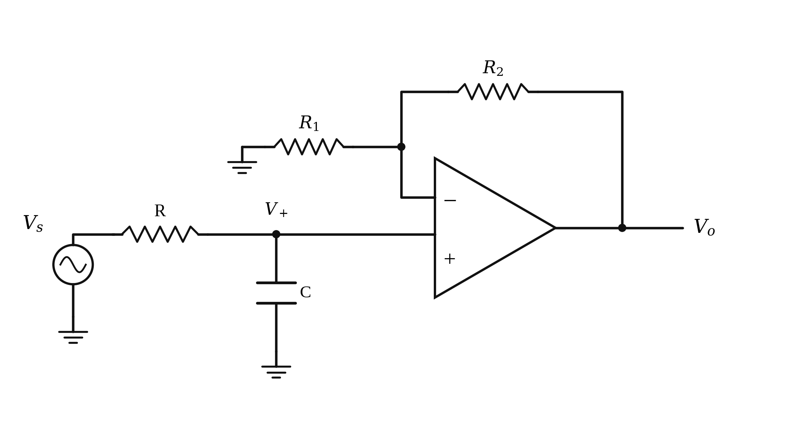{width="92%" fig-alt="Figura 4. Filtro pasa-bajas activo no inversor de primer orden: red RC a la entrada y realimentación resistiva."}

La tensión del nodo capacitivo, $V_{+}(s)$, se obtiene aplicando la LCK; si el operacional tiene una impedancia de entrada elevada,

$$\frac{V_{s}(s) - V_{+}(s)}{R} = sC\, V_{+}(s).$$

Agrupando términos,

$$V_{s}(s) = V_{+}(s)(1 + sRC),$$

de donde

$$\boxed{\frac{V_{+}(s)}{V_{s}(s)} = \frac{1}{1 + sRC}}.$$

Por otra parte, el amplificador no inversor ideal presenta la ganancia

$$\frac{V_{o}(s)}{V_{+}(s)} = 1 + \frac{R_{2}}{R_{1}} = K.$$

La función total es el producto de ambas relaciones:

$$\boxed{H(s) = \frac{V_{o}(s)}{V_{s}(s)} = \left( 1 + \frac{R_{2}}{R_{1}} \right)\frac{1}{1 + sRC}}.$$

Se obtienen así dos condiciones de diseño:

$$K = 1 + \frac{R_{2}}{R_{1}},\quad\quad\omega_{c} = \frac{1}{RC}.$$

Para ganancia unitaria basta sustituir la etapa no inversora por un **seguidor de voltaje**, conectando directamente la salida del operacional con su entrada inversora. Este recurso permite que la red RC conserve aproximadamente su respuesta frente a cargas conectadas a la salida.

### Independencia práctica y restricciones

En el modelo ideal, $R_{1}$ y $R_{2}$ controlan la ganancia y $R$ y $C$ controlan la frecuencia de corte. No obstante, para que la separación se mantenga en un circuito físico deben cumplirse ciertas condiciones: impedancia de entrada suficientemente alta, un producto ganancia-ancho de banda del amplificador adecuado, excursión de salida compatible con las fuentes de alimentación y márgenes para tolerancias de los componentes.

Cuando se elige un operacional real, también conviene comprobar el ruido, la corriente de polarización, el voltaje de offset, la estabilidad con la carga y la posibilidad de saturación. En las ecuaciones siguientes se mantiene el modelo ideal para centrarse en el procedimiento de diseño.

## Ejemplo 1. Filtro Butterworth pasa-bajas, ganancia cinco y corte a 1 kHz

### Especificaciones

Se desea diseñar un filtro activo pasa-bajas de primer orden con aproximación Butterworth, ganancia de banda de paso $K = 5$ y frecuencia de corte

$$f_{c} = 1000\, Hz.$$

Se seleccionará la topología no inversora de la Figura 4, cuya ganancia será positiva. Como factor de impedancia se adoptará $Z_{s} = 10^{4}$, equivalente a transformar una resistencia normalizada de $1\,\Omega$ en una resistencia física de $10\, k\Omega$.

### Prototipo normalizado

La función Butterworth normalizada de primer orden es

$$H_{n}(p) = \frac{1}{p + 1}.$$

Para la ganancia especificada,

$$H_{n}(p) = \frac{5}{p + 1}.$$

Al desnormalizar a $f_{c} = 1000\, Hz$,

$$\omega_{c} = 2\pi(1000) \simeq 6283.19\, rad/s,$$

$$\boxed{H(s) = \frac{5}{1 + s/6283.19}}$$

o, de forma equivalente,

$$H(s) = \frac{5(6283.19)}{s + 6283.19}.$$

### Valores normalizados de los componentes

Para la red RC se adoptan los valores normalizados $R_{n} = 1\,\Omega$ y $C_{n} = 1\, F$. El amplificador no inversor deberá satisfacer

$$K = 1 + \frac{R_{2n}}{R_{1n}} = 5.$$

Si se selecciona $R_{1n} = 1\,\Omega$,

$$R_{2n} = 4R_{1n} = 4\,\Omega.$$

Estos valores forman un prototipo matemático que conserva las proporciones entre las resistencias de realimentación.

### Valores físicos por escalamiento

El factor de frecuencia es

$$F_{F} = 2\pi f_{c} = 6283.19,$$

y el factor de impedancia escogido es $Z_{s} = 10^{4}$. Para la resistencia de la red RC,

$$R = Z_{s}R_{n} = \left( 10^{4} \right)(1\,\Omega) = 10\, k\Omega.$$

La capacitancia correspondiente será

$$C = \frac{C_{n}}{Z_{s}F_{F}} = \frac{1}{\left( 10^{4} \right)(6283.19)}\, F = 1.59155 \times 10^{- 8}\, F.$$

Por lo tanto,

$$\boxed{C \simeq 15.9\, nF}.$$

Las dos resistencias de la realimentación se obtienen con el mismo factor de impedancia:

$$R_{1} = (1)\left( 10^{4} \right) = 10\, k\Omega,$$

$$R_{2} = (4)\left( 10^{4} \right) = 40\, k\Omega.$$

Es fácil verificar que

$$1 + \frac{R_{2}}{R_{1}} = 1 + \frac{40}{10} = 5.$$

El circuito final se muestra en la Figura 5.

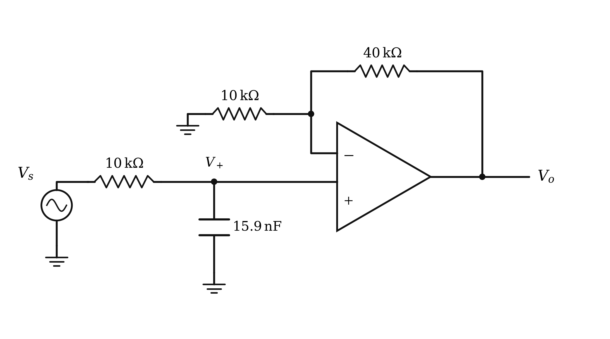{width="92%" fig-alt="Figura 5. Implementación del ejemplo 1: red RC de 10 kΩ y 15.9 nF con amplificador no inversor de ganancia cinco."}

### Comprobación de la frecuencia de corte

Al sustituir los componentes calculados,

$$f_{c} = \frac{1}{2\pi RC} = \frac{1}{2\pi\left( 10 \times 10^{3} \right)\left( 15.915 \times 10^{- 9} \right)} \simeq 1000\, Hz.$$

El valor de $15.9\, nF$ corresponde al capacitor redondeado para la presentación del circuito. Con ese valor,

$$f_{c} \simeq 1001\, Hz,$$

lo cual representa una desviación pequeña respecto al objetivo nominal. En una realización de laboratorio deben considerarse, además, las tolerancias reales de los componentes.

## Magnitud, fase y diagrama de Bode del primer ejemplo

### Obtención de la respuesta en frecuencia

La función de transferencia del filtro diseñado se expresa como

$$H(s) = \frac{5}{1 + s/\omega_{c}},\quad\quad\omega_{c} = 2\pi(1000).$$

Para una entrada sinusoidal se evalúa la función en $s = j\omega$:

$$H(j\omega) = \frac{5}{1 + j\omega/\omega_{c}}.$$

El módulo de esta expresión es

$$\boxed{\left| H(j\omega) \right| = \frac{5}{\sqrt{1 + \left( \omega/\omega_{c} \right)^{2}}}}$$

y su ángulo de fase,

$$\boxed{\phi(\omega) = - \tan^{- 1}\left( \frac{\omega}{\omega_{c}} \right)}.$$

Dado que $\omega/\omega_{c} = f/f_{c}$, también puede trabajarse directamente en hercios:

$$\left| H(f) \right| = \frac{5}{\sqrt{1 + \left( f/f_{c} \right)^{2}}},\quad\quad\phi(f) = - \tan^{- 1}\left( f/f_{c} \right).$$

Estas expresiones describen la amplitud relativa y el desfase de la salida de un filtro no inversor ideal.

### Comportamiento a bajas frecuencias

Para $f \ll f_{c}$, el término $\left( f/f_{c} \right)^{2}$ es muy pequeño, por lo que

$$\left| H(f) \right| \simeq 5,\quad\quad\phi(f) \simeq 0^{\circ}.$$

En decibeles,

$$G_{dB} = 20\log_{10}(5) \simeq 13.98\, dB.$$

Este es el nivel horizontal al que tiende la respuesta de magnitud en la banda de paso. Un valor superior a $0\, dB$ indica **amplificación**; no significa que el filtro deje de ser pasa-bajas.

### Comportamiento en la frecuencia de corte

Cuando $f = f_{c}$,

$$\left| H\left( f_{c} \right) \right| = \frac{5}{\sqrt{2}} \simeq 3.536.$$

La ganancia en decibeles es

$$G_{dB}\left( f_{c} \right) = 20\log_{10}\left( \frac{5}{\sqrt{2}} \right) \simeq 10.97\, dB.$$

Por tanto, la reducción respecto de la banda de paso es

$$10.97 - 13.98 \simeq - 3.01\, dB.$$

La fase en este punto es

$$\phi\left( f_{c} \right) = - \tan^{- 1}(1) = - 45^{\circ}.$$

Así, la frecuencia de corte se reconoce por dos resultados característicos del sistema de primer orden: disminución relativa de $3.01\, dB$ y desfase de $- 45^{\circ}$.

### Comportamiento por encima de la frecuencia de corte

Cuando $f \gg f_{c}$,

$$\left| H(f) \right| \simeq 5\frac{f_{c}}{f}.$$

Si la frecuencia aumenta diez veces, la magnitud disminuye aproximadamente diez veces. Por ello la pendiente asintótica es $- 20\, dB$ **por década**, o aproximadamente $- 6\, dB$ por octava, mientras que la fase tiende a $- 90^{\circ}$.

La Tabla 1 reúne valores obtenidos directamente de la función de transferencia ideal.

  ------------------------------------------------------------------------------------
  Frecuencia     $f/f_{c}$      Magnitud $|H|$   Ganancia (dB)   Fase
  -------------- -------------- ---------------- --------------- ---------------------
  $100\, Hz$     0.1            4.975            13.94           $- {5.71}^{\circ}$

  $500\, Hz$     0.5            4.472            13.01           $- {26.57}^{\circ}$

  $1\, kHz$      1              3.536            10.97           $- 45^{\circ}$

  $10\, kHz$     10             0.498            −6.06           $- {84.29}^{\circ}$

  $1\, MHz$      1000           0.005            −46.02          $- {89.94}^{\circ}$
  ------------------------------------------------------------------------------------

Los valores de muy alta frecuencia representan el **modelo ideal de primer orden**; un operacional real puede apartarse significativamente de ellos debido a su respuesta de lazo abierto, limitaciones de banda y otras parasitarias.

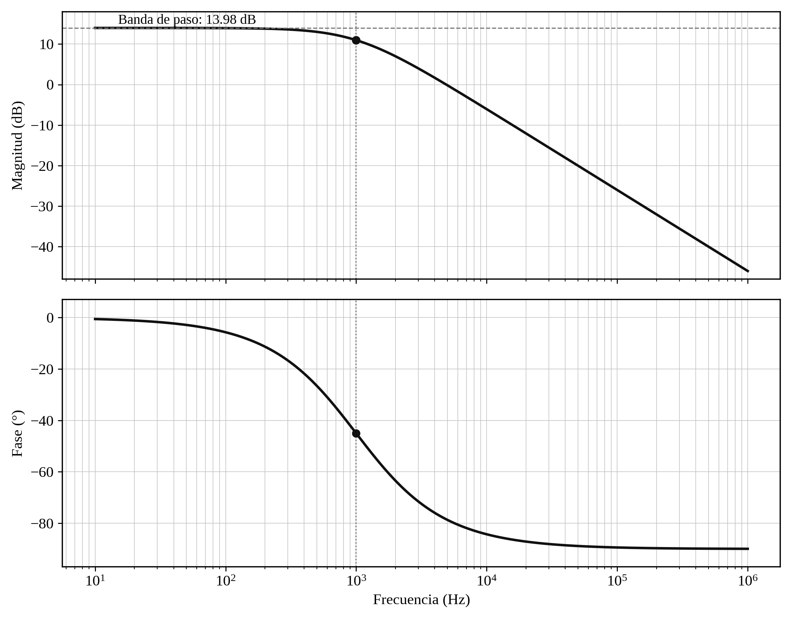{width="92%" fig-alt="Figura 6. Respuestas teóricas de magnitud y fase del filtro de ganancia cinco y frecuencia de corte de 1 kHz."}

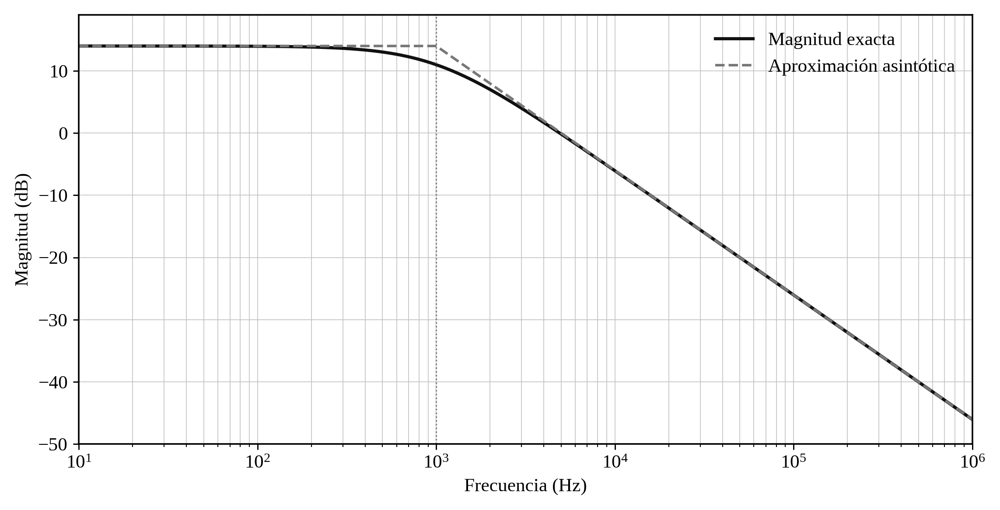{width="92%" fig-alt="Figura 7. Respuesta de magnitud exacta y aproximación asintótica: región plana y pendiente de −20 dB por década."}

## Ejemplo 2. Filtro Butterworth de ganancia unitaria y corte a 500 Hz

### Especificaciones y elección de circuito

Se desea un filtro pasa-bajas activo de primer orden, de tipo Butterworth, con ganancia de banda de paso $K = 1$ y frecuencia de corte

$$f_{c} = 500\, Hz.$$

Se elige un **seguidor de voltaje** a la salida de la red RC. Esta solución es adecuada porque no hace falta amplificar la señal en la banda de paso: el operacional sirve para aislar la red del efecto de una carga externa.

El prototipo normalizado sigue siendo

$$H_{n}(p) = \frac{1}{p + 1}.$$

La función de transferencia física debe ser

$$H(s) = \frac{1}{1 + s/\omega_{c}},\quad\quad\omega_{c} = 2\pi(500) \simeq 3141.59\, rad/s.$$

### Componentes normalizados y escalamiento

Se utilizan nuevamente $R_{n} = 1\,\Omega$ y $C_{n} = 1\, F$. Para este ejemplo se selecciona el factor de impedancia $Z_{s} = 10^{3}$. Por tanto,

$$R = Z_{s}R_{n} = \left( 10^{3} \right)(1\,\Omega) = 1\, k\Omega.$$

El factor de frecuencia es

$$F_{F} = 2\pi f_{c} = 3141.59.$$

La capacitancia no normalizada resulta

$$C = \frac{C_{n}}{Z_{s}F_{F}} = \frac{1}{\left( 10^{3} \right)(3141.59)}\, F = 3.18310 \times 10^{- 7}\, F.$$

Es decir,

$$\boxed{C \simeq 318.3\, nF}.$$

La Figura 8 ilustra el circuito de ganancia unitaria.

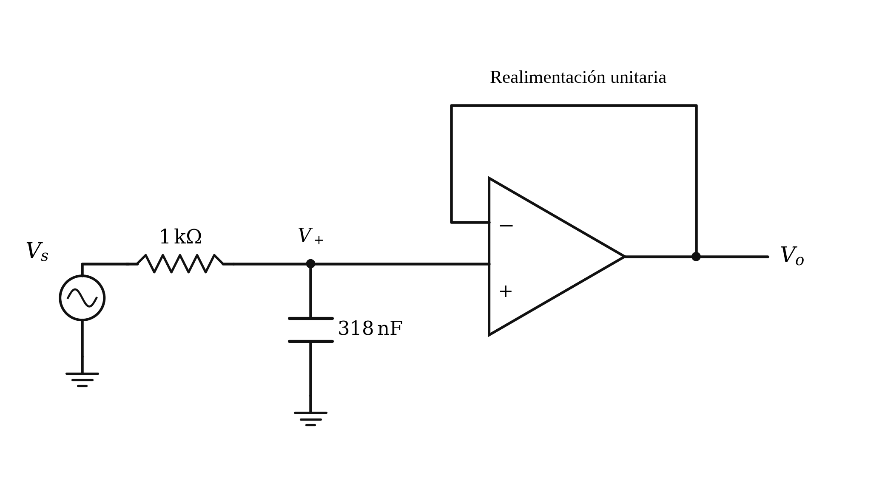{width="92%" fig-alt="Figura 8. Filtro activo pasa-bajas de primer orden con seguidor de voltaje: R = 1 kΩ y C = 318.3 nF."}

### Verificación de diseño

La frecuencia de corte calculada a partir de los valores físicos es

$$f_{c} = \frac{1}{2\pi(1000)\left( 318.31 \times 10^{- 9} \right)} \simeq 500\, Hz.$$

Como la ganancia del seguidor es uno, la función de transferencia queda

$$\boxed{H(s) = \frac{1}{1 + s/(2\pi \cdot 500)}}.$$

La magnitud y la fase se expresan como

$$\left| H(f) \right| = \frac{1}{\sqrt{1 + (f/500)^{2}}},$$

$$\phi(f) = - \tan^{- 1}(f/500).$$

En la banda de paso, $|H| \simeq 1$ y la ganancia vale aproximadamente $0\, dB$. En el corte,

$$\left| H(500) \right| = \frac{1}{\sqrt{2}} \simeq 0.7071,$$

$$G_{dB}(500) = 20\log_{10}(0.7071) \simeq - 3.01\, dB,$$

$$\phi(500) = - 45^{\circ}.$$

A frecuencias mayores que $f_{c}$ se recupera la pendiente característica de $- 20\, dB$ por década. En la Figura 9 se muestran las respuestas de magnitud y fase previstas.

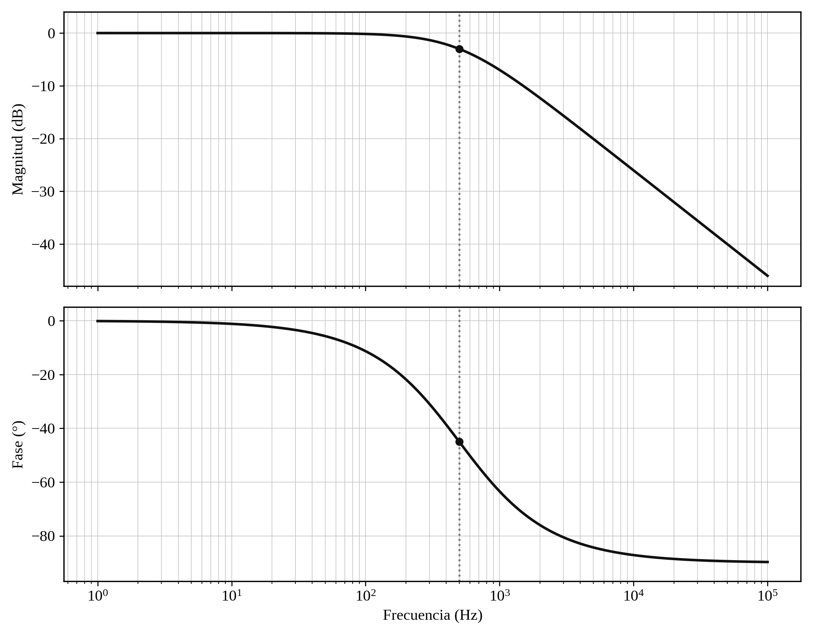{width="92%" fig-alt="Figura 9. Diagrama de Bode del filtro de ganancia unitaria y frecuencia de corte de 500 Hz."}

  ---------------------------------------------------------------------------
  Frecuencia        Magnitud $|H|$    Ganancia (dB)     Fase
  ----------------- ----------------- ----------------- ---------------------
  $50\, Hz$         0.9950            −0.04             $- {5.71}^{\circ}$

  $250\, Hz$        0.8944            −0.97             $- {26.57}^{\circ}$

  $500\, Hz$        0.7071            −3.01             $- 45^{\circ}$

  $5\, kHz$         0.09950           −20.04            $- {84.29}^{\circ}$

  $50\, kHz$        0.0100            −40.00            $- {89.43}^{\circ}$
  ---------------------------------------------------------------------------

## Interpretación de la respuesta normalizada

Una propiedad importante de ambos ejemplos es que la forma de la respuesta depende de la frecuencia **relativa** $f/f_{c}$, no de su frecuencia absoluta. Puede expresarse la magnitud en relación con la ganancia de banda de paso como

$$\frac{\left| H(f) \right|}{K} = \frac{1}{\sqrt{1 + \left( f/f_{c} \right)^{2}}}.$$

La ganancia relativa en decibeles es

$$\boxed{G_{rel,dB} = - 10\log_{10}\left\lbrack 1 + \left( f/f_{c} \right)^{2} \right\rbrack}.$$

Al utilizar $f/f_{c}$ en el eje horizontal, las curvas de los dos filtros se superponen. La diferencia entre ellos reside en la escala de frecuencia de corte y en el valor de la ganancia $K$. Esta interpretación explica la utilidad de construir primero un prototipo normalizado.

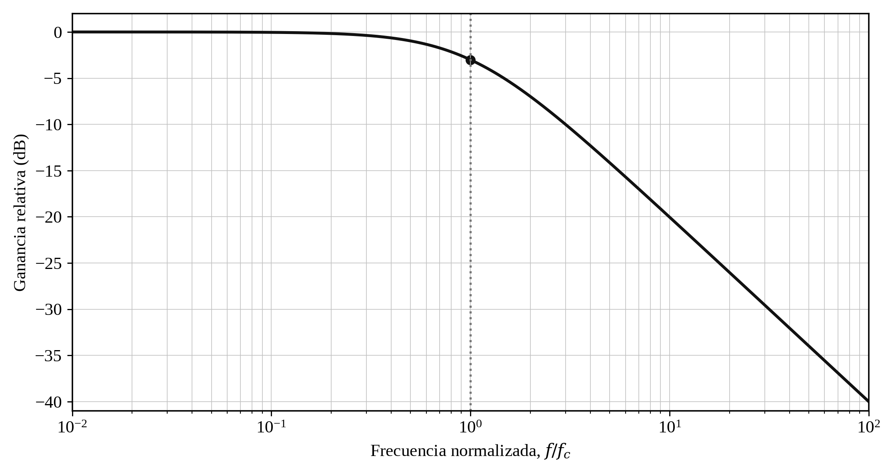{width="92%" fig-alt="Figura 10. Respuesta de magnitud relativa de un filtro de primer orden frente a la frecuencia normalizada."}

## Comprobación por simulación y elección de valores comerciales

### Ensayo de respuesta en frecuencia

El circuito diseñado debe contrastarse con un barrido de frecuencia suficientemente amplio, por ejemplo desde una o dos décadas por debajo de $f_{c}$ hasta varias décadas por encima. El procedimiento recomendado es:

1.  Construir la red RC y la etapa de amplificación de acuerdo con los valores obtenidos.
2.  Aplicar una excitación sinusoidal pequeña para evitar saturación y limitaciones de velocidad de respuesta.
3.  Medir la amplitud de entrada y salida; determinar $\left| V_{o}/V_{s} \right|$ y expresarla en decibeles.
4.  Obtener el desfase de salida respecto de entrada, manteniendo consistente el criterio de signos.
5.  Localizar la frecuencia a la que la ganancia disminuye $3.01\, dB$ **respecto de su valor de banda de paso**, no necesariamente respecto de $0\, dB$.
6.  Verificar el comportamiento asintótico y comparar la simulación con las expresiones teóricas.

En el ejemplo de ganancia cinco, el nivel de corte no es $- 3\, dB$ absoluto, sino aproximadamente $10.97\, dB$, porque la banda de paso se encuentra a $13.98\, dB$. En el ejemplo de ganancia unitaria, el corte se encuentra aproximadamente a $- 3.01\, dB$ absoluto.

### Valores comerciales y tolerancias

Los valores calculados pueden no existir como componentes de la serie comercial seleccionada. Por ejemplo, si se reemplaza el capacitor nominal de $15.915\, nF$ por uno de $15\, nF$, manteniendo $R = 10\, k\Omega$, la frecuencia de corte se desplaza a

$$f_{c} = \frac{1}{2\pi\left( 10 \times 10^{3} \right)\left( 15 \times 10^{- 9} \right)} \simeq 1061\, Hz.$$

La Figura 11 representa el efecto de esta sustitución sobre la respuesta teórica. Si se desea aproximar más la frecuencia objetivo, puede elegirse una combinación comercial diferente o utilizar arreglos serie/paralelo de componentes. El desplazamiento de la respuesta debe distinguirse de las desviaciones causadas por tolerancias, temperatura y comportamiento real del operacional.

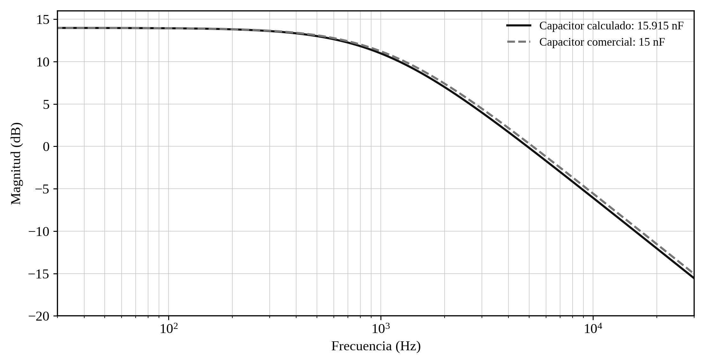{width="92%" fig-alt="Figura 11. Efecto teórico de sustituir el capacitor calculado por un valor comercial de 15 nF."}

### Límites de funcionamiento del amplificador operacional

La función ideal de primer orden es una aproximación válida en la medida en que el operacional actúa como amplificador de lazo cerrado. Para un filtro no inversor con ganancia $K$, debe seleccionarse un dispositivo cuyo **producto ganancia-ancho de banda** sea suficientemente mayor que la frecuencia de operación y que pueda entregar la amplitud de salida prevista sin saturarse. También deben considerarse las alimentaciones disponibles, la velocidad de cambio máxima de la salida y el rango de modo común de las entradas.

Estas restricciones no modifican el procedimiento de normalización, pero sí determinan si el circuito real reproduce el comportamiento matemático. La simulación con un modelo realista del amplificador y la posterior medición experimental completan la validación.

## Procedimiento resumido para el diseño

El diseño de un filtro pasa-bajas activo Butterworth de primer orden puede sintetizarse mediante las siguientes relaciones:

$$\text{Especificaciones:}\quad K,\ f_{c},\quad\omega_{c} = 2\pi f_{c},$$

$$H_{n}(p) = \frac{1}{p + 1},\quad\quad H(s) = \frac{K}{1 + s/\omega_{c}},$$

$$R = Z_{s}R_{n},\quad\quad C = \frac{C_{n}}{Z_{s}\omega_{c}},$$

$$K = 1 + \frac{R_{2}}{R_{1}}\ \text{(no inversor)},\quad\quad f_{c} = \frac{1}{2\pi RC}.$$

Después de seleccionar los componentes, la comprobación teórica debe utilizar

$$\left| H(f) \right| = \frac{K}{\sqrt{1 + \left( f/f_{c} \right)^{2}}},\quad\quad\phi(f) = - \tan^{- 1}\left( f/f_{c} \right).$$

Una organización rigurosa del cálculo evita confundir los valores del prototipo ---útiles solo como referencia--- con los valores físicos que se colocarán finalmente en el circuito.

### Tutor IA · Deducción de la red RC con seguidor {#tutor-l10-rc-seguidor-s15}

::: {.tutor-box}
::: {.tutor-texto}
Actúe como tutor socrático de Electrónica II y tráteme siempre de usted. Pregunte una cosa por turno. Guíeme a establecer la LCK en el nodo RC conectado a la entrada no inversora de un seguidor, despejar Vo/Vs, identificar el polo, y explicar la función de un buffer. Revise unidades y la hipótesis de entrada ideal; no me dé la expresión final antes de mi deducción.
:::
::: {.tutor-acciones}
[Abrir ChatGPT](https://chatgpt.com/){.course-button target="_blank" rel="noopener"}
:::
:::

### Tutor IA · Filtro no inversor {#tutor-l10-no-inversor-s15}

::: {.tutor-box}
::: {.tutor-texto}
Actúe como tutor de circuitos analógicos; utilice trato de usted y una pregunta a la vez. Pídame obtener primero el voltaje en el capacitor mediante el divisor de impedancias, luego la relación de realimentación resistiva del amplificador no inversor y finalmente la función de transferencia completa. Compruebe si distingo frecuencia de corte y ganancia de banda de paso. Espere mi respuesta en cada paso.
:::
::: {.tutor-acciones}
[Abrir ChatGPT](https://chatgpt.com/){.course-button target="_blank" rel="noopener"}
:::
:::

### Tutor IA · Filtro inversor {#tutor-l10-inversor-s15}

::: {.tutor-box}
::: {.tutor-texto}
Guíeme, tratándome de usted y con preguntas secuenciales, en el filtro inversor de primer orden con RF y C en paralelo. Pídame calcular la impedancia equivalente, aplicar LCK en la entrada inversora, justificar el signo y reconocer el polo. Después solicíteme calcular la magnitud y explicar correctamente la fase, sin regalarme de entrada la solución.
:::
::: {.tutor-acciones}
[Abrir ChatGPT](https://chatgpt.com/){.course-button target="_blank" rel="noopener"}
:::
:::

### Tutor IA · Prototipo y escalamiento {#tutor-l10-escalamiento-s15}

::: {.tutor-box}
::: {.tutor-texto}
Quiero diseñar un filtro pasa-bajas de primer orden mediante un prototipo Butterworth normalizado. Tráteme de usted y formule una pregunta por turno. Primero exíjame especificar K y fc; después solicite el prototipo, el escalamiento de frecuencia, el de impedancia y el cálculo de resistencias y capacitores. Revise las unidades y pida justificar cada valor comercial.
:::
::: {.tutor-acciones}
[Abrir ChatGPT](https://chatgpt.com/){.course-button target="_blank" rel="noopener"}
:::
:::

### Tutor IA · Verificación del diseño {#tutor-l10-simulacion-s15}

::: {.tutor-box}
::: {.tutor-texto}
Ayúdeme de manera socrática a verificar en Multisim un filtro activo pasa-bajas de primer orden. Tráteme de usted. Pida primero el circuito y valores, luego la frecuencia de corte teórica, después solicite puntos de magnitud/fase y una estimación de la pendiente. Revise mi evidencia sin inventar resultados simulados ni mediciones.
:::
::: {.tutor-acciones}
[Abrir ChatGPT](https://chatgpt.com/){.course-button target="_blank" rel="noopener"}
:::
:::
