# Lección 10 · Filtros activos pasa-bajas de segundo orden {.unnumbered}

Un filtro pasa-bajas de segundo orden incorpora dos polos y ofrece una atenuación asintótica de $-40\,\mathrm{dB/década}$ en la región de rechazo. La topología Sallen–Key permite ajustar la ganancia y el factor de calidad mediante resistencias y capacitores. El análisis se desarrolla a partir de las leyes de Kirchhoff y desemboca en procedimientos de diseño normalizado y ejemplos de implementación.

::: {#video-l10-segundo-orden .course-actions}
[Video de la Lección 10 · Parte 4](https://www.youtube.com/watch?v=UDm4hUV63yA){.course-button .course-button-primary target="_blank" rel="noopener"}
[Parte 5](https://www.youtube.com/watch?v=2uc9vLDUjxE){.course-button target="_blank" rel="noopener"}
[Agenda de la semana 15](semana-15.qmd){.course-button}
:::

**Actividad de video — Lección 10, segundo orden.** Revise las dos partes y prepare **apuntes manuscritos** que incluyan las deducciones de Sallen–Key, las relaciones de $f_0$, $Q$ y $K$, los procedimientos de síntesis y los ejemplos de diseño. **Entrega: clase 47 (segunda sesión de la semana 16)**, según las actividades programadas. Consulte [Recursos de la semana 16](../16/semana-16.qmd#recursos-semana-16) para la actividad final de diseño.

## Objetivos de aprendizaje

- Obtener la función de transferencia de Sallen–Key con seguidor y con ganancia no inversora.
- Relacionar los parámetros $f_0$, $Q$, $K$ y la frecuencia de corte de $-3$ dB.
- Elegir una variante de diseño según la ganancia requerida y los componentes disponibles.
- Dimensionar un filtro Butterworth y evaluar el efecto de las tolerancias y del ancho de banda del operacional.

## Fundamentos, análisis nodal y casos de diseño

## Modelo general de un filtro pasa-bajas de segundo orden

### Función de transferencia estándar

Una función de transferencia pasa-bajas de segundo orden puede expresarse como

$$\boxed{H(s) = K\frac{\omega_{0}^{2}}{s^{2} + \frac{\omega_{0}}{Q}s + \omega_{0}^{2}}},$$

donde $K$ es la ganancia de baja frecuencia, $\omega_{0}$ la frecuencia angular natural y $Q$ el **factor de calidad**. El factor $Q$ controla la amortiguación de los polos, mientras que $K$ establece la ganancia en la banda de paso.

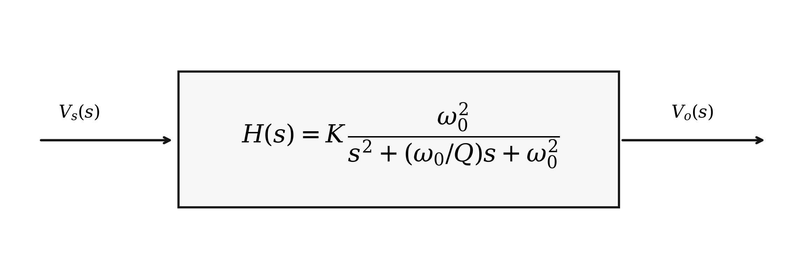{width="92%" fig-alt="Figura 1. Representación del filtro de segundo orden como un sistema caracterizado por K, \\omega_0 y Q."}

Dividiendo numerador y denominador entre $\omega_{0}^{2}$ se obtiene una forma adimensional:

$$H(s) = \frac{K}{\left( \frac{s}{\omega_{0}} \right)^{2} + \frac{1}{Q}\left( \frac{s}{\omega_{0}} \right) + 1}.$$

Otra representación común, especialmente útil para el diseño de filtros a partir de prototipos normalizados, es

$$\boxed{H_{n}(p) = K\frac{b}{p^{2} + ap + b}},$$

con $p$ como variable de Laplace normalizada. Al comparar los coeficientes de $p^{2} + ap + b$ con la forma estándar, se identifican las relaciones

$$\omega_{0n} = \sqrt{b},\quad\quad a = \frac{\omega_{0n}}{Q},\quad\quad Q = \frac{\sqrt{b}}{a}.$$

Cuando el prototipo utiliza $\omega_{0n} = 1\, rad/s$, se tiene $b = 1$ y, por tanto, $a = 1/Q$. Esta forma de trabajar permite diseñar primero una respuesta teórica y convertir después sus coeficientes en valores de resistencias y capacitores.

### Frecuencia natural, corte y calidad

La frecuencia natural se expresa en radianes por segundo y su equivalente en hercios es

$$\boxed{f_{0} = \frac{\omega_{0}}{2\pi}}.$$

Conviene distinguir $f_{0}$ de la frecuencia de corte de $- 3\, dB$, que se define con respecto a la ganancia de baja frecuencia $K$. En un filtro de segundo orden ambas frecuencias **coinciden para una respuesta Butterworth**, donde $Q = 1/\sqrt{2}$; para otros factores de calidad, la frecuencia de $- 3\, dB$ generalmente es diferente. En consecuencia, al diseñar una red Sallen--Key, no basta con especificar solamente $f_{0}$: también es necesario establecer $Q$.

El polinomio característico del denominador tiene las raíces

$$s_{1,2} = - \frac{\omega_{0}}{2Q} \pm \omega_{0}\sqrt{\frac{1}{4Q^{2}} - 1}.$$

Para $Q > 1/2$, los polos forman un par complejo conjugado y se acostumbra escribir

$$s_{1,2} = - \frac{\omega_{0}}{2Q} \pm j\omega_{0}\sqrt{1 - \frac{1}{4Q^{2}}}.$$

Los polos permanecen en el semiplano izquierdo si $\omega_{0} > 0$ y $Q > 0$. Un valor pequeño de $Q$ produce una respuesta más amortiguada; valores elevados generan una transición más acentuada e incluso un máximo de magnitud cerca de $\omega_{0}$.

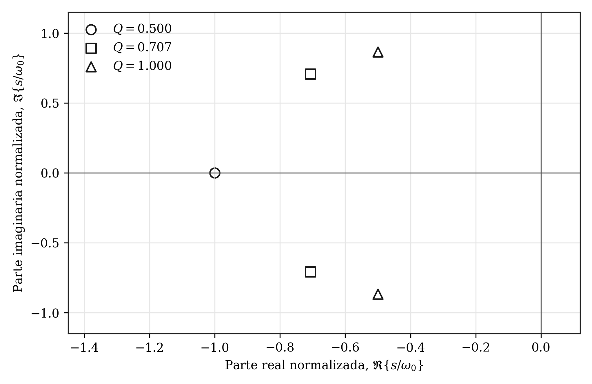{width="92%" fig-alt="Figura 2. Ubicación de los polos normalizados para distintos factores de calidad."}

### Respuesta en frecuencia

Para evaluar la respuesta sinusoidal se sustituye $s = j\omega$. Definiendo $x = \omega/\omega_{0}$,

$$H(j\omega) = \frac{K}{\left( 1 - x^{2} \right) + j\frac{x}{Q}}.$$

La magnitud resulta de calcular el módulo del denominador complejo:

$$\boxed{\left| H(j\omega) \right| = \frac{K}{\sqrt{\left( 1 - x^{2} \right)^{2} + \left( \frac{x}{Q} \right)^{2}}}}.$$

La ganancia en decibeles es

$$G_{dB}(\omega) = 20\log_{10}\left| H(j\omega) \right|,$$

y la fase, con el cuadrante correspondiente, se obtiene mediante

$$\boxed{\phi(\omega) = - atan2\left( \frac{x}{Q},\, 1 - x^{2} \right)}.$$

De estas ecuaciones se desprenden tres propiedades: para $\omega \ll \omega_{0}$ la magnitud se aproxima a $K$ y la fase a $0^{\circ}$; para $\omega = \omega_{0}$ la magnitud vale $KQ$ y la fase es $- 90^{\circ}$; finalmente, para $\omega \gg \omega_{0}$, la fase tiende a $- 180^{\circ}$ y la magnitud disminuye con pendiente asintótica de $- 40\, dB/década$.

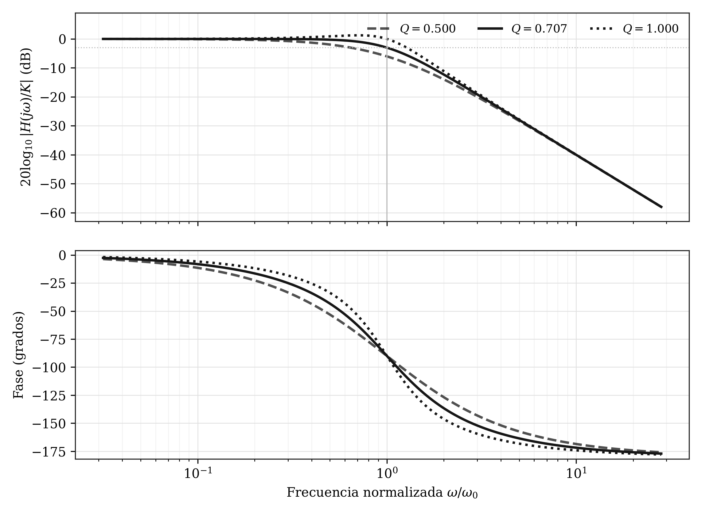{width="92%" fig-alt="Figura 3. Diagramas de magnitud y fase, con la ganancia de banda de paso normalizada, para diferentes valores de Q."}

La respuesta Butterworth de segundo orden utiliza

$$\boxed{Q = \frac{1}{\sqrt{2}} \simeq 0.7071}.$$

Así, en $\omega = \omega_{0}$ se verifica $\left| H\left( j\omega_{0} \right) \right| = K/\sqrt{2}$, equivalente a $- 3.0103\, dB$ respecto de la ganancia de banda de paso. Se trata de una respuesta de magnitud máximamente plana alrededor de la frecuencia cero.

## Filtro Sallen--Key con seguidor de voltaje

### Descripción del circuito

La primera configuración utiliza el amplificador operacional como **seguidor de voltaje**. Las resistencias $R_{1}$ y $R_{2}$ conectan en serie la fuente con la entrada no inversora. El capacitor $C_{2}$ se conecta entre dicha entrada y tierra; el capacitor $C_{1}$ conecta el nodo intermedio $V_{x}$ con la salida del amplificador.

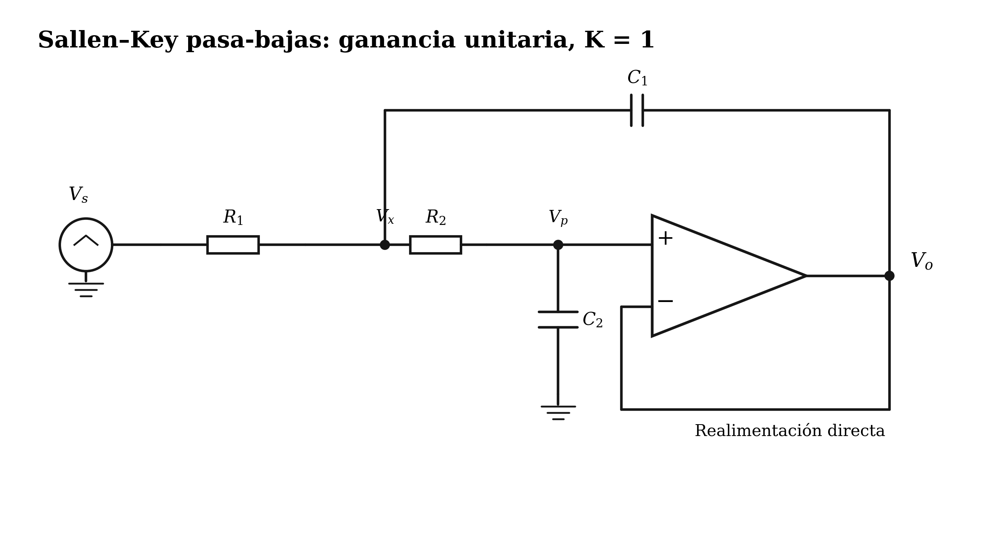{width="92%" fig-alt="Figura 4. Topología Sallen--Key de segundo orden con ganancia unitaria. Los dos capacitores forman parte de la red selectiva en frecuencia."}

En un amplificador operacional ideal se considera ganancia de lazo abierto infinita, corrientes de entrada nulas y operación bajo realimentación negativa. La condición de cortocircuito virtual conduce a

$$V_{n}(s) = V_{p}(s).$$

Como la salida se conecta directamente a la entrada inversora, se cumple

$$\boxed{V_{o}(s) = V_{p}(s)}.$$

Esta igualdad simplifica el análisis, aunque no implica que los capacitores dejen de afectar la respuesta. Precisamente el camino de realimentación mediante $C_{1}$ introduce una segunda dependencia con $s$.

### Identificación de nodos y corrientes

Se distinguen dos nodos de análisis: $V_{x}$, ubicado entre $R_{1}$ y $R_{2}$, y $V_{p}$, conectado a la entrada no inversora del operacional y a $C_{2}$. En el dominio de Laplace, la admitancia de un capacitor ideal es $sC$ y su impedancia vale $1/(sC)$.

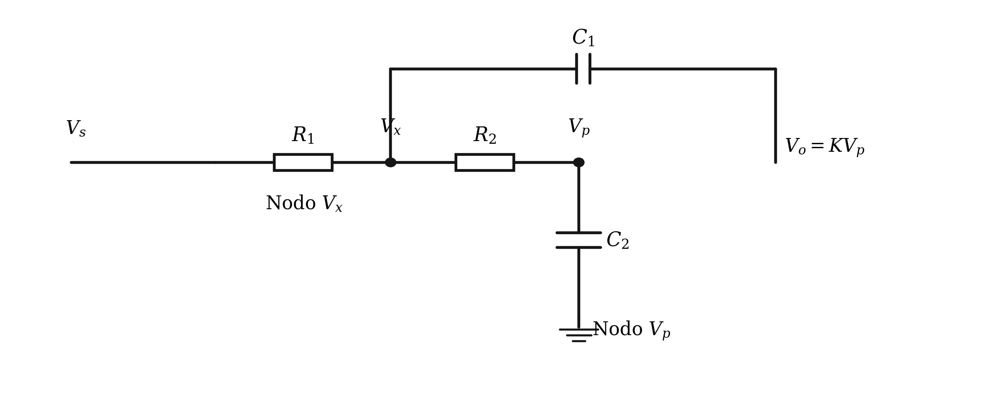{width="92%" fig-alt="Figura 5. Identificación de los dos nodos que se utilizan para aplicar la ley de corrientes de Kirchhoff."}

El orden del procedimiento será obtener primero $V_{x}$ en función de $V_{p}$ y después relacionar $V_{s}$ con esas dos variables. Finalmente se aplicará $V_{o} = V_{p}$.

### Primera ecuación: nodo $V_{p}$

En el nodo $V_{p}$, la corriente por $R_{2}$ es igual a la corriente por el capacitor $C_{2}$, debido a que la entrada no inversora del amplificador ideal no absorbe corriente:

$$\frac{V_{x}(s) - V_{p}(s)}{R_{2}} = sC_{2}V_{p}(s).$$

Multiplicando ambos miembros por $R_{2}$ y despejando $V_{x}(s)$,

$$V_{x}(s) - V_{p}(s) = sR_{2}C_{2}V_{p}(s),$$

$$\boxed{V_{x}(s) = V_{p}(s)\left( 1 + sR_{2}C_{2} \right)}.$$

La ecuación (1) es una expresión auxiliar importante. Muestra que $V_{x}$ y $V_{p}$ no son iguales para cualquier frecuencia: la corriente que circula por $C_{2}$ produce una caída de voltaje en $R_{2}$.

### Segunda ecuación: nodo $V_{x}$

Al aplicar LCK en $V_{x}$, la corriente que llega desde la fuente por $R_{1}$ se reparte entre $R_{2}$ y el capacitor $C_{1}$:

$$\frac{V_{s}(s) - V_{x}(s)}{R_{1}} = \frac{V_{x}(s) - V_{p}(s)}{R_{2}} + sC_{1}\left\lbrack V_{x}(s) - V_{o}(s) \right\rbrack.$$

El primer término del miembro derecho ya se conoce por la ecuación del nodo $V_{p}$:

$$\frac{V_{x} - V_{p}}{R_{2}} = sC_{2}V_{p}.$$

Además, para el seguidor $V_{o} = V_{p}$. Por tanto, la ecuación (2) se convierte en

$$\frac{V_{s} - V_{x}}{R_{1}} = sC_{2}V_{p} + sC_{1}\left( V_{x} - V_{p} \right).$$

Sustituyendo $V_{x} = V_{p}\left( 1 + sR_{2}C_{2} \right)$,

$$\frac{V_{s} - V_{p}\left( 1 + sR_{2}C_{2} \right)}{R_{1}} = sC_{2}V_{p} + sC_{1}\left\lbrack sR_{2}C_{2}V_{p} \right\rbrack.$$

Al multiplicar por $R_{1}$ y agrupar los términos:

$$V_{s} = V_{p}\left( 1 + sR_{2}C_{2} \right) + sR_{1}C_{2}V_{p} + s^{2}R_{1}R_{2}C_{1}C_{2}V_{p},$$

$$\boxed{V_{s}(s) = V_{p}(s)\left\lbrack 1 + sC_{2}\left( R_{1} + R_{2} \right) + s^{2}R_{1}R_{2}C_{1}C_{2} \right\rbrack}.$$

No se ha supuesto que los dos capacitores sean iguales. La función de transferencia se obtiene al utilizar $V_{o} = V_{p}$ en (3).

### Función de transferencia y forma normalizada

El cociente de salida a entrada es

$$\boxed{H(s) = \frac{V_{o}(s)}{V_{s}(s)} = \frac{1}{s^{2}R_{1}R_{2}C_{1}C_{2} + sC_{2}\left( R_{1} + R_{2} \right) + 1}}.$$

Dividiendo entre $R_{1}R_{2}C_{1}C_{2}$ se obtiene un denominador mónico:

$$H(s) = \frac{\frac{1}{R_{1}R_{2}C_{1}C_{2}}}{s^{2} + s\left( \frac{1}{C_{1}R_{1}} + \frac{1}{C_{1}R_{2}} \right) + \frac{1}{R_{1}R_{2}C_{1}C_{2}}}.$$

Esta expresión coincide con $H(s) = \omega_{0}^{2}/\left\lbrack s^{2} + \left( \omega_{0}/Q \right)s + \omega_{0}^{2} \right\rbrack$ y proporciona las siguientes relaciones de diseño:

$$\boxed{\omega_{0} = \frac{1}{\sqrt{R_{1}R_{2}C_{1}C_{2}}}},$$

$$\boxed{\frac{\omega_{0}}{Q} = \frac{1}{C_{1}R_{1}} + \frac{1}{C_{1}R_{2}}},$$

$$\boxed{Q = \frac{\sqrt{R_{1}R_{2}C_{1}C_{2}}}{C_{2}\left( R_{1} + R_{2} \right)}}.$$

En esta realización la ganancia de baja frecuencia es necesariamente $K = 1$. La elección de las resistencias y los capacitores controla $\omega_{0}$ y $Q$.

### Casos particulares con resistencias iguales

Una elección conveniente es $R_{1} = R_{2} = R$. Las ecuaciones anteriores se reducen a

$$\omega_{0} = \frac{1}{R\sqrt{C_{1}C_{2}}},\quad\quad Q = \frac{1}{2}\sqrt{\frac{C_{1}}{C_{2}}}.$$

Si también se eligen capacitores iguales, $C_{1} = C_{2} = C$, se obtiene $Q = 1/2$ y $\omega_{0} = 1/(RC)$. Esta elección no produce la respuesta Butterworth. En cambio, para alcanzar $Q = 1/\sqrt{2}$, se exige

$$\frac{1}{2}\sqrt{\frac{C_{1}}{C_{2}}} = \frac{1}{\sqrt{2}},$$

de donde

$$\boxed{C_{1} = 2C_{2}}.$$

En consecuencia, una red Sallen--Key de ganancia unitaria con resistencias iguales y capacitores en relación $2:1$ implementa la respuesta Butterworth ideal de segundo orden.

## Filtro Sallen--Key con amplificador no inversor

### Incorporación de ganancia de banda de paso

La segunda configuración conserva la red $R_{1}$--$R_{2}$--$C_{1}$--$C_{2}$, pero sustituye el seguidor por un amplificador no inversor. La ganancia se fija mediante la resistencia $R_{3}$, conectada a tierra, y la resistencia de realimentación $R_{F}$, conectada desde la salida hasta la entrada inversora.

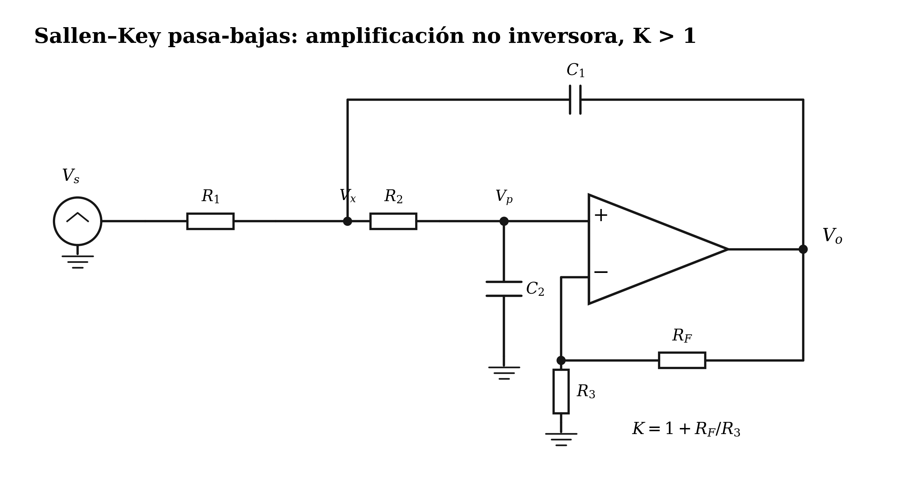{width="92%" fig-alt="Figura 6. Filtro Sallen--Key de segundo orden con amplificador no inversor. La red R_F--R_3 determina la ganancia K."}

En condiciones ideales, $V_{n} = V_{p}$ y la corriente de entrada inversora es nula. Aplicando LCK en $V_{n}$:

$$\frac{0 - V_{n}(s)}{R_{3}} = \frac{V_{n}(s) - V_{o}(s)}{R_{F}}.$$

Al ordenar los términos,

$$V_{o}(s) = V_{n}(s)\left( 1 + \frac{R_{F}}{R_{3}} \right).$$

Como $V_{n} = V_{p}$,

$$\boxed{V_{o}(s) = KV_{p}(s),\quad\quad K = 1 + \frac{R_{F}}{R_{3}}}.$$

En esta configuración el voltaje de salida ya no coincide necesariamente con el del nodo $V_{p}$. Esta diferencia modifica la corriente que circula por $C_{1}$, y con ello el coeficiente de amortiguamiento del filtro.

### Análisis en el nodo $V_{p}$

La relación obtenida anteriormente entre $V_{x}$ y $V_{p}$ no depende de cómo se conecte la realimentación del amplificador, dado que la corriente de entrada no inversora continúa siendo nula. Por ello,

$$\frac{V_{x} - V_{p}}{R_{2}} = sC_{2}V_{p},$$

$$\boxed{V_{x} = V_{p}\left( 1 + sR_{2}C_{2} \right)}.$$

### Análisis en el nodo $V_{x}$

La ley de corrientes de Kirchhoff toma la misma forma que en el caso anterior:

$$\frac{V_{s} - V_{x}}{R_{1}} = \frac{V_{x} - V_{p}}{R_{2}} + sC_{1}\left( V_{x} - V_{o} \right).$$

Sin embargo, ahora debe utilizarse $V_{o} = KV_{p}$. Sustituyendo esta expresión y la ecuación (8),

$$\frac{V_{s} - V_{p}\left( 1 + sR_{2}C_{2} \right)}{R_{1}} = sC_{2}V_{p} + sC_{1}\left\lbrack V_{p}\left( 1 + sR_{2}C_{2} \right) - KV_{p} \right\rbrack.$$

El término dentro del segundo corchete se simplifica:

$$V_{p}\left( 1 + sR_{2}C_{2} \right) - KV_{p} = V_{p}\left( 1 - K + sR_{2}C_{2} \right).$$

Por tanto,

$$V_{s} - V_{p}\left( 1 + sR_{2}C_{2} \right) = sR_{1}C_{2}V_{p} + sR_{1}C_{1}V_{p}\left( 1 - K + sR_{2}C_{2} \right).$$

Desarrollando los productos y agrupando por potencias de $s$,

$$\boxed{V_{s} = V_{p}\left\lbrack 1 + s\left( C_{2}\left( R_{1} + R_{2} \right) + C_{1}R_{1}(1 - K) \right) + s^{2}R_{1}R_{2}C_{1}C_{2} \right\rbrack}.$$

Puesto que $V_{o} = KV_{p}$, la función de transferencia se establece directamente a partir de (9).

### Función de transferencia y parámetros

El resultado general es

$$\boxed{H(s) = \frac{K}{s^{2}R_{1}R_{2}C_{1}C_{2} + s\left\lbrack C_{2}\left( R_{1} + R_{2} \right) + C_{1}R_{1}(1 - K) \right\rbrack + 1}}.$$

Al dividir el denominador por $R_{1}R_{2}C_{1}C_{2}$, se obtiene

$$H(s) = K\frac{\omega_{0}^{2}}{s^{2} + \frac{\omega_{0}}{Q}s + \omega_{0}^{2}},$$

con

$$\boxed{\omega_{0} = \frac{1}{\sqrt{R_{1}R_{2}C_{1}C_{2}}}},$$

$$\boxed{\frac{\omega_{0}}{Q} = \frac{1}{C_{1}R_{1}} + \frac{1}{C_{1}R_{2}} + \frac{1 - K}{C_{2}R_{2}}},$$

$$\boxed{Q = \frac{\sqrt{R_{1}R_{2}C_{1}C_{2}}}{C_{2}\left( R_{1} + R_{2} \right) + C_{1}R_{1}(1 - K)}}.$$

Las expresiones muestran dos propiedades relevantes. La frecuencia natural depende del producto $R_{1}R_{2}C_{1}C_{2}$ y es independiente de $K$ en el modelo ideal; por su parte, el factor de calidad sí depende de la ganancia no inversora. Por ello, modificar $R_{F}/R_{3}$ no equivale únicamente a cambiar la amplitud de salida: también puede alterar el amortiguamiento y la forma de la respuesta del filtro.

Para que el denominador describa un sistema estable con componentes pasivos positivos, el término de primer orden debe ser positivo:

$$\boxed{C_{2}\left( R_{1} + R_{2} \right) + C_{1}R_{1}(1 - K) > 0}.$$

Esta condición debe verificarse al seleccionar la ganancia de la etapa.

### Componentes iguales: relación entre $Q$ y $K$

Si $R_{1} = R_{2} = R$ y $C_{1} = C_{2} = C$, las ecuaciones (11) y (12) se simplifican a

$$\omega_{0} = \frac{1}{RC},\quad\quad\frac{\omega_{0}}{Q} = \frac{3 - K}{RC},$$

por lo que

$$\boxed{Q = \frac{1}{3 - K}},\quad\quad 1 \leq K < 3.$$

Por ejemplo, $K = 1$ produce $Q = 0.5$; $K = 2$ proporciona $Q = 1$ y, cuando $K$ se aproxima a $3$ desde abajo, $Q$ crece considerablemente. Un filtro con $Q$ elevado puede presentar un pico importante de magnitud, mayor sensibilidad a tolerancias y una respuesta transitoria oscilatoria. El valor $K = 3$ representa el límite de amortiguamiento nulo del modelo ideal y no debe emplearse como diseño estable.

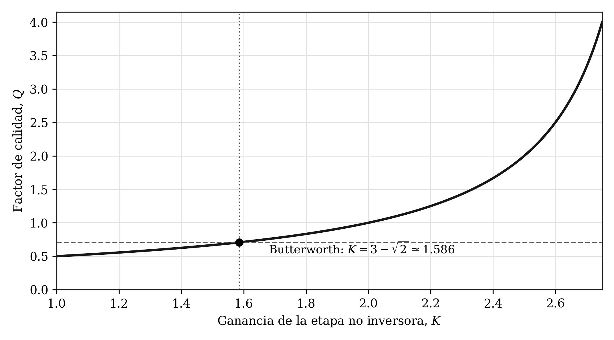{width="92%" fig-alt="Figura 7. Influencia de la ganancia K sobre el factor de calidad cuando se utilizan resistencias y capacitores iguales."}

Para alcanzar una respuesta Butterworth de segundo orden, se iguala (14) con $1/\sqrt{2}$:

$$\frac{1}{3 - K} = \frac{1}{\sqrt{2}},$$

$$\boxed{K = 3 - \sqrt{2} \simeq 1.5858}.$$

Este resultado permite implementar una respuesta Butterworth con **todos los componentes de la red RC iguales**, ajustando únicamente el cociente de resistencias de la etapa no inversora. Constituye una alternativa sencilla frente al caso de ganancia unitaria, en el que se requiere una relación específica entre los capacitores.

## Procedimientos de diseño con funciones normalizadas

### Relación con los coeficientes $a$ y $b$

En un diseño a partir del prototipo

$$H_{n}(p) = K\frac{b}{p^{2} + ap + b},$$

los coeficientes $a$ y $b$ describen la ubicación de los polos. Para un prototipo Butterworth de segundo orden con frecuencia natural normalizada igual a la unidad,

$$\boxed{a = \sqrt{2},\quad\quad b = 1}.$$

La topología Sallen--Key debe proporcionar los mismos coeficientes. Antes del escalamiento físico, las expresiones normalizadas para una ganancia general son

$$b = \frac{1}{R_{1n}R_{2n}C_{1n}C_{2n}},$$

$$a = \frac{1}{C_{1n}R_{1n}} + \frac{1}{C_{1n}R_{2n}} + \frac{1 - K}{C_{2n}R_{2n}}.$$

Las magnitudes $R_{in}$ y $C_{in}$ representan valores de un **prototipo matemático**, no componentes que necesariamente se instalarán en el circuito final.

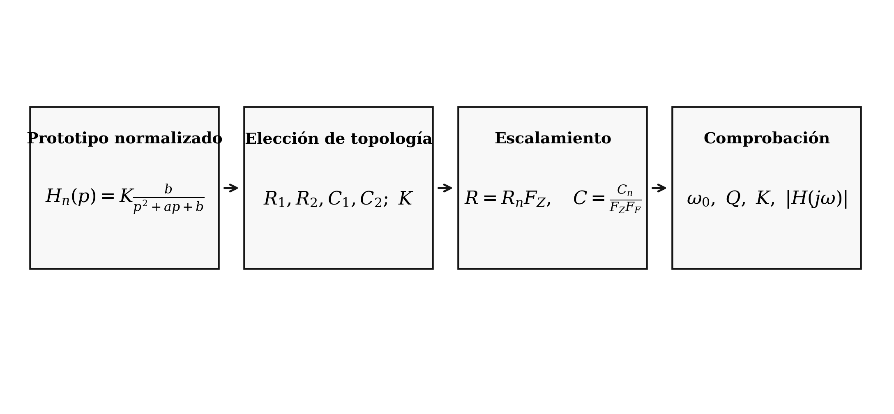{width="92%" fig-alt="Figura 8. Procedimiento de síntesis desde el prototipo normalizado hasta la comprobación del filtro físico."}

### Diseño I: ganancia unitaria y resistencias iguales

Para $K = 1$ y $R_{1n} = R_{2n} = 1\,\Omega$, las relaciones de coeficientes se simplifican a

$$a = \frac{2}{C_{1n}},\quad\quad b = \frac{1}{C_{1n}C_{2n}}.$$

Despejando los dos capacitores,

$$\boxed{C_{1n} = \frac{2}{a}},\quad\quad\boxed{C_{2n} = \frac{a}{2b}}.$$

Para Butterworth, $a = \sqrt{2}$ y $b = 1$, por lo que $C_{1n} = \sqrt{2}\, F$ y $C_{2n} = 1/\sqrt{2}\, F$. La relación $C_{1n} = 2C_{2n}$ confirma el resultado obtenido anteriormente a partir del factor de calidad.

### Diseño II: ganancia mayor que uno y capacitores distintos

Una segunda posibilidad establece $R_{1n} = R_{2n} = R_{3n} = 1\,\Omega$ y, por la ganancia no inversora, $R_{Fn} = K - 1\,\Omega$. Los coeficientes toman la forma

$$a = \frac{2}{C_{1n}} + \frac{1 - K}{C_{2n}},\quad\quad b = \frac{1}{C_{1n}C_{2n}}.$$

De la segunda relación se despeja $C_{1n} = 1/\left( bC_{2n} \right)$. Sustituyendo en la expresión de $a$,

$$a = 2bC_{2n} + \frac{1 - K}{C_{2n}}.$$

Multiplicando por $C_{2n}$ se obtiene una ecuación cuadrática:

$$2bC_{2n}^{2} - aC_{2n} + (1 - K) = 0.$$

La solución positiva, para $K > 1$, es

$$\boxed{C_{2n} = \frac{a + \sqrt{a^{2} + 8b(K - 1)}}{4b}},$$

$$\boxed{C_{1n} = \frac{1}{bC_{2n}}}.$$

Estas expresiones proporcionan una familia de soluciones con ganancia seleccionable, utilizando resistencias normalizadas iguales y dos capacitores de diferente valor.

### Diseño III: resistencias y capacitores iguales

Si se imponen $R_{1n} = R_{2n} = R_{3n} = 1\,\Omega$ y $C_{1n} = C_{2n} = 1\, F$, se obtiene $b = 1$ y

$$a = 3 - K.$$

Por consiguiente,

$$\boxed{K = 3 - a}.$$

Esta expresión es útil cuando se desea mantener una red RC con valores idénticos. En el caso Butterworth de segundo orden, con $a = \sqrt{2}$, conduce nuevamente a $K = 3 - \sqrt{2}$.

### Escalamiento al circuito físico

Una vez obtenido el prototipo, se elige una frecuencia natural de diseño $\omega_{0} = 2\pi f_{0}$ y un nivel conveniente de resistencias. Para un prototipo con $\omega_{0n} = 1\, rad/s$, el escalamiento puede escribirse como

$$\boxed{R_{i} = F_{Z}R_{in}},\quad\quad\boxed{C_{i} = \frac{C_{in}}{F_{Z}\omega_{0}}},$$

con $F_{Z}$ expresado en ohmios cuando los valores normalizados se interpretan respecto de $1\,\Omega$. En la práctica es frecuente elegir primero $R_{1}$ y $R_{2}$ para evitar resistencias demasiado pequeñas ---que aumentan el consumo--- o excesivamente grandes ---que agravan los efectos de corrientes de polarización y capacitancias parásitas---.

## Ejemplo de diseño I: Sallen--Key Butterworth con ganancia unitaria

Se requiere un filtro pasa-bajas Butterworth de segundo orden con ganancia de baja frecuencia igual a uno y frecuencia natural de $f_{0} = 1\, kHz$. Se selecciona la configuración con seguidor y se impone $R_{1} = R_{2} = 10\, k\Omega$.

Como $Q = 1/\sqrt{2}$, debe cumplirse $C_{1} = 2C_{2}$. A partir de la expresión de la frecuencia natural,

$$\omega_{0} = \frac{1}{R\sqrt{C_{1}C_{2}}} = \frac{1}{R\sqrt{2}C_{2}},$$

se despeja

$$C_{2} = \frac{1}{2\pi f_{0}R\sqrt{2}}.$$

Sustituyendo los valores,

$$C_{2} = \frac{1}{2\pi(1000)(10\, 000)\sqrt{2}} = 11.25\, nF,$$

$$\boxed{C_{1} = 22.51\, nF}.$$

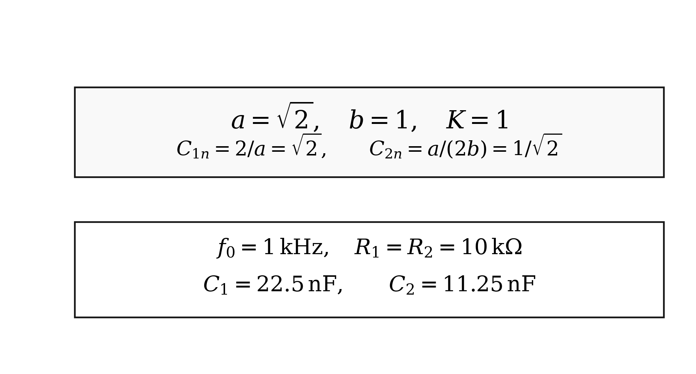{width="92%" fig-alt="Figura 9. Valores correspondientes al diseño Butterworth de segundo orden con resistencias iguales."}

Una opción de implementación consiste en utilizar $C_{1} = 22\, nF$ y $C_{2} = 11\, nF$ (este último puede formarse mediante dos capacitores idénticos de $22\, nF$ en serie). Recalculando los parámetros reales,

$$f_{0} = \frac{1}{2\pi R\sqrt{C_{1}C_{2}}} \simeq 1.023\, kHz,$$

$$Q = \frac{1}{2}\sqrt{\frac{22}{11}} \simeq 0.7071.$$

La relación entre los capacitores conserva el factor de calidad Butterworth, mientras que el valor absoluto desplaza ligeramente la frecuencia natural. En la verificación experimental, debe determinarse el efecto adicional de las tolerancias de los componentes.

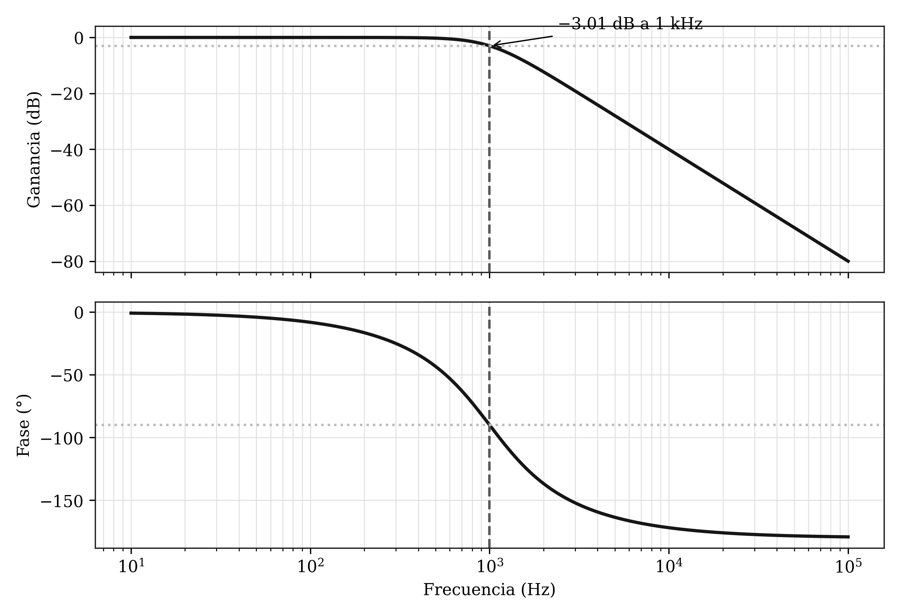{width="92%" fig-alt="Figura 10. Magnitud y fase ideales de un filtro Butterworth de segundo orden con f_0=1\\,\\mathrm{kHz}."}

En la figura se identifica una ganancia de $0\, dB$ a bajas frecuencias, una reducción aproximada de $3.01\, dB$ a $1\, kHz$ y un desfase de $- 90^{\circ}$ en la frecuencia natural.

## Ejemplo de diseño II: Butterworth con componentes RC iguales

Se desea nuevamente un filtro Butterworth de segundo orden con $f_{0} = 1\, kHz$, pero esta vez con **los cuatro componentes de la red selectiva iguales por pares**: $R_{1} = R_{2} = R$ y $C_{1} = C_{2} = C$. La configuración de ganancia unitaria no cumple este requisito con $Q = 1/\sqrt{2}$; por ello se emplea un amplificador no inversor.

Se selecciona $R = 10\, k\Omega$. La frecuencia natural exige

$$C = \frac{1}{2\pi f_{0}R} = 15.92\, nF.$$

La ganancia necesaria se obtiene de $K = 3 - \sqrt{2}$:

$$\boxed{K \simeq 1.5858}.$$

En el amplificador no inversor,

$$K = 1 + \frac{R_{F}}{R_{3}}.$$

Si se escoge $R_{3} = 10\, k\Omega$, el valor teórico de realimentación es

$$R_{F} = (K - 1)R_{3} = 5.858\, k\Omega.$$

Una realización práctica puede utilizar $R_{F} = 5.9\, k\Omega$ y $C_{1} = C_{2} = 15.9\, nF$. Los parámetros recalculados son

$$K = 1.59,\quad\quad f_{0} \simeq 1.001\, kHz,\quad\quad Q \simeq 0.709.$$

El pequeño cambio respecto del valor Butterworth se debe a la selección de componentes. El análisis debe hacerse con los valores realmente disponibles, no únicamente con los valores teóricos iniciales.

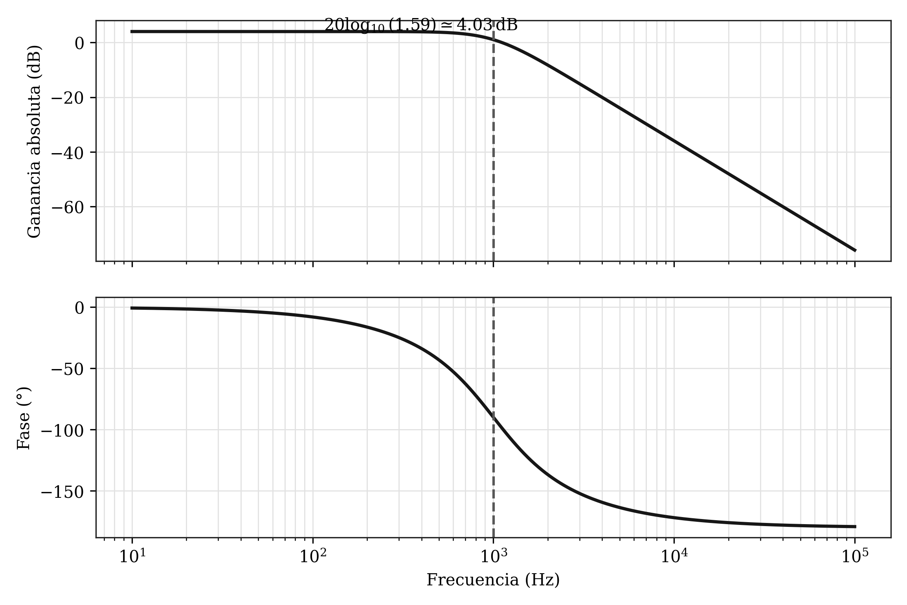{width="92%" fig-alt="Figura 11. Diagrama de Bode previsto para el filtro no inversor con ganancia cercana a 1.59 y frecuencia natural de 1\\,\\mathrm{kHz}."}

En esta configuración la banda de paso aparece alrededor de $20\log_{10}(1.59) \simeq 4.03\, dB$. La caída de $- 3\, dB$ debe medirse **respecto de esa ganancia**, no respecto de $0\, dB$.

## Ejemplo de diseño III: selección mediante un prototipo normalizado con $K = 2$

El método de la sección 4.3 permite fijar una ganancia de $K = 2$ y conservar $Q = 1/\sqrt{2}$ sin exigir capacitores iguales. Se parte del prototipo Butterworth $a = \sqrt{2}$, $b = 1$ y se eligen $R_{1n} = R_{2n} = R_{3n} = 1\,\Omega$.

El capacitor normalizado $C_{2n}$ vale

$$C_{2n} = \frac{\sqrt{2} + \sqrt{2 + 8(2 - 1)}}{4} \simeq 1.1441\, F,$$

y el otro capacitor resulta

$$C_{1n} = \frac{1}{C_{2n}} \simeq 0.8740\, F.$$

Se requiere $f_{0} = 1\, kHz$ y se selecciona un nivel de resistencias de $10\, k\Omega$. Con el escalamiento (19),

$$C_{1} = \frac{0.8740}{2\pi(1000)(10\, 000)} \simeq 13.91\, nF,$$

$$C_{2} = \frac{1.1441}{2\pi(1000)(10\, 000)} \simeq 18.21\, nF.$$

Como $K = 2$, puede elegirse $R_{3} = R_{F} = 10\, k\Omega$. La función de transferencia ideal conserva la forma Butterworth con ganancia de paso igual a dos. Si se seleccionan $C_{1} = 13.8\, nF$ y $C_{2} = 18\, nF$, se obtienen aproximadamente $f_{0} = 1.010\, kHz$ y $Q = 0.710$. Esta aproximación muestra que el **factor de calidad puede mantenerse próximo a su valor nominal aunque la ganancia sea mayor que uno**, mediante una adecuada relación entre los capacitores.

## Comportamiento transitorio y significado físico de $Q$

Las respuestas de segundo orden no se distinguen solamente en la región de rechazo. Su comportamiento ante cambios rápidos de entrada también depende del amortiguamiento. Para una entrada escalón de amplitud $V_{E}$, la salida de un filtro estable converge, en condiciones ideales, al valor final $KV_{E}$.

La relación entre el factor de calidad y la razón de amortiguamiento $\zeta$ es

$$\boxed{\zeta = \frac{1}{2Q}}.$$

Cuando $Q = 0.5$, se obtiene $\zeta = 1$ y el sistema es críticamente amortiguado. Para $Q = 1/\sqrt{2}$ se tiene $\zeta = 1/\sqrt{2}$ y aparecen polos complejos con un sobreimpulso moderado. Para $Q = 1$, la razón de amortiguamiento disminuye a $0.5$ y el sobreimpulso es más evidente.

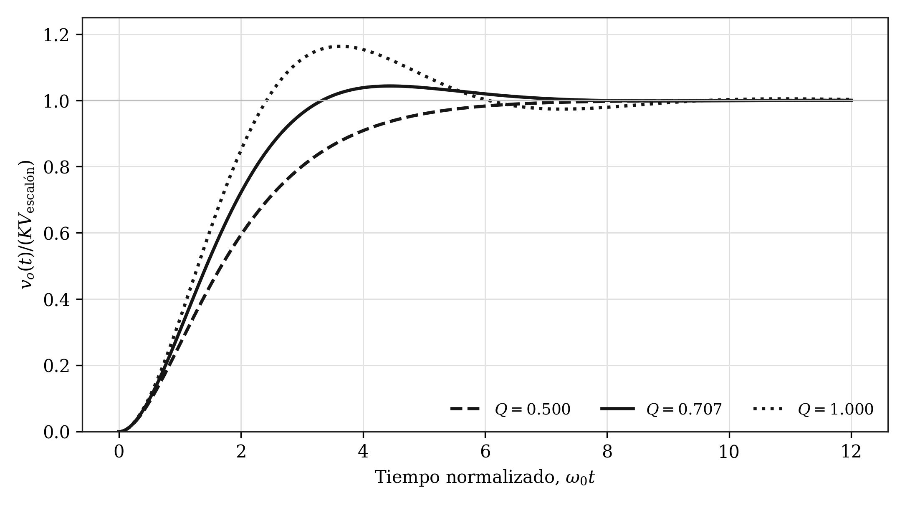{width="92%" fig-alt="Figura 12. Respuesta al escalón normalizada para diversos factores de calidad."}

La figura ilustra una consecuencia importante del diseño de filtros: aumentar el factor de calidad puede mejorar la selectividad cerca de la frecuencia natural, pero también puede introducir oscilaciones transitorias y sobreimpulso. Por ello, la elección de $Q$ debe considerar tanto la respuesta frecuencial como el comportamiento temporal requerido por la aplicación.

## Consideraciones para la implementación y la simulación

### Modelo ideal y ancho de banda del operacional

Las deducciones anteriores se apoyan en un amplificador operacional ideal. En un circuito real, la ganancia en lazo abierto disminuye al aumentar la frecuencia, la salida presenta límites de excursión y el ancho de banda de ganancia unitaria (*gain-bandwidth product*, GBW) es finito. Si la frecuencia característica del filtro se aproxima demasiado al ancho de banda del amplificador, cambian la ganancia efectiva, la posición de los polos y el factor de calidad.

Como criterio preliminar conviene seleccionar un dispositivo cuyo GBW sea claramente superior al producto entre la frecuencia de operación relevante y la ganancia de la etapa; sin embargo, la precisión requerida en $Q$ puede exigir un margen adicional. La verificación definitiva debe realizarse con el modelo concreto del operacional y con las condiciones de alimentación previstas.

### Sensibilidad a los componentes

De la expresión $\omega_{0} = \left( R_{1}R_{2}C_{1}C_{2} \right)^{- 1/2}$ se obtiene, por diferenciación logarítmica, una estimación de primer orden para pequeñas variaciones:

$$\frac{\Delta\omega_{0}}{\omega_{0}} \approx - \frac{1}{2}\left( \frac{\Delta R_{1}}{R_{1}} + \frac{\Delta R_{2}}{R_{2}} + \frac{\Delta C_{1}}{C_{1}} + \frac{\Delta C_{2}}{C_{2}} \right).$$

Esta ecuación explica por qué se recomienda comprobar el diseño con los valores nominales y con extremos de tolerancia. El factor $Q$, especialmente cuando se eleva mediante la ganancia del operacional, puede resultar todavía más sensible a pequeñas desviaciones. También deben considerarse las características térmicas y la dependencia de algunos capacitores con el voltaje aplicado.

### Comprobación por simulación

Un procedimiento de validación ordenado comprende la obtención de la ganancia a frecuencias muy por debajo de $f_{0}$, el análisis AC de magnitud y fase, la identificación de la frecuencia natural y, cuando corresponda, de la frecuencia de $- 3\, dB$; finalmente, se realiza un análisis transitorio con una señal escalón o cuadrada para observar el amortiguamiento de la respuesta.

Cuando se empleen modelos reales del amplificador deben comprobarse además los márgenes de alimentación, la saturación, la carga conectada y la compatibilidad del modo común de entrada. Una coincidencia favorable entre las ecuaciones ideales y el análisis AC no sustituye por completo la comprobación temporal ni la tolerancia de los componentes.

## Comparación de configuraciones

  ----------------------------------------------------------------------------------------------------------------------------------------
  Propiedad                                   Seguidor ($K = 1$)                    No inversor ($K > 1$)
  ------------------------------------------- ------------------------------------- ------------------------------------------------------
  Ganancia en banda de paso                   Unitaria                              $1 + R_{F}/R_{3}$

  Frecuencia natural                          $1/\sqrt{R_{1}R_{2}C_{1}C_{2}}$       La misma expresión

  Factor de calidad                           Determinado por la red RC             Determinado por la red RC y por $K$

  Componentes idénticos $R,C$                 $Q = 0.5$                             $Q = 1/(3 - K)$

  Condición Butterworth con $R_{1} = R_{2}$   $C_{1} = 2C_{2}$                      Con $C_{1} = C_{2}$: $K = 3 - \sqrt{2}$

  Ventaja característica                      Simplicidad, sin ganancia adicional   Ajuste de $Q$ mediante la ganancia

  Precaución principal                        Relación precisa de capacitores       Sensibilidad y estabilidad para valores altos de $K$
  ----------------------------------------------------------------------------------------------------------------------------------------

Las dos versiones comparten la misma estructura selectiva de frecuencia. En la primera, el diseñador fija el amortiguamiento modificando las relaciones entre componentes RC; en la segunda dispone, además, de la ganancia no inversora como parámetro de diseño. La elección depende de la respuesta requerida, la facilidad para obtener valores comerciales y las características reales del amplificador utilizado.

## Tres alternativas de diseño normalizado

La elección de una alternativa depende de cuáles parámetros son especificados y cuáles componentes pueden seleccionarse libremente. Para desarrollar el procedimiento, se toma como referencia el denominador normalizado

$$p^{2} + a_{n}p + b_{n}$$

junto con resistencias normalizadas de valor unitario. Una vez obtenidas las capacitancias y la ganancia normalizadas, los valores físicos se recuperan mediante escalamiento. El enfoque permite separar el problema de **determinar la forma de la respuesta** del problema de **seleccionar unidades y componentes comerciales**.

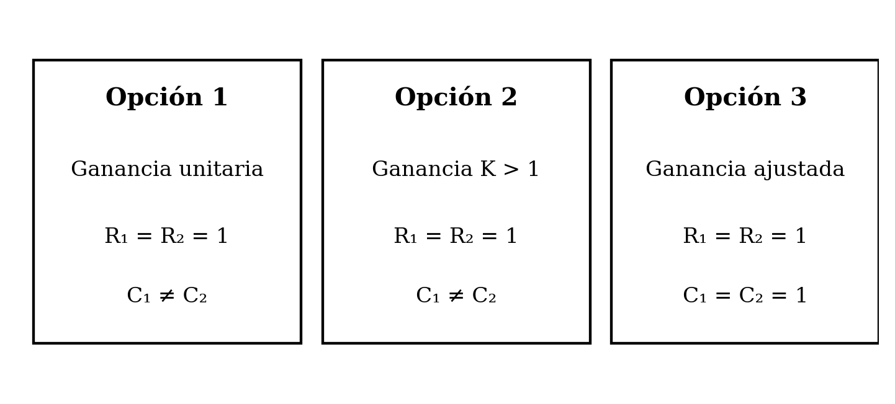{width="92%" fig-alt="Figura 4. Tres alternativas de normalización utilizadas para el diseño de filtros Sallen--Key."}

### Opción 1: ganancia unitaria y capacitores diferentes

Se adopta $K = 1$, $R_{1n} = R_{2n} = 1$ y se permite que $C_{1n}$ y $C_{2n}$ sean diferentes. Al sustituir estas condiciones en los coeficientes del denominador:

$$a_{n} = \frac{2}{C_{1n}},\quad\quad b_{n} = \frac{1}{C_{1n}C_{2n}}.$$

Se obtiene directamente

$$\boxed{C_{1n} = \frac{2}{a_{n}}},\quad\quad\boxed{C_{2n} = \frac{a_{n}}{2b_{n}}}.$$

Para Butterworth, $a_{n} = \sqrt{2}$ y $b_{n} = 1$, de modo que

$$C_{1n} = \sqrt{2} \approx 1.4142,\quad\quad C_{2n} = \frac{1}{\sqrt{2}} \approx 0.7071.$$

Esta opción es apropiada cuando se busca un filtro con ganancia de continua igual a uno, por ejemplo, para limitar el ancho de banda sin amplificar la señal.

### Opción 2: ganancia mayor que uno y capacitores diferentes

Se establece $K > 1$ y $R_{1n} = R_{2n} = 1$. La ganancia se fija con la red resistiva del operacional, mientras que las dos capacitancias se calculan para satisfacer los coeficientes del denominador:

$$a_{n} = \frac{2}{C_{1n}} + \frac{1 - K}{C_{2n}},\quad\quad b_{n} = \frac{1}{C_{1n}C_{2n}}.$$

De la segunda relación resulta

$$C_{1n} = \frac{1}{b_{n}C_{2n}}.$$

Al sustituirla en la primera:

$$a_{n} = 2b_{n}C_{2n} + \frac{1 - K}{C_{2n}}.$$

Multiplicando por $C_{2n}$ y ordenando:

$$2b_{n}C_{2n}^{2} - a_{n}C_{2n} + (1 - K) = 0.$$

La ecuación cuadrática tiene las raíces

$$C_{2n} = \frac{a_{n} \pm \sqrt{a_{n}^{2} + 8b_{n}(K - 1)}}{4b_{n}}.$$

Para $K > 1$, la raíz con signo negativo no conduce a una capacitancia positiva. Por lo tanto, se elige

$$\boxed{C_{2n} = \frac{a_{n} + \sqrt{a_{n}^{2} + 8b_{n}(K - 1)}}{4b_{n}}},$$

$$\boxed{C_{1n} = \frac{1}{b_{n}C_{2n}}},\quad\quad\boxed{R_{Fn} = K - 1}\quad\text{si }R_{3n} = 1.$$

Esta segunda alternativa es especialmente útil cuando se especifica una amplificación considerable, porque permite conservar la forma del filtro ajustando la relación entre capacitores. La solución matemática debe acompañarse de una revisión de estabilidad, ancho de banda y excursión de salida del operacional.

### Opción 3: componentes iguales y ganancia ajustada

Se imponen las condiciones $R_{1n} = R_{2n} = 1$ y $C_{1n} = C_{2n} = 1$. Los coeficientes se reducen a

$$a_{n} = 3 - K,\quad\quad b_{n} = 1.$$

La ganancia resulta

$$\boxed{K = 3 - a_{n}},\quad\quad\boxed{R_{Fn} = K - 1}\quad\text{si }R_{3n} = 1.$$

Para Butterworth,

$$K = 3 - \sqrt{2} \approx 1.5858.$$

La opción es sencilla porque utiliza resistencias y capacitores iguales, pero **no permite seleccionar arbitrariamente la ganancia y el factor de calidad al mismo tiempo**. En particular, fijar $K = 10$ no es compatible con estas igualdades: se obtendría $a_{n} = 3 - 10 < 0$, que corresponde a un sistema ideal inestable.

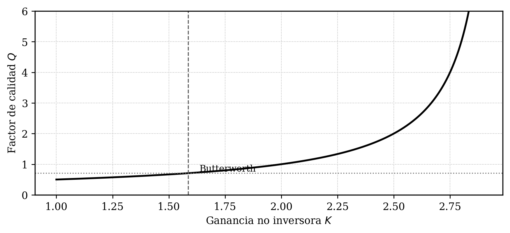{width="92%" fig-alt="Figura 5. Dependencia del factor de calidad respecto a la ganancia cuando las cuatro constantes del prototipo normalizado son iguales."}

## Procedimiento de diseño de un filtro de segundo orden

Conviene seguir una secuencia sistemática para pasar de las especificaciones a un circuito físicamente realizable.

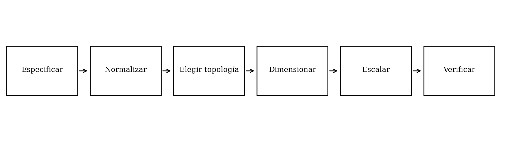{width="92%" fig-alt="Figura 6. Secuencia general para el diseño, escalamiento y comprobación de un filtro activo pasa-bajas."}

**Definición de especificaciones.** Se indica la frecuencia de corte deseada $f_{c}$, la ganancia de continua $K$ y la aproximación de respuesta (Butterworth, Bessel o Chebyshev). La aproximación determina los coeficientes del polinomio normalizado. Una ganancia elevada también exige determinar la amplitud máxima de entrada que no saturará el operacional.

**Selección del denominador normalizado.** Para Butterworth de orden dos, el polinomio de referencia es $p^{2} + \sqrt{2}p + 1$. En otros tipos de respuesta se utilizan sus correspondientes coeficientes normalizados y, cuando corresponda, otras definiciones de frecuencia de referencia.

**Elección de la alternativa.** Según la ganancia y la conveniencia de utilizar componentes iguales, se selecciona una de las opciones del apartado anterior. Después se calculan todos los valores normalizados.

**Escalamiento de frecuencia e impedancia.** El prototipo se transforma en un circuito físico mediante un factor de frecuencia $F_{\omega}$ y un factor de impedancia $F_{Z}$. Para un prototipo normalizado a $\omega_{n} = 1\, rad/s$:

$$\boxed{F_{\omega} = \omega_{c} = 2\pi f_{c}},\quad\quad\boxed{F_{Z} = R_{referencia}}.$$

Los valores físicos se obtienen con

$$\boxed{R = R_{n}F_{Z}},\quad\quad\boxed{C = \frac{C_{n}}{F_{Z}F_{\omega}}}.$$

Estas dos transformaciones conservan los productos $RC$ que determinan la frecuencia. El escalamiento de impedancias no altera la forma de la función de transferencia ideal: aumenta las resistencias y reduce proporcionalmente las capacitancias, o viceversa.

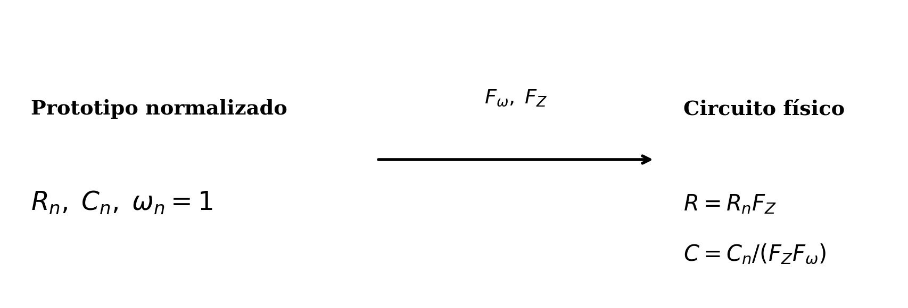{width="92%" fig-alt="Figura 7. Relación entre los valores normalizados y los valores físicos de resistencia y capacitancia."}

**Selección comercial y comprobación.** Se sustituyen los valores teóricos por componentes disponibles, se recalcula $\omega_{0}$ y $Q$ y finalmente se comprueba la respuesta en frecuencia y, si es pertinente, la respuesta transitoria. El redondeo debe evaluarse porque la magnitud y el amortiguamiento pueden modificarse incluso cuando la frecuencia natural varía poco.

## Ejemplo completo: filtro Butterworth con ganancia de diez

Se requiere diseñar un filtro activo pasa-bajas de segundo orden con las especificaciones siguientes:

  ------------------------------------------------------------------------
  Parámetro                           Valor requerido
  ----------------------------------- ------------------------------------
  Aproximación                        Butterworth, segundo orden

  Frecuencia de corte                 $f_{c} = 1\, kHz$

  Ganancia en banda de paso           $K = 10$ (equivalente a $20\, dB$)

  Topología                           Sallen--Key no inversora
  ------------------------------------------------------------------------

### Obtención del prototipo

El prototipo Butterworth tiene el denominador

$$p^{2} + 1.4142p + 1.$$

Por consiguiente,

$$a_{n} = 1.4142,\quad\quad b_{n} = 1,\quad\quad K = 10.$$

La ganancia especificada es mayor que uno y no puede conseguirse con la opción de componentes completamente iguales. Se emplea la **opción 2**: $R_{1n} = R_{2n} = R_{3n} = 1$, $C_{1n} \neq C_{2n}$.

### Cálculo de capacitores normalizados

Con $K = 10$, la capacitancia normalizada de la rama a tierra resulta

$$C_{2n} = \frac{1.4142 + \sqrt{(1.4142)^{2} + 8(1)(10 - 1)}}{4(1)}.$$

Como $(1.4142)^{2} \simeq 2$, se obtiene

$$\boxed{C_{2n} \approx 2.5041}.$$

La otra capacitancia se calcula mediante

$$C_{1n} = \frac{1}{(1)(2.5041)},\quad\quad\boxed{C_{1n} \approx 0.39934}.$$

Con $R_{3n} = 1$, el resistor de realimentación es

$$R_{Fn} = K - 1 = 9.$$

Sustituyendo las capacitancias normalizadas en los coeficientes se verifica que $b_{n} \approx 1$ y $a_{n} \approx \sqrt{2}$, por lo que se conserva la respuesta Butterworth deseada.

### Escalamiento de frecuencia

La frecuencia especificada de $1\, kHz$ equivale a

$$F_{\omega} = 2\pi(1000) \approx 6283.19\, rad/s.$$

Se elige además un factor de impedancia $F_{Z} = 10^{4}\,\Omega$. Esta elección lleva las resistencias normalizadas unitarias al intervalo de los kiloohmios, habitual en filtros activos de propósito general.

### Valores físicos de los resistores

Para las tres resistencias normalizadas unitarias:

$$R_{1} = R_{2} = R_{3} = (1)\left( 10^{4} \right) = 10\, k\Omega.$$

Para la resistencia de realimentación:

$$R_{F} = (9)\left( 10^{4} \right) = 90\, k\Omega.$$

Comprobación de ganancia:

$$K = 1 + \frac{90\, k\Omega}{10\, k\Omega} = 10.$$

### Valores físicos de los capacitores

La transformación de capacitancia proporciona

$$C_{1} = \frac{0.39934}{\left( 10^{4} \right)(6283.19)} \approx 6.36 \times 10^{- 9}\, F,$$

$$\boxed{C_{1} \approx 6.36\, nF},$$

$$C_{2} = \frac{2.5041}{\left( 10^{4} \right)(6283.19)} \approx 39.85 \times 10^{- 9}\, F,$$

$$\boxed{C_{2} \approx 39.85\, nF}.$$

La figura siguiente reúne la implementación teórica. Las etiquetas corresponden a los valores calculados antes de redondearlos a una serie comercial.

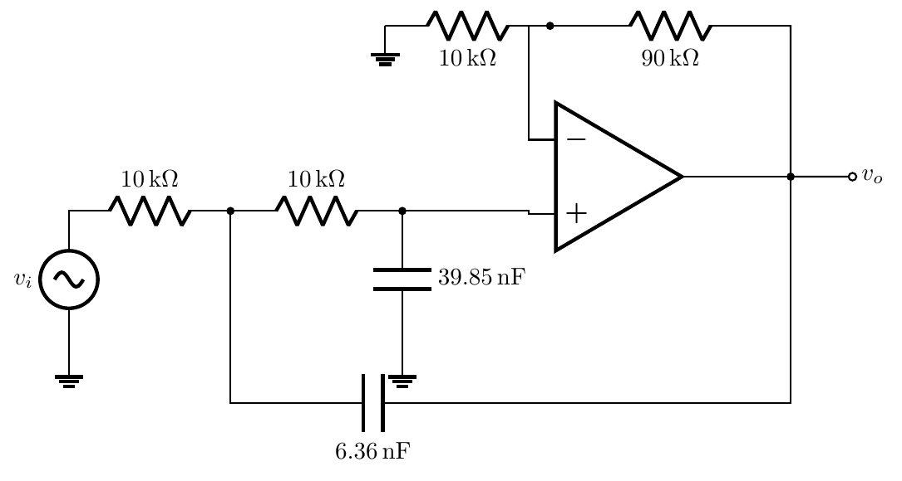{width="92%" fig-alt="Figura 8. Circuito Sallen--Key diseñado para una ganancia de 10 y corte Butterworth a 1 kHz; valores teóricos de componentes."}

### Verificación analítica

La frecuencia natural obtenida mediante los componentes debe ser cercana a la solicitada:

$$f_{0} = \frac{1}{2\pi\sqrt{R_{1}R_{2}C_{1}C_{2}}} \approx 1000\, Hz.$$

De igual manera, la relación entre el término lineal y la frecuencia natural debe dar

$$Q = \frac{\omega_{0}}{a} \approx \frac{1}{\sqrt{2}} \approx 0.7071.$$

El resultado coincide con el factor de calidad de Butterworth de segundo orden. Estas dos verificaciones son independientes: comprobar solamente $f_{0}$ no demuestra que la respuesta tenga el amortiguamiento correcto.

## Respuesta en frecuencia del filtro diseñado

Para una función de transferencia de segundo orden, se sustituye $s = j\omega$. Definiendo la razón adimensional $r = \omega/\omega_{0}$, se obtiene

$$H(j\omega) = \frac{K}{1 - r^{2} + j\frac{r}{Q}}.$$

Por lo tanto, la magnitud queda expresada por

$$\boxed{\left| H(j\omega) \right| = \frac{K}{\sqrt{\left( 1 - r^{2} \right)^{2} + (r/Q)^{2}}}}.$$

El ángulo de fase ---considerando el cuadrante correcto--- es

$$\boxed{\phi(\omega) = - atan2\left( \frac{r}{Q},\, 1 - r^{2} \right)}.$$

Para $Q = 1/\sqrt{2}$, la magnitud toma una forma particularmente sencilla:

$$\left| H(j\omega) \right| = \frac{K}{\sqrt{1 + r^{4}}}.$$

### Región de bajas frecuencias

Cuando $r \ll 1$, los términos que contienen $r$ tienden a cero, de manera que

$$H(j\omega) \approx K.$$

La ganancia expresada en decibeles es

$$G_{dB} \approx 20\log_{10}(K).$$

Para $K = 10$, la banda de paso presenta una ganancia nominal de $20\, dB$ y un desplazamiento de fase cercano a cero. Esto significa que las componentes de baja frecuencia se amplifican aproximadamente diez veces en amplitud.

### Frecuencia de corte

En $\omega = \omega_{0}$, se tiene $r = 1$ y

$$\left| H\left( j\omega_{0} \right) \right| = KQ = \frac{K}{\sqrt{2}}.$$

En consecuencia,

$$G_{dB}\left( \omega_{0} \right) = 20\log_{10}(K) - 3.0103\, dB.$$

En el ejemplo se obtiene una ganancia de aproximadamente $16.99\, dB$ respecto a la entrada. El valor de $- 3\, dB$ describe la disminución **respecto a la ganancia de la banda de paso** y no significa que la ganancia absoluta de salida sea negativa.

La fase en esta frecuencia es

$$\phi\left( \omega_{0} \right) = - 90^{\circ}.$$

### Región de altas frecuencias

Cuando $r \gg 1$, domina el término cuadrático y la magnitud se aproxima a

$$\left| H(j\omega) \right| \approx K\left( \frac{\omega_{0}}{\omega} \right)^{2}.$$

En decibeles,

$$G_{dB} \approx 20\log_{10}(K) - 40\log_{10}\left( \frac{\omega}{\omega_{0}} \right).$$

La pendiente asintótica de atenuación es $- 40\, dB$ por década, o aproximadamente $- 12\, dB$ por octava. Al aumentar la frecuencia, la fase se aproxima a $- 180^{\circ}$.

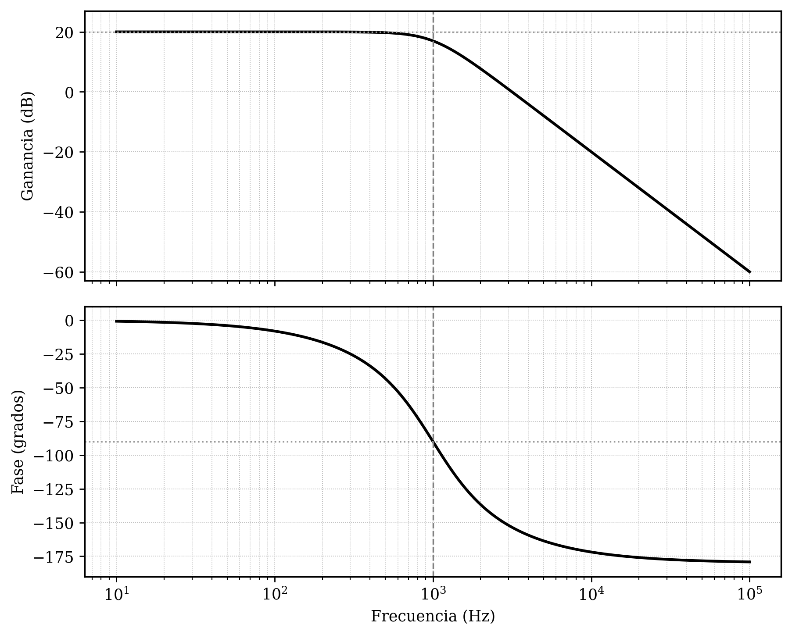{width="92%" fig-alt="Figura 9. Magnitud y fase de la función de transferencia Butterworth diseñada, con ganancia de 10 y frecuencia natural de 1 kHz."}

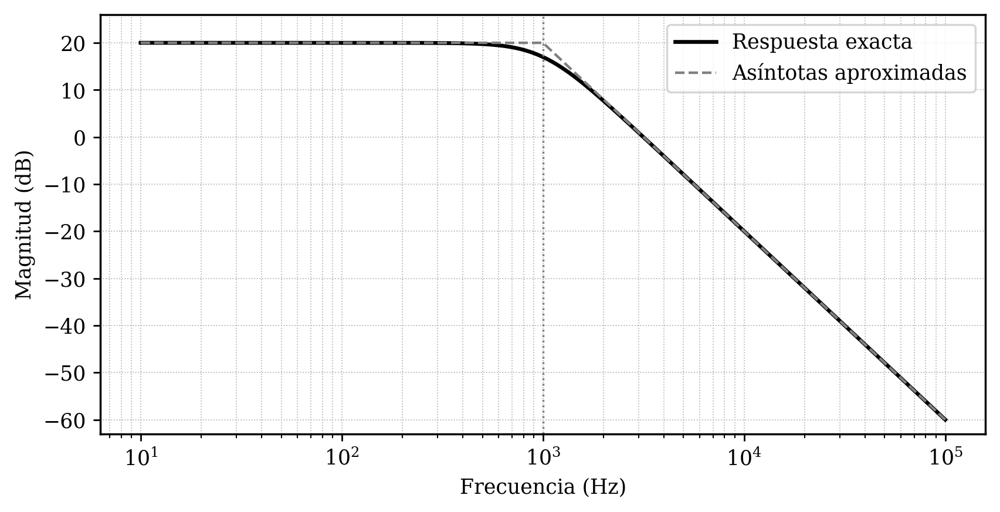{width="92%" fig-alt="Figura 10. Comparación de la curva exacta y las asíntotas de Bode del filtro de segundo orden."}

La interpretación conjunta de estas curvas permite identificar el comportamiento del filtro sin efectuar una simulación temporal para cada frecuencia. Debe recordarse, no obstante, que las gráficas corresponden al **modelo ideal lineal**; un amplificador real puede presentar errores adicionales a frecuencias altas por su ancho de banda finito.

## Selección de componentes comerciales

Los valores teóricos rara vez coinciden exactamente con los de una serie comercial. Una implementación posible consiste en conservar $R_{1} = R_{2} = R_{3} = 10\, k\Omega$ y $R_{F} = 90\, k\Omega$, y aproximar los capacitores a $C_{1} = 6.2\, nF$ y $C_{2} = 39\, nF$. Estos valores son una alternativa de implementación, no una medición realizada.

Al recalcular los parámetros con los valores elegidos se obtiene aproximadamente

$$f_{0} \approx 1.024\, kHz,\quad\quad Q \approx 0.700.$$

La frecuencia natural queda desplazada cerca de $2.4\%$ respecto al diseño nominal, mientras que el factor de calidad permanece cercano al Butterworth ideal. La proximidad de ambos resultados no debe extrapolarse a cualquier sustitución de componentes: cambios asimétricos en $C_{1}$ y $C_{2}$ pueden alterar considerablemente el término de amortiguamiento.

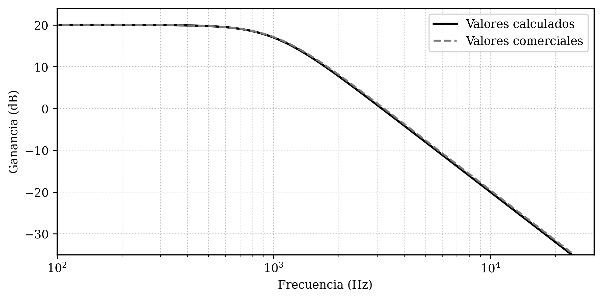{width="92%" fig-alt="Figura 11. Respuesta ideal calculada y respuesta obtenida al redondear los dos capacitores a valores comerciales."}

En un montaje real conviene considerar tolerancias de capacitores, dispersión de resistencias, impedancias de las fuentes, ruido y características dinámicas del amplificador operacional. Una verificación rigurosa consiste en calcular la respuesta con valores mínimos, nominales y máximos de los componentes, y después confirmar mediante medición la frecuencia de corte y la ganancia.

## Ganancia, factor de calidad y comportamiento temporal

La elección de $Q$ también se aprecia cuando se observa la respuesta a una señal escalón. El filtro Butterworth de segundo orden presenta un compromiso entre rapidez y sobreimpulso, mientras que valores superiores de $Q$ pueden aumentar la resonancia y producir una respuesta más oscilatoria.

En un prototipo de segundo orden, el factor de amortiguamiento $\zeta$ se relaciona con $Q$ mediante

$$\boxed{\zeta = \frac{1}{2Q}}.$$

Para Butterworth, $Q = 1/\sqrt{2}$ y $\zeta = 1/\sqrt{2}$. Si el sistema se analiza dentro del modelo lineal subamortiguado, el sobreimpulso porcentual del escalón ideal viene dado por

$$M_{p} = 100\exp\left( - \frac{\pi\zeta}{\sqrt{1 - \zeta^{2}}} \right) \approx 4.32\%.$$

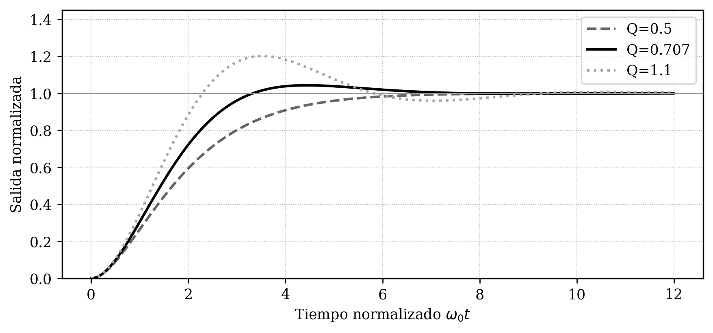{width="92%" fig-alt="Figura 12. Comparación de respuestas al escalón para tres factores de calidad, con ganancias de continua normalizadas."}

Para mantener el operacional en su intervalo de operación, la ganancia debe considerarse junto con la amplitud de entrada y el voltaje de alimentación. Por ejemplo, con $K = 10$, una señal de $0.1\, V$ en la banda de paso produce una salida ideal cercana a $1\, V$; una señal de $2\, V$ exigiría aproximadamente $20\, V$ de salida y podría no ser realizable con la alimentación disponible.

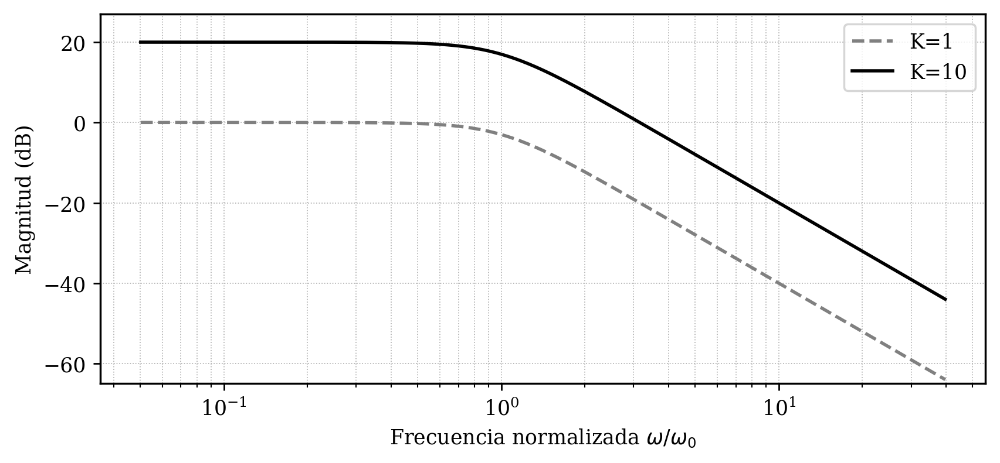{width="92%" fig-alt="Figura 13. Dos respuestas Butterworth del mismo orden y frecuencia natural, con diferente ganancia de baja frecuencia."}

## Comprobación mediante simulación y laboratorio

La función de transferencia describe el comportamiento ideal del filtro. Antes de construirlo, resulta conveniente reproducir el circuito en Multisim u otro simulador apropiado y contrastar los resultados con los valores calculados.

La comprobación puede realizarse en cuatro etapas. Primero se mide la ganancia en una frecuencia suficientemente inferior a $f_{c}$ para confirmar el valor esperado de $20\, dB$. En segundo lugar se realiza un barrido logarítmico de frecuencia y se localiza el punto cuya magnitud está $3.01\, dB$ por debajo del nivel de la banda de paso. En tercer lugar se comprueba el desplazamiento de fase, especialmente su paso por $- 90^{\circ}$ cerca de $f_{0}$. Finalmente se verifica que la pendiente de altas frecuencias se aproxima a $- 40\, dB/dec$ dentro del intervalo en el que el amplificador conserva su comportamiento lineal previsto.

Para una evaluación experimental también conviene registrar la amplitud de la señal de entrada, la de salida y el desfase, evitando utilizar niveles que saturen el amplificador. La fuente de señal y el instrumento de medición deben tener un ancho de banda adecuado para que sus propias limitaciones no se confundan con la respuesta del filtro.

  ------------------------------------------------------------------------
  Magnitud                             Predicción del diseño ideal
  ------------------------------------ -----------------------------------
  Ganancia en bajas frecuencias        $K = 10$ o $20\, dB$

  Frecuencia de corte Butterworth      $f_{c} = 1\, kHz$

  Ganancia absoluta en $f_{c}$         $16.99\, dB$

  Fase en $f_{c}$                      $- 90^{\circ}$

  Pendiente asintótica de atenuación   $- 40\, dB/dec$

  Factor de calidad                    $Q \approx 0.7071$
  ------------------------------------------------------------------------

La tabla resume **predicciones teóricas**, no resultados medidos. Las diferencias entre cálculo, simulación y medición deben analizarse considerando la selección real de componentes y el modelo del operacional utilizado.

### Tutor IA · Modelo de segundo orden {#tutor-l10-modelo-s16}

::: {.tutor-box}
::: {.tutor-texto}
Sea mi tutor socrático y tráteme de usted. Formule una pregunta por turno para que distinga K, frecuencia natural, frecuencia de corte y Q en un filtro pasa-bajas de segundo orden. Pídame escribir H(s), luego interpretar sus polos y la respuesta Butterworth. Verifique la diferencia entre f0 y f de -3 dB sin anticiparme respuestas.
:::
::: {.tutor-acciones}
[Abrir ChatGPT](https://chatgpt.com/){.course-button target="_blank" rel="noopener"}
:::
:::

### Tutor IA · Sallen–Key de ganancia unitaria {#tutor-l10-sk-unidad-s16}

::: {.tutor-box}
::: {.tutor-texto}
Guíeme de usted y una pregunta a la vez para deducir el Sallen–Key con seguidor de voltaje: identifique los nodos, plantee LCK en Vp y Vx, sustituya Vo=Vp y obtenga el denominador. Después pídame encontrar f0 y Q. Revise mis signos y dimensiones; no me proporcione la deducción ya hecha.
:::
::: {.tutor-acciones}
[Abrir ChatGPT](https://chatgpt.com/){.course-button target="_blank" rel="noopener"}
:::
:::

### Tutor IA · Sallen–Key con ganancia {#tutor-l10-sk-ganancia-s16}

::: {.tutor-box}
::: {.tutor-texto}
Soy estudiante de Electrónica II. Tráteme de usted y formule preguntas individuales. Quiero deducir el filtro Sallen–Key pasa-bajas con amplificador no inversor y ganancia K. Pídame plantear primero la relación Vo=K Vp y luego la LCK de los nodos, para obtener los coeficientes del denominador. Ayúdeme a interpretar el efecto de K sobre Q sin resolverlo por adelantado.
:::
::: {.tutor-acciones}
[Abrir ChatGPT](https://chatgpt.com/){.course-button target="_blank" rel="noopener"}
:::
:::

### Tutor IA · Diseño Butterworth de segundo orden {#tutor-l10-diseno-butterworth-s16}

::: {.tutor-box}
::: {.tutor-texto}
Actúe como tutor socrático y tráteme de usted. Necesito diseñar un Sallen–Key Butterworth de segundo orden a partir de fc y K. Pídame escoger una topología compatible, escribir el polinomio normalizado, efectuar el escalamiento, elegir resistencias y capacitores y después contrastar mis resultados con f0 y Q. Verifique el signo, las unidades y que no exista saturación. No entregue los componentes antes de mis cálculos.
:::
::: {.tutor-acciones}
[Abrir ChatGPT](https://chatgpt.com/){.course-button target="_blank" rel="noopener"}
:::
:::

### Tutor IA · Factor de calidad y respuesta temporal {#tutor-l10-q-s16}

::: {.tutor-box}
::: {.tutor-texto}
Tráteme de usted y una pregunta por turno. Quiero explicar cómo afecta Q al pico de magnitud, posición de polos, amortiguamiento y sobreimpulso. Pídame comparar varias funciones de transferencia y sus gráficas, interpretar correctamente las escalas en decibelios y justificar mis conclusiones con expresiones matemáticas.
:::
::: {.tutor-acciones}
[Abrir ChatGPT](https://chatgpt.com/){.course-button target="_blank" rel="noopener"}
:::
:::
